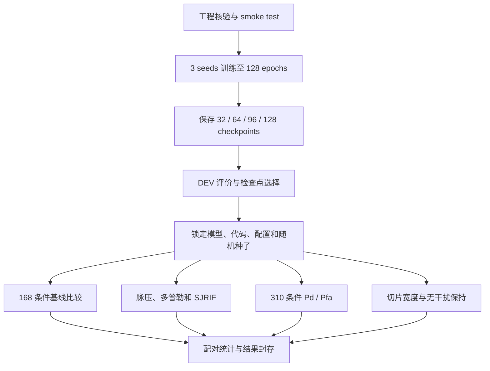

# ISRJ_2 第二篇论文实验执行计划

_版本：2026-11-14。以用户指定的 1103 论文实验章节为协议来源；只规划当前 ISRJ_2 CorrectionNet，不把附件论文中的方法当作本项目操作要求。_

---

## 📌 目标与范围

本计划把第二篇论文的实验压缩为一条可执行的证据链：先证明实验代码和数据符合 1103 的物理设置，再训练并保留 32、64、96、128 轮检查点，随后按同一信号处理链完成基线比较、脉压/多普勒、SJRIF、检测概率、切片宽度敏感性和无干扰保持评价。

本轮明确暂停 MCA-ADMM-Net、ISRJ-FNet 比较与消融实验。方法比较仅含 CorrectionNet、Max-TF、GMM-OMP、已知干扰支撑 BCS（oracle 参照）、KEEP 与无干扰含噪参考。BCS 使用真实干扰支撑，结果必须标为 oracle 上界参照。

1103 的实验方法和参数是参考协议；它的模型结果不是 ISRJ_2 的结果。附件 PDF、草稿和旧会话只作为证据材料，不覆盖用户给出的范围。本项目的数据、模型和输出都留在 `G:\Project Code\ISRJ_222\`；旧 ISRJ 文件夹只读，不访问其中的 held-out Gate 数组。

## 🧭 执行顺序

## 🔬 预注册实验与其能回答的问题

| 顺序 | 实验 | 设置与样本量 | 主要指标 | 可以支持的结论 |
|---|---|---|---|---|
| 0 | 数据及处理链 smoke test | 8 脉冲 × 1800 快时间点；检查四状态恒等式、共享目标/噪声、相参相位、匹配滤波 lag、三类干扰、BCS 支撑边界及 CA-CFAR 参考单元 | 恒等关系、目标峰位置、多普勒 bin、$N_r=436$ | 代码实现与约定相符；不证明恢复性能 |
| 1 | 训练轮次与冻结点 | Main/Extreme 各 256 个 train parent；direct/repeat/cyclic 三个干扰变体；3 个从头训练 seed（17、29、41）；每 seed 128 epoch，在 32/64/96/128 保存 4 个完整 checkpoint | DEV 上的 $e_U$、目标增量误差、SJRIF、$P_D$、单元/帧 $P_{FA}$、干净输入改动 | 不同训练长度和随机初始化的稳定性及检查点选择依据 |
| 2 | 主对比网格 | 3 类干扰 × 14 个 SNR × 4 个 JSR = 168 格；每格 256 个共同 parent；所有方法成对评估 | $e_U$、$e_S$、SJRIF、$P_D$、单元/帧 $P_{FA}$ | 当前模型相对于四种经典信号处理对照在规定仿真族中的变化；不能外推为实测结论 |
| 3 | 典型脉压与多普勒 | 同一 8 脉冲场景对比无干扰含噪参考、受扰 KEEP、CorrectionNet 输出 | 距离像、脉间相位 RMSE、相参积累功率比、多普勒峰误差 | 恢复是否保留后级相干处理所需的距离和慢时间结构 |
| 4 | Pd / 虚警扫描 | 重复转发；SNR −30…0 dB，1 dB 步长；JSR −10…35 dB，5 dB 步长；310 格、每格 512 个共同 parent | $P_D$、单元虚警率、整帧虚警率及区间 | 在完整 SNR/JSR 扫描范围内，检测收益与虚警代价如何变化 |
| 5 | 切片宽度扫描 | 1103 第 4.2.4 节 A/B 两组；A 组每条件 256 parent，B 组每条件 128 parent；固定 parent 并控制总干扰能量 | $e_U$、$e_S$、SJRIF、$P_D$、虚警 | 性能变化来自切片时序/宽度的敏感性；3 点和 84 点条件属于训练范围外推 |
| 6 | 无干扰保持 | 输入纯噪声 $E$ 和含目标噪声 $S+E$；另在三种干扰类型和 14 个 SNR 条件中比较恢复前后无干扰命中 | 相对输入改动能量、命中率差、单元/整帧虚警 | 恢复器是否在没有干扰时误改输入或引入虚警 |

主比较的 SNR 为 −30、−28、−26、−25、−24、−23、−22、−20、−15、−10、−5、0、5、10 dB；JSR 为 0、10、20、35 dB。Pd 扫描是独立的重复转发实验，不能拿它替代主比较中的三类 jammer 网格。

切片宽度 A 组固定周期 260 点、$M=2$，宽度为 3、6、18、36、54、72、84 点，SNR/JSR_E 为 −10/20、−20/35、0/10 dB。B 组宽度为 6、18、36、54、72 点，$M=2,4$，周期按 $(M+1)w+1$ 调整，SNR/JSR_E 为 −10/20、−20/35 dB。生成器必须在这些条件间复用同一 parent 的目标、噪声、受扰脉冲位置和通道随机参数，并按总干扰能量重新标定；当前这项配对干预尚未完成实现。

## 📐 指标与数学依据

主连续指标选总体恢复归一化平方误差：

$$
e_U=\frac{\|\widehat U-(S+E)\|_2^2}{\|S+E\|_2^2}.
$$

它直接度量模型相对“同一噪声实现下无干扰接收波形”的恢复误差，按参考能量归一，便于跨 SNR/目标幅度比较。它单独使用会被强背景能量稀释，因此同时计算目标增量误差：

$$
e_S=\frac{\|[\widehat U(S+J+E)-\widehat U(J+E)]-S\|_2^2}{\|S\|_2^2}.
$$

$e_S$ 检查目标加入前后模型输出的差是否等于真实目标，避免仅靠压低输出获得较小总体误差。对无干扰输入另报告
$e_0=\|\widehat U(Y)-Y\|_2^2/\|Y\|_2^2$。

雷达处理指标沿用 1103 的 SJRIF。对 8 脉冲平均脉压功率，令 $k_s$ 为无噪目标真实距离峰：

$$
P_y[k]=\frac18\sum_{p=0}^{7}|\mathcal M_x(y_p)[k]|^2,\qquad
\mathrm{SJR}(y)=10\log_{10}\frac{P_y[k_s]}{\max_{k\ne k_s}P_y[k]},\qquad
\mathrm{SJRIF}=\mathrm{SJR}(\widehat y)-\mathrm{SJR}(y).
$$

SJRIF 是处理前后目标峰与最大非目标距离响应功率比的 dB 改善；当最大旁瓣落在目标主瓣相邻点时会饱和，所以它与 $e_U$、$e_S$、假峰保护区外抑制量及检测指标一起解释，不单独作为成功标准。

检测以同一 600 点模板进行脉压，然后对 8 脉冲慢时间 FFT，再施加二维 CA-CFAR。距离保护/参考窗每侧 12/24，多普勒每侧 1/2 且周期延拓，参考单元数 $N_r=73\times7-25\times3=436$，名义单元虚警率 $10^{-6}$。命中定义为目标真实多普勒单元、距离 ±1 单元内有统计量越门限。报告 $P_D$ 之外，必须报告单元和整帧 $P_{FA}$，因为统一名义门限不能保证恢复前后实际虚警率相同。

统计单位是物理 parent。先在 parent 内汇总 jammer/pulse/state，再做方法间配对 bootstrap 95% 区间；Pd 另用 parent 二项区间。不得把同 parent 的 jammer 类型、脉冲、四种状态算作独立样本。

## 🧪 训练、DEV 选点与冻结

每个 seed 从头训练 B4 目标函数，保存 epoch 32、64、96、128 的网络、优化器与调度器状态、配置、历史、源码/数据 SHA、独立 checkpoint SHA 和完成标记。训练 epoch 定义为遍历 512 parent × 3 jammer 记录一次，batch 32，因此每 epoch 48 次更新；这与 1103 的 512 场景规模相符，但不等于其每轮更新次数。3 seed × 128 epoch 共 18,432 次更新。

DEV 评价公开全部 12 个检查点。为避免任意加权，把 $e_U$、$e_S$、$P_D$、单元/整帧 $P_{FA}$ 作为并列目标报告，不拼成单个未经论证的分数。若一个 checkpoint 在这些指标上不劣且至少一项更优，可判为 Pareto 支配；若互有取舍，就保留多个候选并将选择规则冻结后再进行独立 TEST。TEST 不用于选 epoch、seed 或阈值。

## 🛠️ 当前实现状态与阶段门

截至 2026-11-14T07:10Z，已建立 [1103 执行协议](PAPER2_1103_EXECUTION_PROTOCOL.md)、独立 8 脉冲数据生成器、训练入口和基础雷达评价代码。`python -m pytest -q` 为 23 项通过；4-parent 数据 smoke 通过四状态恒等式和目标/噪声跨 jammer 共享检查。单步 GPU smoke 的耗时只用于资源估算。

正式训练进程 PID 41024 仍在运行。seed 17、29 均已完成 128 轮并保存 32/64/96/128 检查点；seed 29 四个权重 SHA 均通过回执核验。seed 41 当前第 65/128 轮，step 3100/6144，最近 loss 0.111075，32/64 轮检查点已保存。seed 17 的四个检查点已在修正多普勒折叠后的 DEV 上评价；其余八个检查点待训完后重评。该 seed-17 探索结果不能单独决定模型选择。主比较算法、完整 Pd/虚警扫描、切片宽度配对生成和独立 TEST 尚未运行，不能将当前进展表述为实验完成。

完整实验仍须满足以下门槛；当前只通过工程与基础实现检查，尚未通过完整比较器/扫描检查：

1. 生成器按表 4-1 验证 SNR/JSR 定义、范围、脉间独立 jammer 参数和同 parent 配对。
2. 匹配滤波输出长度、距离坐标与峰位和 1103 一致；慢时间 FFT 的多普勒混叠位置正确。
3. SJRIF、目标保护区旁瓣指标、CA-CFAR 窗口计数和已知支撑 BCS 通过解析/合成小样本核对。
4. Max-TF、GMM-OMP、BCS 的实现来源、参数、输出参考和 oracle 信息边界被记录；与 CorrectionNet 使用相同场景和检测器。
5. 训练中途失败保留失败记录和部分 checkpoint；不得覆盖、静默续跑或把未完成 run 标为完成。

## ⚠️ 结果边界

本轮只验证单目标仿真条件。CorrectionNet 仍是逐脉冲单观测模型，8 脉冲通过共享权重逐条推理，因此能测试波形恢复对相参处理链的影响，但不能宣称网络联合学习了脉间结构。完成完整主网格、检查点选择、锁定 TEST 和近邻方法查新前，不写优越性、新颖性或投稿级确认结论。原始数组、训练数据、模型权重和完整日志只留本地，不进入 GitHub。
