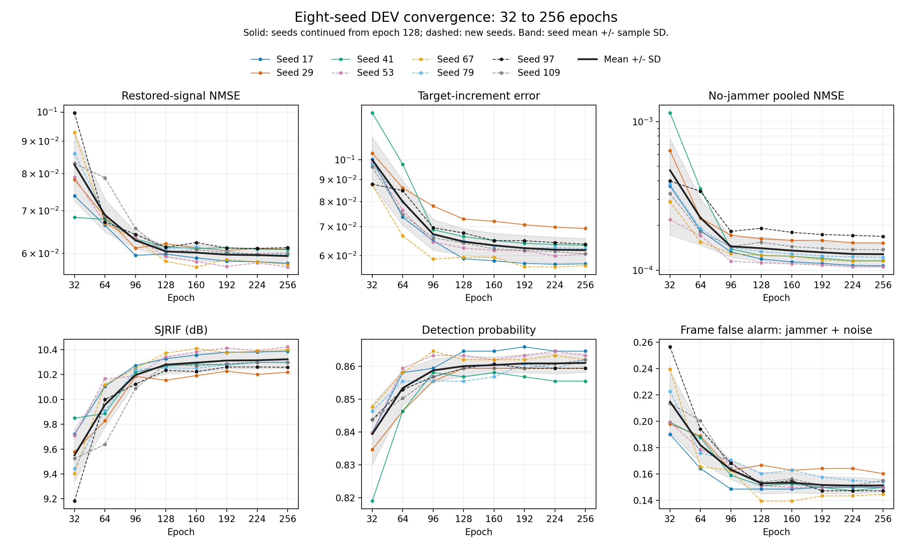

# ISRJ_2 实验进度核查（2026-11-15）

此前授权的长期流水线已全部完成，当前没有本项目的训练或测试进程运行。控制器于 2026-11-15 04:29:14 UTC 完成，即洛杉矶时间 2026-11-14 20:29:14 PST。七个阶段均有完成记录；本次重新检查了模型、收敛输入及源码绑定。此处的“完成”指既定队列完成，论文仍有下文列出的证据和写作工作。

状态依据为 `outputs/paper2_long_pipeline_20261114/STATUS.json`、`outputs/paper2_256_epoch_8seed_20261114/STATUS.json` 与 `evidence/outputs/PROGRESS_CHECK_20261115/INTEGRITY_AUDIT.json`。历史进度、故障及负结果保留，不把旧的 RUNNING 字段当作进程仍在运行的证据。

| 已完成项目 | 核验结果 |
|---|---|
| 原有 seed 续训 | 17、29、41 均由 128 轮续至 256 轮 |
| 新增 seed 训练 | 53、67、79、97、109 均完成 1–256 轮 |
| 模型冻结 | 8 seed × 32/64/96/128/160/192/224/256 轮，共 64 份里程碑模型 |
| 开发集评价 | 64 组 DEV v4 评价，全部完成 |
| 收敛数据 | 2048 行逐轮训练指标；64 行里程碑 DEV 指标 |
| 恢复存档 | 1664 个新训练轮次的完整恢复档，以及 3 份原有 128 轮入口档，共 1667 份 |
| 原模型保留 | 原三 seed 的 12 份模型全部保留，SHA 核验通过 |
| 独立 TEST | 2237 个方法与条件组合完成；流水线审计通过 103826 个 parent block |
| 图表 | 脉压、多普勒、各扫描结果及八 seed 收敛图均已保存 |

每个新训练轮次均保存恢复状态；每 32 轮另存冻结模型，数据、结构/配置快照与来源 SHA 均保留在本工作区。原三 seed 在本次续训前已有的逐轮指标保留，但历史上未保存的逐轮权重不能追溯补造。所有模型权重、原始训练/测试数据、parent arrays、缓存与完整日志只存本地。

下面是同一 DEV 数据上的八 seed 描述性均值。恢复 NMSE 对应原报告 eU，目标增量误差对应 eS，定义与检测链见 `PAPER2_1103_PROGRESS_20261114.md`；Pfa 是无目标受扰输入 J+E 的整帧虚警概率，不能与名义 cell Pfa 混用。

| 轮次 | 恢复 NMSE ↓ | 目标增量误差 ↓ | SJRIF / dB ↑ | Pd ↑ | Frame Pfa J+E ↓ |
|---:|---:|---:|---:|---:|---:|
| 32 | 0.082677 | 0.099914 | 9.5507 | 83.936% | 21.484% |
| 64 | 0.068933 | 0.079982 | 9.9558 | 85.335% | 18.180% |
| 96 | 0.062933 | 0.067263 | 10.1948 | 85.872% | 16.309% |
| 128 | 0.060439 | 0.064651 | 10.2786 | 86.003% | 15.283% |
| 160 | 0.060170 | 0.063376 | 10.2951 | 86.035% | 15.332% |
| 192 | 0.059729 | 0.062455 | 10.3120 | 86.084% | 15.153% |
| 224 | 0.059637 | 0.061939 | 10.3140 | 86.084% | 15.104% |
| 256 | 0.059440 | 0.061786 | 10.3221 | 86.100% | 15.120% |

256 轮时，恢复 NMSE 为 0.059440 ± 0.001647，目标增量误差为 0.061786 ± 0.003950，SJRIF 为 10.32215 ± 0.07263 dB，Pd 为 86.1003% ± 0.2849 个百分点。这里的 ± 是八个训练 seed 的样本标准差，不是置信区间；八 seed 共享数据，不能当作八套独立测试集。

128→256 轮的平均训练总损失由 0.082919 降至 0.079791。DEV 恢复 NMSE 下降约 1.65%，目标增量误差下降约 4.43%，无干扰保持误差下降约 8.81%；SJRIF 增加 0.04357 dB，Pd 增加 0.0977 个百分点，整帧受扰虚警率减少 0.1628 个百分点。当前学习率日程下，128 轮之后收益减小，192–256 轮已接近平台。个别 seed 与部分指标仍会波动，不能写成所有指标逐轮单调改善，也不能仅凭下降曲线宣布统计显著或证明全局收敛。

训练总损失及分项曲线见 `evidence/outputs/PROGRESS_CHECK_20261115/TRAINING_CONVERGENCE_REVIEW.png`，可编辑数据见 `evidence/outputs/CONVERGENCE_256_8SEED_20261114/` 下的两个 CSV。原始导出图保留；本次另导出标题与图例不重叠的 PNG/PDF，数据不变，来源及输出 SHA 记录在 `FIGURE_MANIFEST.json`。

独立 TEST 使用此前冻结的 seed 29、128 轮模型，未因后续结果更换。主比较 168 条件 × 6 方法、Pd 310 × 3、保持性 42 × 3、相参 3 × 3、切片 A 21 × 4、切片 B 20 × 4 均完成。SNR、JSR 和切片步长沿用既定 1103 冻结设置，逐条件结果与 parent 配对统计已保存。

在主网格条件等权、按 physical parent 配对的描述性比较中，冻结模型相对 Max-TF 的 SJRIF 增加 1.57209 dB，逐比较 95% parent bootstrap 区间为 [1.49638, 1.65057]；Pd 增加约 4.21 个百分点。但相对 BCS-oracle，SJRIF 低 0.97202 dB、整帧受扰虚警率高约 19.51 个百分点；相参场景的目标幅度衰减仍需如实讨论。结果不支持“各项指标全面优于所有方法”。完整比较、置信区间及 oracle 信息优势见原进度报告与 `TEST_PAIRED_AGGREGATES_1103.json`。

尚未完成的工作及下一步范围如下：

- 256 轮八 seed 目前只有 DEV 评价，不能把这些数值写作新的独立 TEST 结果。如果论文最终采用扩展训练后的模型，需要先明确模型确定规则及独立确认方案，避免在已查看的 TEST 上反复挑选。
- 与第一版 RSDR-Net 在一致数据、处理链和检测口径下的直接横向比较尚未完成。现有 `reference` 是同噪声无干扰参考，不是 RSDR-Net；训练轮次相同也不代表更新预算相同。本项目每轮 48 次更新，1103 第一篇为每轮 512 次更新。
- 仍需完成基线文献/离散实现核验、负结果与相参损伤的解释，以及论文实验章和最终封存清单。既定队列完成不等于投稿材料全部完成。

本次没有新开模型训练，也未改变冻结选择、网格或指标。MCA-ADMM、FNet 和消融仍暂停；旧 ISRJ 目录保持只读，未访问旧 held-out Gate arrays；codex-with-chatgpt 及替代协作保持停用。GitHub 仅同步专用 ISRJ_2 仓库所需的轻量证据、图表、源码与报告。
