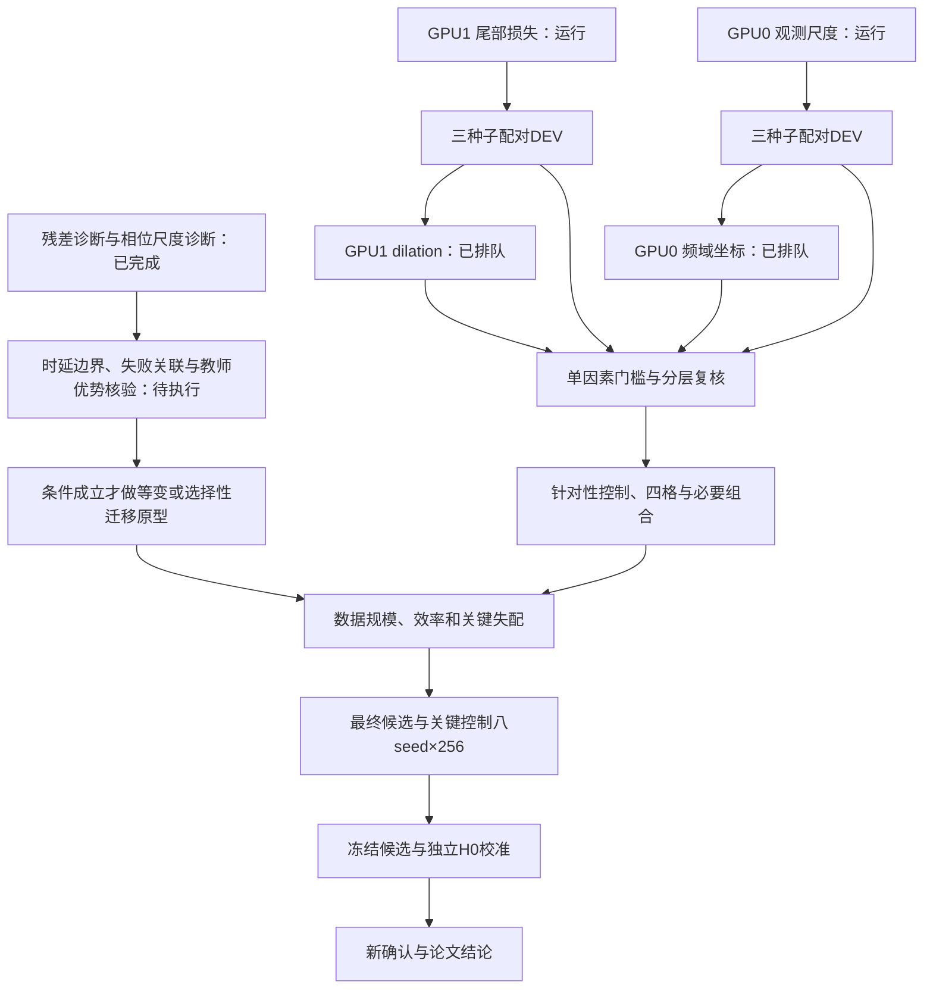

# 两份创新思路的逐项核对与实验流水线

日期：2026-11-17。当前状态以带时间的服务器快照为准。本报告将研究建议、已经完成的诊断、正在训练的筛查和有条件的后续开发分开。尚无证据证明新增尾部损失、观测尺度、空洞卷积或频域表示已经提高最终性能。

## 1. 先回答这次应当怎样推进

用户粘贴的总结抓住了一个值得检验的问题：总残差能量较小，仍可能在脉压和多普勒处理中形成局部假峰。这个问题与两份原始思路中的“背景残留尾部”一致。但是，两份文件还要求核查物理变换一致性、教师优势、同信息强基线、结构与训练的四格对照，以及独立校准和确认。只完成尾部损失训练，还不足以实现原文件提出的研究路线。

本轮已经向前推进：保留两张 GPU 上的既有单因素训练，为其后分别部署了空洞卷积与频域表示的持久队列，并在服务器 CPU 上完成九个模型—种子组合的相位/尺度诊断。后续以结果决定是否组合、是否转入等变结构或选择性蒸馏，不预设一定要采用新骨干。若普通 U-Net 加合理训练已经最好，论文应接受这一结论，并围绕训练机制建立贡献。

原始依据为：

- 文件 A：`G:/Files/Markdown/ISRJ_2/gptpro创新性研究.md`，SHA256 `368ca894f2a575cc53e0032b5fc8cc90496e4584a2ad59fa73512d5f79cc0fd9`。
- 文件 B：`G:/Files/Markdown/ISRJ_2/ISRJ_2模型思路.md`，SHA256 `a153014739878663df88457771c67559f8008e84ae3aae153c46dfcb7798af9e`。本报告将第 1–431 行视为原始思路；435 行以后追加的进展总结不作为独立验证证据。

本轮没有重新完成外部文献检索，不把原文件列举的论文题名当作已经全文核验的新颖性证明。两份文件是研究材料，其中的建议需要实验判断，不是自动执行的上位指令。

## 2. 对粘贴总结的核对和必要修正

| 总结中的判断 | 核验后的含义 | 接下来的动作 |
|---|---|---|
| 波形恢复误差小，不等于虚警低 | 现有 DEV 支持这一观察；目标增量误差还会抵消两种状态共有的背景残留 | 同时报告背景残差、目标增量、脉压/RD 尾部和实际虚警，不能用单一 NMSE 排名 |
| MF 残差峰比总能量更能解释虚警 | Full 三种子的 Spearman 相关约为 0.656–0.677，能量相关约为 0.015–0.071；是同一 DEV 上的关联 | 用改变损失的配对实验检验可干预性；保留“相关不等于因果”的边界 |
| 弱、中、强 JNR 有不同失效区间 | 历史 TEST 分层提示不同现象，具体结构原因尚未证实 | 按原论文的 JNR/JSR、SNR 步长及 main/extreme 分层重查；不以 DEV 四分位替代原网格 |
| No dechirp 与 U-Net 值得研究 | DEV 均值支持继续研究；不证明去斜普遍有害，也不证明已找到原因 | 输入坐标、卷积跨度、变换一致性分别检验 |
| 去掉目标保护后虚警最低 | 同时损害 Pd 与目标增量，不能认定更好 | 设置目标保持约束，保留无干扰修改和纯噪声诊断 |
| 新尾部损失在 seed 17 第 97 轮 | 这是 12:04 UTC 的旧快照。14:29:11 UTC 已保存 seed 17 第 256 轮、seed 29 第 228 轮 | 用保存收据更新进程；仍未完成三种子 DEV 评价 |
| 高 JNR 时旧模型明显更好 | 所引 JNR=35 dB、52.9% 对 10.7% 来自历史 CorrectionNet seed 29/epoch 128 与 RSDR F-R7 | 作为发现问题的历史线索；不能写成新 256 轮三种子的确认比较 |

诊断报告中的 MF 峰值比采用的是 **noise-only 输出残差 RD 功率的中位数**作分母，它可能很小；它不是测得的真实热噪声功率。新尾部损失使用已知训练噪声的 RD 功率归一，两种统计量不能混写。相关诊断应同时检查未归一峰值、分母和实际检测事件，排除比值分母带来的解释偏差。

## 3. 与两份原始文件逐项对应

下表中的“部分完成”不能解读为对应创新已经成立。A/B 的行号仅用于定位本轮读取的原始版本。

| 原文件要求 | 定位 | 当前证据与缺口 | 下一动作与判断条件 |
|---|---|---|---|
| 明确第二篇区别于第一篇的贡献 | A 15–29；B 25–54 | 同噪声参考、目标增量监督、选择性恢复不能再次作为全新贡献；现骨干尚未稳定胜过 U-Net | 围绕可重复的失败机制、最小干预、公平验证组织新故事；没有增益就保留负结果 |
| 公共相位变换一致性 | A 100–134；B 105–180 | 本轮完成 Full/No dechirp/U-Net × 3 seed 的小样本诊断，存在不一致；尚无检测关联证据 | 扩展到共同 DEV 的 parent 级失效关联，再比较同增强 U-Net、普通复数网络与最小等变网络；增强已解决或与失效无关则停止结构分支 |
| 去斜与时延/频移关系 | A 114–132；B 129–178 | 代数关系明确；No dechirp 均值较好不能证明机制 | 补整场景时移、有效区域和边界敏感性诊断；S/J/E 必须共同变换，截断单列 |
| 实幅度尺度一致性 | B 125、163、385 | 本轮 0.1 倍/10 倍公共缩放误差接近数值精度 | 不把已有尺度性质包装成新贡献；低能量/RMS 下限和实际噪声污染另查 |
| 背景残留尾部训练 | A 172–180；B 292–324 | 有关联诊断；U-Net 尾部损失三种子筛查训练中 | 固定 epoch 256 配对 DEV；虚警、Pd、目标损伤共同过门槛后才进入组合 |
| 对照平均 PC 加权和困难样本训练 | A 180；B 304–324 | 未完成；不能说明 top-k 比一般重加权更有特异性 | 同骨干、同更新数比较平均 PC 权重控制与按 parent 困难度加权；所有选择只用训练/DEV |
| 有限容量的长程/频率处理 | A 79–89；B 56–89、129–174 的相关机制启发 | 已完成同参数工程检查；两组后续队列真实启动，尚未训练 | 独立筛查 dilation 和 FFT 坐标；它们是对候选机制的操作化，不等于原文已指定完整结构 |
| 归一化是否妨碍弱干扰识别 | 结合残差/JNR 诊断的补充假设，不是两文已证明结论 | 观测尺度分支训练中，强干扰会污染频带代理 | 固定估计器，不根据 DEV 再调频带；按 JNR 查收益与污染。不能声称 RMS 从信息论上抹去了 JNR |
| 只迁移旧模型可靠的背景能力 | A 136–156；B 186–250 | 历史旧模型优势存在，但未完成教师在当前共同 DEV 上的逐场景优势核验 | 先做教师来源/训练数据隔离和共同 DEV 核验；成立后才训练真值、普通输出 KD、校正量 KD、选择性/关系 KD 四组 |
| 真正利用八脉冲结构 | A 160–170；B 254–288 | 现在骨干仍逐脉冲；训练损失使用八脉冲不等于前向利用多脉冲 | 后置。先完善非相参/部分相参/强相参干扰和目标运动场景；加入相同八脉冲输入的轻量 2D/时序 U-Net |
| 架构×训练四格 | A 184–191；B 334–345 | A：U-Net 旧训练已具备；B：U-Net 新损失在跑；C：独立结构筛查排队；D 尚未实现 | 只对通过的结构补 D，并保留 A/B/C；用交互差分判断增益来自哪里 |
| 更多独立训练 parent | A 231；B 387–389 | 当前固定 512 parent 的筛查不能证明数据充分时仍优 | 方向成立后做 2048/8192 parent 或在线生成对照，区分等更新与等 epoch 两种预算 |
| 独立 H0 校准与新确认 | A 199–215；B 373–395 | 历史 TEST/确认已用于分析；不是新候选的未见证据 | 最终候选冻结后建立独立校准集和新确认集，预设帧虚警目标，E 与 J+E 分开报告 |
| 训练随机性与场景随机性 | A 205–209；B 389 | 当前 3 seed 是筛查；同 parent 的家族/脉冲不能算独立重复 | 最终候选按用户要求 8 seed×256 轮，parent 配对重采样与 seed 波动分开；不挑最好 seed/epoch |
| 真实部署效率 | A 193–197；B 349–359 | 59,714 个活动参数相同，但不代表计算和延迟相同；旧计时收据冲突未解 | 同设备/精度测完整前向与整八脉冲组 P50/P95、MAC 覆盖范围、吞吐、显存；计入 FFT/逆变换和归一化 |
| 原创性与外部有效性 | A 91–98、211–235；B 91–103、286、381–395 | 直接近邻全文差异表、独立仿真来源和真实背景仍缺 | 在方向确定后定向核验；按主张选失配轴。半合成不写成真实硬件转发验证 |

两份文件优先推荐的“变换一致性”和“选择性迁移”尚未被本轮四个筛查取代。现在先检验成本较低、可隔离的损失与表示因素；相位结果已补上第一步，时延和教师核验是下一批诊断任务。不会因为目前四个实验方便运行，就把其余原始问题写成已经排除。

## 4. 本轮新增诊断的实际结果

完成时间：2026-11-17 14:18:26 UTC，即洛杉矶时间 06:18:26 PST。服务器 CPU、2 线程，仅推理，无训练、无权重改写、无 GPU 占用。固定取 DEV 前 16 个 parent，覆盖三类干扰、八脉冲和 J+E / S+J+E 两种状态；三种结构各 seed 17/29/41，共九个模型—种子组合。不是完整 DEV 的检测评价。

令校正量为 C，变换 g 为公共复相位或正实尺度。本轮计算：

\[
E_g=\frac{\|g^{-1}C(gY)-C(Y)\|_2^2}
{\max(\|C(Y)\|_2^2,10^{-12}\|E\|_2^2)}.
\]

表中每个区间是三个 seed 的“场景平均相对平方误差”的最小值到最大值，不是置信区间，也不是幅度误差百分比。

| 结构 | 公共相位 π/4 | 公共相位 π/2 | 公共相位 π | 公共尺度 0.1/10 |
|---|---:|---:|---:|---:|
| Full | 0.1400–0.1866 | 0.2172–0.2245 | 0.2124–0.2518 | 约 10⁻¹²–10⁻¹¹ |
| No dechirp | 0.1418–0.1765 | 0.2192–0.2553 | 0.2030–0.2481 | 约 10⁻¹²–10⁻¹¹ |
| U-Net | 0.0911–0.1186 | 0.1556–0.2039 | 0.1002–0.2101 | 约 10⁻¹¹ |

按 J 能量归一的平均端点误差变化在模型、种子和旋转角之间正负不一：Full 约 −0.00386 至 +0.00415，No dechirp 约 −0.01085 至 +0.00961，U-Net 约 −0.00608 至 +0.00064。因此，本轮能说明三个映射并非精确相位等变，不能说明这种不一致已经造成了检测退化。公共幅度缩放基本符合现有 RMS 架构应有的性质，也不能据此排除不同 JNR 下的识别问题：公共缩放不会改变 JNR。

没有检测关联、整场景时延/截断诊断或旧 RSDR 教师评价。零校正也可以完美等变，所以等变误差不能代替抗干扰能力。诊断的完整轻量结果及权重/来源 SHA 见 `phase_scale_diagnostic_20261117_v1/SUMMARY.json`。

## 5. 当前实际运行和已部署队列

最新轻量状态快照为 **2026-11-17 14:29:11 UTC / 06:29:11 PST**；最近一次完整恢复点审计为 14:22:15 UTC。轮次只计已经保存的恢复点，不计当前正在计算的轮次。

| 状态 | 任务 | 物理 GPU | seed 17 / 29 / 41 已保存轮次 | 自动后续 |
|---|---|---:|---|---|
| RUNNING | U-Net + 0.05 匹配滤波尾部损失 | 1 | 256 / 228 / 未开始 | 三种子完成→固定 epoch 256 配对 DEV |
| RUNNING | U-Net 观测尺度归一化 | 0 | 131 / 未开始 / 未开始 | 三种子完成→固定 epoch 256 配对 DEV |
| QUEUED | U-Net 空洞卷积跨度筛查 | 1 | 均未开始 | 等尾部分支训练和 DEV 汇总完成→资源准入→GPU 恢复预检→训练→DEV |
| QUEUED | U-Net 频域坐标筛查 | 0 | 均未开始 | 等归一化分支训练和 DEV 汇总完成→资源准入→GPU 恢复预检→训练→DEV |
| COMPLETE | 相位/尺度小样本诊断 | 服务器 CPU | 九组均完成 | 用于决定后续诊断，不直接决定性能排名 |

最新快照中，尾部分支 seed 17 保留 epoch 0–256 的 257 个恢复点，seed 29 保留 229 个恢复点；归一化 seed 17 保留 132 个恢复点，各组最新恢复点 SHA 与收据一致。14:22:15 UTC 完整审计覆盖当时已保存的 tail 256/209 轮及 norm 113 轮：恢复点 SHA、身份、连续性、应有 32 轮里程碑和训练/DEV 数据身份均通过。最新快照再次确认运行源码没有漂移，但不将它称为后续全部恢复点的完整审计。两个运行分支均尚无三种子 DEV 汇总。

队列的依赖是设备调度和前置评价完成，不要求前置因素“获胜”。例如尾部损失即使未通过性能门槛，空洞卷积仍按预设独立定义检验，不能因此偷换成“空洞卷积+尾部损失”。两条队列已有冻结源码清单和 WAIT_DEPENDENCY 状态收据，是真实后台控制器；组合、蒸馏及最终确认目前只是计划，尚未自动排入训练。

空洞卷积仅将五个双卷积块的 dilation 设为 1/2/4/2/1；频域分支仅使用逐脉冲正交 FFT、fftshift、原 U-Net、逆变换。两者都保持原 RMS、原损失、59,714 活动参数及初始张量，不含尾部损失。它们分别检验卷积采样跨度与表示坐标，不代表所有长程模型或所有频率模块。

服务器 CPU 工程检查已确认两组同初始张量、活动参数、有限前反向、FFT 往返和 Parseval。**正式 GPU 数值恢复预检仍等待各自设备释放**，没有提前标为通过。检查证据见 `IDEA_PIPELINE_ENGINEERING_CHECK_20261117.json`。

观测尺度分支的频带噪声代理可能受干扰污染：原训练前检查中 J+E/E 代理比均值为 1.276271，95% 分位数 2.565063，最大 12.617789。它是观测尺度代理，不是真实噪声估计；本轮保持定义冻结，不依据 DEV 再调参。

## 6. 各阶段任务、准入和停止条件

### P0：诊断证据闭环

已完成残差/虚警关联、历史 JNR 回顾和本轮相位/尺度小样本诊断。下一批补：共同 DEV 上 RSDR 教师优势与数据隔离核验、相位不一致与失败的 parent 级关系、整场景时延与边界、MF 比值分母敏感性。按相同 parent/家族对应，不重新打开新确认集寻找机制。

时延诊断必须分别报告共同有效区域与完整窗口，不能把裁剪损失当网络失效；纯噪声在窗口边缘同样存在，不能假定整个噪声数组有零边界。若采用额外上下文生成后裁切，需新数据身份并说明与原 DEV 的区别。若教师共同 DEV 不具备稳定背景优势，就停止选择性迁移分支；若变换不一致与失败无关，结构分支降级为性质验证。

### P1：四个独立因素筛查

当前两组训练和两组持久队列按上述配置运行，均 seed 17/29/41×256 轮。每种子 12,288 次更新；冻结 epoch 256 配对普通 U-Net，不挑轮次。每项报告统一评价口径的整体恢复误差、目标增量误差、无干扰修改、SJRIF、Pd、纯噪声和受扰背景帧/单元虚警；分项训练 loss 画收敛曲线，但不同目标函数的总训练 loss 不作性能排序。

四组沿用同一资源筛查门槛：三种子受扰背景帧虚警差的中位数 < 0；每个 seed 的 Pd 差 ≥ −0.02；三种子目标增量损伤差的均值 ≤ +0.005。所有差均为新因素减普通 U-Net。通过只表示值得下一阶段，不是显著性或非劣效证明；同时公开改善种子数。虚警改善但目标损伤越界则不准入；仅一个种子好或效应极小则列为不稳定，不能直接扩成八种子结论。

补充风险分层使用原 1103/1113 实验的实际配置与步长：main/extreme、弱/中/强 JNR、SNR、干扰家族、采样宽度/转发参数。确认 JNR 与 JSR 的换算和定义后再画图；不直接把两个轴当同一个量。每个交叉分层报告 parent 数量，稀疏分层只描述，不从小样本挑“优势区”。

### P2：检验针对性，再组合有效因素

尾部因素通过后，在相同 U-Net 上补“平均 PC 加权”与“按 parent 困难度加权/尾部”控制，以区分帧内强峰约束与跨场景困难样本关注。控制的定义、权重选择范围和预算在读取其结果前冻结，训练/DEV 用于开发，新确认不参与选择。若一般重加权已经解释全部收益，则不能宣称特有的雷达尾部机制优越。

只有通过 P1 且效应稳定的因素进入候选组合。先做必要的二因素组合，不一次叠满四项；若归一化受强干扰污染且失败，不将它默认带入最终模型。保留结构×损失四格：A=U-Net/原损失，B=U-Net/新损失，C=候选结构/原损失，D=候选结构/新损失。

对一个预先选定、越大越好的效用指标 q，交互为：

\[
I=(q_D-q_C)-(q_B-q_A).
\]

虚警和损伤本来越小越好，须统一方向再解释。若 B 已获得全部收益，定位为训练贡献；若 C 无优势而 D 有优势，只能说明可能有交互。组合损害目标或收益消失，就回退到较简单方案。若高 JNR 仍存在抵消平台，再考虑共享参数的两步校正；共享参数不代表推理计算免费，不提前启动迭代训练。

### P3：有证据才开发原始思路中的两条候选主线

变换分支须先完成 P0 关联，再以同增强普通 U-Net 为控制。若需要复数/等变原型，逐层说明偏置、门控、归一化、池化/插值和边界满足何种性质；不能把“复数卷积”直接写成等变证明。去斜与骨干交叉对照单列，防止同时换多个因素后无法归因。

迁移分支须先证明教师在共同 DEV 的哪些背景成分可靠，并审核教师训练数据与新校准/确认集隔离。保留真值训练、普通输出蒸馏、校正量蒸馏、选择性/关系蒸馏四组；目标增量以真 S 为监督，E 与 S+E 保持由真值约束。教师失效区单列，禁止用确认真值挑教师好场景。部署只保留学生，但报告教师训练/推理监督成本。

这两条主线不自动一起开发：先看诊断与 P1/P2 的结果选择，避免同时增加结构和监督而无法判断来源。多脉冲结构暂不进入这批长训练；启动前须补相参干扰生成器、相同八脉冲输入基线与目标运动/多目标场景。

### P4：扩大数据与训练复现

在方向稳定后，安排 2048/8192 独立训练 parent 或在线生成对照；“等更新”检验数据多样性，“等 epoch”同时改变优化量，不能混作单一数据因素。最终候选及关键 U-Net 控制使用共同八个 seed，训练到 256 轮，逐轮保存完整恢复状态、每 32 轮保存冻结里程碑；已完成且身份完全一致的 seed 可以保留复用，其余补齐，不重新选种子。旧八种子 CorrectionNet 权重保留只读，但不能算作新结构已完成的八次训练。

### P5：冻结后才进行新校准和确认

固定模型、epoch、损失、分析计划、阈值校准方式和样本量后，再生成独立 H0 校准集与新确认集。沿用可测的帧虚警工作点（暂以 1% 为候选目标，正式确认前冻结）；每种方法在同一校准规则下获得可部署阈值，确认集不调阈值。纯噪声 E 与受扰背景 J+E 分别报告实际帧/单元虚警及区间，并报告 Pd、目标损伤、SJRIF。

名义 CFAR 参数 10⁻⁶ 不等于实测帧虚警 1%，也不保证网络输出上实现等虚警。同工作点比较仍需报告确认集实际虚警及不确定性。按 parent 保持相关条件整组配对 bootstrap，seed 方差另报；不能把三家族×八脉冲扩成独立样本量。H0 样本量按所需虚警区间精度、H1 按检测差精度在确认前规划，不能看到好结果就停或看到不利结果才扩样。

### P6：投稿前补齐可复现性与近邻差异

解决旧效率收据冲突，在统一设备和计时范围下测完整八脉冲组 P50/P95、MAC 范围、吞吐、峰值内存，分别陈述等参数、等计算量、等延迟。因素跨 GPU 分配有设备差异，必要时交换设备复核。根据最终主张选择波形失配、相位/时延、未见宽度、相参干扰、弱近邻目标或教师失败轴，而非无限追加实验。核验直接近邻全文及引用，独立仿真/真实背景能获得多少就诚实报告多少。

## 7. 流水线依赖图与时间

14:29:11 UTC 的恢复文件时间差中位数约为 22.4 秒/轮（尾部）和 22.5 秒/轮（归一化）。以该快照已保存轮次计算，两组剩余纯训练时间约 1.8 小时、4.0 小时；并行时由较长分支决定，另外还需完整保存审计和 DEV 评价。这个估计基于实际墙钟进度，包含当时的常规轮次保存间隔，不包含未来停机、资源等待和评价。

后续 dilation/频域尚未测速，因此没有可核验 ETA。仅作预算情景：若它们也能维持约 22.5 秒/轮，每组 768 轮约需 4.8 小时；两条设备链从 14:29:11 UTC 起分别约需 6.6 小时和 8.8 小时，另加各自评价和等待。新因素可能更慢，不能将这个情景写成预计完成时刻。

新架构八个 seed 若速度相同，单架构约为 12.8 GPU 小时；若其中三个 seed 完全同身份可复用，补五个约为 8.0 GPU 小时。关键控制、数据规模、组合、蒸馏或等变原型的成本均另计。现在无法给整篇论文剩余工作的可靠总时长，因为分支取决于尚未完成的结果。

机器可读任务依赖和实际执行状态见 `IDEA_EXPERIMENT_PIPELINE_20261117.json`；实时带日期快照由 `python -B -m tools.snapshot_idea_pipeline_20261117` 在服务器生成。机器清单中的 PLANNED/CONDITIONAL 不等于已部署控制器，只有当前四个筛查任务具备训练/持久队列。

## 8. 保存、恢复与交付

所有长训练均在服务器 B 的第二篇专用目录执行，本机仅整理代码、文档和轻量证据。每轮原子保存模型、优化器、RNG 与分项损失，保留全部恢复点和 32 轮里程碑，原模型不丢弃。恢复及评价前核验源码、训练/DEV 数据和检查点 SHA；错误保留后停止，不以重训覆盖失败，不停止无关任务。

新增队列含主机/目录/GPU 编号及 UUID 守卫、资源准入、源码绑定、96 小时累计预算和 STOP/PAUSE 控制。意外退出后使用同入口显式恢复，不声称已经具备无限自动容错。前置完成收据和 DEV 汇总 SHA 不匹配时不能继续。

GitHub 仅同步 `paper2` 的代码、预设方案、报告、状态与轻量汇总，不上传训练数据、权重、原始数组、缓存、凭据或完整日志。本轮不会重写论文正文或将开发期趋势写入摘要为已确认性能。真正下一次值得更新论文结论的节点，是三种子配对 DEV 完成；真正支持最终性能主张的节点，是冻结候选后的新确认。
