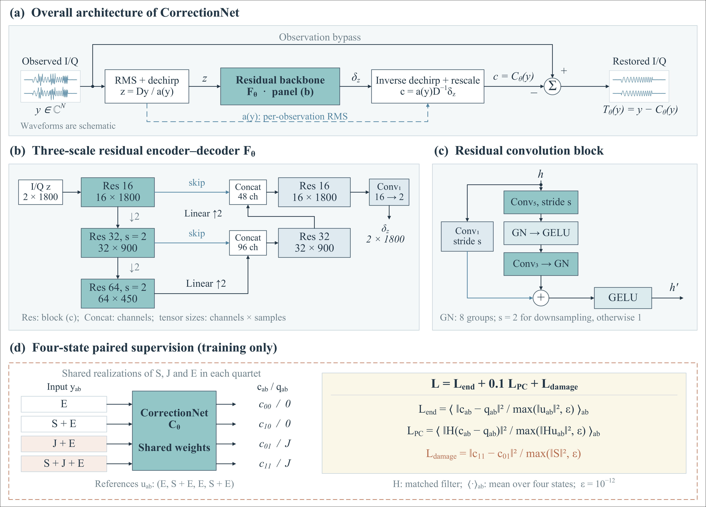
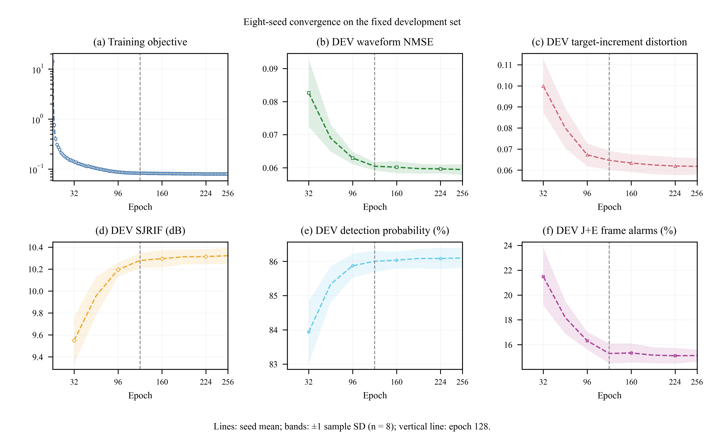
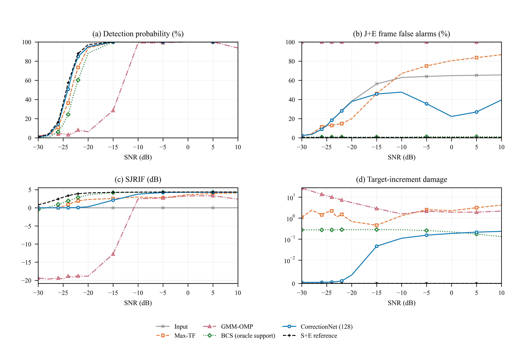
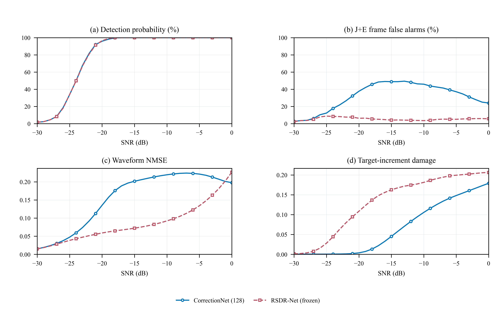
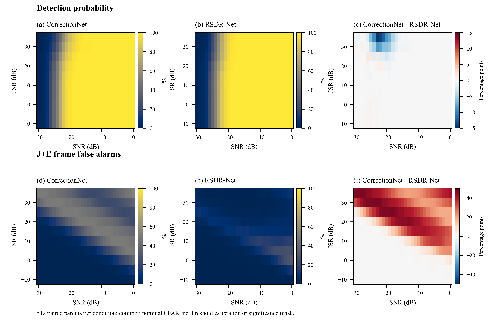
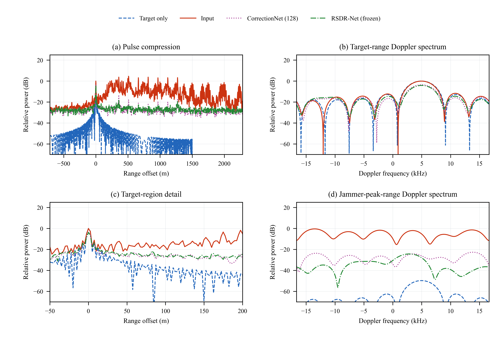
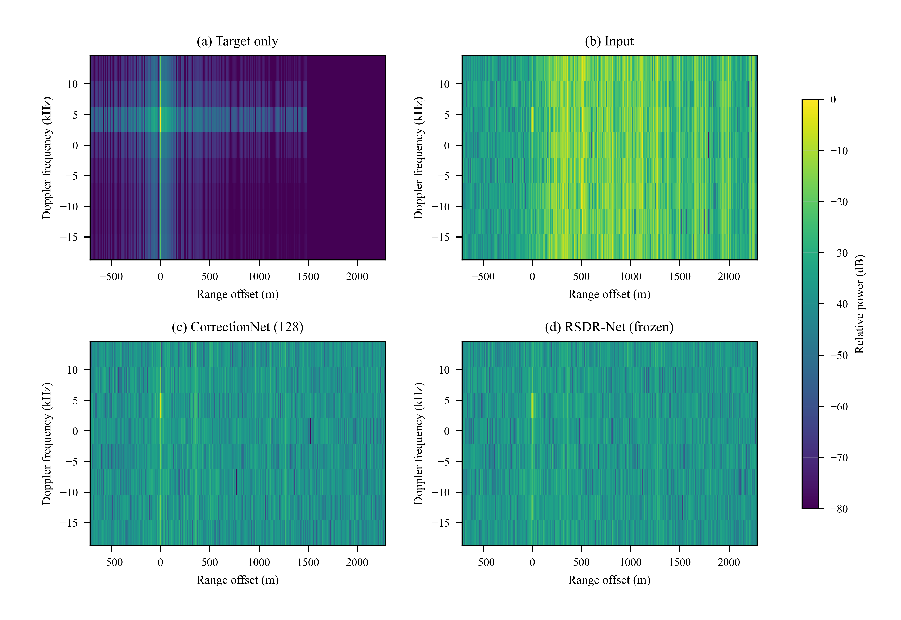
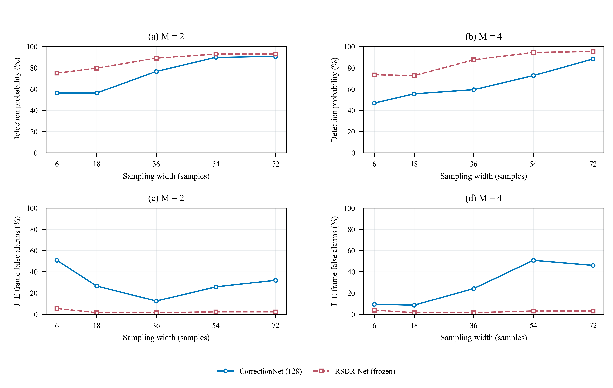

# A Compact Waveform Correction Network for Interrupted-Sampling Repeater Jamming: Target-Increment Constraints and Recovery Tradeoffs

> Complete manuscript revision, 16 November 2026 (UTC). Independent tests use the frozen seed-29, epoch-128 model. Eight-seed results through epoch 256 and the three-seed U-Net comparison are development-set analyses. Four structural/loss ablations and a separate equal-frame-false-alarm calibration/confirmation study for six second-version models are complete. A prospective equal-false-alarm comparison with RSDR-Net remains outstanding. Author names, affiliations and funding information remain for the authors to supply.

## Abstract

Interrupted-sampling repeater jamming retains local chirp structure from the transmitted waveform, so interference suppression and target preservation must be handled together. This paper studies a single-corrector waveform-restoration method. It normalizes the received I/Q signal, applies a fixed dechirp transform, estimates a correction with a three-scale residual encoder–decoder, and subtracts that correction through an identity path. Training uses four paired states formed from shared target, jammer, and noise realizations, with endpoint, pulse-compression, and target-increment constraints. The target-increment term is exactly the finite-difference error of the complete nonlinear restoration map when the target is added; this identity alone guarantees neither lossless recovery nor constant-false-alarm behaviour. We describe the signal-processing operations, network parameterization, and objective, and evaluate the method under a frozen simulation protocol spanning several ISRJ modes, signal-to-noise and jammer-to-signal variations, sampling-width changes, pulse compression, Doppler processing, and detection. The evaluation distinguishes waveform error, target-increment distortion, pulse-compression interference measures, and alarms in jammed target-absent backgrounds to characterize the scope and limitations of a single-corrector design.

**Index terms:** Interrupted-sampling repeater jamming; waveform restoration; residual learning; target-increment consistency; pulse compression; constant false alarm rate detection.

## 1 Introduction

Interrupted-sampling repeater jamming (ISRJ) intercepts short portions of a radar pulse and retransmits delayed copies that can produce false peaks after matched filtering [1]. The interference retains the local chirp structure of the transmitted waveform and may overlap the desired echo. A receiver therefore has to reduce interference that can trigger downstream detections while preserving a target with similar local structure. A visually smoother waveform, or a lower average reconstruction error, does not establish that both requirements have been met.

Existing receiver-side methods exploit observable differences between the target and retransmitted fragments. Time–frequency filtering uses their distributions to construct rejection filters, with Max-TF providing a representative implementation [2]. Other methods identify usable samples and reconstruct the echo in a sparse representation. Gaussian-mixture-based processing estimates usable segments from amplitude statistics before sparse reconstruction [3], whereas Bayesian compressed sensing recovers the signal from incomplete observations [4]. These approaches express structural assumptions explicitly. Their performance nevertheless depends on how well sample selection, the reconstruction dictionary and estimated parameters match the observation, particularly when noise or temporal overlap obscures fragment boundaries.

Learning-based methods offer different output contracts. A multipulse detection method applies model-driven Doppler-channel accumulation and preprocessing before convolutional target detection [5], but its output need not replace a waveform-processing front end. For waveform recovery, MREDNet uses a multi-residual encoder–decoder [6], MSMD-Net combines stages and signal domains [7], and extended complex-valued convolutional autoencoders integrate sample discrimination, denoising and reconstruction [8]. An end-to-end approach for low-SNR operation also includes pulse-compression supervision [9]. These studies motivate combining signal structure and downstream processing requirements, while making the differences in supervision and model complexity important to interpretation.

Recent work incorporates physical priors and optimization structure more directly. Complex-valued FISTA-Net unfolds sparse reconstruction iterations [10]. Joint morphological component analysis and reconstruction use estimated jamming parameters to adapt the decomposition [11], and MCA-ADMM-Net organizes the network around a dual-dictionary model and unfolded ADMM iterations [12]. In the HRRP domain, ISRJ-FNet learns a structured filtering mask and constrains its consistency under target perturbations [13]. Point-wise temporal classification followed by sparse reconstruction provides another separation between structural identification and recovery [14]. These approaches constrain different objects: an optimization trajectory, a filtering mask or a sample classification. Their interpretation depends on the signal domain and the desired output.

Our earlier RSDR-Net manuscript defines the reference as the jammer-free received waveform with the same noise realization, and uses four paired states to assess the incremental response to a target [15]. The system combines reliability estimation, several restoration experts, a fixed convex combination and bounded gating. The present work retains the task definition and asks whether a single compact correction path can provide useful restoration when those separate branches are removed. This question concerns both simplification and its cost: a reduction in waveform error may coexist with stronger residual peaks and more alarms in target-absent jammed backgrounds.

CorrectionNet first normalizes the I/Q observation and applies a fixed dechirp transform. A three-scale residual encoder–decoder predicts the waveform correction, which is transformed back and subtracted from the observation. The training reference is not a noise-free target. Instead, the network should leave unjammed inputs largely unchanged and remove changes caused by the jammer. A paired target-increment loss additionally discourages the correction from changing when only the target is added to a fixed background. We derive its exact relation to the finite-difference distortion of the restored target response.

The contributions are a compact correction path with 59,714 active parameters; an explicit distinction between endpoint, pulse-compression and target-increment constraints; and a frozen evaluation covering waveform fidelity, detection, false alarms, coherent processing and sampling-width sensitivity. These contributions build on established encoder–decoders, residual learning and the earlier paired supervision [15–18]. The study does not establish a new general identifiability theorem or uniform superiority over RSDR-Net. The additional parameter-matched U-Net development comparison also provides no evidence that the proposed backbone is superior. It instead helps locate the remaining problem: obtaining target preservation and residual-interference control together within a compact model.

## 2 Signal model and restoration objective

### 2.1 Coherent pulses and sampled observations

Let the fast-time sampling frequency be \(f_s\), the sampling interval \(T_s=1/f_s\), the observation length \(N\), the number of coherent pulses \(P\), and the pulse repetition interval \(T_r\). The transmitted baseband LFM pulse is

\[
s_0(t)=\mathbf 1_{[0,T_p)}(t)\exp\!\left\{j\pi\mu(t-T_p/2)^2\right\},
\qquad \mu=\frac{B}{T_p},
\tag{1}
\]

where \(T_p\), \(B\), and \(\mu\) denote pulse width, bandwidth and chirp rate. Sampling occurs at \(t_n=nT_s\). For a single target with delay \(\tau\), amplitude \(a\), reference phase \(\phi\), and Doppler frequency \(f_D\), pulse \(p\) is

\[
S_p(t)=a\,s_0(t-\tau)\exp\!\left\{j\phi+j2\pi f_D(t+pT_r)\right\},
\tag{2}
\]

The resulting pulse-to-pulse phase relation is

\[
S_{p+1}(t)=S_p(t)\exp(j2\pi f_D T_r),
\tag{3}
\]

Stacking the sampled pulses gives \(S\in\mathbb C^{P\times N}\). On the effective target support, the sampled signal is

\[
s_p[n]=a\,\mathbf1_{\{0\le nT_s-\tau<T_p\}}
\exp\!\left\{j\left[\phi+\pi\mu(nT_s-\tau-T_p/2)^2
+2\pi f_D(nT_s+pT_r)\right]\right\}.
\]

The generator represents any fractional delay through waveform sampling. Slow-time samples cannot distinguish \(f_D\) from \(f_D+k/T_r\), because the additional pulse-dependent phase is \(2\pi kp\). Doppler scoring therefore uses the frequency folded by the PRF; a wide simulated Doppler range is not an unambiguous velocity range.

The additive noise \(E\in\mathbb C^{P\times N}\) is zero-mean complex Gaussian. A noise realization is generated once per base scene and shared by the paired states and associated jamming variants. Its real representation is

\[
\mathcal R(E_p)=
\begin{bmatrix}
\operatorname{Re}E_p[0]&\cdots&\operatorname{Re}E_p[N-1]\\
\operatorname{Im}E_p[0]&\cdots&\operatorname{Im}E_p[N-1]
\end{bmatrix}.
\tag{4}
\]

For the main grid, let \(\Omega_S\) and \(\Omega_J\) be the nonzero target and jammer supports. Define \(P_S\) and \(P_J\) as their mean powers over those supports, and \(P_E=\mathbb E|E_p[n]|^2\). The generator uses

\[
\operatorname{SNR}=10\log_{10}\frac{P_S}{P_E},\qquad
\operatorname{JSR}=10\log_{10}\frac{P_J}{P_S}.
\tag{5}
\]

The nominal SNR controls the noise variance; finite realizations fluctuate around that expectation. The synthesized jammer is scaled using its actual effective-support mean power. This convention differs from the whole-group energy ratio used in the width scans in Section 4.3.

### 2.2 Fragment retransmission model

Let \(w_{p,k}(t)\) select fragment \(k\) of pulse \(p\), \(d_{p,k,m}\) be its retransmission delay, \(\beta_{p,k,m}\) its complex gain, and \(\Delta f_{p,k,m}\) an additional frequency shift. A fragment model is

\[
J_p(t)=
\sum_{k}\sum_m
\beta_{p,k,m}\,w_{p,k}(t-d_{p,k,m})
S_p(t-d_{p,k,m})
\exp(j2\pi\Delta f_{p,k,m}t).
\tag{6}
\]

The four factors describe sample selection, delay, gain/phase and frequency modulation. The simulator uses the current target waveform as a proxy for the intercepted LFM signal. It does not separately model all radar–target and radar–jammer propagation paths. Direct retransmission replays a selected fragment once; repeated retransmission replays it at several delays; cyclic retransmission replays a finite set of buffered fragments in reverse order. The modes share the target and noise but draw their own fragment and modulation parameters.

Using a diagonal selection matrix \(W_{p,k}\), a zero-padded integer-delay matrix \(P_d\), and a diagonal modulation matrix \(M(\nu)\), the discrete representation follows below. The delay subscript in (7) is measured in samples, corresponding to the continuous delay divided by \(T_s\) and represented by the generator's integer delay. The notation \(d_{p,k,m}\) is retained for this discrete delay.

\[
\mathbf j_p=
\sum_{k,m}\beta_{p,k,m}
M(\Delta f_{p,k,m})P_{d_{p,k,m}}W_{p,k}\mathbf s_p,
\qquad
\mathbf s_p,\mathbf j_p\in\mathbb C^N.
\tag{7}
\]

ISRJ is thus a sum of selection–delay–modulation operators rather than a fixed convolution. Since retransmissions can overlap each other and the target, support cannot generally be inferred from a unique amplitude threshold. The observation is

\[
\mathbf y_p=\mathbf s_p+\mathbf j_p+\mathbf e_p.
\tag{8}
\]

or \(Y=S+J+E\) for the pulse group. The deployed network receives the observed I/Q samples and fixed transmit-waveform constants. True supports, target delay and SNR/JSR labels are not inputs.

For \(A_{p,k,m}=M(\Delta f_{p,k,m})P_{d_{p,k,m}}W_{p,k}\), the identities \(W^{\mathrm H}W=W\), \(M^{\mathrm H}M=I\), and \(P_d^{\mathrm H}P_d\preceq I\) give

\[
\|\mathbf j_p\|_2\le\sum_{k,m}|\beta_{p,k,m}|\,\|W_{p,k}\mathbf s_p\|_2,
\qquad
\|\mathbf j_p\|_2^2=\sum_{u,v}\beta_u^*\beta_v
\langle A_u\mathbf s_p,A_v\mathbf s_p\rangle.
\]

The cross terms show why unscaled jammer energy is not determined by width and repetition count alone. Moreover, after support-power scaling, the same nominal JSR can still produce different full-window energies as support occupancy changes.

### 2.3 Pulse compression and error propagation

Let \(\mathcal H\) denote linear matched filtering with the transmitted template, with out-of-window samples set to zero:

\[
(\mathcal Hx)[\ell]=\sum_{n=0}^{N-1}x[n]s_0^*[n-\ell],
\tag{9}
\]

The implementation uses zero-padded FFT correlation with \(L\ge N+N_p-1\), where the template length is \(N_p=600\). The training loss retains all linear-correlation lags. Linearity gives

\[
\mathcal H(\mathbf y-\mathbf u)=\mathcal H\mathbf y-\mathcal H\mathbf u.
\tag{10}
\]

and, under the common DFT convention, Parseval's identity gives

\[
\|\mathcal H r\|_2^2
=\frac{1}{L}\sum_{k=0}^{L-1}
|\widehat r[k]|^2|\widehat s_0[k]|^2,
\tag{11}
\]

for a time-domain error \(r\). Pulse-compression supervision therefore weights spectral error by the transmit-template power spectrum. It penalizes errors that the correlator can amplify, but remains an energy criterion, not a direct objective on the largest false peak or a CFAR detection event. Zero padding embeds the signal isometrically, and selecting correlation lags cannot increase its norm. Hence

\[
\|\mathcal H r\|_2\le\|\mathcal H\|_{2\to2}\|r\|_2,
\qquad
\|\mathcal H\|_{2\to2}\le\max_k|\widehat s_0[k]|.
\]

For an individual lag, Cauchy–Schwarz also yields \(|(\mathcal Hr)[\ell]|\le\|h_\ell\|_2\|r\|_2\), with \(h_\ell\) the corresponding template. These bounds limit total and per-cell perturbations without ordering the maximum residual peaks of two different outputs. The range-bin spacing is \(c_0/(2f_s)\), while the ideal LFM compressed-mainlobe scale is approximately \(c_0/(2B)\).

### 2.4 Four paired states and the same-noise reference

A parent is one independent base scene with fixed \((S,J,E)\). The target and jammer presence indicators \(a,b\in\{0,1\}\) define the following paired states.

| State | Input \(Y_{ab}\) | Desired correction \(Q_{ab}\) | Output reference \(U_{ab}\) |
|---|---|---|---|
| 00 | \(E\) | \(0\) | \(E\) |
| 10 | \(S+E\) | \(0\) | \(S+E\) |
| 01 | \(J+E\) | \(J\) | \(E\) |
| 11 | \(S+J+E\) | \(J\) | \(S+E\) |

Equivalently, \(Y_{ab}=aS+bJ+E\), \(Q_{ab}=bJ\), and \(U_{ab}=aS+E\). The same components must be shared across states, so that

\[
Y_{11}-Y_{01}=S,
\qquad Q_{11}-Q_{01}=0,
\qquad U_{11}-U_{01}=S.
\tag{12}
\]

Resampling either noise or jamming when adding the target would introduce a nuisance difference and invalidate the target-only interpretation. The learned correction and restoration maps are

\[
C_\theta:\mathbb C^N\rightarrow\mathbb C^N,
\qquad
T_\theta(y)=y-C_\theta(y),
\tag{13}
\]

with desired endpoint conditions

\[
C_\theta(E)=0,\quad C_\theta(S+E)=0,\quad
C_\theta(J+E)=J,\quad C_\theta(S+J+E)=J.
\tag{14}
\]

For \(r_{ab}=C_\theta(Y_{ab})-Q_{ab}\), direct substitution yields \(T_\theta(Y_{ab})-U_{ab}=-r_{ab}\). Correction supervision therefore also constrains the restored output. The reference preserves the realized receiver noise; it separates jammer removal from denoising and determines the meaning of the endpoint error. It is not a claim that noise-free supervision used elsewhere is invalid.

### 2.5 Target response of a nonlinear restoration map

A nonlinear output has no unique decomposition into a restored target and restored jammer. We instead define a finite difference at fixed background \(v=J+E\):

\[
\Delta_S T_\theta(v)
=T_\theta(v+S)-T_\theta(v).
\tag{15}
\]

**Proposition 1.** For any correction map and any \(v,S\),

\[
\Delta_S T_\theta(v)-S
=-\left[C_\theta(v+S)-C_\theta(v)\right],
\tag{16}
\]

and therefore

\[
\|\Delta_S T_\theta(v)-S\|_2^2
=\|C_\theta(v+S)-C_\theta(v)\|_2^2.
\tag{17}
\]

**Proof.** Substitution of \(T_\theta(x)=x-C_\theta(x)\) into (15) cancels \(v\) and \(S\), giving (16). Taking squared norms gives (17). For the paired data, \(v=Y_{01}\) and \(v+S=Y_{11}\). Thus the squared difference of the two corrections is exactly the distortion of the incremental target response. This is an algebraic identity, not an approximation or a recovery guarantee.

Where the real-coordinate mapping is twice differentiable along the relevant segment, a local expansion is

\[
C_\theta(v+S)-C_\theta(v)
=J_{C_\theta}(v)S+R_2(v,S),
\qquad
\|R_2(v,S)\|_2
\le \frac12\sup_{0\le\xi\le1}
\|H_{C_\theta}(v+\xi S)\|\,\|S\|_2^2,
\tag{18}
\]

The Jacobian is defined in \(2N\)-dimensional real coordinates. For the vector-valued second derivative, the norm is \(\|H_C(x)\|=\sup_{\|u\|_2=\|w\|_2=1}\|H_C(x)[u,w]\|_2\). The triangle inequality gives

\[
\|J_{C_\theta}(v)S\|_2
\le\|C_\theta(v+S)-C_\theta(v)\|_2+\|R_2(v,S)\|_2.
\]

A small increment error therefore supports a small first-order response along the target direction only when the perturbation is sufficiently small and the second-order remainder is controlled. At finite amplitudes, cancellation between first- and higher-order terms can produce a small difference without a small Jacobian. The identities (16)–(17) themselves require no differentiability. None of these statements guarantees preservation in all directions, at arbitrary amplitudes, or under multiple targets and distribution shift.

### 2.6 Identifiability, degenerate solutions and normalization

If all four endpoint residuals vanish for a scene, the restoration is correct at those four input points. This finite set of constraints does not establish a globally unique decomposition. For example, \(C\equiv0\) has zero target-increment distortion while leaving all jamming intact. Conversely,

\[
\|c_{11}-c_{01}\|_2^2
\le2\|c_{11}-J\|_2^2+2\|c_{01}-J\|_2^2
\]

bounds the unnormalized increment error by the endpoint errors. Dividing by a small target energy can make the normalized distortion appreciable even when absolute endpoint errors are small. The two objectives are complementary.

Let \(A_v=J_C(v)\). For nonzero \(S\), the theoretical metric without a denominator floor satisfies

\[
\frac{\|C(v+\alpha S)-C(v)\|_2^2}{\|\alpha S\|_2^2}
\longrightarrow\frac{\|A_vS\|_2^2}{\|S\|_2^2},\qquad\alpha\to0^+.
\]

Both leading terms scale as \(\alpha^2\). With a fixed positive denominator floor, however, sufficiently small amplitudes inevitably activate that floor and the implemented metric tends to zero. The directional-sensitivity interpretation applies only in the amplitude range where the denominator is not clipped.

To illustrate identifiability, consider the unnormalized squared risk \(\mathbb E\|C(Y)-Q\|_2^2\), assuming a square-integrable correction label. This illustrative risk omits network parameterization, per-state normalization, pulse-compression supervision and the target-increment penalty. The conditional decomposition

\[
\mathbb E[\|c-Q\|_2^2\mid Y=y]
=\|c-\mathbb E[Q\mid Y=y]\|_2^2
+\mathbb E[\|Q-\mathbb E[Q\mid Y=y]\|_2^2\mid Y=y]
\]

gives \(C^\star(y)=\mathbb E[Q\mid Y=y]\). Conditional variance remains when different component realizations admit the same observation. Pairing supplies finite-difference constraints but does not eliminate this ambiguity. Adding a target-increment penalty couples the two inputs \(J+E\) and \(J+E+S\); pulse-compression weighting and per-state normalization further change the optimum. Their combined risk generally has no pointwise closed-form solution.

### 2.7 Connection to downstream detection

For the jammed observation, define \(\widehat J=C_\theta(Y)\) and \(\rho=J-\widehat J\). Then \(\widehat U-(S+E)=\rho\) and \(\mathcal H\widehat U-\mathcal H(S+E)=\mathcal H\rho\). Endpoint and pulse-compression losses thus control errors in quantities used downstream, but a small total residual can remain concentrated in a false peak. Target-increment error can also cancel a residual shared by the two target states.

For the pulse-averaged compressed power \(P_x[\ell]=P^{-1}\sum_p|(\mathcal Hx_p)[\ell]|^2\), the implemented peak ratio is

\[
R(x)=10\log_{10}\frac{\max(P_x[\ell_t],\varepsilon_{64})}
{\max(\max_{\ell\ne\ell_t}P_x[\ell],\varepsilon_{64})},
\qquad \mathrm{SJRIF}=R(\widehat U)-R(Y).
\]

Here \(\ell_t\) is located from the target-only compressed power, and \(\varepsilon_{64}\) is the smallest positive normal float64 value, used to make the ratio and logarithm defined at zero power. The denominator excludes only the target cell. A mainlobe guard is used solely in the separately recorded false-peak suppression metric. SJRIF therefore includes the effects of noise, sidelobes and residual interference; it is not a component-separated physical signal-to-jammer energy ratio.

Let \(Z_x[\nu,\ell]\) be the slow-time Fourier transform of the compressed pulses. The detection event is

\[
\mathsf D(x)=\mathbf1\!\left\{
\max_{(\nu,\ell)\in\mathcal G_t}
\left(|Z_x[\nu,\ell]|^2-\alpha\widehat P_{\mathrm{ref}}[\nu,\ell]\right)>0\right\},
\quad
\mathcal G_t=\{(\nu_t,\ell):|\ell-\ell_t|\le1\}\cap\mathcal V.
\]

The bin \(\nu_t\) is nearest to the true Doppler frequency after folding modulo the pulse repetition frequency; \(\mathcal V\) contains cells with complete CFAR reference windows. The evaluator requires the target center to be valid. Target truth is used only for simulation scoring, not as a network input. The power-difference form also covers a zero reference power. Restoration changes both the cell-under-test power and its estimated background. Consequently, neither an energy bound nor SJRIF determines the probability of this threshold event. Detection and target-absent false alarms must be measured separately on frozen outputs, without treating nominal CFAR calibration as an empirical guarantee.

## 3 Compact waveform correction network

The network assigns the known LFM phase rotation to a fixed operator and the unknown fragment boundaries and amplitude/phase changes to a compact learned backbone. The output is a correction in observation coordinates, with a subtraction bypass implementing restoration (Fig. 1).

**Fig. 1.** CorrectionNet inference and training. (a) Normalization, fixed dechirp, correction prediction, inverse transformation and subtraction. (b) Three-scale residual encoder–decoder. (c) Residual convolutional block. (d) Four states sharing the target, jammer and noise. The diagram abbreviates the text's \(\delta_z''\) as \(\delta_z\). Component labels are used only for training. Waveform icons are schematic.

### 3.1 I/Q representation, dechirp and amplitude normalization

The real representation and its inverse are

\[
\mathcal R(x)=
\begin{bmatrix}\operatorname{Re}x\\\operatorname{Im}x\end{bmatrix}
\in\mathbb R^{2\times N},
\qquad
\mathcal R^{-1}\!\left(\begin{bmatrix}x_R\\x_I\end{bmatrix}\right)=x_R+jx_I.
\tag{19}
\]

Pointwise complex multiplication can be represented by

\[
M(q[n])=
\begin{bmatrix}q_R[n]&-q_I[n]\\q_I[n]&q_R[n]\end{bmatrix},
\qquad
\mathcal R(q\odot x)[:,n]=M(q[n])\mathcal R(x)[:,n].
\tag{20}
\]

Thus \(\|\mathcal R(x)\|_F^2=\|x\|_2^2\), and \(M(q)^{\mathsf T}M(q)=|q|^2I_2\). Known phase rotations need not be learned, although the subsequent real-valued I/Q convolutions still learn cross-channel coupling.

Define the fixed dechirp reference by

\[
q[n]=\exp(j\pi\mu t_n^2),
\qquad
D=\operatorname{diag}(q^*[0],\ldots,q^*[N-1]).
\tag{21}
\]

Since \(|q[n]|=1\),

\[
D^{\mathrm H}D=I,
\qquad
\|Dx\|_2=\|x\|_2.
\tag{22}
\]

On the target support, the transformed phase becomes

\[
\begin{aligned}
\arg\!\left(S_p(t)e^{-j\pi\mu t^2}\right)
={}&\phi+2\pi f_D(t+pT_r)
+\pi\mu\left[(t-\tau-T_p/2)^2-t^2\right]\\
={}&\phi_p+2\pi\left[f_D-\mu(\tau+T_p/2)\right]t,
\end{aligned}
\tag{23}
\]

where \(\phi_p\) absorbs terms independent of fast time. The common quadratic phase becomes linear. Delayed fragments retain different boundaries and frequencies, so dechirping simplifies coordinates without separating target and jammer by itself.

The input RMS scale and normalized signal are

\[
a(y)=\max\!\left\{
\sqrt{\frac1N\sum_{n=0}^{N-1}|y[n]|^2},10^{-8}\right\},
\qquad z=\frac{Dy}{a(y)}.
\tag{24}
\]

With \(F_\theta\) denoting the I/Q network, interpreted as a complex output, the complete maps are

\[
C_\theta(y)=a(y)D^{\mathrm H}
F_\theta\!\left(\frac{Dy}{a(y)}\right),
\qquad
T_\theta(y)=y-C_\theta(y).
\tag{25}
\]

If neither the original nor the scaled input activates the RMS floor, then for \(\gamma>0\),

\[
a(\gamma y)=\gamma a(y),\qquad
C_\theta(\gamma y)=\gamma C_\theta(y),\qquad
T_\theta(\gamma y)=\gamma T_\theta(y).
\tag{26}
\]

This follows because the normalized input is unchanged and the external scale contributes \(\gamma\). It is positive-real amplitude equivariance, not arbitrary complex-phase equivariance. Real I/Q convolutions and GELU do not impose the latter. Adding a target changes the RMS, so Proposition 1 concerns the full correction map, including normalization and inverse transformation.

Away from the RMS floor, its differential is

\[
\mathrm da=\frac{\langle y,\mathrm dy\rangle_{\mathbb R}}{Na(y)},
\qquad
\mathrm dz=D\left(\frac{\mathrm dy}{a(y)}-\frac{y\,\mathrm da}{a(y)^2}\right).
\]

The second term removes the pure amplitude direction from normalized coordinates. At the floor, the denominator is fixed and this differential must be replaced by the corresponding piecewise expression.

### 3.2 Three-scale residual encoder–decoder

Let \(x_0=\mathcal R(z)\in\mathbb R^{2\times1800}\). Reliability inputs, reliability features and gating are disabled in the deployed configuration. A residual block is

\[
B_l(x)=
\sigma\!\left[
N_{l,2}\!\left(W_{l,2}\,\sigma(N_{l,1}(W_{l,1}x))\right)+P_lx
\right].
\tag{27}
\]

where \(W_{l,1}\) and \(W_{l,2}\) are convolutions of lengths 5 and 3, \(N_{l,i}\) are group-normalization operators, \(P_l\) is an identity or a \(1\times1\) projection, and \(\sigma\) is GELU. Downsampling uses stride 2 in the first convolution and projection. The forward recursion is

\[
\begin{aligned}
f_0&=B_0(x_0), && f_0\in\mathbb R^{16\times1800},\\
f_1&=B_1(f_0), && f_1\in\mathbb R^{32\times900},\\
f_2&=B_2(f_1), && f_2\in\mathbb R^{64\times450},\\
g_1&=B_{d1}\!\left([U_1(f_2),f_1]\right), && g_1\in\mathbb R^{32\times900},\\
g_0&=B_{d0}\!\left([U_0(g_1),f_0]\right), && g_0\in\mathbb R^{16\times1800},\\
\delta_z''&=W_o*g_0+b_o, && \delta_z''\in\mathbb R^{2\times1800},
\end{aligned}
\tag{28}
\]

Here \(U_1,U_0\) are linear interpolation to the skip-connection lengths, brackets denote channel concatenation, and \(W_o\) is a \(1\times1\) output convolution. The correction and restored output are

\[
\widehat c= a(y)D^{\mathrm H}\delta_z'',
\qquad
\widehat u=T_\theta(y)=y-\widehat c.
\tag{29}
\]

**Table 1. Actual forward tensor dimensions.**

| Node | Channels | Fast-time length | Role |
|---|---:|---:|---|
| \(x_0\) | 2 | 1800 | Normalized, dechirped I/Q |
| \(f_0\) | 16 | 1800 | Full-resolution encoding |
| \(f_1\) | 32 | 900 | First encoding with stride 2 |
| \(f_2\) | 64 | 450 | Second encoding with stride 2 |
| \(g_1\) | 32 | 900 | Upsampling and \(f_1\) concatenation |
| \(g_0\) | 16 | 1800 | Upsampling and \(f_0\) concatenation |
| \(\delta_z''\) | 2 | 1800 | Dechirped I/Q correction |

The convolutional length rule is \(L_{\rm out}=\lfloor(L_{\rm in}+2p-k)/s\rfloor+1\). Kernel length 5, padding 2 and stride 2 produce lengths 900 and 450 from 1800. Decoder interpolation explicitly matches the skip lengths.

Ignoring normalization statistics, the convolutional support obeys \(j_{l+1}=s_lj_l\) and \(r_{l+1}=r_l+(k_l-1)j_l\). The encoder outputs have \((j,r)=(1,7),(2,15),(4,31)\). Counting the maximum two-point interpolation support gives approximately 47 input samples after the first decoder and 55 at the output head. This is a path-support calculation, not the full network receptive field: GroupNorm uses statistics across time and the input RMS uses the whole window, allowing global dependence. Boundary padding and interpolation alignment also affect individual paths. The model contains no slow-time convolution or cross-pulse attention; coherent tests assess preservation by a pulsewise front end.

GroupNorm [19] uses eight channel groups. For \(x\in\mathbb R^{C\times L}\),

\[
\mu_g=\frac{\sum_{c\in\mathcal C_g,n}x_{c,n}}{|\mathcal C_g|L},\qquad
\sigma_g^2=\frac{\sum_{c\in\mathcal C_g,n}(x_{c,n}-\mu_g)^2}{|\mathcal C_g|L},
\quad
\operatorname{GN}(x)_{c,n}=\gamma_c\frac{x_{c,n}-\mu_{g(c)}}{\sqrt{\sigma_{g(c)}^2+\epsilon}}+\beta_c.
\]

Statistics are recomputed per input at inference; no running batch averages are used. GELU [20] is the exact error-function form \(x[1+\operatorname{erf}(x/\sqrt2)]/2\). Together with the convolutions, these operators make the learned map nonlinear and input dependent.

### 3.3 Active parameters and deployment scope

The encoder blocks contain 32,464 parameters, decoder blocks 27,216, and output convolution 34, totaling 59,714 active parameters. For a biased convolution, \(n_{\rm conv}=C_o(C_ik+1)\); an affine GroupNorm has \(2C_o\) parameters. Each of the five blocks has two convolutions, two normalization layers and a projection:

\[
n_{\rm block}=C_o(5C_i+1)+2C_o+C_o(3C_o+1)+2C_o+C_o(C_i+1).
\]

The channel pairs \((2,16),(16,32),(32,64),(96,32),(48,16)\) give 1,072, 6,368, 25,024, 21,728 and 5,488 parameters. The registry also retains 21,840 disabled gating parameters and 31,202 parameters in an inactive reliability propagator, giving 112,756 registered parameters. They are not counted as inference capacity. The earlier RSDR-Net registers 3,017,877 parameters; the reduction in registered count is 96.26%. Parameter count alone does not establish latency, memory, throughput or energy savings.

If the learned correction vanishes, the outer bypass is exactly the identity. The zero labels for unjammed states therefore constrain the actual waveform modification. The fixed reference supports 1800 samples; longer windows require a new reference and dimensional validation. For fixed channel widths, convolution, interpolation and phase rotation scale linearly with \(N\), with convolutional order \(\mathcal O(N\sum_l k_lC_{l-1}C_l)\). No measured real-time deployment claim is made.

### 3.4 Training losses

For \(c_{ab}=C_\theta(Y_{ab})\), the normalized endpoint objective is

\[
\mathcal L_{\mathrm{end}}=
\frac14\sum_{a,b\in\{0,1\}}
\frac{\|c_{ab}-q_{ab}\|_2^2}
{\max(\|u_{ab}\|_2^2,\varepsilon)},
\qquad \varepsilon=10^{-12}.
\tag{30}
\]

This is also the normalized output error because the output and correction residuals differ only by sign. The two unjammed states penalize unnecessary modification, and the two jammed states supervise subtraction of \(J\). For \(r_{ab}=c_{ab}-q_{ab}\), pulse-compression supervision is

\[
\mathcal L_{\mathrm{PC}}=
\frac14\sum_{a,b\in\{0,1\}}
\frac{\|\mathcal H r_{ab}\|_2^2}
{\max(\|\mathcal H u_{ab}\|_2^2,\varepsilon)}.
\tag{31}
\]

The target-increment objective is

\[
\mathcal L_{\mathrm{damage}}=
\frac{\|c_{11}-c_{01}\|_2^2}
{\max(\|S\|_2^2,\varepsilon)}
=\frac{\|T_\theta(Y_{11})-T_\theta(Y_{01})-S\|_2^2}
{\max(\|S\|_2^2,\varepsilon)},
\tag{32}
\]

where Proposition 1 gives the equality. The implemented objective is

\[
\mathcal L(\theta)=
\mathcal L_{\mathrm{end}}(\theta)
+\lambda_{\mathrm{PC}}\mathcal L_{\mathrm{PC}}(\theta)
+\lambda_{\mathrm{damage}}\mathcal L_{\mathrm{damage}}(\theta),
\qquad
\lambda_{\mathrm{PC}}=0.1,\quad
\lambda_{\mathrm{damage}}=1.
\tag{33}
\]

The three terms constrain correction accuracy, template-weighted error and target-direction response, respectively. The zero-correction degeneracy prevents using the increment term alone. Equations (11) and (17), and the bound in Section 2.6, explain their relations without turning any term into a detection-rate objective. Their empirical contributions require controlled ablations.

The implementation expands each record into eight pulses and four states, calculates denominators per pulse and state, and averages over the batch. Group-level test NMSE instead sums energies over the pulse group before division. These different normalization orders explain why the training loss is not numerically interchangeable with the test metric (Appendix A).

### 3.5 Optimization and gradient paths

An epoch traverses \(512\times3\) parent–jamming-mode records. A batch contains 32 records, giving 48 updates per epoch. Adam [21] uses \(\beta_1=0.9\), \(\beta_2=0.999\), \(\epsilon=10^{-8}\), no weight decay, and global gradient-norm clipping at 5. The learning rate warms linearly from zero to \(10^{-3}\) in epoch 1, decays by the registered cosine schedule to \(2\times10^{-5}\) at epoch 128, and then decays to \(2\times10^{-6}\) at epoch 256. The training procedure is

\[
\begin{array}{ll}
1.&\text{Read shared }(S,J,E)\text{ and construct }Y_{00},Y_{10},Y_{01},Y_{11};\\
2.&\text{For each state, compute }z=DY/a(y),\quad\delta_z''=F_\theta(z);\\
3.&\text{Compute }c_{ab}=a(y)D^{\mathrm H}\delta_z''\text{ and losses (30)--(33)};\\
4.&\text{Backpropagate, clip the gradient norm, and update }\theta;\\
5.&\text{Save recovery and identity records each epoch; retain milestones every 32 epochs.}
\end{array}
\tag{34}
\]

For update index \(k\ge1\), initialize \(m_0=v_0=0\) and write

\[
\begin{aligned}
g_k&=\nabla_\theta\widehat{\mathcal L}_k,\qquad
\widetilde g_k=g_k\min\!\left(1,\frac{5}{\|g_k\|_2+\epsilon_g}\right),\\
m_k&=\beta_1m_{k-1}+(1-\beta_1)\widetilde g_k,\qquad
v_k=\beta_2v_{k-1}+(1-\beta_2)\widetilde g_k^{\,2},\\
\theta_{k+1}&=\theta_k-\eta_k\frac{m_k/(1-\beta_1^k)}{\sqrt{v_k/(1-\beta_2^k)}+\epsilon}.
\end{aligned}
\]

The positive clipping stabilizer \(\epsilon_g\) is distinct from Adam's \(\epsilon\); a zero gradient remains zero. Squares, square roots and divisions are elementwise, whereas clipping uses the global gradient norm. The common scaling acts on the gradient supplied to Adam and does not bound the norm of Adam's final parameter update.

Every completed epoch has a recovery point, and every 32nd epoch has a separate milestone. The frozen TEST model remains seed 29 at epoch 128. The eight-seed extension is used for development-set convergence analysis, not to replace that identity retrospectively.

Writing a block as \(B_l(x)=\sigma(G_l(x)+P_lx)\), its local Jacobian is

\[
J_{B_l}(x)=J_\sigma(G_l(x)+P_lx)\,[J_{G_l}(x)+P_l].
\]

The projection supplies a direct path, but does not prove nonexpansiveness. Group statistics and the GELU derivative \(\Phi(x)+x\varphi(x)\) vary with the features. Interpolation at fixed dimensions is a fixed linear operator whose norm need not be one. For \(\delta=F_\theta(z)\), the complete correction differential away from the RMS floor is

\[
\mathrm d\widehat c=D^{\mathrm H}\left(\delta\,\mathrm da+aJ_{F_\theta}(z)\,\mathrm dz\right).
\]

The normalization scale affects both the internal coordinates and the correction written back to the observation. The proven structural properties are dechirp isometry, positive-real scale equivariance under the stated condition, and the finite-difference identity. None establishes global unbiasedness, distortion-free recovery or CFAR preservation.

## 4 Experimental design and evaluation

### 4.1 Data generation and data roles

The radar settings and scan paths follow the earlier study [15], while the actual data manifests define the splits used here. The sampling frequency is 60 MHz, bandwidth 30 MHz, pulse width 10 μs and pulse repetition interval 30 μs. Each record contains eight coherent pulses of 1800 samples. Training contains one true target, with amplitude drawn from \([0.15,2]\), initial phase from \([0,2\pi)\), and Doppler from \([-200,200]\) kHz. Fast- and slow-time phases are retained. The broad Doppler sampling is scored modulo the PRF rather than treated as unambiguous velocity coverage.

There are 512 independent training parents. Half use SNR in \([-20,15]\) dB and JSR in \([-12,35]\) dB; the low-SNR half use \([-30,-20)\) dB and \([-12,45]\) dB, respectively. Each parent has direct, repeated and cyclic variants, yielding 1536 pulse-group records. The number of jammed pulses is selected from 1, 2, 4, 6 and 8. SNR is drawn per pulse, and jammer intensity and structure are drawn for the jammed pulses. The four states share the realized components.

DEV consists of another 256 parents with SNR drawn over \([-30,15]\) dB and JSR over \([-12,45]\) dB. It does not reproduce the training stratification quotas. TEST contains separate base scenes evaluated at the fixed conditions in Table 3. DEV is used for model selection and convergence analysis; TEST is used for the frozen-model results. Their averages are not pooled.

**Table 2. Training and optimization settings.**

| Item | Setting |
|---|---|
| Radar | \(f_s=60\) MHz; \(B=30\) MHz; \(T_p=10\) μs; \(T_r=30\) μs |
| Record | \(P=8\), \(N=1800\); four paired states |
| Sampling width | 6–72 samples |
| Sampling period | Lower bound \(\max(36,w+1)\); upper bound 260 samples |
| Replay delay, repetition count, additional gap | 1–96 samples; 1–10; 0–64 samples |
| Additional frequency shift | \([-200,200]\) kHz, with pulse-dependent phase variation |
| Training records | 512 parents × 3 modes; 8 pulses per record |
| Batch and updates | 32 records; 48 updates per epoch |
| Optimizer | Adam [21]; \(\beta_1=0.9\), \(\beta_2=0.999\), \(\epsilon=10^{-8}\) |
| Learning rate | First-epoch warmup to \(10^{-3}\); at epoch 128, cosine decay reaches \(2\times10^{-5}\); at epoch 256, the extension reaches \(2\times10^{-6}\) |
| Regularization | Weight decay 0; gradient-norm limit 5 |
| Seeds | 17, 29, 41, 53, 67, 79, 97, 109 |
| Retention | Every-epoch recovery; separate milestones every 32 epochs, 64 milestones in total |

### 4.2 Frozen model and comparison methods

The initial three seeds, 17, 29 and 41, were trained for 128 epochs under the same schedule, retaining epochs 32, 64, 96 and 128. These are intermediate checkpoints on one trajectory, not four separately optimized training durations. Epoch 128 was selected from the three-seed mean DEV waveform NMSE, and the fixed middle-seed rule selected seed 29 before TEST execution. This selection followed inspection of DEV; it was not a model choice made before seeing DEV.

The three runs were then extended to 256 epochs and five additional seeds followed the same two-stage schedule. All eight are evaluated on the same DEV every 32 epochs. The extension does not replace the epoch-128 TEST identity. A final model selected using these results requires a fresh confirmation set.

Comparisons include the identity output (KEEP), the same-noise jammer-free reference \(S+E\), Max-TF [2], GMM-OMP [3], BCS with oracle support [4], and frozen RSDR-Net [15]. The \(S+E\) reference requires inaccessible components and is not a deployable algorithm. The classical methods are local formula-based reproductions with frozen parameters, not the original authors' executables or TEST-tuned variants. Max-TF includes local choices for discrete smoothing and ties. GMM-OMP uses a two-component amplitude EM fit, at most 100 EM iterations and eight OMP iterations; its variance update uses the standard responsibility-weighted form, correcting an apparently omitted factor in the printed expression. Such choices can affect the comparison.

BCS uses a smoothed \(L_1\) MAP objective, outer reweighting and inner complex conjugate gradients. It receives the true unjammed support and is always labeled **BCS (oracle support)**. It is an extra-information reference, not an observation-only competitor. A prespecified DEV pilot tested nine Max-TF and eight GMM-OMP configurations. None passed the entry gate for full DEV review, so no configuration was frozen for confirmation; this finding applies to the tested local implementations, not to either method class.

The RSDR-Net comparator is the complete F-R7 system, with training seed 40312102 and a final-stage epoch-32 checkpoint. Its multistage components used 32 epochs per stage and 512 updates per epoch, whereas CorrectionNet uses 48 updates per epoch. Testing inputs, downstream processing and metrics are unified; training budgets are not. The comparison is therefore between frozen systems, not an isolated architectural ablation. RSDR-Net inference was added after the original TEST results and did not trigger retraining or checkpoint replacement.

### 4.3 Test grids and statistical units

**Table 3. Completed test suites. Conditions within a suite share parents and are not additional independent samples.**

| Suite | Conditions | Number of conditions | Independent parents |
|---|---|---:|---:|
| Three-mode main grid | SNR: −30, −28, −26, −25, −24, −23, −22, −20, −15, −10, −5, 0, 5, 10 dB; JSR: 0, 10, 20, 35 dB; three modes | 168 | 256 |
| Dense detection grid | SNR −30 to 0 dB, 1-dB steps; JSR −10 to 35 dB, 5-dB steps | 310 | 512 |
| Unjammed retention | SNR −30 to −20 dB, 1-dB steps, plus −15, −10, 0 dB; three scene groups | 42 | 1536, 512 per group |
| Width scan A | Period 260 samples, \(M=2\); widths 3, 6, 18, 36, 54, 72, 84; three intensity settings | 21 | 256 |
| Width scan B | \(M=2,4\); widths 6, 18, 36, 54, 72; period \((M+1)w+1\) | 20 | 128 |
| Coherent processing | (SNR, JSR) = (−20,20), (0,20), (0,35) dB; target Doppler within ±14 kHz | 3 | 16 |

Scan A uses \((\mathrm{SNR},\mathrm{JSR}_E)=(-10,20),(-20,35),(0,10)\) dB, and scan B uses the first two. Here \(\mathrm{JSR}_E\) is the jammer-to-target energy ratio over the whole pulse group. Main-grid JSR uses effective-support mean power. Changing support occupancy changes the relationship, so width-scan values are not pooled with main-grid means. Widths 3 and 84 are outside the training interval; this limited check does not establish generalization to arbitrary jamming.

Metrics are first averaged equally across specified conditions within each parent, and then across parents. Method differences use paired parent values and 4000 parent-bootstrap resamples for pointwise 95% intervals [22]. The three unjammed groups are resampled within strata. Pulses, states, modes and repeated conditions are not independent replicates. The intervals are not multiplicity-adjusted and do not include training-seed uncertainty. Convergence shading is the sample standard deviation across training seeds, a separate source of variation.

### 4.4 Waveform and target-increment metrics

With \(\widehat U_{ab}=T_\theta(Y_{ab})\), full-group errors are

\[
\mathrm{NMSE}_U=\frac{\|\widehat U_{11}-(S+E)\|_F^2}{\|S+E\|_F^2},\qquad
D_S=\frac{\|\widehat U_{11}-\widehat U_{01}-S\|_F^2}{\|S\|_F^2}.
\tag{35}
\]

The implementation floors tiny denominators at \(10^{-24}\). The first metric measures total deviation from the same-noise reference; the second measures the change in target response at a fixed background. For \(V=\widehat U_{11}-\widehat U_{01}\), define

\[
g=\frac{\langle S,V\rangle}{\|S\|_F^2},\qquad V=gS+V_\perp,
\quad \langle S,V_\perp\rangle=0,
\tag{36}
\]

Orthogonality gives

\[
D_S=|g-1|^2+\frac{\|V_\perp\|_F^2}{\|S\|_F^2}.
\tag{37}
\]

Thus \(D_S\) combines complex gain error with deformation that a scalar gain cannot explain. It does not measure all interference remaining in \(\widehat U_{01}\): KEEP has \(D_S=0\) while retaining the jammer. Unjammed retention is measured by

\[
\mathrm{NMSE}_{0}=\frac{\|\widehat U_{00}-E\|_F^2+
\|\widehat U_{10}-(S+E)\|_F^2}{\|E\|_F^2+\|S+E\|_F^2}.
\tag{38}
\]

which includes both noise-only and target-plus-noise states.

### 4.5 Pulse compression, SJRIF and detection

Evaluation uses a 600-sample matched template and retains valid lags 0–1200, giving 1201 range cells. For compressed pulse \(Z_p(r)\), the average power is

\[
P_Z(r)=\frac1P\sum_{p=0}^{P-1}|Z_p(r)|^2.
\tag{39}
\]

The target-only compressed signal determines \(r_t\). Following the existing experiment implementation,

\[
R(Z)=10\log_{10}\frac{\max(P_Z(r_t),\varepsilon_{64})}{\max(\max_{r\ne r_t}P_Z(r),\varepsilon_{64})},\qquad
\mathrm{SJRIF}=R(Z_{\mathrm{out}})-R(Z_{\mathrm{in}}).
\tag{40}
\]

The numerical floor is defined in Section 2.7. The denominator includes adjacent mainlobe samples, sidelobes, noise and residual jamming. SJRIF here is therefore an improvement in a target-to-strongest-other-cell ratio, not a true-component physical signal-to-jammer improvement. At twice-bandwidth sampling, the ideal nearest mainlobe sample is only approximately 3.92 dB below the peak, and can dominate the denominator once interference is suppressed. A separate maximum false-peak suppression measure outside the mainlobe is retained in the evidence, but (40) is not treated as residual-jammer energy.

An eight-point slow-time FFT produces the range–Doppler power map. Two-dimensional CA-CFAR uses guard/reference half-widths of 12/24 in range and 1/2 in Doppler, with periodic Doppler boundaries. The number of reference cells is

\[
N_r=[2(12+24)+1][2(1+2)+1]-(2\times12+1)(2\times1+1)=436.
\tag{41}
\]

There are 9032 valid cells under test per frame. At nominal cell false-alarm probability \(P_{\rm FA}^{\rm nom}=10^{-6}\), the reference mean is multiplied by

\[
\alpha=N_r\left[(P_{\mathrm{FA}}^{\mathrm{nom}})^{-1/N_r}-1\right].
\tag{42}
\]

This coefficient assumes independent identically distributed exponential background powers. Matched filtering and nonlinear restoration can change both dependence and distribution, so empirical false alarms are measured separately. Detection is successful when at least one range cell within \(r_t\pm1\), at the nearest periodic Doppler bin, exceeds threshold. \(P_D\) is the frequency of this event over parents.

Cell and frame false-alarm rates are evaluated on \(E\) and \(J+E\). A frame alarm means at least one valid cell exceeds threshold. All methods share the nominal CFAR rule, but their empirical false alarms differ; this is not a matched-empirical-false-alarm ROC comparison.

### 4.6 Calibrated frame-level detection comparison

A separate evaluation compares the full model, parameter-matched U-Net and four prespecified ablations under a target frame false-alarm calibration. For each model and training seed, a threshold is fixed at the empirical 99th percentile of the maximum valid range–Doppler statistic over target-absent $J+E$ frames from 1,024 calibration parents. Detection and realized frame false alarms are then evaluated on 2,048 new parents with no parent overlap. Parent is the resampling unit; jammer types are averaged within parent. This operating point differs from the cell-level nominal CA-CFAR rule in Section 4.5 and is not an RSDR-Net comparison.

The cell statistic is CUT power divided by the local CA reference-cell mean, and the frame statistic is its maximum over valid cells. Each parent generates three jammer types, yielding 3,072 calibration-frame statistics pooled to set one threshold per model and seed. The empirical quantile uses the higher adjacent order statistic (`method="higher"`); the threshold is not refitted by true confirmation SNR, JSR or jammer type. Confirmation contains 6,144 frames, but the three types sharing a parent are dependent. Event indicators are first averaged within parent, and aggregation and bootstrap resampling use the 2,048 parents. Detection checks the target range cell and its ±1 neighbours at the nearest physical Doppler bin, whereas a target-absent frame alarm checks all valid cells.

### 4.7 Forward-pass timing

The timing receipt records host `DESKTOP-RFFERM3` and an NVIDIA GeForce RTX 5060 Ti, with FP32 and TF32 disabled, 40 warm-up calls and 160 CUDA-event measurements per batch size. The receipt does not identify the script version or its hash. The current working-tree timing script calls `model(x)`, which follows the model forward path in that version; however, the raw `EFFICIENCY_RESULTS.json` says RMS/dechirp transforms are excluded, and the unversioned script cannot establish which path produced the measurements. The latency values below are therefore provisional and do not support a confirmed full-forward speed ranking until the source and receipt are reconciled. Pulse compression, Doppler processing, CFAR and transfers outside CUDA tensors are excluded. Conv1d MAC counts are reported separately and do not represent all operations or full-chain latency.

### 4.8 Coherent-processing metrics

At the true target range, let \(z_p^S\) and \(z_p\) be the target-only and processed slow-time sequences. Define \(\chi_p=z_p(z_p^S)^*/|z_p^S|^2\) and remove the common phase \(\phi_0=\arg\sum_p\chi_p\). Then

\[
\sigma_\phi=\sqrt{\frac1P\sum_p
\operatorname{wrap}(\arg\chi_p-\phi_0)^2},
\quad
G_{\mathrm{coh}}=10\log_{10}
\frac{\left|\sum_p z_p(z_p^S)^*/|z_p^S|\right|^2}
{\left(\sum_p|z_p^S|\right)^2}.
\tag{43}
\]

Phase RMSE is reported in degrees. \(G_{\rm coh}\) is a coherent power ratio relative to the target-only signal; noise can make it positive without implying a true target-energy gain. Peak frequency error uses 4096-point zero-padded spectra of the eight-pulse sequences and periodic frequency distance. Zero padding interpolates the spectrum without increasing physical Doppler resolution.

## 5 Results

### 5.1 Eight-seed training and convergence

All eight seeds completed 256 epochs, yielding 2048 epoch records and 64 DEV milestone evaluations. The training objective falls rapidly early and improves more slowly later (Fig. 2). Between epochs 32 and 128, mean DEV NMSE decreases from 0.08268 to 0.06044 and target-increment distortion from 0.09991 to 0.06465. From 128 to 256, NMSE decreases to 0.05944 while detection changes from 86.003% to 86.100%. The evidence indicates diminishing gains, rather than strictly monotone improvement or no further learning after epoch 128.

**Fig. 2.** Training objective and DEV metrics over eight seeds. Lines and shading show the mean and sample standard deviation across seeds. The training objective uses a logarithmic axis; DEV is evaluated every 32 epochs. The vertical line marks the schedule boundary at epoch 128. All seeds use the same DEV, so shading is not a population confidence interval for new scenes.

**Table 4. Mean DEV performance across eight seeds. Probabilities are percentages.**

| Epoch | \(\mathrm{NMSE}_U\) ↓ | \(D_S\) ↓ | SJRIF/dB ↑ | \(P_D\)/% ↑ | \(J+E\) frame alarms/% ↓ |
|---:|---:|---:|---:|---:|---:|
| 32 | 0.082677 | 0.099914 | 9.5507 | 83.936 | 21.484 |
| 64 | 0.068933 | 0.079982 | 9.9558 | 85.335 | 18.180 |
| 96 | 0.062933 | 0.067263 | 10.1948 | 85.872 | 16.309 |
| 128 | 0.060439 | 0.064651 | 10.2786 | 86.003 | 15.283 |
| 160 | 0.060170 | 0.063376 | 10.2951 | 86.035 | 15.332 |
| 192 | 0.059729 | 0.062455 | 10.3120 | 86.084 | 15.153 |
| 224 | 0.059637 | 0.061939 | 10.3140 | 86.084 | 15.104 |
| 256 | 0.059440 | 0.061786 | 10.3221 | 86.100 | 15.120 |

At epoch 256, the seed standard deviations are 0.00165 for NMSE, 0.00395 for \(D_S\), 0.0726 dB for SJRIF and 0.285 percentage points for detection. This describes initialization variation on a fixed DEV, not eight independent generalization studies. DEV and the main grid have different condition distributions, preventing direct interpretation of their mean SJRIF or detection differences as training gains.

### 5.2 Frozen main-grid comparison with classical methods

Table 5 averages the 168 conditions equally within parents. Relative to KEEP, CorrectionNet reduces same-noise waveform error, raises SJRIF by 3.65 dB and increases detection from 59.20% to 67.07%. Relative to the local Max-TF reproduction, the paired SJRIF difference is 1.572 dB (95% interval 1.496–1.651 dB), and detection increases by 4.211 percentage points (3.764–4.653). Jammed-background frame alarms also decrease, but remain 20.42%, well above the jammer-free reference.

**Table 5. Main-grid results across three jamming modes. Reference rows are not ranked as deployable algorithms.**

| Method | \(\mathrm{NMSE}_U\) ↓ | \(D_S\) ↓ | SJRIF/dB ↑ | \(P_D\)/% ↑ | \(J+E\) frame alarms/% ↓ |
|---|---:|---:|---:|---:|---:|
| KEEP | 30.32106 | 0 | 0 | 59.203 | 34.924 |
| Max-TF, local reproduction | 1.12729 | 4.56331 | 2.0819 | 62.858 | 33.963 |
| GMM-OMP, local reproduction | 1.42492 | 8.99357 | −9.1752 | 39.651 | 99.923 |
| BCS (oracle support) | 0.10696 | 0.18506 | 4.6260 | 62.714 | 0.911 |
| CorrectionNet, epoch 128 | 0.08741 | 0.04731 | 3.6540 | 67.069 | 20.424 |
| \(S+E\), inaccessible reference | 0 | 0 | 5.1026 | 69.420 | 0.391 |

GMM-OMP produces very high jammed-background frame alarms in this implementation and fixed configuration. Different denoising targets can affect its same-noise NMSE, but do not by themselves explain a frame alarm rate near 100%. The prespecified pilot gate was not passed by any tested GMM-OMP configuration, so the result is limited to this local implementation and tested parameter set. BCS uses additional support information and has stronger SJRIF and lower background alarms than CorrectionNet, but lower detection. Neither observation establishes an oracle performance limit or identifies a single causal mechanism.

**Fig. 3.** Detection, jammed-background frame alarms, SJRIF and target-increment distortion versus SNR for repeated retransmission at JSR 20 dB. Each condition uses 256 paired parents. Lines join tested points. The distortion axis uses a symmetric logarithmic scale with a linear region around zero to display KEEP and larger errors together. Oracle and inaccessible references do not have the same input information as deployable methods.

### 5.3 Unified comparison with RSDR-Net

Under identical test inputs and processing, CorrectionNet has lower main-grid NMSE and target-increment distortion, with paired difference intervals excluding zero. The same comparison shows lower SJRIF and detection, and substantially more jammed-background alarms (Table 6). Simplification preserves useful waveform recovery but loses some control of residual interference.

**Table 6. Unified main-grid comparison over 256 independent parents. Differences are CorrectionNet minus RSDR-Net; brackets are paired pointwise 95% bootstrap intervals.**

| Metric | CorrectionNet | RSDR-Net | Difference [interval] |
|---|---:|---:|---|
| \(\mathrm{NMSE}_U\) ↓ | 0.087409 | 0.102302 | −0.014892 [−0.021168, −0.008966] |
| \(D_S\) ↓ | 0.047309 | 0.071769 | −0.024459 [−0.026527, −0.022480] |
| SJRIF/dB ↑ | 3.654024 | 4.736024 | −1.082001 [−1.150363, −1.011990] |
| \(P_D\)/% ↑ | 67.0689 | 67.9688 | −0.8998 [−1.0579, −0.7510] percentage points |
| \(J+E\) frame alarms/% ↓ | 20.4241 | 7.0754 | +13.3487 [12.0443, 14.6508] percentage points |

The waveform-error ranking is condition dependent. On the dense 310-condition grid, NMSE is 0.10515 for CorrectionNet and 0.07551 for RSDR-Net, reversing the main-grid order. Target-increment distortion remains lower, at 0.05294 versus 0.08844. Detection is 78.729% versus 79.170%, and jammed-background frame alarms are 21.326% versus 4.817%. Lower target-increment distortion is therefore more consistent across the two grids than lower total waveform error.

**Fig. 4.** Dense-grid slice at JSR 20 dB with 1-dB SNR steps and 512 paired parents per condition. The four panels show how lower target-increment distortion can coexist with more jammed-background alarms. This slice does not replace the full-grid summary.

The complete maps in Fig. 5 locate detection differences mainly around the low-SNR transition and stronger jamming, while background-alarm differences extend more broadly. The maps are descriptive condition means and paired point differences, without cellwise significance claims.

**Fig. 5.** All 310 dense-grid conditions. The upper row shows detection probability and the lower row shows target-absent jammed-background frame alarms. Columns show CorrectionNet, RSDR-Net and their difference in percentage points. There are 512 paired parents per condition, with SNR/JSR steps of 1/5 dB. Absolute panels share a 0–100% scale; difference panels use symmetric limits separately for each metric. No smoothing or interpolation is applied. Thresholds follow the common nominal CFAR rule rather than matched empirical false alarms.

Because training, capacity and architecture differ together, this comparison does not identify which RSDR-Net branch accounts for its stronger suppression. The parameter-matched development comparison in Section 5.7 provides a separate check on the compact backbone.

### 5.4 Pulse compression and coherent processing

Figures 6 and 7 use the fixed parent 0 at SNR 0 dB and JSR 20 dB, rather than selecting a favourable output. Both networks preserve the principal response near the target, but amplitudes differ from the target-only reference and some CorrectionNet residual peaks are higher. The plotted target-only reference is \(S\), whereas training uses \(S+E\). Differences from the plot reference cannot all be assigned to network error, and peak-position retention is not distortion-free restoration.

**Fig. 6.** Fixed parent 0, repeated forwarding, SNR 0 dB and JSR 20 dB. Panels show (a) full pulse compression, (b) target-range Doppler spectrum, (c) target-region detail and (d) Doppler spectrum at the strongest jammer-only compressed range bin. The target-only peak is lag 286; the jammer-only peak is lag 490, selected from the paired truth solely for visualization and held fixed across methods. Range is relative to the target-only peak. Pulse-mean compressed powers and slow-time spectral powers are normalized by the same maximum target-only pulse-compression power. The spectra use eight pulses, 4096-point zero padding and division by eight squared; padding does not improve physical resolution. Values below the displayed −70 dB limit are clipped in the view; the log floor is 10⁻¹⁴ before conversion. CorrectionNet uses the frozen epoch-128 checkpoint. Predictions were replotted from the SHA-verified frozen array without new inference; interpret the amplitude changes with Table 7.

**Fig. 7.** Range–Doppler maps of the same fixed scene, arranged as target only, input, CorrectionNet and RSDR-Net. All panels share a reference equal to the largest power across the four maps and a −80 to 0 dB color scale. Eight actual Doppler bins are retained without interpolation; values below −80 dB saturate at the lower color limit. Range is relative to the target-only compressed peak. The vector grids were redrawn from the same verified predictions as Fig. 6. This scene illustrates spatial structure; detection and false-alarm conclusions use paired statistics.

Across the 16-parent coherent check, at SNR 0 dB and JSR 35 dB, CorrectionNet reduces phase RMSE from 23.26° to 6.40° and peak frequency error from 317.38 to 69.68 Hz, while detection rises from 37.5% to 100%. The coherent power ratio is −3.79 dB, indicating substantial attenuation alongside that improvement. At the low-SNR condition (−20,20) dB, phase and frequency errors do not improve appreciably.

**Table 7. Coherent-processing means over 16 independent parents. Power ratios use the target-only reference. Detection estimates have limited sample size.**

| SNR/JSR, dB | Processing | Phase RMSE/° ↓ | Coherent power ratio/dB | Peak frequency error/Hz ↓ | \(P_D\)/% |
|---|---|---:|---:|---:|---:|
| −20/20 | Input | 16.429 | +0.488 | 116.984 | 93.75 |
| −20/20 | CorrectionNet | 16.460 | +0.322 | 120.036 | 93.75 |
| 0/20 | Input | 5.075 | +0.098 | 65.104 | 100 |
| 0/20 | CorrectionNet | 4.362 | −2.896 | 44.759 | 100 |
| 0/35 | Input | 23.260 | +0.496 | 317.383 | 37.5 |
| 0/35 | CorrectionNet | 6.402 | −3.795 | 69.682 | 100 |

Equally averaging the three conditions gives phase RMSEs of 9.075° and 8.955° for the new and old models, with a difference interval crossing zero. Mean peak frequency errors are 78.159 and 101.217 Hz: the paired difference is −23.058 Hz, with interval [−38.825, −8.647] Hz. This result is limited to the tested scenes and does not establish reliable velocity superiority in complex measured environments.

### 5.5 Unjammed retention and sampling-width sensitivity

The combined unjammed retention NMSE is \(1.6800\times10^{-4}\) for CorrectionNet and \(1.9396\times10^{-5}\) for RSDR-Net. Both are small, but the compact model modifies the input more. Unjammed detection is 55.6641% versus 55.6687%, with a difference interval crossing zero; noise-only cell false alarms are approximately \(1.442\times10^{-6}\), and frame alarms are 1.302% for both. These are averages over low-SNR conditions, not high-SNR detection ceilings. No equivalence margin was prespecified, so failure to resolve a detection difference is not proof of equivalence.

In fixed-period width scan A, the new and old NMSEs are 0.06744 and 0.11627, with nearly identical detection of 98.419% and 98.400%. Jammed-background frame alarms remain 16.592% and 2.958%. In scan B, where period varies with width, CorrectionNet NMSE rises to 0.30403 versus 0.10241 for RSDR-Net. Detection is 84.102% versus 92.344%, a difference of −8.242 percentage points with interval [−9.883, −6.563]. Target-increment distortion is still lower, 0.16088 versus 0.25874, without producing better detection.

**Fig. 8.** Scan B at SNR −20 dB and \(\mathrm{JSR}_E=35\) dB, with separate columns for \(M=2\) and \(M=4\). Each condition uses 128 paired parents. The period is \((M+1)w+1\); changing the horizontal coordinate changes both width and period, so it is not a width-only intervention.

These results locate a failure boundary of the simplified model. Preserving the target increment does not compensate for residual interference when fragment structure changes.

### 5.6 Why lower target-increment error can coexist with more alarms

Equations (16)–(17) measure the change in correction when a target is added. A residual retained similarly in the two states can cancel in that finite difference while producing false peaks in the \(J+E\) output. NMSE also averages energy over a pulse group: a few concentrated residuals and a diffuse error can have similar total energy but different CFAR consequences. SJRIF introduces another dependence on the strongest non-target cell and adjacent mainlobe samples. Different metric rankings therefore need not be contradictory.

The data support lower target-increment distortion in several scans and weaker residual-interference control than the complete RSDR-Net. They do not identify whether loss weights, backbone capacity or missing reliability mechanisms cause that tradeoff.

### 5.7 Parameter-matched U-Net development comparison

A conventional one-dimensional I/Q U-Net [16] has exactly 59,714 active parameters. Its channel widths are 18, 42 and 74, with two length-3 convolutions, GroupNorm and ReLU per scale, max-pooling downsampling, linear-interpolation upsampling and concatenated skips. It uses neither fixed dechirp nor local residual blocks. Widths were selected by parameter count, without using validation performance. RMS normalization, correction output, four-state supervision and all three losses are retained. Data, seeds 17/29/41 and the 256-epoch schedule match CorrectionNet. Several architectural choices change together, so this is a capacity-matched backbone comparison rather than a single-factor ablation.

All three U-Net runs completed training. Table 8 uses the same three seeds and epoch for both models; it does not compare an eight-seed CorrectionNet average with a three-seed U-Net average. DEV data hashes and shared evaluation-source hashes were checked. Values are means ± sample standard deviations across seeds on the same 256-parent DEV. They are descriptive development results, not independent confirmation or significance tests.

**Table 8. Same-seed, epoch-256 DEV comparison. Standard deviations of percentage metrics are in percentage points.**

| Model | Active parameters | \(\mathrm{NMSE}_U\) ↓ | \(D_S\) ↓ | SJRIF/dB ↑ | \(P_D\)/% ↑ | \(J+E\) frame alarms/% ↓ |
|---|---:|---:|---:|---:|---:|---:|
| CorrectionNet | 59,714 | 0.059888 ± 0.001727 | 0.063397 ± 0.005935 | 10.3013 ± 0.0842 | 85.981 ± 0.457 | 15.321 ± 0.601 |
| U-Net | 59,714 | 0.054511 ± 0.001022 | 0.048145 ± 0.001424 | 10.6052 ± 0.0266 | 86.806 ± 0.398 | 11.111 ± 0.328 |

U-Net performs better on all five aggregate metrics. This does not negate the feasibility of compact correction, but provides no evidence of an advantage for the dechirped residual backbone. Since DEV has been used repeatedly, it does not itself provide independent confirmation; the separate analysis in Section 5.8 addresses this limitation for the six second-version models. Switching model choice after this comparison would not make the existing TEST unseen again. Four prespecified ablations have since been completed and evaluated under a separate calibration/confirmation protocol (Section 5.8). They provide preliminary component-level evidence, but three seeds per variant and the simulated data distribution limit causal and population-level interpretation.

### 5.8 Separate frame-false-alarm calibration and ablation results

The six second-version models were evaluated with thresholds frozen on 1,024 calibration parents and tested on 2,048 new parents. Table 9 reports descriptive means and sample standard deviations across three training seeds; per-seed parent-bootstrap intervals are retained in the evidence receipt and represent a different source of uncertainty.

**Table 9. Independently calibrated confirmation results at epoch 256 for seeds 17, 29 and 41: mean ± sample standard deviation across seeds. Probabilities are percentages and their standard deviations are percentage points.**

| Variant | $P_D$ (%) | Test frame $P_{fa}$ (%) | Target-increment error |
|---|---:|---:|---:|
| Full | 47.11 ± 1.15 | 0.857 ± 0.050 | 0.06094 ± 0.00560 |
| U-Net | 51.04 ± 0.95 | 0.819 ± 0.050 | 0.04626 ± 0.00148 |
| No dechirp | 51.92 ± 0.72 | 0.895 ± 0.081 | 0.04353 ± 0.00168 |
| No RMS | 49.57 ± 0.52 | 0.613 ± 0.068 | 0.06201 ± 0.00093 |
| No pulse-compression loss | 46.46 ± 0.73 | 0.830 ± 0.065 | 0.05679 ± 0.00434 |
| No target-increment loss | 54.65 ± 0.76 | 1.004 ± 0.073 | 0.12483 ± 0.00053 |

Removing the target-increment term is associated with the highest detection mean and an approximately twofold target-increment error relative to the full model. This is evidence of a tradeoff in the tested setup, not a general claim that removing the term improves detection. Test false-alarm rates range from 0.61% to 1.00%, so realized operating points are not exactly matched. With three seeds per configuration, mean rankings are descriptive rather than population-level training comparisons. The calibration uses simulated jammed target-absent backgrounds and does not cover noise-only scenes, external clutter or hardware data.

### 5.9 Forward-pass efficiency

The raw receipt records host `DESKTOP-RFFERM3` and an NVIDIA GeForce RTX 5060 Ti. It reports batch-one median and 95th-percentile forward latencies of 3.394 and 4.404 ms for CorrectionNet, and 2.203 and 2.886 ms for U-Net. Measurements used FP32, disabled TF32, 40 warm-up calls and 160 timed calls. The receipt contains no timing-script version or hash. The current working-tree script calls `model(x)`, but the receipt's `scope` field explicitly says RMS/dechirp transforms are excluded; the available artifacts do not establish which code path produced the measurements. These values remain provisional and do not confirm a latency ranking between CorrectionNet and U-Net. The receipt reports Conv1d MAC counts of 94.81 M and 91.80 M; these counts do not cover all operations. Pulse compression, Doppler, CFAR and external transfers are excluded, so even a reconciled forward measurement would not establish real-time performance of the full radar chain.

## 6 Discussion

### 6.1 Contribution in relation to prior methods

Unlike optimization-unfolding approaches [10–12], CorrectionNet does not map each layer to an iterative solver step. Its interpretable elements are the correction task, invertible phase rotation and paired finite difference. Unlike HRRP-domain structured filtering [13], it processes raw I/Q waveforms and feeds conventional pulse-compression and Doppler processing, while constraining the response of the full correction. Relative to RSDR-Net, it retains the task and part of the supervision but removes the separate reliability, expert and gating roles.

The contribution is consequently a compact implementation and a system evaluation, rather than a new four-state supervision principle. The finite-difference formulation makes target response measurable; the unified tests show that this response can improve while jammed-background alarms worsen. The same-capacity result further limits a backbone-superiority claim. The unresolved timing-scope conflict also prevents an efficiency–accuracy advantage from being claimed. A stronger method contribution would require a reproducible improvement over that baseline or a verified efficiency–accuracy operating point.

### 6.2 What the current evidence establishes

Without oracle support, a single correction path improves the main-grid SJRIF and detection relative to KEEP and the local Max-TF configuration. Compared with complete RSDR-Net, insufficient background suppression recurs across scans. The eight-seed curves show only modest DEV improvement after epoch 128, but do not establish whether an epoch-256 model closes that gap on independent data.

All conclusions remain conditional on the generator, frozen checkpoint and processing chain. Three modes and four states derived from 512 training parents do not provide the same diversity as that many independent scenes. Repeated development choices can become dependent on the fixed DEV. Fresh confirmation must evaluate the eventual frozen choice rather than provide another opportunity to select favourable conditions.

### 6.3 Limitations and required validation

The matched-capacity comparison is the main limitation of the current method claim: conventional U-Net already performs better on the same DEV. The four prespecified ablations have completed three-seed training and separate calibration/confirmation evaluation. They narrow the component-level questions but do not establish broad causal effects: each configuration has only three training seeds and all scenes come from the simulation generator.

A separate calibration study now sets a model- and seed-specific threshold at a nominal 1% frame false-alarm rate using 1,024 calibration parents, then evaluates 2,048 new parents. Realized frame false alarms range from 0.61% to 1.00%, so the tested operating points are close but not identical; RSDR-Net was not included. A prospective two-model comparison on newly generated, disjoint calibration and confirmation parents remains necessary. This protocol supplements, but does not replace, the main cell-level nominal CA-CFAR comparison.

All current results use single-target simulations. There are no measured radar echoes, hardware retransmission tests or real-clutter validation for this model. Some prior studies use measured data [10,11,13], but measured echoes with injected jamming must be distinguished from hardware-generated retransmission. Multiple targets, closely spaced targets, waveform mismatch, non-Gaussian clutter and unseen jammer combinations remain untested. No tested Max-TF/GMM-OMP pilot configuration passed the prespecified DEV gate for full review or confirmation; this does not establish that either method class is ineffective. BCS regularization was selected by DEV-only GCV, with a small same-cohort sensitivity check, and remains an oracle-support reference. The timing receipt records host `DESKTOP-RFFERM3` and reports batch-one medians of 3.39 ms for CorrectionNet and 2.20 ms for U-Net on an RTX 5060 Ti, but it lacks a timing-script identity and its scope field conflicts with the current working-tree path. These values are not treated as a confirmed speed ranking. Even if reconciled, the measurement excludes downstream radar processing and cannot be generalized to other hardware. The coherent comparison still uses only 16 parents. These limitations bound the current conclusions.

## 7 Conclusion

This work studies a compact single-corrector network for ISRJ waveform restoration. Under a same-noise reference, RMS normalization, fixed dechirp, a three-scale residual backbone and input subtraction are trained with endpoint, pulse-compression and target-increment losses. The increment loss has an exact algebraic relation to finite-difference target distortion, but does not guarantee distortion-free recovery for arbitrary inputs.

Frozen tests show improved pulse-compression and detection behaviour relative to the jammed input. Compared with the earlier RSDR-Net, the compact model has lower waveform error on the main grid and lower target-increment distortion, but the waveform-error ranking reverses on the dense grid. SJRIF and jammed-background false-alarm control are weaker, with a marked detection deficit in one width scan. Eight-seed training shows limited additional DEV improvement through epoch 256. A same-capacity U-Net also performs better on the three-seed DEV comparison, leaving the proposed backbone's advantage unestablished. Compact correction is feasible, but target preservation and residual-interference suppression must be improved jointly. The completed ablations and calibrated evaluation narrow the remaining questions, but a prospective equal-frame-false-alarm comparison with RSDR-Net, a source-level audit of the classical implementations and validation on measured clutter or hardware data remain necessary for a stronger independent method claim.

## Data, code and reproducibility

Code and lightweight evidence are maintained in the authors' dedicated repository, `Hxin0203/ISRJ_2`. Training data, weights and raw arrays are not uploaded there; current repository access is not a public-release commitment. Data identities, checkpoint hashes, condition summaries and figure provenance are recorded in the accompanying evidence. Access arrangements and required author statements must be finalized for the target journal. No measured-data permission or hardware validation is claimed.

## References

[1] Wang X, Liu J, Zhang W, Fu Q, Liu Z, Xie X. Mathematic principles of interrupted-sampling repeater jamming (ISRJ). *Science in China Series F: Information Sciences*, 2007, 50(1): 113–123. DOI: [10.1007/s11432-007-2017-y](https://doi.org/10.1007/s11432-007-2017-y).

[2] Chen J, Wu W, Xu S, Chen Z, Zou J. Band pass filter design against interrupted-sampling repeater jamming based on time-frequency analysis. *IET Radar, Sonar & Navigation*, 2019, 13(10): 1646–1654. DOI: [10.1049/iet-rsn.2018.5658](https://doi.org/10.1049/iet-rsn.2018.5658).

[3] Liu Z, Liang W, Fu N, Qiao L, Zhang J. Interrupted sampling repeater jamming suppression based on Gaussian mixture model and sparse reconstruction. *Digital Signal Processing*, 2025, 161: 105132. DOI: [10.1016/j.dsp.2025.105132](https://doi.org/10.1016/j.dsp.2025.105132).

[4] Huan S, Dai G, Luo G, Ai S. Bayesian Compress Sensing Based Countermeasure Scheme Against the Interrupted Sampling Repeater Jamming. *Sensors*, 2019, 19(15): 3279. DOI: [10.3390/s19153279](https://doi.org/10.3390/s19153279).

[5] Zhang Y, Jiu B, Peng X, Liu H, Jiang W. A new scheme of target detection for pulse Doppler radar in interrupted sampling repeater jamming environment. *IET Radar, Sonar & Navigation*, 2022, 16(11): 1836–1850. DOI: [10.1049/rsn2.12300](https://doi.org/10.1049/rsn2.12300).

[6] Wang H, Chen B, Ye Q, Huang F. MREDNet: A Multi-Residual Encoder-Decoder Network for recovering LFM interfered by intra-pulse retransmission interferences. *Signal Processing*, 2024, 217: 109329. DOI: [10.1016/j.sigpro.2023.109329](https://doi.org/10.1016/j.sigpro.2023.109329).

[7] He X, Liao K, Peng S, Tian Z, Huang J. Interrupted-Sampling Repeater Jamming-Suppression Method Based on a Multi-Stages Multi-Domains Joint Anti-Jamming Depth Network. *Remote Sensing*, 2022, 14(14): 3445. DOI: [10.3390/rs14143445](https://doi.org/10.3390/rs14143445).

[8] Meng Y, Yu L, Wei Y. Interrupted sampling repeater jamming suppression based on multiple extended complex-valued convolutional auto-encoders. *IET Radar, Sonar & Navigation*, 2024, 18(8): 1274–1290. DOI: [10.1049/rsn2.12568](https://doi.org/10.1049/rsn2.12568).

[9] Dai G, Yang X, Huan S, Chen Z, Peng C, Xu Y. End-to-End Interrupted Sampling Repeater Jamming Countermeasure Network Under Low Signal-to-Noise Ratio. *Sensors*, 2025, 25(13): 3925. DOI: [10.3390/s25133925](https://doi.org/10.3390/s25133925).

[10] Huang Q, Zhang L. Interrupted Sampling Repeater Jamming Suppression Using Complex-Valued FISTA-Net. *IEEE Transactions on Aerospace and Electronic Systems*, 2026, 62: 3270–3286. DOI: [10.1109/TAES.2025.3646182](https://doi.org/10.1109/TAES.2025.3646182).

[11] Wei S, Han H, Wei S, Zhang L, Zhou Y. ISRJ Suppression Using Joint Morphological Component Analysis and Signal Reconstruction Based on Jamming Parameters Estimation. *IEEE Transactions on Aerospace and Electronic Systems*, 2026, 62: 3773–3797. DOI: [10.1109/TAES.2025.3648973](https://doi.org/10.1109/TAES.2025.3648973).

[12] Wei S, Han H, Zhang H, Wei S, Zhou Y, Zhang L. Interrupted Sampling Repeater Jamming Suppression for Wideband Radar With MCA-ADMM-Net. *IEEE Transactions on Neural Networks and Learning Systems*, 2026, early access. DOI: [10.1109/TNNLS.2026.3736439](https://doi.org/10.1109/TNNLS.2026.3736439).

[13] Liu M, Gao X, Qiu X, Zhao Y. Structure-Informed Deep Filtering for Radar HRRP ISRJ Mitigation. *IEEE Signal Processing Letters*, 2026, 33: 3601–3605. DOI: [10.1109/LSP.2026.3726844](https://doi.org/10.1109/LSP.2026.3726844).

[14] Chen L, Wang K, Pan X, Gu Z, Xiao S. Interrupted Sampling Repeater Jamming Suppression Based on Point-Wise Temporal Classification and Sparse Signal Reconstruction. *IET Radar, Sonar & Navigation*, 2026, 20: e70251. DOI: [10.1049/rsn2.70251](https://doi.org/10.1049/rsn2.70251).

[15] Authors. Reliability-guided selective waveform restoration for interrupted-sampling repeater jamming. Unpublished research manuscript, versions of 3 and 13 November 2026. Cited for inherited methodology and the frozen comparator; not a peer-reviewed publication. Author details and publication status require updating before submission.

[16] Ronneberger O, Fischer P, Brox T. U-Net: Convolutional Networks for Biomedical Image Segmentation. In: *Medical Image Computing and Computer-Assisted Intervention—MICCAI 2015*. 2015: 234–241. DOI: [10.1007/978-3-319-24574-4_28](https://doi.org/10.1007/978-3-319-24574-4_28).

[17] He K, Zhang X, Ren S, Sun J. Deep Residual Learning for Image Recognition. In: *Proceedings of the IEEE Conference on Computer Vision and Pattern Recognition*. 2016: 770–778. DOI: [10.1109/CVPR.2016.90](https://doi.org/10.1109/CVPR.2016.90).

[18] Zhang K, Zuo W, Chen Y, Meng D, Zhang L. Beyond a Gaussian Denoiser: Residual Learning of Deep CNN for Image Denoising. *IEEE Transactions on Image Processing*, 2017, 26(7): 3142–3155. DOI: [10.1109/TIP.2017.2662206](https://doi.org/10.1109/TIP.2017.2662206).

[19] Wu Y, He K. Group Normalization. In: *Computer Vision—ECCV 2018*. 2018: 3–19. DOI: [10.1007/978-3-030-01261-8_1](https://doi.org/10.1007/978-3-030-01261-8_1).

[20] Hendrycks D, Gimpel K. Gaussian Error Linear Units (GELUs). arXiv preprint, 2016. [arXiv:1606.08415](https://arxiv.org/abs/1606.08415).

[21] Kingma D P, Ba J. Adam: A Method for Stochastic Optimization. *International Conference on Learning Representations*, 2015. [arXiv:1412.6980](https://arxiv.org/abs/1412.6980).

[22] Efron B. Bootstrap Methods: Another Look at the Jackknife. *The Annals of Statistics*, 1979, 7(1): 1–26. DOI: [10.1214/aos/1176344552](https://doi.org/10.1214/aos/1176344552).

## Appendix A. Additional interpretation of the paired objectives

### A.1 Pulsewise and groupwise normalization

Let \(e_p\) and \(u_p\) be error and reference energies for pulse \(p\). The pulsewise training average is \(P^{-1}\sum_p e_p/u_p\), whereas the group metric is \((\sum_p e_p)/(\sum_p u_p)=\sum_p\omega_p(e_p/u_p)\), with \(\omega_p=u_p/\sum_q u_q\). The former weights pulses equally; the latter weights their ratios by reference energy. Since the generator varies noise and interference across pulses, these quantities need not agree.

### A.2 Increment distortion and common residuals

With \(r_{11}=C(Y_{11})-J\) and \(r_{01}=C(Y_{01})-J\), \(D_S=\|r_{11}-r_{01}\|_F^2/\|S\|_F^2\) before denominator clipping. Equal nonzero residuals give zero increment distortion while leaving endpoint error. Conversely, a weak target can have appreciable normalized increment distortion despite small absolute endpoint errors. This is why both measurements are retained.

### A.3 Nominal CA-CFAR coefficient

If the cell power \(X\) and the \(N_r\) reference powers are independent exponentials with mean \(\sigma^2\), the reference sum is Gamma distributed. Integrating \(\Pr(X>\alpha\bar X_r\mid\bar X_r)\) over that distribution gives \((1+\alpha/N_r)^{-N_r}\). Solving for \(\alpha\) yields (42). Correlated matched-filter outputs and nonlinear restoration need not satisfy these assumptions. The derivation explains the nominal coefficient, not preservation of CFAR by the network.

