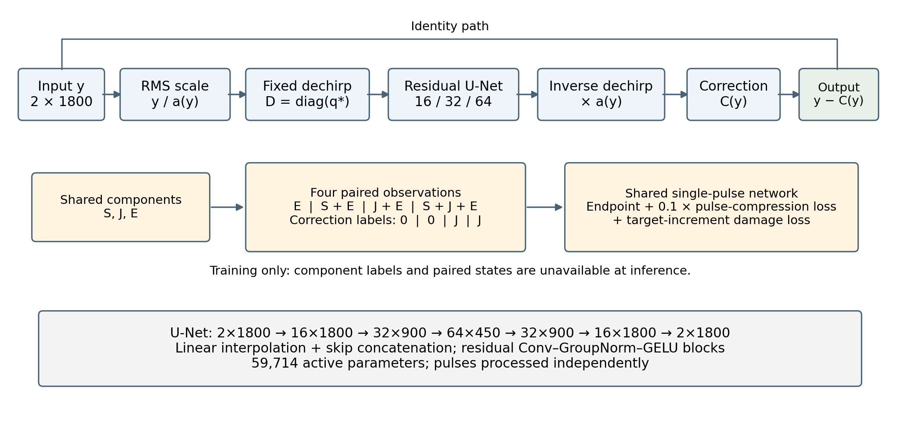
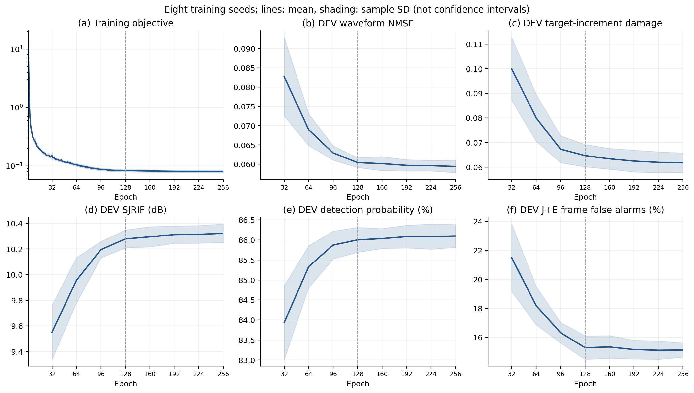
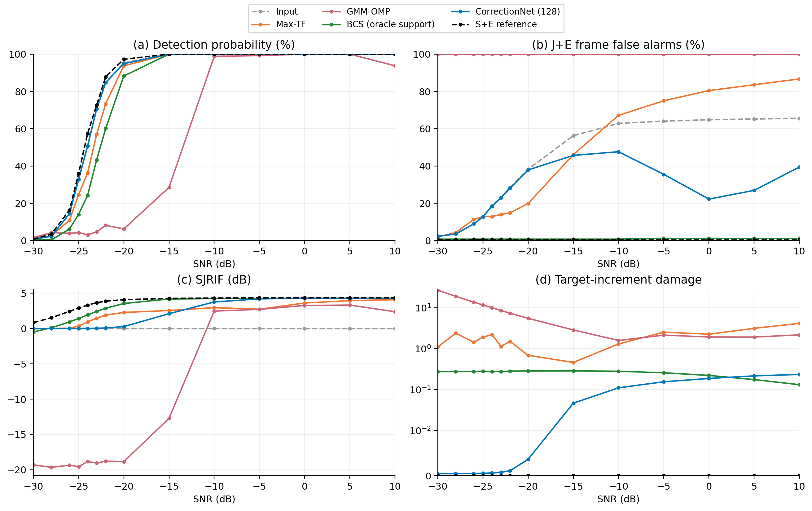
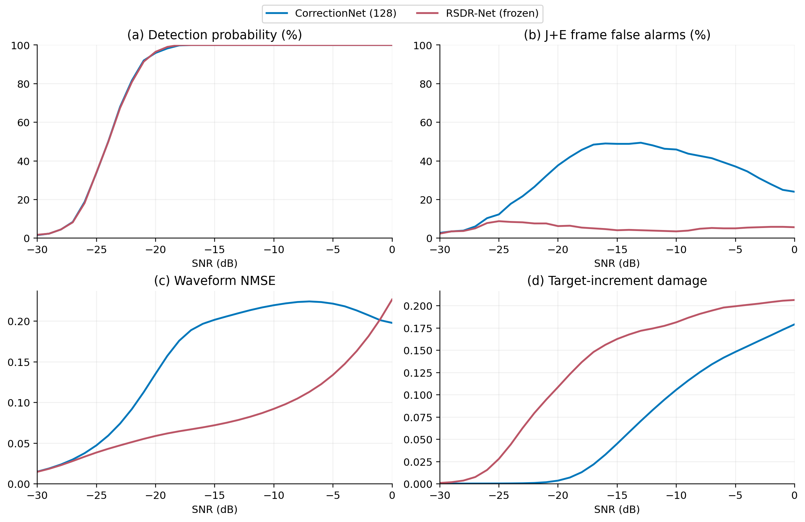
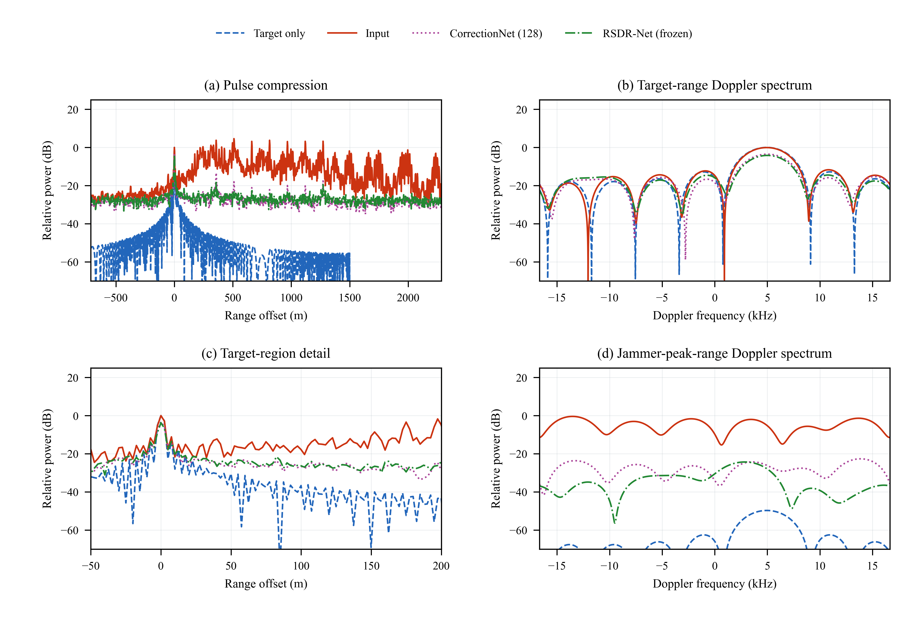
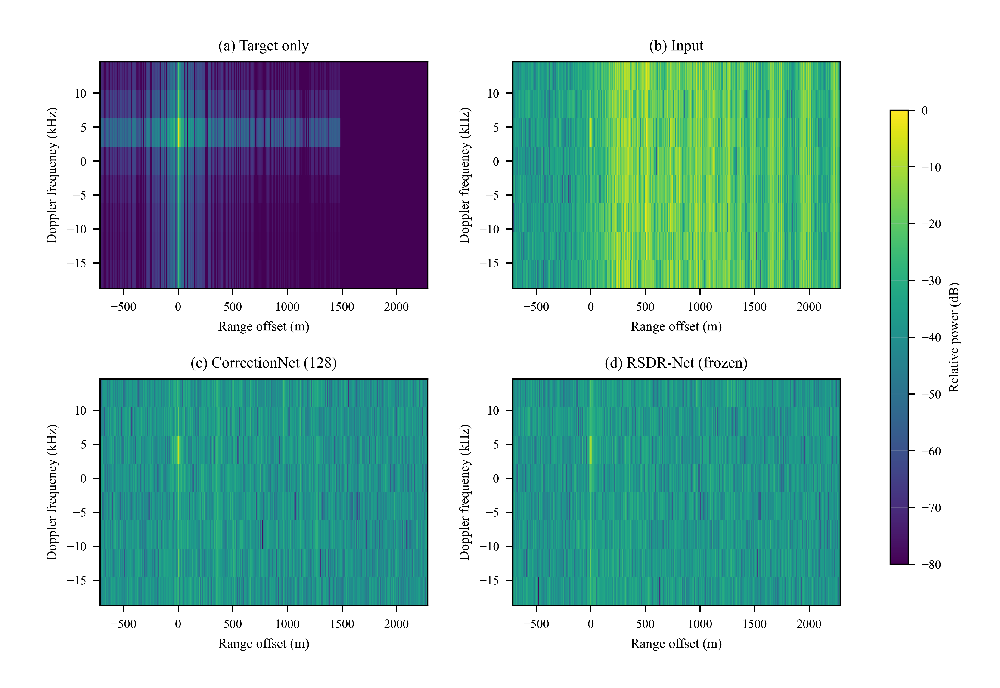
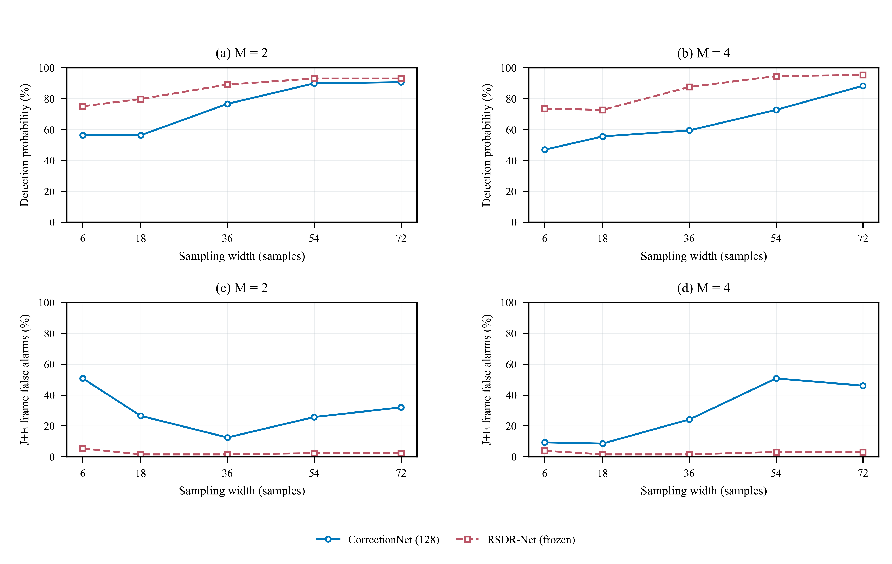

# 面向间歇采样转发干扰的紧凑波形校正网络：目标增量约束与恢复性能取舍

**A Compact Waveform Correction Network for Interrupted-Sampling Repeater Jamming: Target-Increment Constraints and Recovery Tradeoffs**

> 初稿版本：2026-11-15。正文以已完成、已冻结的实验为依据。独立测试采用 seed 29、第 128 轮模型；八个种子训练至 256 轮的结果用于收敛与开发集稳定性分析。等有效参数量 U-Net 和结构/损失消融尚未完成，相关位置明确列出待验证问题，不填入推测结果。作者、单位、基金及通讯信息由作者定稿时补充。

## 摘要

间歇采样转发干扰与目标回波具有相近的局部调频结构。恢复网络在削弱干扰时，也可能改变目标的幅相响应；增加可靠度估计、专家分支和门控虽能提供更多调节手段，却使模型结构与训练流程更加复杂。本文研究在保留同噪声波形参考和目标响应约束的条件下，单一紧凑校正网络能否完成有用的干扰抑制。网络以接收信号的 I/Q 分量为输入，通过幅度归一化、固定去斜、三尺度残差编码器—解码器及逆去斜预测校正量，再从观测中相减得到恢复波形。训练使用共享目标、干扰和噪声的四种配对状态，以波形端点误差和脉压域误差约束校正准确性，并以加入目标前后的校正差异约束目标增量失真。该约束与恢复算子的目标有限差分误差严格相等，但不构成任意输入下的无损保证。网络实际参与前向计算的参数为 59,714，登记参数为 112,756。独立仿真测试覆盖三类转发干扰、信噪比与干信比扫描、采样宽度变化以及脉压和多普勒处理。在三类干扰的 168 个主网格条件上，采用相同的名义 CA-CFAR 规则时，冻结模型相对 Max-TF 本地复现的检测概率提高 4.21 个百分点，SJRIF 提高 1.57 dB；这一检测比较未匹配处理后的经验虚警率。与第一版 RSDR-Net 的统一测试比较表明，新模型的平均波形归一化误差和目标增量失真分别由 0.10230、0.07177 降至 0.08741、0.04731，但 SJRIF 下降 1.08 dB，受扰无目标背景的帧虚警率由 7.08% 升至 20.42%。八个种子训练至 256 轮后，开发集误差在 128 轮以后改善趋缓。结果表明，单校正器能够以较小的模型规模获得较低的目标增量失真，但目前仍未达到复杂恢复器的残留干扰控制水平；模型规模、目标响应与受扰背景虚警需要联合评价。

**关键词：** 间歇采样转发干扰；波形恢复；残差学习；目标增量一致性；脉冲压缩；恒虚警检测

## Abstract

Interrupted-sampling repeater jamming (ISRJ) shares local chirp structures with the desired echo, making interference suppression and target preservation competing requirements. This paper investigates a compact, single-corrector alternative to a reliability-guided multi-expert restoration system. The network normalizes the received I/Q waveform, applies a fixed dechirp transform, predicts a correction using a three-scale residual encoder–decoder, and maps the correction back to the observation domain. Four paired states constructed from shared target, jammer, and noise components provide waveform and pulse-compression supervision. A target-increment loss penalizes changes in the predicted correction when the target is added; this loss equals the finite-difference distortion of the restored target response. The network contains 59,714 active parameters and 112,756 registered parameters. In a frozen simulation test covering 168 conditions and three jamming modes, the model improves detection probability by 4.21 percentage points and SJRIF by 1.57 dB over a local Max-TF reproduction under the same nominal CA-CFAR rule; the comparison does not match empirical false-alarm rates after processing. Under a common evaluation protocol, it reduces waveform NMSE and target-increment distortion relative to the earlier RSDR-Net, but yields lower SJRIF and more false alarms in target-absent jammed backgrounds. Eight training seeds evaluated up to 256 epochs show diminishing development-set improvements beyond 128 epochs. These results identify a practical tradeoff between model size, target-response fidelity, and residual-interference control, rather than uniform superiority of the compact architecture.

## 1 引言

间歇采样转发干扰（interrupted-sampling repeater jamming，ISRJ）通过截取和延迟重放雷达信号的短片段，在匹配滤波后形成具有处理增益的伪峰[1]。它与目标回波的区别并不表现为简单的带外频谱分离：转发片段保留了原信号的局部调频规律，也可能与真实回波在时间上重叠。因而，前端抑制器需要解决两个相互关联的问题，一是减少足以触发后级检测的干扰残留，二是避免将具有相似结构的目标回波一并削弱。仅观察恢复波形是否平滑，或只比较平均重构误差，都不足以判断这两项要求是否同时满足。

已有接收端方法通常从可观测结构中寻找区分依据。时频滤波方法利用目标与转发切片的时频分布差异构造滤波器，Max-TF 是其中具有代表性的方案[2]。另一类方法先提取可用采样点，再利用去斜后的稀疏表示重构信号。基于高斯混合模型和稀疏重构的方法以幅度分布估计可用片段[3]；基于贝叶斯压缩感知的方案则从不完整观测恢复回波[4]。这些方法将物理结构明确写入求解过程，但其性能依赖片段判定、字典表示与实际数据之间的匹配。低信噪比下的片段混淆，或参数估计误差，都可能传递到重构结果。

学习方法提供了另一种实现路径。多脉冲检测网络直接学习受扰数据到检测统计量的映射[5]，但其输出不一定能替代通用的波形前端。面向波形恢复，MREDNet 采用多残差编码器—解码器处理 LFM 受扰信号[6]，MSMD-Net 串联多阶段、多域模块[7]，扩展复值卷积自编码器将采样点判别、去噪与重构结合[8]，低信噪比端到端方法进一步引入脉压域约束[9]。这些工作说明，时域误差、结构先验和后级处理需求可以共同参与网络设计；同时，也使不同方法的监督目标和复杂度差异更加明显。

近期研究进一步将优化结构和信号先验融入网络。复值 FISTA-Net 将稀疏迭代求解展开为可学习模型[10]；基于干扰参数估计的形态分量分析方法联合调整字典和信号重构[11]；MCA-ADMM-Net 以双字典建模和 ADMM 迭代展开组织方法推导[12]。与优化展开不同，ISRJ-FNet 在 HRRP 域利用结构先验学习滤波掩模，并通过目标扰动下的掩模一致性抑制干扰估计对目标的依赖[13]。逐点时序分类与稀疏重构相结合的方法也体现了结构识别和波形恢复的分工[14]。这些方法分别约束迭代求解、滤波掩模或采样点分类，其作用需要放回各自的信号域与恢复目标中理解。

作者前期的 RSDR-Net 稿件采用同一次噪声实现下的无干扰接收波形作为恢复参考，并利用四种配对状态与目标增量监督评价目标保持性[15]。该系统由可靠度估计、多个恢复专家、固定凸组合及有界门控等部分组成，能够根据输入调整恢复行为。本文沿用其任务定义，提出一个更集中的问题：当可靠度分支、专家选择与门控均被移除，只保留一条波形校正路径时，已有监督能否支持有效恢复？这一问题关系到方法能否被简化，也关系到较低的波形误差是否足以补偿残留伪峰和受扰背景虚警的增加。

为研究这一问题，本文构造紧凑的单校正器 CorrectionNet。它通过固定去斜降低已知 LFM 调频项对局部表示的影响，再用三尺度残差网络预测需要从观测中扣除的波形成分。训练并不要求网络生成无噪目标，而是要求其在无干扰输入上接近恒等映射，在有干扰输入上撤销干扰造成的改变。目标增量约束进一步要求：当保持干扰和噪声不变、只加入目标时，预测的校正量应尽量不随之变化。本文给出该约束与恢复输出有限差分误差的等价关系，并明确其适用范围。

本文的工作集中在三个方面。

1. 给出一条实际仅使用 59,714 个前向参数的波形校正路径，将幅度归一化、固定去斜和残差编码器—解码器组合到同噪声参考的恢复任务中。模型推理只使用接收观测和已知发射波形参数，不输入真实干扰支撑、目标时延或 SNR/JSR 标签。
2. 在前期四状态监督的基础上，明确区分端点恢复、脉压误差与目标增量失真的约束对象。通过恒等式说明目标增量项约束的是完整非线性校正算子的有限差分，而不是某个内部掩模或单独分支。
3. 在冻结独立测试和八种子开发集分析中，同时报告恢复误差、SJRIF、检测概率、无干扰保持性和受扰背景虚警。与 RSDR-Net 的统一比较揭示了紧凑模型的收益与失效条件，而不将单一指标的改善解释为全面性能优势。

这里的网络骨干、残差学习、固定去斜及配对监督各有既有基础[1, 15–18]。本文贡献应理解为特定恢复任务下的紧凑实现及其可验证的性能取舍。等参数量网络与逐项消融完成之前，尚不能把观察到的全部增益归因于某一个模块。

## 2 信号模型与恢复目标

### 2.1 相参脉冲与干扰观测

设发射 LFM 基带波形为

\[
s_0(t)=\mathbf 1_{[0,T_p)}(t)\exp\!\left\{j\pi\mu(t-T_p/2)^2\right\},\qquad \mu=B/T_p,
\tag{1}
\]

其中，$T_p$ 为脉宽，$B$ 为带宽。本文采用单目标场景，目标时延为 $\tau$，第 $p$ 个脉冲的目标回波可写为

\[
S_p(t)=a\,s_0(t-\tau)\exp\!\left\{j\phi+j2\pi f_D(t+pT_r)\right\},
\tag{2}
\]

其中 $a$、$\phi$、$f_D$ 和 $T_r$ 分别为幅度、初相、多普勒频率和脉冲重复间隔。时间原点引起的常相位可并入 $\phi$。采样后，$S\in\mathbb C^{P\times N}$ 表示一个 $P$ 脉冲组。

ISRJ 可表示为若干采样片段经延迟、幅相调制和转发后叠加的结果[1]。一种统一记法为

\[
J_p(t)=\sum_{k,m}\beta_{p,k,m}\,w_{p,k}(t-d_{p,k,m})\,
S_p(t-d_{p,k,m})\exp(j2\pi\Delta f_{p,k,m}t),
\tag{3}
\]

其中 $w_{p,k}$ 表示片段选择窗，$d_{p,k,m}$ 为转发延迟，$\beta_{p,k,m}$ 包含幅相系数，$\Delta f_{p,k,m}$ 为附加频移。本文生成器以当前脉冲的目标波形作为被截获 LFM 的代理，截取片段后延迟重放，并施加独立的信道相位与频移；这是一种共享调频模板的仿真构造，并非分别建模雷达—目标与雷达—干扰机的传播链路。直接转发重放当前片段一次，重复转发重放当前片段多次，循环转发按逆序重放已存片段中的有限个。式（3）概括这一分量结构，推理时不需要其中的真实参数。

实际输入为

\[
Y=S+J+E,
\tag{4}
\]

其中 $E$ 为复高斯噪声。本文的目标参考为 $U=S+E$，即在保留同一次噪声实现的条件下移除 $J$。该定义使无干扰接收波形成为应保持的基准，避免把“抑制干扰”与“重建无噪目标”混为同一任务。它也带来一个评价边界：主动去噪的方法即使保留了目标，也可能因为改变了 $E$ 而产生较大的该参考下误差。因此，本文不会仅凭这一误差否定面向去噪目标设计的方法。

### 2.2 校正算子与四种配对状态

令网络预测的校正量为 $C_\theta(Y)$，恢复算子定义为

\[
T_\theta(Y)=Y-C_\theta(Y).
\tag{5}
\]

训练样本由共享的 $(S,J,E)$ 构造四种状态。下标的第一位表示是否有目标，第二位表示是否有干扰。

| 状态 | 输入 $Y_{ab}$ | 期望校正 $Q_{ab}$ | 期望输出 $U_{ab}$ |
|---|---|---|---|
| $00$ | $E$ | $0$ | $E$ |
| $10$ | $S+E$ | $0$ | $S+E$ |
| $01$ | $J+E$ | $J$ | $E$ |
| $11$ | $S+J+E$ | $J$ | $S+E$ |

四种状态的配对关系是监督成立的条件。若改变其中一次噪声实现，则输出差分会额外包含噪声变化；若加入目标时重新生成干扰，则差分也不再只对应目标响应。本文数据生成时先固定一个独立基础场景，随后共享其目标与噪声，并在同一干扰实现下构造四状态。全文将这一基础场景称为 parent。四状态标签和分量真值只在训练及离线评价中使用，推理时网络接收一个普通的受扰或未受扰波形。

### 2.3 非线性恢复中的目标响应

对于非线性算子，通常不能将 $T_\theta(S+J+E)$ 唯一分解为“恢复后的目标、干扰和噪声”。本文改用保持背景不变时的有限差分

\[
\Delta_S T_\theta(J+E)=T_\theta(S+J+E)-T_\theta(J+E)
\tag{6}
\]

评价加入目标后引起的输出变化。将式（5）代入，有

\[
\Delta_S T_\theta(J+E)-S
=-\left[C_\theta(S+J+E)-C_\theta(J+E)\right].
\tag{7}
\]

因此，两侧的平方范数严格相等。这一关系使目标增量误差能够直接作为校正网络的训练项。它并不意味着式（6）就是受扰输出中可物理分离的真实目标分量；它是一种控制了背景条件的响应诊断。

还需区分“不过度响应目标”与“正确去除干扰”。若网络始终输出零校正，则式（7）的误差为零，但输入中的干扰完全保留。因而，目标增量项必须与干扰校正的端点监督共同使用，不能单独作为成功抑制干扰的证据。

## 3 紧凑波形校正网络

### 3.1 总体映射与固定去斜

网络逐脉冲处理输入 $y\in\mathbb C^N$，将实部与虚部堆叠为两个实值通道。设

\[
a(y)=\max\!\left\{\sqrt{\frac{1}{N}\sum_{n=0}^{N-1}|y[n]|^2},\,10^{-8}\right\},
\quad q[n]=\exp\!\left(j\pi\mu t_n^2\right),\quad t_n=n/f_s,
\tag{8}
\]

并记 $D=\operatorname{diag}(q^*)$，则完整校正映射为

\[
C_\theta(y)=a(y)D^{\mathrm H}F_\theta\!\left(Dy/a(y)\right),
\qquad T_\theta(y)=y-C_\theta(y).
\tag{9}
\]

$F_\theta$ 为两通道实值残差网络。$D$ 是已知的单位模对角变换，满足 $D^{\mathrm H}D=I$，因而不改变输入能量，也不丢弃任何采样点。固定去斜不使用真实目标时延；它在整个接收窗中去除共同的二次相位项。以式（2）的理想单目标为例，在有效支撑内，去斜后的相位关于 $t$ 的二次项抵消，留下与时延和多普勒有关的一次相位及常相位。不同转发片段仍可形成多个局部频率和边界，去斜本身并不完成目标与干扰的分离。

RMS 归一化使网络主要处理相对幅度结构，而输出乘回 $a(y)$ 以恢复量纲。在式（8）的下限未触发时，对任意正实数 $\gamma$ 有

\[
C_\theta(\gamma y)=\gamma C_\theta(y),\qquad
T_\theta(\gamma y)=\gamma T_\theta(y).
\tag{10}
\]

这一性质来自输入归一化和输出重缩放，不需要对内层网络作线性假设。它只说明正实幅度缩放等变；普通 I/Q 实值卷积与非线性并不保证任意复相位旋转等变。另外，加入目标会改变 RMS，式（7）的训练实际约束了包括归一化在内的完整 $C_\theta$，不能简化为对 $F_\theta$ 的孤立约束。

**图 1.** 单校正器的推理路径与四状态训练关系。实线顶部为恒等旁路，最终输出等于输入减去校正。配对分量标签仅在训练时使用。图中通道和长度对应实际前向计算，不包含关闭的可靠度传播和门控参数。

### 3.2 三尺度残差编码器—解码器

骨干采用 U-Net 式的跨尺度跳接[16]和残差卷积块[17]。输入长度为 1,800，编码通道依次为 16、32 和 64，两次步长为 2 的下采样得到长度 900 和 450 的表示。解码端采用线性插值恢复分辨率，并与同尺度编码特征拼接。最后的 $1\times1$ 卷积输出两通道校正量。表 1 给出实际张量尺寸。

**表 1. 网络前向结构。尺寸按“通道数 × 快时间长度”表示。**

| 阶段 | 操作 | 输出尺寸 |
|---|---|---|
| 输入 | RMS 归一化与固定去斜 | $2\times1800$ |
| 编码 1 | 残差卷积块，步长 1 | $16\times1800$ |
| 编码 2 | 残差卷积块，首层步长 2 | $32\times900$ |
| 编码 3 | 残差卷积块，首层步长 2 | $64\times450$ |
| 解码 2 | 插值至 900；与编码 2 拼接为 96 通道；残差块 | $32\times900$ |
| 解码 1 | 插值至 1,800；与编码 1 拼接为 48 通道；残差块 | $16\times1800$ |
| 输出头 | $1\times1$ 卷积 | $2\times1800$ |
| 波形恢复 | 逆去斜、幅度重缩放、从输入相减 | $2\times1800$ |

每个残差块的主分支为核长 5 的一维卷积、组归一化（Group Normalization）[19]、GELU[20]、核长 3 的一维卷积及第二次组归一化。主分支与恒等或 $1\times1$ 投影分支相加后，再施加 GELU。卷积的填充分别为 2 和 1；发生下采样时，步长 2 用于主分支首层和投影分支。本文通道数对应的组归一化组数均为 8。采用残差校正还与残差去噪网络的基本思想有关[18]，但这里的标签是干扰校正量，恢复参考中保留了噪声。

该模型没有实际参与推理的可靠度估计器、动态专家路由、有界门控或慢时间网络。实现复用了前期骨干类，因而仍登记了 53,042 个不参与当前前向的参数；有效参数为 59,714，登记参数总量为 112,756。第一版冻结 RSDR-Net 的登记参数为 3,017,877。按登记总量计算，新模型减少 96.26%。为避免把闲置参数算成实际能力，本文同时报告两种计数。参数量并不等于运行时延，当前还没有统一硬件上的 MACs、延迟和吞吐率测量，故不据此声称实时性或确定的加速倍数。

逐脉冲推理意味着网络并未直接利用慢时间相参结构。后文的多普勒实验检验这一前端处理是否保留了可供既有慢时间处理使用的信息，而不是验证一个学习式多普勒估计器。

### 3.3 端点、脉压与目标增量损失

对一个脉冲的四状态，令 $c_{ab}=C_\theta(y_{ab})$，$q_{ab}$ 和 $u_{ab}$ 分别为表中校正标签与输出参考。定义端点损失

\[
\mathcal L_{\mathrm{end}}=
\frac14\sum_{a,b\in\{0,1\}}
\frac{\|c_{ab}-q_{ab}\|_2^2}{\max(\|u_{ab}\|_2^2,\epsilon)},\qquad \epsilon=10^{-12}.
\tag{11}
\]

由于 $T_\theta(y_{ab})-u_{ab}=-(c_{ab}-q_{ab})$，式（11）同时也是恢复输出相对于同噪声参考的误差。无干扰两状态促使校正接近零，有干扰两状态则促使校正接近 $J$。

设 $\mathcal H$ 为发射模板的线性匹配滤波算子，脉压域损失为

\[
\mathcal L_{\mathrm{PC}}=
\frac14\sum_{a,b\in\{0,1\}}
\frac{\|\mathcal H(c_{ab}-q_{ab})\|_2^2}
{\max(\|\mathcal H u_{ab}\|_2^2,\epsilon)}.
\tag{12}
\]

训练实现使用 600 点 LFM 模板与 4,096 点零填充 FFT，保留全部线性相关滞后，其存储采用循环索引排列。该排列不改变全滞后能量。匹配滤波是线性的，故式（12）把恢复误差传递到后级相关域；根据 Parseval 关系，其分子等价于频域误差能量按模板功率谱加权的和。它强调与模板相关的误差，却不直接最小化最强伪峰，也不保证某一 CFAR 门限下的最优检测率。

目标增量损失定义为

\[
\mathcal L_{\mathrm{damage}}=
\frac{\|c_{11}-c_{01}\|_2^2}{\max(\|s\|_2^2,\epsilon)}
=\frac{\|T_\theta(y_{11})-T_\theta(y_{01})-s\|_2^2}
{\max(\|s\|_2^2,\epsilon)}.
\tag{13}
\]

三项合并为

\[
\mathcal L=\mathcal L_{\mathrm{end}}+0.1\mathcal L_{\mathrm{PC}}+
\mathcal L_{\mathrm{damage}}.
\tag{14}
\]

训练时先将每条记录的八个脉冲展开，逐脉冲、逐状态计算相应能量比，再平均得到批损失。后文测试指标则在一个完整脉冲组上先求能量再作比值。两者的归一化权重不同，不能将训练损失的数值直接等同于测试 NMSE。

式（13）与 ISRJ-FNet 的扰动一致性思路存在关联[13]，但约束对象不同。后者在 HRRP 域通过目标扰动约束滤波掩模的一致性；本文在原始波形校正任务中，固定 $J$ 和 $E$、显式加入 $S$，约束完整校正量不随目标出现而改变。与此同时，四状态和目标增量监督已存在于作者前期稿件[15]，本文不将其重新表述为首次提出的独立方法。

### 3.4 约束的解释与边界

将复信号表示为实部和虚部构成的实向量。在可微路径上，校正差分可写为

\[
C_\theta(v+s)-C_\theta(v)
=\int_0^1 J_{C_\theta}(v+\xi s)\,s\,\mathrm d\xi,
\qquad v=j+e,
\tag{15}
\]

其中 $J_{C_\theta}$ 是校正映射的实 Jacobian。式（15）解释了目标增量项为何会限制沿训练目标方向的平均响应，但它不是本文新提出的数学定理。积分中不同位置的响应可以抵消，有限训练样本也没有覆盖任意方向。因此，低增量误差不能推出 Jacobian 处处接近零，更不能推出任意目标幅度、多目标组合或分布外输入下的无损恢复。

类似地，恒等旁路允许网络选择“不改写”，无干扰时是否接近恒等映射仍由监督和数据决定。本文通过无干扰保持误差与经验虚警率检验这种行为。

## 4 实验设计与评价方法

### 4.1 数据生成与数据角色

实验沿用前期稿件的主要雷达参数和测试扫描路径[15]，但数据划分以本次实际生成记录为准。采样率为 60 MHz，带宽为 30 MHz，脉宽为 10 μs，脉冲重复间隔为 30 μs；每脉冲 1,800 点，每组 8 个相参脉冲。训练只含一个真实目标，其幅度在 $[0.15,2]$ 中抽取，初相在 $[0,2\pi)$ 中抽取，多普勒在 $[-200,200]$ kHz 中抽取。快时间与慢时间均保留相应相位变化。慢时间采样存在 PRF 周期混叠，后续检测按折叠后的多普勒位置评分，不把宽频率抽样误称为无模糊测速范围。

训练集由 512 个独立 parent 构成，其中 256 个来自常规层，SNR 为 $[-20,15]$ dB、JSR 为 $[-12,35]$ dB；另 256 个来自低 SNR 层，SNR 为 $[-30,-20)$ dB、JSR 为 $[-12,45]$ dB。每个 parent 生成直接、重复和循环三类转发变体，共 1,536 条脉冲组记录。每组有 1、2、4、6 或 8 个受扰脉冲，目标和噪声在三种变体间共享。SNR 逐脉冲抽取，JSR 与干扰结构参数在各受扰脉冲上抽取，四状态共享相应实现。

开发集 DEV 使用另外 256 个 parent，统一从 SNR $[-30,15]$ dB、JSR $[-12,45]$ dB 范围抽样。它并非将训练集的两个分层配额机械复制到开发集。独立测试 TEST 使用不同的基础场景，按表 3 中预定的条件扫描。DEV 用于模型选择和后续收敛分析，TEST 用于冻结模型的性能评价；二者不合并统计。

**表 2. 训练数据与优化参数。**

| 项目 | 设置 |
|---|---|
| 雷达参数 | $f_s=60$ MHz，$B=30$ MHz，$T_p=10$ μs，$T_r=30$ μs |
| 数据尺寸 | $P=8$，$N=1800$；四状态配对 |
| 干扰采样宽度 | 6–72 点 |
| 干扰采样周期 | 下界为 $\max(36,w+1)$，上界 260 点 |
| 转发延迟、重复次数、附加间隔 | 1–96 点；1–10 次；0–64 点 |
| 附加干扰频移 | $[-200,200]$ kHz，另有逐脉冲相位变化 |
| 训练数据 | 512 parent × 3 干扰类型；8 脉冲/记录 |
| 批量与每轮更新 | 32 条记录；48 次参数更新/轮 |
| 优化器 | Adam[21]；$\beta_1=0.9$，$\beta_2=0.999$，$\epsilon=10^{-8}$ |
| 学习率 | 首轮线性预热至 $10^{-3}$；至第 128 轮余弦衰减到 $2\times10^{-5}$；续训至第 256 轮衰减到 $2\times10^{-6}$ |
| 正则与梯度 | 权重衰减 0；梯度范数裁剪上限 5 |
| 随机种子 | 17、29、41、53、67、79、97、109 |
| 保存点 | 每轮恢复点；每 32 轮独立里程碑，共 64 个里程碑 |

### 4.2 模型冻结与对照方法

第一阶段对种子 17、29、41 进行同一日程的 128 轮训练，保留第 32、64、96、128 轮检查点。它们是训练轨迹的中间点，不是四组各自重新设计学习率终点的训练。依据三个种子的 DEV 平均波形 NMSE 选择第 128 轮，再按事先固定的中间种子规则选取 seed 29 进行独立测试。该选择发生在查看 DEV 之后、运行 TEST 之前，本文不将其称为查看 DEV 前已经完成的预注册。

随后，前三个种子续训至 256 轮，并新增五个种子完成同样的两段学习率日程。八个种子均在同一 DEV 上评价每 32 轮检查点，用于检查训练稳定性和边际收益。第 256 轮结果没有替换已冻结的第 128 轮独立测试身份。若以后依据这些结果选择新模型，应使用另外的确认集，不能在已经分析过的 TEST 上重新选择后仍称其为独立确认。

对照包括原始输入恒等输出（KEEP）、同噪声无干扰参考 $S+E$、Max-TF[2]、GMM-OMP[3]、带真实支撑的 BCS 参考[4]以及冻结的第一版 RSDR-Net[15]。$S+E$ 需要不可观测的真实分量，只提供任务参考，不是可部署算法。三种经典方法均为本地公式复现，参数按已冻结的实验实现使用，不在 TEST 上寻优。Max-TF 的离散平滑与并列值处理是本地复现选择；GMM-OMP 使用两分量幅度 EM、最多 100 次 EM 迭代和 8 次 OMP 迭代，其方差更新采用标准责任度加权形式，修正了原文印刷公式中疑似遗漏的因子。这些细节可能影响结果，本文不把本地数值等同于原作者实现的最优性能。

BCS 采用平滑 $L_1$ MAP 目标、外层重加权和内层复共轭梯度求解，并获得真实的未受扰支撑，故始终标为 **BCS（oracle 支撑）**。它是带额外信息的参考方法，不能与仅使用观测的模型视为同等信息竞争者。现有经典基线还缺少系统的 DEV 参数校准，这一点限制了对其性能上限的判断。

RSDR-Net 使用完整冻结模型 F-R7，训练种子为 40312102、最终阶段检查点为第 32 轮。旧系统包含多个训练阶段，其相关组件按每阶段 32 轮、每轮 512 次更新训练；新模型的第 128 轮则对应每轮 48 次更新。因此，新旧比较统一了测试数据、推理处理和统计口径，但没有统一训练预算，不能被解释为严格控制训练算力后的结构消融。RSDR-Net 对照是在已有 TEST 结果后追加的冻结推理，属于追加比较；没有据此重训或选择新权重。

### 4.3 测试网格与独立统计单位

**表 3. 已完成的测试系列。条件数不等于独立样本数；同一系列中多个条件共享 parent。**

| 系列 | 条件设置 | 条件数 | 独立 parent 数 |
|---|---|---:|---:|
| 三类干扰主网格 | SNR：−30、−28、−26、−25、−24、−23、−22、−20、−15、−10、−5、0、5、10 dB；JSR：0、10、20、35 dB；直接/重复/循环 | 168 | 256 |
| 稠密检测网格 | SNR：−30 至 0 dB，步长 1 dB；JSR：−10 至 35 dB，步长 5 dB | 310 | 512 |
| 无干扰保持 | SNR：−30 至 −20 dB，步长 1 dB，另加 −15、−10、0 dB；三组独立场景 | 42 | 1,536（每组 512） |
| 固定周期宽度扫描 A | 周期 260 点、重复数 $M=2$；宽度 3、6、18、36、54、72、84 点；强度组合见正文 | 21 | 256 |
| 固定重复数宽度扫描 B | $M=2,4$；宽度 6、18、36、54、72 点；周期 $(M+1)w+1$ | 20 | 128 |
| 相参性检查 | (SNR, JSR)：(−20,20)、(0,20)、(0,35) dB；目标多普勒限制为 ±14 kHz | 3 | 16 |

宽度扫描 A 的三组强度为 $(\mathrm{SNR},\mathrm{JSR}_E)=(-10,20),(-20,35),(0,10)$ dB；扫描 B 使用前两组。这里 $\mathrm{JSR}_E$ 按整个脉冲组的目标与干扰能量比定义。主网格的 JSR 则由生成器按有效支撑上的平均功率定义。由于支撑占比随宽度变化，两种口径不能直接互换，宽度扫描与主网格的数值不合并计算总均值。宽度 3 和 84 点超出训练宽度范围，属于有限的边界外检查；它们不能代表对任意未知干扰的泛化。

统计首先在每个 parent 内对指定条件等权平均，再在 parent 间汇总。方法差异使用同一 parent 的配对差值，以 4,000 次 parent bootstrap 给出点态 95% 置信区间[22]；无干扰三组采用分层重采样。脉冲、四状态、干扰变体和重复条件均不被当作额外独立样本。这些区间未进行多重比较校正，也不包含模型训练种子的不确定性。八种子 DEV 图中的阴影为跨种子样本标准差，与 parent bootstrap 区间属于不同层次。

### 4.4 波形与目标增量指标

令 $\widehat U_{ab}=T_\theta(Y_{ab})$，在完整八脉冲组上定义

\[
\mathrm{NMSE}_U=\frac{\|\widehat U_{11}-(S+E)\|_F^2}{\|S+E\|_F^2},\qquad
D_S=\frac{\|\widehat U_{11}-\widehat U_{01}-S\|_F^2}{\|S\|_F^2}.
\tag{16}
\]

实现对极小分母使用 $10^{-24}$ 下限。$\mathrm{NMSE}_U$ 衡量输出偏离目标参考的总误差；$D_S$ 衡量相同背景下的目标增量失真。对 $V=\widehat U_{11}-\widehat U_{01}$，令

\[
g=\frac{\langle S,V\rangle}{\|S\|_F^2},\qquad V=gS+V_\perp,
\quad \langle S,V_\perp\rangle=0,
\tag{17}
\]

则

\[
D_S=|g-1|^2+\frac{\|V_\perp\|_F^2}{\|S\|_F^2}.
\tag{18}
\]

这给出指标的直接解释：目标增量误差同时包含整体复增益偏差和不能由整体增益解释的形变。即便 $D_S$ 较小，仍需单独检查 $\widehat U_{01}$ 中的干扰残留。KEEP 的 $D_S=0$ 正是一个反例：它完全保留目标增量，却没有抑制干扰。

无干扰保持采用

\[
\mathrm{NMSE}_{0}=\frac{\|\widehat U_{00}-E\|_F^2+
\|\widehat U_{10}-(S+E)\|_F^2}{\|E\|_F^2+\|S+E\|_F^2}.
\tag{19}
\]

该指标同时覆盖纯噪声和含目标无干扰状态，避免只展示容易保持的某一类输入。

### 4.5 脉压、SJRIF 与检测概率

评价使用与发射波形匹配的 600 点模板，完成线性相关后保留有效滞后 0–1,200，共 1,201 个距离单元。记输出的脉压结果为 $Z_p(r)$，并对八脉冲功率求平均：

\[
P_Z(r)=\frac1P\sum_{p=0}^{P-1}|Z_p(r)|^2.
\tag{20}
\]

真实目标距离单元 $r_t$ 由目标单分量的脉压定位。本文遵循既有实验的 SJRIF 实现，定义

\[
R(Z)=10\log_{10}\frac{P_Z(r_t)}{\max_{r\ne r_t}P_Z(r)},\qquad
\mathrm{SJRIF}=R(Z_{\mathrm{out}})-R(Z_{\mathrm{in}}).
\tag{21}
\]

式（21）的分母包含目标邻近主瓣、旁瓣、噪声和残留干扰，所以这里的 SJRIF 是“目标峰对最强非目标距离单元峰值比”的改善代理，不是由真值分离得到的物理信干比改善量。在采样率为带宽两倍的配置下，理想主瓣相邻采样点仅比峰值低约 3.92 dB；当干扰被充分抑制后，邻点可能主导分母。因此还保留了主瓣外最大伪峰抑制度这一辅助输出，但不将式（21）单独视为残留干扰能量的测量。

脉压后进行八点慢时间 FFT，得到距离–多普勒功率图。采用二维 CA-CFAR，距离维保护/参考半宽为 12/24，多普勒维为 1/2，多普勒边界周期延拓。参考单元数为

\[
N_r=[2(12+24)+1][2(1+2)+1]-(2\times12+1)(2\times1+1)=436.
\tag{22}
\]

每帧有 9,032 个有效待检单元。名义单元虚警率设为 $P_{\mathrm{FA}}^{\mathrm{nom}}=10^{-6}$，门限为参考单元平均功率乘

\[
\alpha=N_r\left[(P_{\mathrm{FA}}^{\mathrm{nom}})^{-1/N_r}-1\right].
\tag{23}
\]

该系数来自独立同分布指数背景下的 CA-CFAR 标定。经脉压及非线性恢复后，相关性和分布可能变化，故名义设定并不替代经验虚警测量。检测成功定义为真实多普勒的最近周期频率单元上，目标距离 $r_t\pm1$ 内至少一处超过门限。$P_D$ 是这一事件在 parent 上的频率。

本文分别在纯噪声 $E$ 和无目标受扰背景 $J+E$ 上统计单元虚警率及帧虚警率。后者是每帧至少一个有效单元误检的概率，不能与单元虚警率混用。所有方法使用同一名义 CFAR 设置，但处理后实际虚警不同，因此本文报告的是“同一名义门限规则下的检测表现”，不是经验虚警严格相等时的 ROC 优势。

### 4.6 相参性指标

在真实距离单元上，令目标单分量与处理输出的慢时间序列分别为 $z_p^S$ 和 $z_p$。定义 $\chi_p=z_p(z_p^S)^*/|z_p^S|^2$，并去除公共相位 $\phi_0=\arg\sum_p\chi_p$，得到

\[
\sigma_\phi=\sqrt{\frac1P\sum_p
\operatorname{wrap}(\arg\chi_p-\phi_0)^2},
\quad
G_{\mathrm{coh}}=10\log_{10}
\frac{\left|\sum_p z_p(z_p^S)^*/|z_p^S|\right|^2}
{\left(\sum_p|z_p^S|\right)^2}.
\tag{24}
\]

相位均方根以度报告，$G_{\mathrm{coh}}$ 表示相对于目标单分量的相参功率比。含噪输出可能出现正值，不能将其直接解释为目标真实能量增益。峰值频差使用目标与输出各自的 4,096 点零填充慢时间频谱峰位置，按 PRF 周期计算距离。零填充仅插值八脉冲的频谱，不增加物理多普勒分辨率。

## 5 实验结果

### 5.1 八种子训练与收敛

八个种子均已完成 256 轮训练，形成 2,048 条逐轮训练记录和 64 组 DEV 检查点结果。图 2 显示训练目标早期快速下降，随后进入缓慢改善阶段；表 4 列出各里程碑的跨种子均值。第 32 至 128 轮，DEV 波形 NMSE 从 0.08268 降至 0.06044，目标增量失真从 0.09991 降至 0.06465。第 128 至 256 轮，NMSE 进一步降至 0.05944，检测概率仅由 86.003% 增至 86.100%。这些数值支持“128 轮之后边际收益减小”，不支持“128 轮以后完全不再学习”或“所有指标严格单调收敛”。

**图 2.** 八个训练种子的训练目标和 DEV 指标。实线为均值，阴影为跨种子样本标准差；训练目标使用对数纵轴，开发集每 32 轮评价一次。竖虚线表示第 128 轮学习率日程分界。所有种子使用同一 DEV，因此阴影不是对新场景总体性能的置信区间。

**表 4. 八种子 DEV 指标均值。$P_D$ 和 $J+E$ 帧虚警率以百分数表示。**

| 轮数 | $\mathrm{NMSE}_U$ ↓ | $D_S$ ↓ | SJRIF/dB ↑ | $P_D$/% ↑ | $J+E$ 帧虚警率/% ↓ |
|---:|---:|---:|---:|---:|---:|
| 32 | 0.082677 | 0.099914 | 9.5507 | 83.936 | 21.484 |
| 64 | 0.068933 | 0.079981 | 9.9558 | 85.335 | 18.180 |
| 96 | 0.062933 | 0.067263 | 10.1948 | 85.872 | 16.309 |
| 128 | 0.060439 | 0.064651 | 10.2786 | 86.003 | 15.283 |
| 160 | 0.060170 | 0.063376 | 10.2951 | 86.035 | 15.332 |
| 192 | 0.059729 | 0.062455 | 10.3120 | 86.084 | 15.153 |
| 224 | 0.059637 | 0.061939 | 10.3140 | 86.084 | 15.104 |
| 256 | 0.059441 | 0.061786 | 10.3221 | 86.100 | 15.120 |

第 256 轮的跨种子样本标准差分别为 NMSE 0.00165、$D_S$ 0.00395、SJRIF 0.0726 dB 和检测概率 0.285 个百分点。训练初始化带来的波动在这一固定 DEV 上较小，但八个种子共享数据生成器和同一开发样本，不能由此宣称已经完成八份独立数据集上的泛化验证。DEV 与主网格的条件分布不同，其平均 SJRIF 和 $P_D$ 也不应直接横向比较。

### 5.2 与经典方法的冻结主网格比较

表 5 汇总三类干扰、168 个条件上的等权均值。CorrectionNet 相对原始输入大幅降低了含噪参考下的波形误差，SJRIF 提高 3.65 dB，检测概率由 59.20% 提高到 67.07%。相对 Max-TF 本地复现，SJRIF 的配对差值为 1.572 dB，95% 区间为 [1.496, 1.651] dB；检测概率提高 4.211 个百分点，95% 区间为 [3.764, 4.653] 个百分点。在该固定配置下，新模型同时改善了检测和受扰背景帧虚警，但后者仍达到 20.42%，尚不能认为受扰背景已经恢复到纯噪声水平。

**表 5. 三类干扰主网格结果。箭头表示期望方向；参考行不参与算法排名。**

| 方法 | $\mathrm{NMSE}_U$ ↓ | $D_S$ ↓ | SJRIF/dB ↑ | $P_D$/% ↑ | $J+E$ 帧虚警率/% ↓ |
|---|---:|---:|---:|---:|---:|
| KEEP | 30.32106 | 0 | 0 | 59.203 | 34.924 |
| Max-TF，本地复现 | 1.12729 | 4.56331 | 2.0819 | 62.858 | 33.963 |
| GMM-OMP，本地复现 | 1.42492 | 8.99357 | −9.1752 | 39.651 | 99.923 |
| BCS（oracle 支撑） | 0.10696 | 0.18506 | 4.6260 | 62.714 | 0.911 |
| CorrectionNet，128 轮 | 0.08741 | 0.04731 | 3.6540 | 67.069 | 20.424 |
| $S+E$，不可观测参考 | 0 | 0 | 5.1026 | 69.420 | 0.391 |

GMM-OMP 在当前配置下产生很高的受扰背景帧虚警。该结果应被理解为本地实现、固定超参数和本文宽条件扫描组合下的表现，而不是该类稀疏重构方法必然失效。训练参考与去噪目标不同，也会影响其 NMSE；但接近 100% 的背景帧虚警说明，仅用参考差异仍不足以解释全部不足。正式投稿前需要对经典法实施独立 DEV 校准及失败案例复核，确认性能差异不是可避免的实现或参数偏差造成。

BCS 获得额外支撑信息，其 SJRIF 和背景帧虚警优于新模型，但检测概率低于新模型。这一现象再次说明，低背景报警率和高目标检出率并非同一个目标。它不证明新模型超越了 oracle 重构的理论上限，也不意味着 BCS 的全部性能都受单一因素决定。

**图 3.** 重复转发、JSR = 20 dB 时，随 SNR 变化的检测、受扰背景帧虚警、SJRIF 和目标增量失真。每个条件使用 256 个配对 parent；线段连接的是已测试点。$D_S$ 采用带线性近零区域的对称对数纵轴，以同时显示恒等参考的零值和较大失真。图中 oracle 和不可观测参考不构成同等信息的部署基线。

### 5.3 与第一版 RSDR-Net 的统一比较

表 6 使用相同 parent、相同处理链和相同指标比较新旧冻结模型。在主网格上，CorrectionNet 的 NMSE 与目标增量失真较低，平均差值的区间均不含零。然而，SJRIF 低 1.082 dB，检测概率低 0.900 个百分点，$J+E$ 帧虚警率高 13.349 个百分点。由此可见，模型简化保留了部分波形恢复能力，却没有保留旧系统对残留干扰和无目标受扰背景的全部控制能力。

**表 6. 主网格统一比较，256 个独立 parent。差值为 CorrectionNet − RSDR-Net；括号内为配对 95% bootstrap 区间。**

| 指标 | CorrectionNet | RSDR-Net | 差值及区间 |
|---|---:|---:|---|
| $\mathrm{NMSE}_U$ ↓ | 0.087409 | 0.102302 | −0.014892 [−0.021168, −0.008966] |
| $D_S$ ↓ | 0.047309 | 0.071769 | −0.024459 [−0.026527, −0.022480] |
| SJRIF/dB ↑ | 3.654024 | 4.736024 | −1.082001 [−1.150363, −1.011990] |
| $P_D$/% ↑ | 67.0689 | 67.9688 | −0.8998 [−1.0579, −0.7510] 个百分点 |
| $J+E$ 帧虚警率/% ↓ | 20.4241 | 7.0754 | +13.3487 [12.0443, 14.6508] 个百分点 |

主网格平均 NMSE 的排序并非在所有条件分布下都保持。在 310 个稠密检测条件中，新模型 NMSE 为 0.10515，旧模型为 0.07551，排序反转；目标增量失真仍分别为 0.05294 和 0.08844。两者检测概率为 78.729% 和 79.170%，$J+E$ 帧虚警率为 21.326% 和 4.817%。因此，较低目标增量失真是一项在两个网格上均出现的特征，而整体波形误差的优势依赖测试条件分布。

**图 4.** 稠密检测网格中 JSR = 20 dB 的切片，SNR 步长为 1 dB，每个条件使用 512 个配对 parent。四个面板采用同一测试身份，展示较低目标增量失真与较高受扰背景虚警可以同时出现。完整网格均值见正文，不能用这一单切片替代全体条件。

新旧训练流程、容量与结构同时不同，当前比较反映完整系统的取舍，尚不能确定可靠度估计、多专家或门控中哪一部分负责旧模型的优势。为进一步区分这些因素，本文在第 6.3 节列出等参数网络和逐项消融的后续验证方案。

### 5.4 脉压形态与相参处理

图 5 和图 6 使用预先固定的 parent 0，在 SNR = 0 dB、JSR = 20 dB 下展示脉压、多普勒和距离–多普勒形态。示例用于解释数值指标，不依据结果挑选最优场景。两种网络均保留了目标附近的主要响应，但输出幅度与目标单分量参考之间仍有差异，CorrectionNet 的部分残余伪峰更高。图中的“target-only”是 $S$，不是损失使用的 $S+E$ 参考，不能把与其所有差异都归为网络错误，也不能把保留峰位等同于无损恢复。

**图 5.** 固定 parent 0、SNR = 0 dB、JSR = 20 dB 的脉压与相参处理示例。图中 Paper2 对应冻结的 CorrectionNet 第 128 轮模型，RSDR 对应第一版完整冻结模型。参考为目标单分量；图中可见的幅度下降应与表 7 的跨场景量化结果结合解释。

**图 6.** 与图 5 相同场景的距离–多普勒结果。该图仅展示一个场景的空间分布，检测概率和虚警结论以配对统计为准。

表 7 给出 16 个 parent 的相参性检查。在 SNR = 0 dB、JSR = 35 dB 时，CorrectionNet 将输入的脉间相位均方根从 23.26° 降至 6.40°，多普勒峰值频差从 317.38 Hz 降至 69.68 Hz，检测概率从 37.5% 提高到 100%。但相参功率比为 −3.79 dB，说明恢复伴随明显能量损失。低 SNR 的 (−20,20) dB 条件下，输入与输出的相位误差和频差没有明显改善，不能宣称相参性提升覆盖所有测试条件。

**表 7. 三组相参性条件的均值，16 个独立 parent。功率以目标单分量为参照；检测概率的样本规模有限。**

| SNR/JSR，dB | 处理 | 相位 RMSE/° ↓ | 相参功率比/dB | 峰值频差/Hz ↓ | $P_D$/% |
|---|---|---:|---:|---:|---:|
| −20/20 | 输入 | 16.429 | +0.488 | 116.984 | 93.75 |
| −20/20 | CorrectionNet | 16.460 | +0.322 | 120.036 | 93.75 |
| 0/20 | 输入 | 5.075 | +0.098 | 65.104 | 100 |
| 0/20 | CorrectionNet | 4.362 | −2.896 | 44.759 | 100 |
| 0/35 | 输入 | 23.260 | +0.496 | 317.383 | 37.5 |
| 0/35 | CorrectionNet | 6.402 | −3.795 | 69.682 | 100 |

在三组条件等权合并后，新旧模型的相位 RMSE 为 9.075° 和 8.955°，配对差值区间跨零；平均峰值频差为 78.159 Hz 和 101.217 Hz，新模型低 23.058 Hz，95% 区间为 [−38.825, −8.647] Hz。由于仅有 16 个独立 parent，这一结果应限定在所测场景，不能据此推断复杂实测环境下的稳定测速优势。

### 5.5 无干扰保持与宽度敏感性

无干扰实验中，CorrectionNet 的合并保持误差 $\mathrm{NMSE}_0$ 为 $1.6800\times10^{-4}$，RSDR-Net 为 $1.9396\times10^{-5}$。两者均较小，但新模型的改写量更大。无干扰检测概率分别为 55.6641% 和 55.6687%，差值区间跨零；纯噪声单元虚警率均约为 $1.442\times10^{-6}$，帧虚警率均为 1.302%。这里的检测率是跨低 SNR 条件的均值，不表示高 SNR 下只有约一半目标能被检出。实验未事先规定等效界，因此“未发现检测概率的明确差异”不能改写为“已证明两者完全等效”。

宽度扫描进一步暴露了模型简化的边界。固定周期扫描 A 中，新旧模型的 NMSE 为 0.06744 和 0.11627，检测概率几乎相同，分别为 98.419% 和 98.400%；但受扰背景帧虚警率仍为 16.592% 和 2.958%。在周期随宽度变化的扫描 B 中，新模型 NMSE 升至 0.30403，旧模型为 0.10241；检测概率分别为 84.102% 和 92.344%，新模型低 8.242 个百分点，95% 区间为 [−9.883, −6.563] 个百分点。此时新模型的目标增量失真依然较低，分别为 0.16088 和 0.25874，却没有转化为更好的整体检测。

**图 7.** 宽度扫描 B 中 SNR = −20 dB、$\mathrm{JSR}_E=35$ dB 的结果，$M=2$ 和 $M=4$ 分列展示。每个条件使用 128 个配对 parent。周期为 $(M+1)w+1$，所以横轴变化同时改变采样宽度和周期，不能解释为只改变宽度的单因素效应。

这些结果说明，当前模型较低的目标增量失真未能抵消干扰结构变化后的残留问题。扫描 B 中较低的 $D_S$ 与较差的检测表现并存，进一步表明目标响应、背景残留和检测行为需要联合评价。

### 5.6 为什么目标增量误差更小，虚警仍可能更高

由式（7）可知，$D_S$ 只比较加入目标前后校正量的变化。如果某个残留干扰在两种状态下都被相似地保留，它可以在目标有限差分中抵消，从而不显著增加 $D_S$，但仍会在 $J+E$ 输出中形成伪峰。另一方面，NMSE 将误差分散到整个脉冲组，少数高幅值局部残留和较均匀的背景误差可能具有相近的总能量，却对 CFAR 产生不同影响。SJRIF 又受到最强非目标单元和主瓣邻点的共同限制。这些指标回答的是不同问题，排序不一致并非逻辑矛盾。

当前数据支持的结论是：CorrectionNet 在主网格和多个扫描中降低了目标增量失真，但残留干扰控制弱于完整 RSDR-Net。至于该取舍是否主要由损失权重、单分支容量或缺少可靠度门控造成，现有比较尚不能区分。对这些机制的说明应作为待验证假设，而不作为已经得到实验证明的原因。

## 6 讨论

### 6.1 本文贡献与已有方法的边界

与以优化展开为核心的方法[10–12]相比，CorrectionNet 没有可学习的逐步迭代求解器；其可解释部分来自明确的校正任务、可逆去斜和配对有限差分，而不是每层对应一个优化步骤。与 HRRP 域的结构滤波[13]相比，本文处理原始 I/Q 波形，允许结果进入既有脉压与多普勒链，并直接约束完整校正量的目标响应。与第一版 RSDR-Net 相比，任务定义和部分训练思想被保留，主要变化是移除了输入自适应的复杂分工，只用一个紧凑网络完成校正。

本文由此检验了目标保持任务中结构简化的可行性与代价。配对有限差分使完整校正器的目标响应可被直接度量；统一测试则表明，较低的响应失真可以与较高的背景报警率共存。四状态监督沿用前期方法，当前工作的独立性主要在于紧凑实现及其系统评价。各结构和损失项的具体收益仍需等参数对照与逐项消融检验。

### 6.2 当前证据能够回答的问题

单校正器在没有真实干扰支撑输入的情况下，能够相对原始输入和所用 Max-TF 实现提升主网格的 SJRIF 与检测概率。但与完整 RSDR-Net 相比，其背景抑制不足在不同扫描中反复出现。八种子 DEV 记录显示，当前日程在 128 轮以后只有小幅改善；这一收敛现象尚不能回答第 256 轮模型在独立数据上能否缩小与旧系统的差距。

这些结论受具体生成分布、检查点和处理链限定。512 个训练 parent 形成的三种干扰变体及四状态并不等价于大量独立场景；重复使用固定 DEV 也可能使开发选择逐渐依赖该数据。后续新确认集的作用是检验最终选择，而不是在已有测试上反复寻找有利条件。

### 6.3 适用范围与后续验证

目前完整模型的八种子分析反映初始化稳定性，尚不能回答某个模块是否有效。等参数 U-Net 与逐项消融将检验结构和损失的作用，需要同时考虑跨种子波动及同一场景上的配对差异。相关实验应在服务器上完成，并在所有检查点写入可恢复的训练归档后再进行统一重评。

**表 8. 待完成的受控实验与其检验问题。此表是实验设计，不包含本文已完成的结果。**

| 对照 | 控制方式 | 需要回答的问题 |
|---|---|---|
| 等有效参数 U-Net | 59,714 有效参数；3 种子 × 256 轮 | 当前结构收益是否超过同容量常规恢复骨干 |
| 无固定去斜 | 保留其余结构、数据与损失 | 固定物理变换是否改善学习及跨参数恢复 |
| 无 RMS | 保留其余结构与损失 | 正实幅度缩放处理对幅度变化和训练稳定性有何作用 |
| 无脉压损失 | 移除式（12），保留端点与增量项 | 脉压域误差是否带来可重复的检测或伪峰收益 |
| 无目标增量损失 | 移除式（13），保留其余项 | 较低目标增量失真是否确由该项促进，代价是什么 |

这些对照改变的因素并不完全相同，结果只能按实际实现和控制条件解释，不能把整体差异直接归因于单一组件。完成训练后，还需要在未参与训练、DEV 选择和当前 TEST 解释的新 parent 集上一次性冻结比较；若在已有 TEST 上继续选择检查点，所得结果不能再称为独立确认。

第二个缺口是检测公平性。本文已经报告经验虚警，但尚未提供在独立校准数据上匹配实际虚警水平后的检测比较。若要声称检测优势，应补充固定校准方案下的 ROC 或等经验虚警比较，避免将较宽松的输出背景误认为检测能力更强。

外部有效性也受数据来源限制。本文全部结果来自单目标仿真，没有提供实测雷达回波、硬件转发干扰或真实杂波验证。已有工作使用了实测数据[10, 11, 13]，但具体采集与干扰叠加方式需与真实硬件转发区分。对本文而言，多目标、目标近邻、波形失配、非高斯杂波和未知干扰组合仍是未验证条件；当前结论限于所用生成分布。

此外，经典基线的 DEV 校准、统一硬件效率测量和更大样本的相参性检查将分别检验方法排序对超参数的敏感性、参数减少能否转化为实际效率收益，以及多普勒结果的稳定性。

## 7 结论

本文研究了一个面向 ISRJ 波形恢复的紧凑单校正网络。模型在同噪声参考的任务定义下，将幅度归一化、固定去斜、三尺度残差网络和输入相减结合，通过端点、脉压及目标增量损失共同训练。目标增量项与恢复算子的有限差分失真具有严格的代数对应关系，为解释目标响应提供了明确依据，但并不保证任意输入下的无损恢复。

冻结测试表明，该模型能够改善原始受扰输入的脉压和检测表现，并在主网格上以较低的模型参数量获得比前期 RSDR-Net 更低的波形误差和目标增量失真。然而，旧系统仍具有更高的 SJRIF 和更低的受扰背景虚警，部分宽度扫描中也有明显的检测优势。八种子训练显示，256 轮相对 128 轮的开发集改善已较有限。本文由此给出的结论是，结构简化具有可行性，但目标响应保持与残留干扰控制之间仍存在需要解决的取舍；等参数对照、受控消融和新的独立确认将决定这一紧凑方案能否形成更充分的独立方法贡献。

## 数据、代码与可重复性说明

本文代码与轻量证据存放于作者专用仓库 `Hxin0203/ISRJ_2`。训练数据、模型权重和原始数组不随该仓库上传；当前仓库访问权限不等于公开发布承诺。训练与测试数据身份、检查点 SHA、逐条件汇总和图表来源在随稿证据说明中记录。最终投稿时应按期刊政策明确数据与代码的可获得方式。本文没有声称取得实测数据许可或完成硬件验证。

## 参考文献

[1] Wang X, Liu J, Zhang W, Fu Q, Liu Z, Xie X. Mathematic principles of interrupted-sampling repeater jamming (ISRJ). *Science in China Series F: Information Sciences*, 2007, 50(1): 113–123. DOI: [10.1007/s11432-007-2017-y](https://doi.org/10.1007/s11432-007-2017-y).

[2] Chen J, Wu W, Xu S, Chen Z, Zou J. Band pass filter design against interrupted-sampling repeater jamming based on time-frequency analysis. *IET Radar, Sonar & Navigation*, 2019, 13(10): 1646–1654. DOI: [10.1049/iet-rsn.2018.5658](https://doi.org/10.1049/iet-rsn.2018.5658).

[3] Liu Z, Liang W, Fu N, Qiao L, Zhang J. Interrupted sampling repeater jamming suppression based on Gaussian mixture model and sparse reconstruction. *Digital Signal Processing*, 2025, 161: 105132. DOI: [10.1016/j.dsp.2025.105132](https://doi.org/10.1016/j.dsp.2025.105132).

[4] Huan S, Dai G, Luo G, Ai S. Bayesian Compress Sensing Based Countermeasure Scheme Against the Interrupted Sampling Repeater Jamming. *Sensors*, 2019, 19(15): 3279. DOI: [10.3390/s19153279](https://doi.org/10.3390/s19153279).

[5] Zhang Y, Jiu B, Peng X, Liu H, Jiang W. A new scheme of target detection for pulse Doppler radar in interrupted sampling repeater jamming environment. *IET Radar, Sonar & Navigation*, 2022, 16(11): 1836–1850. DOI: [10.1049/rsn2.12300](https://doi.org/10.1049/rsn2.12300).

[6] Wang H, Chen B, Ye Q, Huang F. MREDNet: A Multi-Residual Encoder-Decoder Network for recovering LFM interfered by intra-pulse retransmission interferences. *Signal Processing*, 2024, 217: 109329. DOI: [10.1016/j.sigpro.2023.109329](https://doi.org/10.1016/j.sigpro.2023.109329).

[7] He X, Liao K, Peng S, Tian Z, Huang J. Interrupted-Sampling Repeater Jamming-Suppression Method Based on a Multi-Stages Multi-Domains Joint Anti-Jamming Depth Network. *Remote Sensing*, 2022, 14(14): 3445. DOI: [10.3390/rs14143445](https://doi.org/10.3390/rs14143445).

[8] Meng Y, Yu L, Wei Y. Interrupted sampling repeater jamming suppression based on multiple extended complex-valued convolutional auto-encoders. *IET Radar, Sonar & Navigation*, 2024, 18(8): 1274–1290. DOI: [10.1049/rsn2.12568](https://doi.org/10.1049/rsn2.12568).

[9] Dai G, Yang X, Huan S, Chen Z, Peng C, Xu Y. End-to-End Interrupted Sampling Repeater Jamming Countermeasure Network Under Low Signal-to-Noise Ratio. *Sensors*, 2025, 25(13): 3925. DOI: [10.3390/s25133925](https://doi.org/10.3390/s25133925).

[10] Huang Q, Zhang L. Interrupted Sampling Repeater Jamming Suppression Using Complex-Valued FISTA-Net. *IEEE Transactions on Aerospace and Electronic Systems*, 2026, 62: 3270–3286. DOI: [10.1109/TAES.2025.3646182](https://doi.org/10.1109/TAES.2025.3646182).

[11] Wei S, Han H, Wei S, Zhang L, Zhou Y. ISRJ Suppression Using Joint Morphological Component Analysis and Signal Reconstruction Based on Jamming Parameters Estimation. *IEEE Transactions on Aerospace and Electronic Systems*, 2026, 62: 3773–3797. DOI: [10.1109/TAES.2025.3648973](https://doi.org/10.1109/TAES.2025.3648973).

[12] Wei S, Han H, Zhang H, Wei S, Zhou Y, Zhang L. Interrupted Sampling Repeater Jamming Suppression for Wideband Radar With MCA-ADMM-Net. *IEEE Transactions on Neural Networks and Learning Systems*, 2026, early access. DOI: [10.1109/TNNLS.2026.3736439](https://doi.org/10.1109/TNNLS.2026.3736439).

[13] Liu M, Gao X, Qiu X, Zhao Y. Structure-Informed Deep Filtering for Radar HRRP ISRJ Mitigation. *IEEE Signal Processing Letters*, 2026, 33: 3601–3605. DOI: [10.1109/LSP.2026.3726844](https://doi.org/10.1109/LSP.2026.3726844).

[14] Chen L, Wang K, Pan X, Gu Z, Xiao S. Interrupted Sampling Repeater Jamming Suppression-Based on Point-Wise Temporal Classification and Sparse Signal Reconstruction. *IET Radar, Sonar & Navigation*, 2026. DOI: [10.1049/rsn2.70251](https://doi.org/10.1049/rsn2.70251). 在线发表条目，未补入尚未确认的卷页。

[15] 作者前期稿件. 可靠度引导的间歇采样转发干扰选择性波形恢复. 未发表研究稿，2026，11 月 3 日及 11 月 13 日版本。本文将其作为方法承袭与冻结系统比较的来源，不视为已发表同行评议文献；作者信息和后续发表状态应在投稿时更新。

[16] Ronneberger O, Fischer P, Brox T. U-Net: Convolutional Networks for Biomedical Image Segmentation. In: *Medical Image Computing and Computer-Assisted Intervention—MICCAI 2015*. 2015: 234–241. DOI: [10.1007/978-3-319-24574-4_28](https://doi.org/10.1007/978-3-319-24574-4_28).

[17] He K, Zhang X, Ren S, Sun J. Deep Residual Learning for Image Recognition. In: *Proceedings of the IEEE Conference on Computer Vision and Pattern Recognition*. 2016: 770–778. DOI: [10.1109/CVPR.2016.90](https://doi.org/10.1109/CVPR.2016.90).

[18] Zhang K, Zuo W, Chen Y, Meng D, Zhang L. Beyond a Gaussian Denoiser: Residual Learning of Deep CNN for Image Denoising. *IEEE Transactions on Image Processing*, 2017, 26(7): 3142–3155. DOI: [10.1109/TIP.2017.2662206](https://doi.org/10.1109/TIP.2017.2662206).

[19] Wu Y, He K. Group Normalization. In: *Computer Vision—ECCV 2018*. 2018: 3–19. DOI: [10.1007/978-3-030-01261-8_1](https://doi.org/10.1007/978-3-030-01261-8_1).

[20] Hendrycks D, Gimpel K. Gaussian Error Linear Units (GELUs). arXiv preprint, 2016. [arXiv:1606.08415](https://arxiv.org/abs/1606.08415).

[21] Kingma D P, Ba J. Adam: A Method for Stochastic Optimization. *International Conference on Learning Representations*, 2015. [arXiv:1412.6980](https://arxiv.org/abs/1412.6980).

[22] Efron B. Bootstrap Methods: Another Look at the Jackknife. *The Annals of Statistics*, 1979, 7(1): 1–26. DOI: [10.1214/aos/1176344552](https://doi.org/10.1214/aos/1176344552).

## 附录 A：配对损失与评价口径的补充推导

### A.1 训练平均与脉冲组指标并不等同

设第 $p$ 脉冲的误差能量为 $e_p$，参考能量为 $u_p$。训练中的对应平均为 $P^{-1}\sum_p e_p/u_p$；脉冲组指标为 $(\sum_p e_p)/(\sum_p u_p)=\sum_p\omega_p(e_p/u_p)$，其中 $\omega_p=u_p/\sum_q u_q$。前者对脉冲等权，后者按参考能量加权。由于生成器可逐脉冲改变噪声和干扰强度，二者一般不相等。不同归一方式下的误差变化不应被直接解释为训练日志与测试结果矛盾。

### A.2 增量损失不替代端点恢复

记校正误差 $r_{11}=C(Y_{11})-J$、$r_{01}=C(Y_{01})-J$，则 $D_S=\|r_{11}-r_{01}\|_F^2/\|S\|_F^2$。若 $r_{11}=r_{01}\ne0$，目标增量失真仍为零，但两状态均含校正误差。反过来，即使两状态各自误差不大，当目标能量很小时，其差值相对于 $\|S\|_F^2$ 仍可能较大。因此，端点与增量项互补，而不是两个可互相替代的“准确率”。

### A.3 CA-CFAR 名义系数的适用条件

在待检功率 $X$ 和 $N_r$ 个参考功率独立同分布、均为均值 $\sigma^2$ 的指数变量时，参考功率和服从 Gamma 分布。若门限为 $\alpha\bar X_r$，则 $\Pr(X>\alpha\bar X_r)=(1+\alpha/N_r)^{-N_r}$，求解即得式（23）。本文的恢复输出与脉压距离单元不必满足这些独立性条件，故仍使用实测于仿真样本的经验虚警率检查标定偏差。该推导解释的是门限公式，不是恢复网络保持 CFAR 性质的证明。
