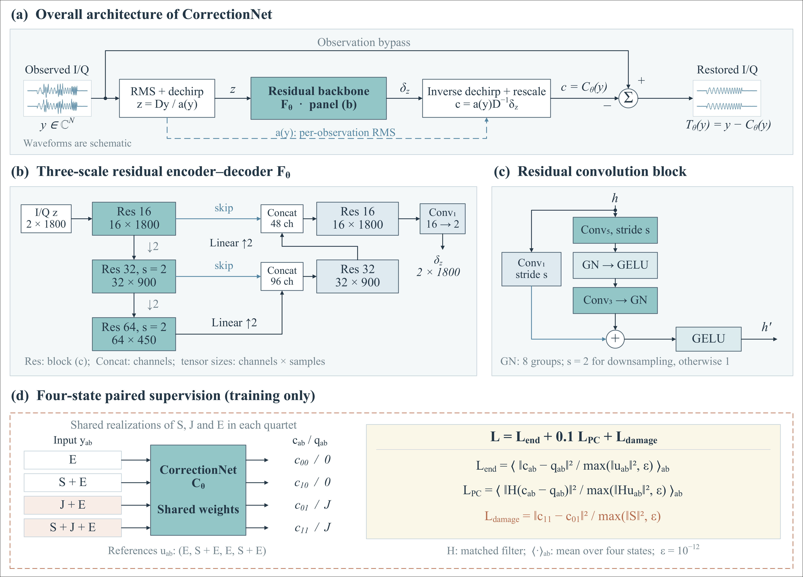
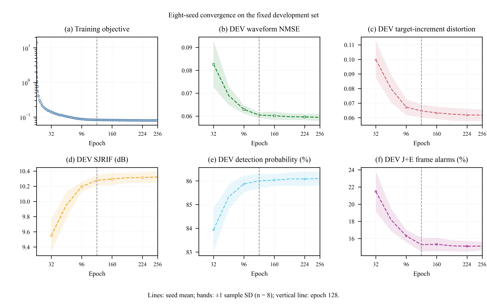
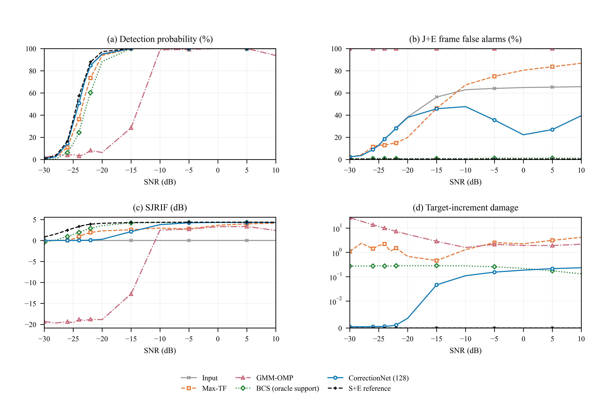
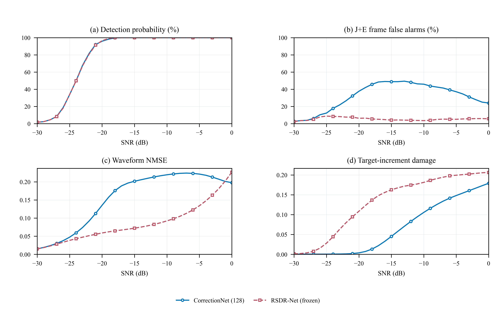
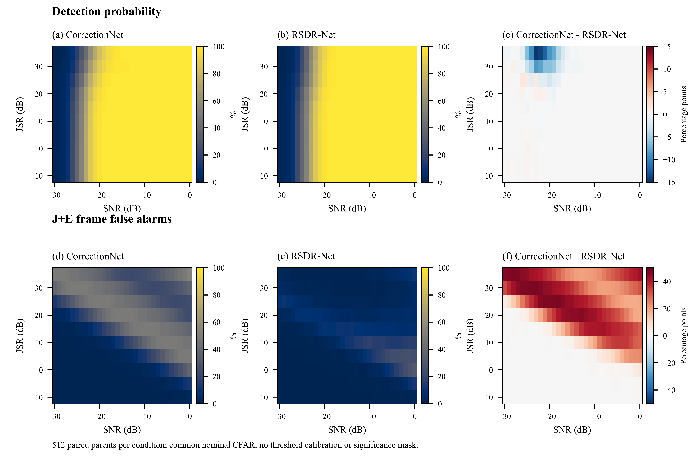
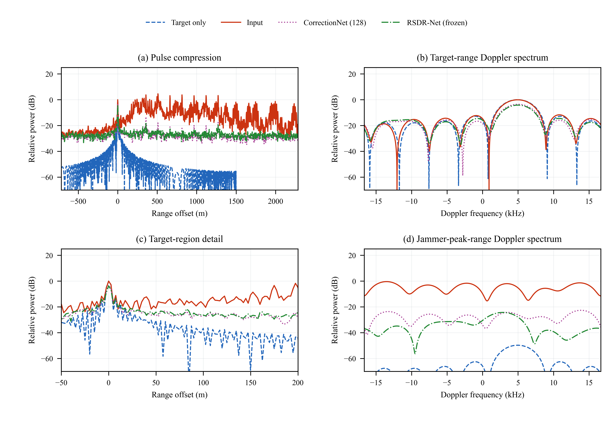
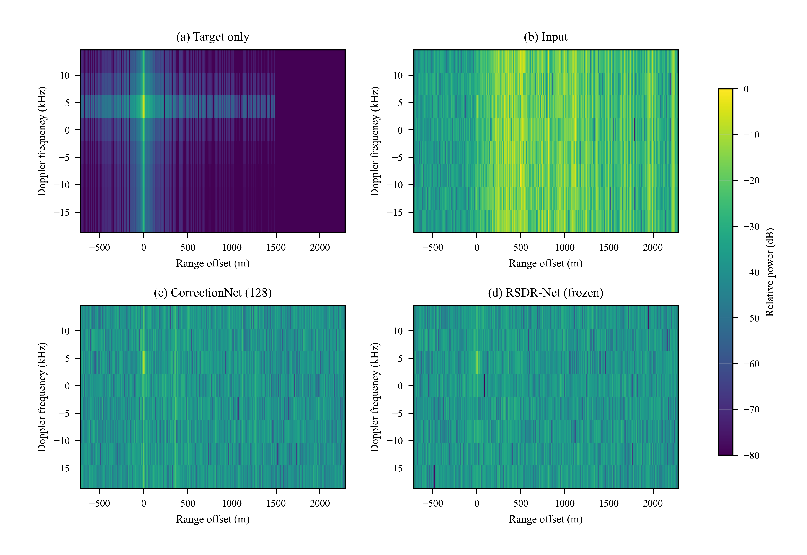
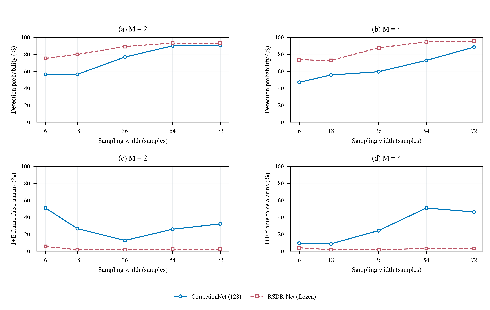

# 面向间歇采样转发干扰的紧凑波形校正网络：目标增量约束与恢复性能取舍

**A Compact Waveform Correction Network for Interrupted-Sampling Repeater Jamming: Target-Increment Constraints and Recovery Tradeoffs**

> 完整修订稿：2026-11-16（UTC）。独立测试采用 seed 29、第 128 轮冻结模型；八种子 256 轮结果用于开发集收敛分析。等有效参数量 U-Net 与四项结构/损失消融均已完成三个种子的 256 轮训练；此外，六种模型均完成了独立校准与确认集评价。相关结论仅适用于其各自冻结的数据角色和检测口径，不与主测试集名义 CA-CFAR 结果混用。作者、单位、基金及通讯信息由作者定稿时补充。

## 摘要

间歇采样转发干扰保留了发射信号的局部调频结构，干扰抑制与目标回波保持因而需要在同一接收波形上协调。本文研究一种单校正器波形恢复方法：先对 I/Q 观测作幅度归一化和固定去斜，再由三尺度残差编码器—解码器估计待扣除的校正量，并通过输入旁路形成恢复波形。训练使用共享目标、干扰和噪声实现构成的四种配对状态，分别施加波形端点、脉冲压缩和目标增量约束。目标增量项可严格改写为恢复算子在加入目标前后的有限差分误差，因此它约束的是完整非线性恢复映射的目标响应变化；该恒等关系本身不保证无损恢复或恒虚警性质。本文说明模型的信号处理过程、参数化结构与损失函数，并在冻结仿真协议下考察多种 ISRJ 模式、信噪比与干信比变化、采样宽度变化以及脉冲压缩、多普勒和检测行为。评价同时区分波形误差、目标增量失真、脉压干扰指标与受扰背景虚警，以呈现单校正器方案的适用范围和局限。

**关键词：** 间歇采样转发干扰；波形恢复；残差学习；目标增量一致性；脉冲压缩；恒虚警检测

## Abstract

Interrupted-sampling repeater jamming retains local chirp structure from the transmitted waveform, so interference suppression and target preservation must be handled together. This paper studies a single-corrector waveform-restoration method. It normalizes the received I/Q signal, applies a fixed dechirp transform, estimates a correction with a three-scale residual encoder–decoder, and subtracts that correction through an identity path. Training uses four paired states formed from shared target, jammer, and noise realizations, with endpoint, pulse-compression, and target-increment constraints. The target-increment term is exactly the finite-difference error of the complete nonlinear restoration map when the target is added; this identity alone guarantees neither lossless recovery nor constant-false-alarm behaviour. We describe the signal-processing operations, network parameterization, and objective, and evaluate the method under a frozen simulation protocol spanning several ISRJ modes, signal-to-noise and jammer-to-signal variations, sampling-width changes, pulse compression, Doppler processing, and detection. The evaluation distinguishes waveform error, target-increment distortion, pulse-compression interference measures, and alarms in jammed target-absent backgrounds to characterize the scope and limitations of a single-corrector design.

## 1 引言

间歇采样转发干扰（interrupted-sampling repeater jamming，ISRJ）通过截取和延迟重放雷达信号的短片段，在匹配滤波后形成具有处理增益的伪峰[1]。它与目标回波的区别并不表现为简单的带外频谱分离：转发片段保留了原信号的局部调频规律，也可能与真实回波在时间上重叠。因而，前端抑制器需要解决两个相互关联的问题，一是减少足以触发后级检测的干扰残留，二是避免将具有相似结构的目标回波一并削弱。仅观察恢复波形是否平滑，或只比较平均重构误差，都不足以判断这两项要求是否同时满足。

已有接收端方法通常从可观测结构中寻找区分依据。时频滤波方法利用目标与转发切片的时频分布差异构造滤波器，Max-TF 是其中具有代表性的方案[2]。另一类方法先提取可用采样点，再利用去斜后的稀疏表示重构信号。基于高斯混合模型和稀疏重构的方法以幅度分布估计可用片段[3]；基于贝叶斯压缩感知的方案则从不完整观测恢复回波[4]。这些方法将物理结构明确写入求解过程，但其性能依赖片段判定、字典表示与实际数据之间的匹配。低信噪比下的片段混淆，或参数估计误差，都可能传递到重构结果。

学习方法提供了另一种实现路径。多脉冲检测方法在模型驱动的多普勒通道积累和预处理后，利用卷积网络完成目标检测[5]，但其输出不一定能替代通用的波形前端。面向波形恢复，MREDNet 采用多残差编码器—解码器处理 LFM 受扰信号[6]，MSMD-Net 串联多阶段、多域模块[7]，扩展复值卷积自编码器将采样点判别、去噪与重构结合[8]，低信噪比端到端方法进一步引入脉压域约束[9]。这些工作说明，时域误差、结构先验和后级处理需求可以共同参与网络设计；同时，也使不同方法的监督目标和复杂度差异更加明显。

近期研究进一步将优化结构和信号先验融入网络。复值 FISTA-Net 将稀疏迭代求解展开为可学习模型[10]；基于干扰参数估计的形态分量分析方法联合调整字典和信号重构[11]；MCA-ADMM-Net 以双字典建模和 ADMM 迭代展开组织方法推导[12]。与优化展开不同，ISRJ-FNet 在 HRRP 域利用结构先验学习滤波掩模，并通过目标扰动下的掩模一致性抑制干扰估计对目标的依赖[13]。逐点时序分类与稀疏重构相结合的方法也体现了结构识别和波形恢复的分工[14]。这些方法分别约束迭代求解、滤波掩模或采样点分类，其作用需要放回各自的信号域与恢复目标中理解。

作者前期的 RSDR-Net 稿件采用同一次噪声实现下的无干扰接收波形作为恢复参考，并利用四种配对状态与目标增量监督评价目标保持性[15]。该系统由可靠度估计、多个恢复专家、固定凸组合及有界门控等部分组成，能够根据输入调整恢复行为。本文沿用其任务定义，提出一个更集中的问题：当可靠度分支、专家选择与门控均被移除，只保留一条波形校正路径时，已有监督能否支持有效恢复？这一问题关系到方法能否被简化，也关系到较低的波形误差是否足以补偿残留伪峰和受扰背景虚警的增加。

为研究这一问题，本文构造紧凑的单校正器 CorrectionNet。它通过固定去斜降低已知 LFM 调频项对局部表示的影响，再用三尺度残差网络预测需要从观测中扣除的波形成分。训练并不要求网络生成无噪目标，而是要求其在无干扰输入上接近恒等映射，在有干扰输入上撤销干扰造成的改变。目标增量约束进一步要求：当保持干扰和噪声不变、只加入目标时，预测的校正量应尽量不随之变化。本文给出该约束与恢复输出有限差分误差的等价关系，并明确其适用范围。

本文的工作集中在三个方面。

1. 给出一条实际仅使用 59,714 个前向参数的波形校正路径，将幅度归一化、固定去斜和残差编码器—解码器组合到同噪声参考的恢复任务中。模型推理只使用接收观测和已知发射波形参数，不输入真实干扰支撑、目标时延或 SNR/JSR 标签。
2. 在前期四状态监督的基础上，明确区分端点恢复、脉压误差与目标增量失真的约束对象。通过恒等式说明目标增量项约束的是完整非线性校正算子的有限差分，而不是某个内部掩模或单独分支。
3. 在冻结独立测试和八种子开发集分析中，同时报告恢复误差、SJRIF、检测概率、无干扰保持性和受扰背景虚警。与 RSDR-Net 的统一比较揭示了紧凑模型的收益与失效条件，而不将单一指标的改善解释为全面性能优势。

这里的网络骨干、残差学习、固定去斜及配对监督各有既有基础[1, 15–18]。本文贡献应理解为特定恢复任务下的紧凑实现及其经实验检验的性能取舍。等参数量 U-Net 的开发集与独立校准确认结果均未显示当前骨干的优势。四项预设消融已完成，但每项仅含三个训练种子，且其独立确认仍来自同一仿真分布；因此它们提供的是受限条件下的组件证据，不足以建立跨场景的普遍因果结论。

## 2 信号模型与恢复目标

ISRJ 抑制的恢复对象不是一个抽象的“干净信号”，而是经过接收噪声、转发片段和脉冲间相参关系共同决定的观测序列。本章先给出连续时间信号的离散化形式，再把转发器写成选择、延迟、调制算子的叠加，最后说明四状态配对监督如何把“去除干扰”和“保持目标”放在同一可计算框架中。所有后续损失和指标都建立在这一分量定义上。

### 2.1 相参脉冲与离散观测

设快时间采样率为 \(f_s\)，采样间隔为 \(T_s=1/f_s\)，每个接收窗包含 \(N\) 个采样点，慢时间上共有 \(P\) 个脉冲，脉冲重复间隔为 \(T_r\)。发射基带 LFM 脉冲写为

\[
s_0(t)=\mathbf 1_{[0,T_p)}(t)\exp\!\left\{j\pi\mu(t-T_p/2)^2\right\},
\qquad \mu=\frac{B}{T_p},
\tag{1}
\]

其中 \(T_p\) 是脉宽，\(B\) 是调频带宽，\(\mu\) 是调频率。以 \(t_n=nT_s\) 采样，记 \(s_0[n]=s_0(t_n)\)。对于时延为 \(\tau\)、多普勒频率为 \(f_D\) 的单目标，第 \(p\) 个脉冲的复包络为

\[
S_p(t)=a\,s_0(t-\tau)\exp\!\left\{j\phi+j2\pi f_D(t+pT_r)\right\},
\tag{2}
\]

其中 \(a\) 为目标幅度，\(\phi\) 为参考相位。由于 \(pT_r\) 只出现在慢时间相位项中，目标在相邻脉冲间满足

\[
S_{p+1}(t)=S_p(t)\exp(j2\pi f_D T_r),
\tag{3}
\]

这一定义使后文的多普勒处理能够在恢复后的脉冲组上直接进行。将 \(S_p(t_n)\) 按脉冲堆叠得到 \(S\in\mathbb C^{P\times N}\)；单脉冲推理时只取其中一行。为明确采样坐标，令 \(n_\tau=\tau/T_s\)（实际生成器允许非整数时延时由离散波形采样隐式表示），并定义目标有效支撑

\[
\iota_\tau[n]=\mathbf 1_{\{0\le nT_s-\tau<T_p\}},\qquad
s_p[n]=a\,\iota_\tau[n]
\exp\!\left\{j\left[\phi+\pi\mu(nT_s-\tau-T_p/2)^2
+2\pi f_D(nT_s+pT_r)\right]\right\}.
\]

因此 \(S\) 的每一行具有相同的快时间包络，慢时间只引入相位因子。由于慢时间采样率为 \(1/T_r\)，频率 \(f_D\) 与 \(f_D+k/T_r\) 产生相同的脉冲间相位序列：

\[
\exp\!\left(j2\pi(f_D+k/T_r)pT_r\right)
=\exp\!\left(j2\pi f_DpT_r\right),\qquad k\in\mathbb Z.
\]

后文把多普勒检测位置解释为 PRF 周期折叠后的频率单元；这一区分避免把仿真中较宽的 \(f_D\) 抽样范围误解为无混叠测速范围。

噪声记为 \(E_p(t_n)\)，在仿真中采用零均值复高斯噪声，记 \(E\in\mathbb C^{P\times N}\)。在给定场景中，噪声实现先生成，再在不同干扰类型之间共享。若 \(E_p[n]=E_{p,R}[n]+jE_{p,I}[n]\)，则其 I/Q 表示为

\[
\mathcal R(E_p)=
\begin{bmatrix}
\operatorname{Re}E_p[0]&\cdots&\operatorname{Re}E_p[N-1]\\
\operatorname{Im}E_p[0]&\cdots&\operatorname{Im}E_p[N-1]
\end{bmatrix}.
\tag{4}
\]

主网格的强度参数按生成器的功率口径定义。设目标有效支撑为 \(\Omega_S\)，干扰非零支撑为 \(\Omega_J\)，目标有效功率为 \(P_S=|\Omega_S|^{-1}\sum_{n\in\Omega_S}|S_p[n]|^2\)，复噪声的期望功率为 \(P_E=\mathbb E|E_p[n]|^2\)，干扰有效功率为 \(P_J=|\Omega_J|^{-1}\sum_{n\in\Omega_J}|J_p[n]|^2\)。则

\[
\operatorname{SNR}=10\log_{10}\frac{P_S}{P_E},\qquad
\operatorname{JSR}=10\log_{10}\frac{P_J}{P_S}.
\tag{5}
\]

生成器用抽取的名义 SNR 设置噪声方差，有限长度噪声实现的样本功率会围绕该期望波动；对已合成的干扰，生成器按其有效支撑平均功率缩放至指定 JSR。上述口径与按整个脉冲组能量定义的宽度扫描 \(\mathrm{JSR}_E\) 不同，见第 4.3 节。

### 2.2 ISRJ 的片段转发模型

间歇采样转发器不直接产生与发射信号无关的窄带噪声，而是截取发射脉冲的有限片段，再经过延迟和幅相调制后重放。用 \(w_{p,k}(t)\in\{0,1\}\) 表示第 \(p\) 个脉冲的第 \(k\) 个采样窗，用 \(d_{p,k,m}\) 表示第 \(m\) 次重放的延迟，用 \(\beta_{p,k,m}\) 表示复幅度系数，用 \(\Delta f_{p,k,m}\) 表示附加频移，则可写成

\[
J_p(t)=
\sum_{k}\sum_m
\beta_{p,k,m}\,w_{p,k}(t-d_{p,k,m})
S_p(t-d_{p,k,m})
\exp(j2\pi\Delta f_{p,k,m}t).
\tag{6}
\]

该表达式把四种实际因素分开：\(w\) 决定哪些采样点被保留，\(d\) 决定伪峰在距离向的位置，\(\beta\) 决定幅度与相位，\(\Delta f\) 改变局部瞬时频率。本文生成器以当前脉冲的目标波形作为被截获 LFM 的代理，在同一基础场景内先产生目标和噪声，再生成干扰。直接转发只重放一个截取片段；重复转发在多个延迟位置重放同一片段；循环转发按逆序重放已缓存片段中的有限个。三者共享目标和噪声，但片段支撑、延迟和频移由各自的随机过程产生。

在离散域中，令 \(W_{p,k}\) 为由 \(w_{p,k}\) 形成的对角选择矩阵，\(P_d\) 为带零填充的整数延迟矩阵，\(M(\nu)\) 为逐点复指数调制矩阵。式（7）的延迟下标以采样点为单位，即连续时间延迟除以 \(T_s\) 后采用生成器中的整数延迟；为简化记号仍写作 \(d_{p,k,m}\)。于是式（6）在该离散延迟模型下写为

\[
\mathbf j_p=
\sum_{k,m}\beta_{p,k,m}
M(\Delta f_{p,k,m})P_{d_{p,k,m}}W_{p,k}\mathbf s_p,
\qquad
\mathbf s_p,\mathbf j_p\in\mathbb C^N.
\tag{7}
\]

这一形式说明 ISRJ 是若干个“局部选择—延迟—调制”算子的叠加，而不是一个固定的卷积核。由于不同片段在快时间上可以重叠，\(\mathbf j_p\) 的支撑通常不能从幅度阈值唯一确定；当目标与片段重叠时，单个采样点同时包含目标和干扰成分。接收观测为

\[
\mathbf y_p=\mathbf s_p+\mathbf j_p+\mathbf e_p.
\tag{8}
\]

本文将一组脉冲写成 \(Y=S+J+E\)。网络只接收 \(Y\) 的 I/Q 数值和已知发射波形常数，不接收 \(S\)、\(J\) 的真实支撑、目标时延或 SNR/JSR 标签。

选择、延迟和调制算子还给出一个有用的能量边界。令
\(A_{p,k,m}=M(\Delta f_{p,k,m})P_{d_{p,k,m}}W_{p,k}\)，则
\(W_{p,k}^{\mathrm H}W_{p,k}=W_{p,k}\)、\(M^{\mathrm H}M=I\)，而零填充延迟满足 \(P_d^{\mathrm H}P_d\preceq I\)。于是

\[
\|\mathbf j_p\|_2
\le \sum_{k,m}|\beta_{p,k,m}|\,\|W_{p,k}\mathbf s_p\|_2,
\qquad
\|\mathbf j_p\|_2^2
=\sum_{u,v}\beta_u^*\beta_v
\langle A_u\mathbf s_p,A_v\mathbf s_p\rangle .
\]

第一式是三角不等式给出的上界，第二式显示重放片段重叠时会出现交叉项。因此，缩放前的片段叠加能量不能仅由采样宽度和重复次数确定。主网格随后按有效支撑平均功率缩放干扰；即使名义 JSR 相同，不同支撑占比仍可产生不同的全窗干扰能量。

### 2.3 从快时间观测到脉压输出

为说明恢复误差为何需要在脉压域检查，定义发射模板的线性匹配滤波算子 \(\mathcal H\)。对单脉冲输入 \(x[n]\)，其全滞后相关可表示为

\[
(\mathcal Hx)[\ell]=\sum_{n=0}^{N-1}x[n]s_0^*[n-\ell],
\tag{9}
\]

超出接收窗的模板样点按零处理。实现中使用长度 \(L\ge N+N_p-1\) 的零填充 FFT，\(N_p=600\) 为模板长度，并保留全部线性相关滞后。对理想目标，\(\mathcal H S_p\) 在真实时延附近形成压缩主瓣；对转发片段，延迟位置、截断边界和局部频率变化会在相关输出中形成多个伪峰或旁瓣结构。

匹配滤波是线性算子，因此有

\[
\mathcal H(\mathbf y-\mathbf u)=\mathcal H\mathbf y-\mathcal H\mathbf u.
\tag{10}
\]

在采用统一 FFT 归一化约定时，Parseval 关系给出

\[
\|\mathcal H r\|_2^2
=\frac{1}{L}\sum_{k=0}^{L-1}
|\widehat r[k]|^2|\widehat s_0[k]|^2,
\tag{11}
\]

其中 \(r\) 是时域误差，帽号表示长度为 \(L\) 的 DFT。因而脉压损失会优先惩罚落在发射模板通带内、并且可能被后级相关器放大的误差；它仍然是误差能量约束，不等价于直接最小化最大伪峰，也不自动保证某一 CFAR 门限下的最优检测率。具体地，零填充相关可以写为

\[
\widehat{\mathcal H r}[k]=\widehat r[k]\,\widehat{s_0}[k]^*,
\qquad
\mathcal H r=\operatorname{IDFT}_L\!\left(\widehat r\odot\widehat{s_0}^{\,*}\right),
\]

其中 \(L\) 足够大时，循环相关在保留有效滞后的区间内等于线性相关。若 \(c_0\) 为传播速度，则离散距离单元间隔为 \(\Delta R=c_0/(2f_s)\)，理想 LFM 压缩主瓣的尺度约为 \(c_0/(2B)\)。这些关系只用于解释脉压坐标与分辨率；本文的训练目标仍在已定义的时域和脉压域误差上计算，不把近似主瓣宽度当作额外监督标签。

### 2.4 四状态配对与恢复参考

令 \(a,b\in\{0,1\}\) 分别表示是否加入目标、是否加入干扰。对同一个 parent 固定 \(S\)、\(J\) 和 \(E\)，构造

| 状态 | 输入 \(Y_{ab}\) | 期望校正 \(Q_{ab}\) | 期望输出 \(U_{ab}\) |
|---|---|---|---|
| \(00\) | \(E\) | \(0\) | \(E\) |
| \(10\) | \(S+E\) | \(0\) | \(S+E\) |
| \(01\) | \(J+E\) | \(J\) | \(E\) |
| \(11\) | \(S+J+E\) | \(J\) | \(S+E\) |

由表中定义立即得到三个配对恒等式

\[
Y_{11}-Y_{01}=S,
\qquad Q_{11}-Q_{01}=0,
\qquad U_{11}-U_{01}=S.
\tag{12}
\]

第一式要求加入目标时只改变输入中的目标分量；第二式是目标不应改变干扰校正标签的条件；第三式把恢复输出的目标响应固定为同一个 \(S\)。这些关系只有在四个状态共享同一个噪声实现、同一个干扰实现和同一个目标实现时才成立。若重新抽取噪声，差分中会出现 \(E_{11}-E_{01}\)；若加入目标时重新生成干扰，差分中会出现 \(J_{11}-J_{01}\)，此时目标增量损失便不再只测量目标响应。四状态也可以压缩为以下统一表达：

\[
Y_{ab}=aS+bJ+E,\qquad Q_{ab}=bJ,\qquad U_{ab}=aS+E,
\quad a,b\in\{0,1\}.
\]

令 \(r_{ab}=C_\theta(Y_{ab})-Q_{ab}\)，则恢复残差满足

\[
T_\theta(Y_{ab})-U_{ab}
=Y_{ab}-C_\theta(Y_{ab})-U_{ab}
=-(C_\theta(Y_{ab})-Q_{ab})=-r_{ab}.
\]

因此端点监督同时约束校正量和恢复输出；它不是先训练一个“干扰掩模”再做未经约束的后处理。更重要的是，四个状态共享 parent 后，\(S\)、\(J\) 和 \(E\) 的差分关系在样本级成立，网络才有机会区分“加入目标造成的变化”和“重新抽样造成的变化”。

网络学习的是校正量而非无噪目标。令

\[
C_\theta:\mathbb C^N\rightarrow\mathbb C^N,
\qquad
T_\theta(y)=y-C_\theta(y),
\tag{13}
\]

则理想端点条件为

\[
C_\theta(E)=0,\quad C_\theta(S+E)=0,\quad
C_\theta(J+E)=J,\quad C_\theta(S+J+E)=J.
\tag{14}
\]

在真实数据中，目标和转发片段可以重叠，且低 SNR 会使局部结构不可辨识，因此式（14）通常只能在训练分布上近似满足。本文把 \(U_{ab}\) 定义为同噪声恢复参考 \(S+E\) 或 \(E\)，目的在于把“移除干扰”和“保持接收噪声”分开。该参考并不排斥其他论文采用的无噪目标监督；它只决定本文端点误差的含义。

### 2.5 非线性恢复中的目标响应

对于非线性校正器，\(T_\theta(S+J+E)\) 没有唯一的物理分解，不能直接从网络输出中宣称某一部分就是“恢复后的目标”。因此本文定义在背景 \(v=J+E\) 固定时加入目标的有限差分

\[
\Delta_S T_\theta(v)
=T_\theta(v+S)-T_\theta(v).
\tag{15}
\]

**命题 1（校正差分与恢复目标误差的等价性）。** 对任意校正映射 \(C_\theta\) 和任意 \(v,S\)，有

\[
\Delta_S T_\theta(v)-S
=-\left[C_\theta(v+S)-C_\theta(v)\right],
\tag{16}
\]

从而

\[
\|\Delta_S T_\theta(v)-S\|_2^2
=\|C_\theta(v+S)-C_\theta(v)\|_2^2.
\tag{17}
\]

证明是直接代入 \(T_\theta(x)=x-C_\theta(x)\)：
\[
T_\theta(v+S)-T_\theta(v)-S
=(v+S-C_\theta(v+S))-(v-C_\theta(v))-S,
\]
整理后即得式（16），再利用复向量取负号不改变二范数，得到式（17）。在四状态构造中，\(v=Y_{01}\)、\(v+S=Y_{11}\)，故式（17）正好对应 \(c_{11}-c_{01}\) 的平方范数。

命题 1 只说明目标增量的一致性，不说明网络一定正确去除了 \(J\)。例如 \(C_\theta\equiv0\) 时，式（17）恒为零，但干扰完全保留。因此目标增量约束必须和式（14）的端点校正约束共同使用。

在校正映射沿线段二阶可微的区域内，还可写出一阶展开

\[
C_\theta(v+S)-C_\theta(v)
=J_{C_\theta}(v)S+R_2(v,S),
\qquad
\|R_2(v,S)\|_2
\le \frac12\sup_{0\le\xi\le1}
\|H_{C_\theta}(v+\xi S)\|\,\|S\|_2^2,
\tag{18}
\]

其中 \(J_{C_\theta}\) 是实坐标下的 Jacobian，\(H_{C_\theta}(x)[u,w]\) 是向量值映射的二阶双线性导数，取算子范数 \(\|H_{C_\theta}(x)\|=\sup_{\|u\|_2=\|w\|_2=1}\|H_{C_\theta}(x)[u,w]\|_2\)。由三角不等式可得

\[
\|J_{C_\theta}(v)S\|_2
\le \|C_\theta(v+S)-C_\theta(v)\|_2+\|R_2(v,S)\|_2.
\]

因此，只有目标扰动足够小且二阶余项受控时，低目标增量误差才支持校正器沿该目标方向的一阶响应较小。有限幅度下，一阶项与高阶项可能抵消，不能单凭较小的有限差分推出 Jacobian 较小。式（16）和式（17）的代数恒等式本身不需要可微性，也不依赖这一局部近似。上述结论均不能推广为所有方向、任意目标幅度、多目标叠加或分布外输入下的无损保证。

### 2.6 约束的可识别性与退化解

四状态监督把恢复问题从单一观测的欠定分解转化为同一 parent 上的多端点约束。对固定的 \((S,J,E)\)，若四个端点残差均为零，则有

\[
T_\theta(E)=E,\quad T_\theta(S+E)=S+E,\quad
T_\theta(J+E)=E,\quad T_\theta(S+J+E)=S+E.
\]

这只是对训练或测试样本中出现的四个输入点的结论，不能外推为对所有 \(y\in\mathbb C^N\) 的全局恒等式。相反，目标增量项与端点误差之间存在如下有限样本界：

\[
\|c_{11}-c_{01}\|_2^2
=\|(c_{11}-J)-(c_{01}-J)\|_2^2
\le 2\|c_{11}-J\|_2^2+2\|c_{01}-J\|_2^2.
\]

这说明未归一化的端点残差同时较小时，未归一化的目标增量误差也受约束；但分母 \(\|S\|_2^2\) 较小时，归一化失真仍可能较大，所以不能简单地以端点项替代增量项。反方向的退化也成立：\(C_\theta\equiv0\) 使目标增量差为零，却保留全部干扰。

若在背景 \(v\) 附近局部线性化，令 \(A_v=J_{C_\theta}(v)\)，则 \(C_\theta(v+\alpha S)-C_\theta(v)=\alpha A_vS+o(\alpha)\)。对非零 \(S\)，先定义不含分母下限的理论指标，按实际目标 \(\alpha S\) 的能量归一化得到

\[
D_S(\alpha)=\frac{\|C_\theta(v+\alpha S)-C_\theta(v)\|_2^2}{\|\alpha S\|_2^2}
\longrightarrow \frac{\|A_vS\|_2^2}{\|S\|_2^2},\qquad \alpha\to0^+.
\]

这里分子和分母的主导尺度均为 \(\alpha^2\)。实现使用固定正数下限：当 \(\alpha\) 足够小时分母必然被截断，其指标趋于零，不能再用上述极限解释目标方向敏感性。只有未触发下限的实际幅度范围内，归一化指标才与无下限定义一致。低增量失真也不能推出对其他方向或分布外输入同样成立。

### 2.7 校正残差向后级观测量的传递

为连接训练损失与测试指标，令有干扰状态的网络输出为
\(\widehat J=C_\theta(Y)\)，并定义校正残差
\(\rho=J-\widehat J\)。由 \(Y=S+J+E\) 和
\(\widehat U=T_\theta(Y)=Y-\widehat J\) 可得

\[
\widehat U-(S+E)=\rho,
\qquad
\widehat U-U=\rho,
\qquad
U=S+E.
\]

因此，端点损失约束的是 \(\rho\) 的总能量，而不是一个与输出无关的中间变量。由于匹配滤波是线性的，恢复前后的脉压差满足

\[
\mathcal H\widehat U-\mathcal H U=\mathcal H\rho,
\qquad
\|\mathcal H\rho\|_2\leq\|\mathcal H\|_{2\to2}\|\rho\|_2.
\]

对任意距离单元 \(\ell\)，若 \(h_\ell\) 表示对应的相关模板，则还具有逐单元界

\[
\left|\left(\mathcal H\rho\right)[\ell]\right|
\leq\|h_\ell\|_2\,\|\rho\|_2.
\]

这说明时域端点误差变小会限制脉压输出的整体扰动，但不能保证最强非目标单元一定下降：一个很小的总能量残差仍可能集中在某个伪峰位置。脉压损失的作用正是通过 \(\mathcal H\) 的模板加权，把这种可能被相关器放大的残差纳入优化。

本文的 SJRIF 是脉压功率比的改善代理量。设八个相参脉冲的脉压功率平均为

\[
P_x[\ell]=\frac1P\sum_{p=0}^{P-1}
\left|\left(\mathcal Hx_p\right)[\ell]\right|^2,
\qquad
R(x)=10\log_{10}\frac{\max(P_x[\ell_t],\varepsilon_{64})}
{\max(\max_{\ell\neq\ell_t}P_x[\ell],\varepsilon_{64})},
\]

其中 \(\ell_t\) 由目标单独脉压结果确定，\(\varepsilon_{64}\) 是实现中 float64 的最小正规正数，仅防止零功率导致对数或除法未定义。分母只排除目标单元本身；主瓣保护区仅用于另行记录的主瓣外伪峰抑制度。测试中报告
\(\mathrm{SJRIF}=R(\widehat U)-R(Y)\)。这个定义只描述目标峰与最强其他距离单元之间的相对改善，包含噪声、旁瓣和残差的共同影响；它不是由 \(\|J-\widehat J\|_2^2\) 唯一决定的物理干扰能量比。因此，SJRIF 必须与波形误差、目标增量误差和检测统计量同时报告。

在二维脉压—多普勒平面上，设 \(Z_x[\nu,\ell]\) 为脉压结果沿慢时间的离散 Fourier 变换。检测事件可以写成

\[
\mathsf D(x)=\mathbf 1\!\left\{
\max_{(\nu,\ell)\in\mathcal G_t}
\left(|Z_x[\nu,\ell]|^2-\alpha\widehat P_{\mathrm{ref}}[\nu,\ell]\right)
>0\right\},
\]

其中 \(\mathcal G_t=\{(\nu_t,\ell):|\ell-\ell_t|\le1\}\cap\mathcal V\)，\(\nu_t\) 是真实多普勒经 PRF 周期折叠后的最近频率单元，\(\mathcal V\) 是具有完整参考窗的有效待检单元集合。评价器要求目标中心位于有效区域。\(\widehat P_{\mathrm{ref}}\) 是 CA-CFAR 参考窗平均功率，\(\alpha\) 由名义单元虚警率设定。这里的目标真值仅用于仿真计分，不作为网络输入。用功率差表示检测事件也覆盖参考功率为零的情况。由于恢复会同时改变 CUT 和参考窗，式中的检测事件不能从端点损失或 SJRIF 解析推出；检测概率和目标缺席时的经验虚警率必须在冻结模型上独立统计。

### 2.8 条件风险与可识别性边界

四状态标签给出了一个有监督的校正问题，但并没有把单个观测的分解变成代数上唯一。设 \((Y,Q)\) 按训练生成分布抽取，其中 \(Q\) 是四状态配对中的期望校正量。为说明可识别性边界，先考虑一个未归一化的纯平方风险示意，暂不纳入网络参数化、逐状态归一化、脉压项和目标增量项：

\[
\mathcal R(C)=\mathbb E\left[\|C(Y)-Q\|_2^2\right].
\]

对给定观测 \(Y=y\)，有偏差—方差分解

\[
\begin{aligned}
\mathbb E[\|c-Q\|_2^2\mid Y=y]
={}&\|c-\mathbb E[Q\mid Y=y]\|_2^2\\
&+\mathbb E\left[\|Q-\mathbb E[Q\mid Y=y]\|_2^2\mid Y=y\right].
\end{aligned}
\]

若随机校正量二阶可积，在上述未归一化平方风险下的总体最优函数是条件均值

\[
C^{\star}(y)=\mathbb E[Q\mid Y=y],
\]

而不是每个样本的真实干扰 \(J\)；第二项条件方差刻画了同一观测对应多个分量解释时不可由该观测消除的歧义。四状态共享同一 \(S,J,E\) 会为目标有限差分提供额外约束，却不会消除低信噪比、片段重叠或相同观测的多种生成路径。因此，端点误差降低应理解为在给定生成分布上的条件估计改善，而不是对任意输入的唯一分解定理。

目标增量项改变了这个总体风险的偏好。以简化联合风险示意，有

\[
\mathcal R_{\lambda}(C)=\mathcal R(C)+\lambda\,\mathbb E\!\left[
\frac{\|C(J+E+S)-C(J+E)\|_2^2}
{\max(\|S\|_2^2,\varepsilon)}\right].
\]

它惩罚校正器沿目标方向的条件变化，从而把“估计干扰”和“不要依赖目标”放在同一优化问题中；由于两个输入共享随机分量且 \(C\) 是非线性函数，该联合风险通常没有逐点闭式解。实际训练还加入脉压域加权和逐状态归一化，故其最优解取决于这些权重、生成分布与网络容量，不能只由式（14）的四个端点条件推出。

对后级匹配滤波，也可以把第 2.3 节的算子界写得更具体。若以长度 \(L\) 的零填充频域表示线性相关，并令 \(\widehat s_0[k]\) 为模板 DFT，则相应循环算子的谱范数为

\[
\|\mathcal H_L\|_{2\to2}=\max_{0\le k<L}|\widehat s_0[k]|.
\]

线性相关的零填充、有效滞后截取分别是等距嵌入和坐标投影，二者不会放大二范数，所以实际算子满足

\[
\|\mathcal H\|_{2\to2}\le
\max_{0\le k<L}|\widehat s_0[k]|.
\]

这个上界把时域端点误差与脉压误差联系起来，但仍只控制整体二范数；最大伪峰、参考窗污染和 CFAR 事件都依赖误差在距离—多普勒平面中的位置，必须用独立测试统计。

## 3 紧凑波形校正网络

网络的设计目标是把已知的 LFM 相位结构交给固定算子，把未知的片段边界和局部幅相变化交给一个小型残差编码器—解码器学习。网络输出校正量，再通过输入旁路完成恢复；因此训练标签和部署输出在数学上保持同一坐标系。图 1 概括推理路径、骨干网络、残差块和仅用于训练的配对监督。

**图 1.** CorrectionNet 的结构与训练约束。(a) 观测经归一化、去斜和骨干网络预测校正量，经逆变换后从观测中扣除；(b) 三尺度残差编码器—解码器；(c) 残差卷积块；(d) 共享目标、干扰和噪声实现的四状态监督。图中 \(\delta_z\) 是正文 \(\delta_z''\) 的简写。真值分量仅用于训练，波形图标为示意。

### 3.1 复数算子、I/Q 表示与固定去斜

对 \(x\in\mathbb C^N\) 定义实值表示算子

\[
\mathcal R(x)=
\begin{bmatrix}\operatorname{Re}x\\\operatorname{Im}x\end{bmatrix}
\in\mathbb R^{2\times N},
\qquad
\mathcal R^{-1}\!\left(\begin{bmatrix}x_R\\x_I\end{bmatrix}\right)=x_R+jx_I.
\tag{19}
\]

复数逐点乘法可由一个二维实矩阵表示。若 \(q[n]=q_R[n]+jq_I[n]\)，则

\[
M(q[n])=
\begin{bmatrix}q_R[n]&-q_I[n]\\q_I[n]&q_R[n]\end{bmatrix},
\qquad
\mathcal R(q\odot x)[:,n]=M(q[n])\mathcal R(x)[:,n].
\tag{20}
\]

因此，网络以两个实值通道表示输入，已知的复相位旋转由固定二维矩阵完成，无需用可学习参数拟合这一算子。后续 I/Q 卷积仍需学习通道间的耦合。该表示还是等距的：

\[
\|\mathcal R(x)\|_F^2=\sum_n\bigl(\operatorname{Re}x[n]^2+\operatorname{Im}x[n]^2\bigr)=\|x\|_2^2,
\qquad
M(q[n])^{\mathsf T}M(q[n])=|q[n]|^2I_2.
\]

因此当 \(|q[n]|=1\) 时，固定复旋转不会改变每个采样点的能量；网络造成的幅相变化来自可学习卷积和非线性，而不是 I/Q 展开本身。

设

\[
q[n]=\exp(j\pi\mu t_n^2),
\qquad
D=\operatorname{diag}(q^*[0],\ldots,q^*[N-1]).
\tag{21}
\]

因为 \(|q[n]|=1\)，有

\[
D^{\mathrm H}D=I,
\qquad
\|Dx\|_2=\|x\|_2.
\tag{22}
\]

这说明固定去斜是能量保持的坐标变换，而不是删去采样点或压缩幅度。对式（2）的有效支撑，去斜后的相位为

\[
\begin{aligned}
\arg\!\left(S_p(t)e^{-j\pi\mu t^2}\right)
={}&\phi+2\pi f_D(t+pT_r)
+\pi\mu\left[(t-\tau-T_p/2)^2-t^2\right]\\
={}&\phi_p+2\pi\left[f_D-\mu(\tau+T_p/2)\right]t,
\end{aligned}
\tag{23}
\]

其中 \(\phi_p\) 吸收了与 \(t\) 无关的项。共同二次相位因此变为一次相位；不同转发片段仍然具有不同的延迟、截断边界和局部频率，故去斜只提供坐标简化，不承担目标—干扰分离。

网络先计算输入的 RMS 尺度

\[
a(y)=\max\!\left\{
\sqrt{\frac1N\sum_{n=0}^{N-1}|y[n]|^2},10^{-8}\right\},
\qquad z=\frac{Dy}{a(y)}.
\tag{24}
\]

设 \(F_\theta\) 表示后续 I/Q 残差网络，并将其二维通道输出解释为复数校正量，则完整校正器为

\[
C_\theta(y)=a(y)D^{\mathrm H}
F_\theta\!\left(\frac{Dy}{a(y)}\right),
\qquad
T_\theta(y)=y-C_\theta(y).
\tag{25}
\]

当原输入及缩放后的输入均未触发 RMS 下限时，对满足该条件的 \(\gamma>0\) 有

\[
a(\gamma y)=\gamma a(y),\qquad
C_\theta(\gamma y)=\gamma C_\theta(y),\qquad
T_\theta(\gamma y)=\gamma T_\theta(y).
\tag{26}
\]

证明只需将 \(\gamma y\) 代入式（24）和式（25）：归一化后的 \(Dy/a(y)\) 不变，网络内部输出不变，外部重缩放产生因子 \(\gamma\)。式（26）是正实幅度缩放等变性，不是任意复相位旋转等变性；普通 I/Q 卷积和 GELU 并不保证后者。加入目标会改变 \(a(y)\)，所以式（16）约束的是包含归一化和去斜在内的完整 \(C_\theta\)，不能简化为只对 \(F_\theta\) 的线性约束。当下限未触发时，归一化对扰动的微分为

\[
\mathrm d a=\frac{\langle y,\mathrm d y\rangle_{\mathbb R}}{Na(y)},
\qquad
\mathrm d z=D\left(\frac{\mathrm d y}{a(y)}
-\frac{y\,\mathrm d a}{a(y)^2}\right),
\]

其中 \(\langle\cdot,\cdot\rangle_{\mathbb R}\) 是把复向量视为 \(2N\) 维实向量后的内积。第二项去除了纯幅度方向的变化，解释了尺度等变性的局部形式；当 RMS 下限被触发时，实际实现使用 \(10^{-8}\) 的固定分母，以上微分关系只在未触发区域成立。

### 3.2 三尺度残差编码器—解码器的递推形式

令 \(x_0=\mathcal R(z)\in\mathbb R^{2\times1800}\)。实际部署配置关闭可靠度输入、可靠度特征和门控，只保留三尺度校正骨干。对第 \(l\) 个残差块，设 \(W_{l,1}\) 和 \(W_{l,2}\) 为核长分别为 5 和 3 的一维卷积，\(N_{l,1},N_{l,2}\) 为组归一化，\(P_l\) 为恒等或 \(1\times1\) 投影，\(\sigma\) 为 GELU，则

\[
B_l(x)=
\sigma\!\left[
N_{l,2}\!\left(W_{l,2}\,\sigma(N_{l,1}(W_{l,1}x))\right)+P_lx
\right].
\tag{27}
\]

下采样块在 \(W_{l,1}\) 和 \(P_l\) 上使用步长 2，其余卷积步长为 1；所有实际通道数都使用 8 组归一化。编码器和解码器递推为

\[
\begin{aligned}
f_0&=B_0(x_0), && f_0\in\mathbb R^{16\times1800},\\
f_1&=B_1(f_0), && f_1\in\mathbb R^{32\times900},\\
f_2&=B_2(f_1), && f_2\in\mathbb R^{64\times450},\\
g_1&=B_{d1}\!\left([U_1(f_2),f_1]\right), && g_1\in\mathbb R^{32\times900},\\
g_0&=B_{d0}\!\left([U_0(g_1),f_0]\right), && g_0\in\mathbb R^{16\times1800},\\
\delta_z''&=W_o*g_0+b_o, && \delta_z''\in\mathbb R^{2\times1800},
\end{aligned}
\tag{28}
\]

其中 \(U_1,U_0\) 是线性插值上采样，\([\cdot,\cdot]\) 是通道维拼接，\(W_o\) 是 \(1\times1\) 输出卷积。最后将 \(\delta_z''\) 解释为去斜坐标中的复校正量，执行

\[
\widehat c= a(y)D^{\mathrm H}\delta_z'',
\qquad
\widehat u=T_\theta(y)=y-\widehat c.
\tag{29}
\]

**表 1. CorrectionNet 实际前向张量尺寸。**

| 节点 | 通道数 | 快时间长度 | 说明 |
|---|---:|---:|---|
| 输入 \(x_0\) | 2 | 1800 | 去斜、RMS 归一化后的 I/Q |
| \(f_0\) | 16 | 1800 | 高分辨率编码特征 |
| \(f_1\) | 32 | 900 | 第一次步长为 2 的下采样 |
| \(f_2\) | 64 | 450 | 第二次步长为 2 的下采样 |
| \(g_1\) | 32 | 900 | 上采样后与 \(f_1\) 拼接 |
| \(g_0\) | 16 | 1800 | 上采样后与 \(f_0\) 拼接 |
| \(\delta_z''\) | 2 | 1800 | 去斜域 I/Q 校正量 |

表 1 中的长度是实际前向张量，而不是仅由理论感受野推测的尺寸。对卷积核长 \(k\)、补零宽度 \(p\) 和步长 \(s\)，长度递推为

\[
L_{\mathrm{out}}=\left\lfloor\frac{L_{\mathrm{in}}+2p-k}{s}\right\rfloor+1.
\]

因此 \(k=5,p=2,s=2\) 将 \(1800\) 点变为 \(900\) 点，再变为 \(450\) 点；解码器的线性插值显式指定输出长度为对应的跳连长度。若以 \(j_l\) 表示相邻特征点在输入坐标中的间隔、以 \(r_l\) 表示暂不计归一化统计量时的卷积路径支持宽度，则每个卷积层满足

\[
j_{l+1}=s_lj_l,
\qquad r_{l+1}=r_l+(k_l-1)j_l.
\]

两次下采样因而扩大了单个低分辨率特征所覆盖的快时间范围，跳连则把片段边界的高分辨率定位信息送回输出端。线性插值并非一般意义上的可逆或等距变换，所以只有固定去斜 \(D\) 具有前文证明的精确能量保持性质。网络没有使用慢时间卷积或跨脉冲注意力；多普勒实验检验的是逐脉冲前端是否保留了慢时间处理所需的相位，而不是一个学习式多普勒估计器。

从 \(j_0=r_0=1\) 开始，沿编码器的连续卷积路径，三处编码输出的跳距和感受野分别为

\[
\begin{aligned}
(j,r)_{f_0}&=(1,7),\\
(j,r)_{f_1}&=(2,15),\\
(j,r)_{f_2}&=(4,31).
\end{aligned}
\]

这里每个残差块的两次卷积分别贡献 \((5-1)j\) 和 \((3-1)j\)。若把两点线性插值按其最大支持范围计入，\(f_2\) 上采样到 \(g_1\) 前的支持增加一个粗尺度跳距，\(g_1\) 的两次卷积再增加 \(4\times2+2\times2\)，得到约 47 个输入采样点；第二次上采样和 \(g_0\) 的两次卷积后，输出头的主卷积路径支持宽度约为 55 个采样点。这个数值只描述忽略归一化时的结构路径，并受边界填充和插值对齐影响；它不是完整网络的局部感受野。GroupNorm 的均值和方差跨时间位置计算，输入 RMS 也使用全窗样本，因此完整映射的一个输出可以依赖整条输入。

为明确实现中的归一化与非线性，设某层特征为 \(x\in\mathbb R^{C\times L}\)，通道被分成 \(G\) 个组，\(\mathcal C_g\) 为第 \(g\) 组的通道集合。组归一化[19]在单个样本内计算

\[
\mu_g=\frac{1}{|\mathcal C_g|L}
\sum_{c\in\mathcal C_g}\sum_{n=0}^{L-1}x_{c,n},
\qquad
\sigma_g^2=\frac{1}{|\mathcal C_g|L}
\sum_{c\in\mathcal C_g}\sum_{n=0}^{L-1}(x_{c,n}-\mu_g)^2,
\]

并输出

\[
\operatorname{GN}(x)_{c,n}=\gamma_c
\frac{x_{c,n}-\mu_{g(c)}}{\sqrt{\sigma_{g(c)}^2+\epsilon}}
+\beta_c.
\]

实际使用 \(G=8\)，且所有经过组归一化的输出通道数均为 8 的倍数。与依赖 batch 统计的批归一化不同，组归一化的统计量在推理时仍由当前输入计算；因此它不引入运行平均值，但也使网络 Jacobian 随当前特征而变。代码中的 \(\operatorname{GELU}\)[20]使用精确误差函数形式

\[
\operatorname{GELU}(x)=\frac{x}{2}\left[1+\operatorname{erf}\left(\frac{x}{\sqrt 2}\right)\right].
\]

这些定义说明式（27）中的 \(N_{l,i}\) 和 \(\sigma\) 并非抽象的“归一化层”和“激活层”，而是确定的输入相关算子；后续梯度分析需把它们的统计量变化纳入考虑。

### 3.3 有效参数、旁路结构与推理边界

实际前向路径的参数可以按模块分解如下。固定去斜 \(D\) 没有可学习参数。

| 前向模块 | 参数量 | 是否参与当前推理 |
|---|---:|---|
| 编码块 \(f_0,f_1,f_2\) | 32,464 | 是 |
| 解码块 \(g_1,g_0\) | 27,216 | 是 |
| 输出 \(1\times1\) 卷积 | 34 | 是 |
| 可靠度门控参数 | 21,840 | 否，配置为 none |
| 静态传播关闭后的传播器 | 31,202 | 否，配置为 static |
| **有效前向参数** | **59,714** | **是** |
| **登记总参数** | **112,756** | 包括关闭分支 |

其中编码块、解码块和输出头的合计为 \(32,464+27,216+34=59,714\)。这个数可以由实际模块的参数公式复核。对输入通道数 \(C_i\)、输出通道数 \(C_o\) 和卷积核长 \(k\)，带偏置的一维卷积参数量为

\[
n_{\mathrm{conv}}(C_i,C_o,k)=C_o(C_ik+1),
\qquad n_{\mathrm{GN}}(C_o)=2C_o.
\]

本模型每个实际使用的卷积块包含 \(5\) 点卷积、组归一化、\(3\) 点卷积、组归一化和一个投影支路，因此

\[
n_{\mathrm{block}}=C_o(C_i\cdot5+1)+2C_o
+C_o(C_o\cdot3+1)+2C_o+C_o(C_i+1).
\]

代入五个块 \((C_i,C_o)=(2,16),(16,32),(32,64),(96,32),(48,16)\)，所得参数量依次为 \(1,072, 6,368, 25,024, 21,728, 5,488\)，加上 \(1\times1\) 输出头 \(34\) 个参数，得到 \(59,714\)。登记但不参与当前前向的参数来自旧骨干接口中保留的门控和可靠度传播模块；它们不应被计入推理能力。这里的“有效”按数据流是否经过该模块定义，即使 PyTorch 的参数登记仍会把关闭模块列入 \(\texttt{model.parameters()}\)。第一版冻结 RSDR-Net 的登记参数为 3,017,877，按登记总量计算，当前模型减少 96.26%。参数规模不能单独推出运行时延、显存或吞吐率。第 5.9 节报告了指定服务器与精度设置下的实测前向延迟和 Conv1d MAC；计时不覆盖完整雷达处理链，Conv1d MAC 也不等同于总运算量。

输入相减是网络的结构性旁路。若 \(F_\theta\) 输出零，式（29）严格退化为恒等映射；因此无干扰状态的校正标签为零并非额外的后处理规则，而是直接约束了网络的写回量。另一方面，输出是从观测中扣除 \(\widehat c\)，网络不显式生成新的噪声实现，这也是本文采用同噪声参考 \(U_{ab}\) 的实现原因。

### 3.4 端点、脉压与目标增量损失

对一个脉冲的四种状态，令 \(c_{ab}=C_\theta(Y_{ab})\)，\(q_{ab}\) 和 \(u_{ab}\) 分别为第 2.4 节四状态表中的校正标签和输出参考。端点损失定义为

\[
\mathcal L_{\mathrm{end}}=
\frac14\sum_{a,b\in\{0,1\}}
\frac{\|c_{ab}-q_{ab}\|_2^2}
{\max(\|u_{ab}\|_2^2,\varepsilon)},
\qquad \varepsilon=10^{-12}.
\tag{30}
\]

由 \(T_\theta(Y_{ab})-u_{ab}=-(c_{ab}-q_{ab})\)，式（30）同时是恢复输出相对于同噪声参考的归一化平方误差。对 \(00\) 和 \(10\) 状态，标签为零，损失抑制无干扰输入上的非必要改写；对 \(01\) 和 \(11\) 状态，标签为 \(J\)，损失要求网络估计需要扣除的干扰。

对同一个误差 \(r_{ab}=c_{ab}-q_{ab}\)，脉压域损失定义为

\[
\mathcal L_{\mathrm{PC}}=
\frac14\sum_{a,b\in\{0,1\}}
\frac{\|\mathcal H r_{ab}\|_2^2}
{\max(\|\mathcal H u_{ab}\|_2^2,\varepsilon)}.
\tag{31}
\]

结合式（11），该项等价于按模板功率谱加权的频域误差。它把与后级匹配滤波有关的误差纳入训练，但没有把 CFAR 阈值、目标检测概率或最大伪峰写进可微目标，因此这些量必须在冻结测试中单独测量。

目标增量损失为

\[
\mathcal L_{\mathrm{damage}}=
\frac{\|c_{11}-c_{01}\|_2^2}
{\max(\|S\|_2^2,\varepsilon)}
=\frac{\|T_\theta(Y_{11})-T_\theta(Y_{01})-S\|_2^2}
{\max(\|S\|_2^2,\varepsilon)},
\tag{32}
\]

第二个等号由命题 1 给出。于是三项组成实际训练目标

\[
\mathcal L(\theta)=
\mathcal L_{\mathrm{end}}(\theta)
+\lambda_{\mathrm{PC}}\mathcal L_{\mathrm{PC}}(\theta)
+\lambda_{\mathrm{damage}}\mathcal L_{\mathrm{damage}}(\theta),
\qquad
\lambda_{\mathrm{PC}}=0.1,\quad
\lambda_{\mathrm{damage}}=1.
\tag{33}
\]

式（33）没有把三项目标解释为同一物理量：端点项控制校正正确性，脉压项控制模板相关误差，目标增量项控制加入目标前后的校正变化。若只保留目标增量项，零校正网络会得到零损失；若只保留端点项，网络可能以降低总体误差为代价改写目标。本文将三项联合使用；各项的实际贡献仍需受控消融检验。式（17）及第 2.6 节的界解释了端点与增量项的关系，式（11）说明脉压项的模板加权作用。这些关系均不把能量损失等同于检测率损失。

训练实现先将每条记录的 8 个脉冲和 4 个状态展开，再在 I/Q 通道上计算式（30）–（33）。分母按单脉冲、单状态计算，最后对 batch 求平均；测试中的组级 NMSE 则先对完整脉冲组求能量再作比值。两种归一化顺序不同，所以训练损失数值不能直接当作测试 NMSE。

### 3.5 优化过程与可复现实验算法

每个训练 parent 包含三种干扰类型，每种类型有 8 个脉冲。一个 epoch 定义为遍历 \(512\times3\) 个 parent—干扰类型记录，batch size 为 32，因此每个 epoch 包含 48 次参数更新；每次更新同时使用四状态标签。优化器为 Adam[21]，\(\beta_1=0.9\)、\(\beta_2=0.999\)、\(\epsilon=10^{-8}\)，不使用权重衰减。学习率在第 1 轮线性从 0 预热至 \(10^{-3}\)，至第 128 轮按余弦日程下降至 \(2\times10^{-5}\)；续训阶段再衰减至第 256 轮的 \(2\times10^{-6}\)。梯度范数裁剪上限为 5。每个完成的 epoch 保存恢复点；第 32、64、96、128 轮另存里程碑检查点，扩展收敛实验继续保存第 160、192、224、256 轮里程碑，保留既有模型。

给定 batch 的训练步骤可写为：

\[
\begin{array}{ll}
1.&\text{读取共享 }(S,J,E)\text{，构造 }Y_{00},Y_{10},Y_{01},Y_{11};\\
2.&\text{对四种 }Y_{ab}\text{ 执行 }z=DY/a(y),\;\delta_z''=F_\theta(z);\\
3.&\text{执行 }c_{ab}=a(y)D^{\mathrm H}\delta_z''\text{，计算式（30）–（33）};\\
4.&\text{反向传播，裁剪梯度，更新 }\theta;\\
5.&\text{每轮保存恢复点及权重、优化器和身份信息；每 32 轮另存里程碑。}
\end{array}
\tag{34}
\]

式（34）中的四状态是在同一 parent 内配对的；不同 parent 才提供独立场景变化。若用 \(k\ge1\) 表示更新步，并令 \(m_0=v_0=0\)，Adam 的参数更新可写为

\[
\begin{aligned}
g_k&=\nabla_\theta\widehat{\mathcal L}_k,\qquad
\widetilde g_k=g_k\min\!\left(1,\frac{5}{\|g_k\|_2+\epsilon_g}\right),\\
m_k&=\beta_1m_{k-1}+(1-\beta_1)\widetilde g_k,\qquad
v_k=\beta_2v_{k-1}+(1-\beta_2)\widetilde g_k^{\,2},\\
\theta_{k+1}&=\theta_k-\eta_k\frac{m_k/(1-\beta_1^k)}{\sqrt{v_k/(1-\beta_2^k)}+\epsilon}.
\end{aligned}
\]

这里 \(\epsilon_g>0\) 是裁剪分母的数值稳定项，与 Adam 分母中的 \(\epsilon\) 不同；零梯度给出 \(\widetilde g_k=0\)。平方、平方根和除法在参数坐标上逐元素进行，梯度裁剪使用全局二范数。裁剪按共同系数缩放输入 Adam 的梯度，不改变四状态标签或损失定义；由于 Adam 还包含动量与二阶矩，不能把它等同于最终参数更新的范数裁剪。训练完成后的 checkpoint 只用于模型选择和收敛分析，独立 TEST 使用预先冻结的 seed 29、第 128 轮模型，避免用 TEST 结果反向选择最终模型。八种子曲线反映初始化和训练轨迹的稳定性，不等于八份独立测试集泛化证据。

### 3.6 数学保证的范围

固定去斜的等距性质和式（26）的正实尺度等变性是结构上成立的；命题 1 的有限差分等价性对任意校正映射都成立。除此之外，网络并没有给出全局无偏、无损或 CFAR 保持定理。GroupNorm、GELU、插值和卷积组成的 \(F_\theta\) 是输入相关的非线性映射，有限训练样本只能约束训练分布附近的响应。因而本文把理论推导用于解释损失和边界，把泛化能力留给独立 TEST、跨 SNR/JSR 扫描、脉压、多普勒和检测概率实验验证。

### 3.7 部署边界与复杂度

固定去斜参考只覆盖 \(N=1800\) 个采样点；实际实现对超过该长度的输入直接报错，因而变长接收窗需要重新登记波形参考并重新验证尺寸递推。RMS 使用 \(10^{-8}\) 下限，既避免全零或极低能量输入的除零，又意味着该极端区域不满足式（26）的严格尺度等变性。有效前向路径由有限长度一维卷积、两次插值和逐点复数旋转组成，其计算量随 \(N\) 线性增长，量级可写为

\[
\mathcal O\!\left(N\sum_l k_lC_{l-1}C_l\right),
\]

该估算不替代实测延迟、显存和能耗。本文将 \(59,714\) 报告为执行图参数量，并在第 5.9 节给出当前硬件上的前向延迟；完整链路实时性与能耗仍未测量。

### 3.8 实现算子与梯度路径

为说明残差旁路在训练中的作用，把式（27）写成

\[
B_l(x)=\sigma\bigl(G_l(x)+P_lx\bigr),
\qquad
G_l(x)=N_{l,2}\!\left(W_{l,2}\,\sigma\!\left(N_{l,1}(W_{l,1}x)\right)\right).
\]

在组统计量不发生奇异变化的局部区域，残差块的 Jacobian 满足

\[
J_{B_l}(x)=J_{\sigma}\bigl(G_l(x)+P_lx\bigr)
\left[J_{G_l}(x)+P_l\right].
\]

其中 \(P_l\) 提供一条直接的线性路径；当输入、输出通道不一致或进行下采样时，它由 \(1\times1\) 卷积和相同步长实现。该路径为特征传递提供直接通路，但不能据此断言梯度范数始终不增。组归一化的均值、方差与 GELU 导数依赖当前特征；固定输入输出尺寸下的线性插值则是固定线性算子，其范数不必为一。精确 GELU 的逐点导数为

\[
\frac{\mathrm d}{\mathrm dx}\operatorname{GELU}(x)
=\Phi(x)+x\,\varphi(x),
\]

其中 \(\Phi\) 和 \(\varphi\) 分别是标准正态分布的累积分布函数和概率密度函数。因此，本文只把旁路解释为改善梯度可达性的结构因素，不把它表述为全局稳定性或 Lipschitz 常数的证明。

此外，校正量还经过输入尺度和逆去斜写回观测域。令 \(\delta=F_\theta(z)\)，在 RMS 下限未触发且 \(D\) 固定时，其微分为

\[
\mathrm d\widehat c
=D^{\mathrm H}\left(\delta\,\mathrm d a+a\,J_{F_\theta}(z)\,\mathrm d z\right),
\qquad
\mathrm d z=D\left(\frac{\mathrm d y}{a}-\frac{y\,\mathrm d a}{a^2}\right).
\]

这条链说明网络不仅通过卷积参数影响输出，输入 RMS 的变化也会同时改变归一化坐标和写回尺度；当 \(a(y)=10^{-8}\) 的下限被触发时，分段实现应按固定分母重新解释，不能套用上述微分式。该边界与式（26）的尺度等变性限定一致。

## 4 实验设计与评价方法

### 4.1 数据生成与数据角色

实验沿用前期稿件的主要雷达参数和测试扫描路径[15]，但数据划分以本次实际生成记录为准。采样率为 60 MHz，带宽为 30 MHz，脉宽为 10 μs，脉冲重复间隔为 30 μs；每脉冲 1,800 点，每组 8 个相参脉冲。训练只含一个真实目标，其幅度在 $[0.15,2]$ 中抽取，初相在 $[0,2\pi)$ 中抽取，多普勒在 $[-200,200]$ kHz 中抽取。快时间与慢时间均保留相应相位变化。慢时间采样存在 PRF 周期混叠，后续检测按折叠后的多普勒位置评分，不把宽频率抽样误称为无模糊测速范围。

训练集由 512 个独立 parent 构成，其中 256 个来自常规层，SNR 为 $[-20,15]$ dB、JSR 为 $[-12,35]$ dB；另 256 个来自低 SNR 层，SNR 为 $[-30,-20)$ dB、JSR 为 $[-12,45]$ dB。每个 parent 生成直接、重复和循环三类转发变体，共 1,536 条脉冲组记录。每组有 1、2、4、6 或 8 个受扰脉冲，目标和噪声在三种变体间共享。SNR 逐脉冲抽取，JSR 与干扰结构参数在各受扰脉冲上抽取，四状态共享相应实现。

开发集 DEV 使用另外 256 个 parent，统一从 SNR $[-30,15]$ dB、JSR $[-12,45]$ dB 范围抽样。它并非将训练集的两个分层配额机械复制到开发集。独立测试 TEST 使用不同的基础场景，按表 3 中预定的条件扫描。DEV 用于模型选择和后续收敛分析，TEST 用于冻结模型的性能评价；二者不合并统计。

**表 2. 训练数据与优化参数。**

| 项目 | 设置 |
|---|---|
| 雷达参数 | $f_s=60$ MHz，$B=30$ MHz，$T_p=10$ μs，$T_r=30$ μs |
| 数据尺寸 | $P=8$，$N=1800$；四状态配对 |
| 干扰采样宽度 | 6–72 点 |
| 干扰采样周期 | 下界为 $\max(36,w+1)$，上界 260 点 |
| 转发延迟、重复次数、附加间隔 | 1–96 点；1–10 次；0–64 点 |
| 附加干扰频移 | $[-200,200]$ kHz，另有逐脉冲相位变化 |
| 训练数据 | 512 parent × 3 干扰类型；8 脉冲/记录 |
| 批量与每轮更新 | 32 条记录；48 次参数更新/轮 |
| 优化器 | Adam[21]；$\beta_1=0.9$，$\beta_2=0.999$，$\epsilon=10^{-8}$ |
| 学习率 | 首轮线性预热至 $10^{-3}$；至第 128 轮余弦衰减到 $2\times10^{-5}$；续训至第 256 轮衰减到 $2\times10^{-6}$ |
| 正则与梯度 | 权重衰减 0；梯度范数裁剪上限 5 |
| 随机种子 | 17、29、41、53、67、79、97、109 |
| 保存点 | 每轮恢复点；每 32 轮独立里程碑，共 64 个里程碑 |

### 4.2 模型冻结与对照方法

第一阶段对种子 17、29、41 进行同一日程的 128 轮训练，保留第 32、64、96、128 轮检查点。它们是训练轨迹的中间点，不是四组各自重新设计学习率终点的训练。依据三个种子的 DEV 平均波形 NMSE 选择第 128 轮，再按事先固定的中间种子规则选取 seed 29 进行独立测试。该选择发生在查看 DEV 之后、运行 TEST 之前，本文不将其称为查看 DEV 前已经完成的预注册。

随后，前三个种子续训至 256 轮，并新增五个种子完成同样的两段学习率日程。八个种子均在同一 DEV 上评价每 32 轮检查点，用于检查训练稳定性和边际收益。第 256 轮结果没有替换已冻结的第 128 轮独立测试身份。若以后依据这些结果选择新模型，应使用另外的确认集，不能在已经分析过的 TEST 上重新选择后仍称其为独立确认。

对照包括原始输入恒等输出（KEEP）、同噪声无干扰参考 $S+E$、Max-TF[2]、GMM-OMP[3]、带真实支撑的 BCS 参考[4]以及冻结的第一版 RSDR-Net[15]。$S+E$ 需要不可观测的真实分量，只提供任务参考，不是可部署算法。三种经典方法均为本地公式复现，参数按已冻结的实验实现使用，不在 TEST 上寻优。Max-TF 的离散平滑与并列值处理是本地复现选择；GMM-OMP 使用两分量幅度 EM、最多 100 次 EM 迭代和 8 次 OMP 迭代，其方差更新采用标准责任度加权形式，修正了原文印刷公式中疑似遗漏的因子。这些细节可能影响结果，本文不把本地数值等同于原作者实现的最优性能。

BCS 采用平滑 $L_1$ MAP 目标、外层重加权和内层复共轭梯度求解，并获得真实的未受扰支撑，故始终标为 **BCS（oracle 支撑）**。它是带额外信息的参考方法，不能与仅使用观测的模型视为同等信息竞争者。Max-TF 和 GMM-OMP 的 17 个预设 DEV pilot 候选均未通过冻结门槛，因此没有参数进入完整 DEV 复核或独立确认；这限制了本文对这两种本地实现可达到性能的判断，不能据此推断相关算法类别的上限或普遍有效性。BCS 的正则参数使用 DEV-only GCV 选择，并完成同一小样本 cohort 的敏感性检查；它仍是 oracle 支撑参考，而非观测信息基线。

RSDR-Net 使用完整冻结模型 F-R7，训练种子为 40312102、最终阶段检查点为第 32 轮。旧系统包含多个训练阶段，其相关组件按每阶段 32 轮、每轮 512 次更新训练；新模型的第 128 轮则对应每轮 48 次更新。因此，新旧比较统一了测试数据、推理处理和统计口径，但没有统一训练预算，不能被解释为严格控制训练算力后的结构消融。RSDR-Net 对照是在已有 TEST 结果后追加的冻结推理，属于追加比较；没有据此重训或选择新权重。

### 4.3 测试网格与独立统计单位

**表 3. 已完成的测试系列。条件数不等于独立样本数；同一系列中多个条件共享 parent。**

| 系列 | 条件设置 | 条件数 | 独立 parent 数 |
|---|---|---:|---:|
| 三类干扰主网格 | SNR：−30、−28、−26、−25、−24、−23、−22、−20、−15、−10、−5、0、5、10 dB；JSR：0、10、20、35 dB；直接/重复/循环 | 168 | 256 |
| 稠密检测网格 | SNR：−30 至 0 dB，步长 1 dB；JSR：−10 至 35 dB，步长 5 dB | 310 | 512 |
| 无干扰保持 | SNR：−30 至 −20 dB，步长 1 dB，另加 −15、−10、0 dB；三组独立场景 | 42 | 1,536（每组 512） |
| 固定周期宽度扫描 A | 周期 260 点、重复数 $M=2$；宽度 3、6、18、36、54、72、84 点；强度组合见正文 | 21 | 256 |
| 固定重复数宽度扫描 B | $M=2,4$；宽度 6、18、36、54、72 点；周期 $(M+1)w+1$ | 20 | 128 |
| 相参性检查 | (SNR, JSR)：(−20,20)、(0,20)、(0,35) dB；目标多普勒限制为 ±14 kHz | 3 | 16 |

宽度扫描 A 的三组强度为 $(\mathrm{SNR},\mathrm{JSR}_E)=(-10,20),(-20,35),(0,10)$ dB；扫描 B 使用前两组。这里 $\mathrm{JSR}_E$ 按整个脉冲组的目标与干扰能量比定义。主网格的 JSR 则由生成器按有效支撑上的平均功率定义。由于支撑占比随宽度变化，两种口径不能直接互换，宽度扫描与主网格的数值不合并计算总均值。宽度 3 和 84 点超出训练宽度范围，属于有限的边界外检查；它们不能代表对任意未知干扰的泛化。

统计首先在每个 parent 内对指定条件等权平均，再在 parent 间汇总。方法差异使用同一 parent 的配对差值，以 4,000 次 parent bootstrap 给出点态 95% 置信区间[22]；无干扰三组采用分层重采样。脉冲、四状态、干扰变体和重复条件均不被当作额外独立样本。这些区间未进行多重比较校正，也不包含模型训练种子的不确定性。八种子 DEV 图中的阴影为跨种子样本标准差，与 parent bootstrap 区间属于不同层次。

### 4.4 波形与目标增量指标

令 $\widehat U_{ab}=T_\theta(Y_{ab})$，在完整八脉冲组上定义

\[
\mathrm{NMSE}_U=\frac{\|\widehat U_{11}-(S+E)\|_F^2}{\|S+E\|_F^2},\qquad
D_S=\frac{\|\widehat U_{11}-\widehat U_{01}-S\|_F^2}{\|S\|_F^2}.
\tag{35}
\]

实现对极小分母使用 $10^{-24}$ 下限。$\mathrm{NMSE}_U$ 衡量输出偏离目标参考的总误差；$D_S$ 衡量相同背景下的目标增量失真。对 $V=\widehat U_{11}-\widehat U_{01}$，令

\[
g=\frac{\langle S,V\rangle}{\|S\|_F^2},\qquad V=gS+V_\perp,
\quad \langle S,V_\perp\rangle=0,
\tag{36}
\]

则

\[
D_S=|g-1|^2+\frac{\|V_\perp\|_F^2}{\|S\|_F^2}.
\tag{37}
\]

这给出指标的直接解释：目标增量误差同时包含整体复增益偏差和不能由整体增益解释的形变。即便 $D_S$ 较小，仍需单独检查 $\widehat U_{01}$ 中的干扰残留。KEEP 的 $D_S=0$ 正是一个反例：它完全保留目标增量，却没有抑制干扰。

无干扰保持采用

\[
\mathrm{NMSE}_{0}=\frac{\|\widehat U_{00}-E\|_F^2+
\|\widehat U_{10}-(S+E)\|_F^2}{\|E\|_F^2+\|S+E\|_F^2}.
\tag{38}
\]

该指标同时覆盖纯噪声和含目标无干扰状态，避免只展示容易保持的某一类输入。

### 4.5 脉压、SJRIF 与检测概率

评价使用与发射波形匹配的 600 点模板，完成线性相关后保留有效滞后 0–1,200，共 1,201 个距离单元。记输出的脉压结果为 $Z_p(r)$，并对八脉冲功率求平均：

\[
P_Z(r)=\frac1P\sum_{p=0}^{P-1}|Z_p(r)|^2.
\tag{39}
\]

真实目标距离单元 $r_t$ 由目标单分量的脉压定位。本文遵循既有实验的 SJRIF 实现，定义

\[
R(Z)=10\log_{10}\frac{\max(P_Z(r_t),\varepsilon_{64})}{\max(\max_{r\ne r_t}P_Z(r),\varepsilon_{64})},\qquad
\mathrm{SJRIF}=R(Z_{\mathrm{out}})-R(Z_{\mathrm{in}}).
\tag{40}
\]

式（40）使用第 2.7 节定义的数值下限，其分母包含目标邻近主瓣、旁瓣、噪声和残留干扰，所以这里的 SJRIF 是“目标峰对最强非目标距离单元峰值比”的改善代理，不是由真值分离得到的物理信干比改善量。在采样率为带宽两倍的配置下，理想主瓣相邻采样点仅比峰值低约 3.92 dB；当干扰被充分抑制后，邻点可能主导分母。因此还保留了主瓣外最大伪峰抑制度这一辅助输出，但不将式（40）单独视为残留干扰能量的测量。

脉压后进行八点慢时间 FFT，得到距离–多普勒功率图。采用二维 CA-CFAR，距离维保护/参考半宽为 12/24，多普勒维为 1/2，多普勒边界周期延拓。参考单元数为

\[
N_r=[2(12+24)+1][2(1+2)+1]-(2\times12+1)(2\times1+1)=436.
\tag{41}
\]

每帧有 9,032 个有效待检单元。名义单元虚警率设为 $P_{\mathrm{FA}}^{\mathrm{nom}}=10^{-6}$，门限为参考单元平均功率乘

\[
\alpha=N_r\left[(P_{\mathrm{FA}}^{\mathrm{nom}})^{-1/N_r}-1\right].
\tag{42}
\]

该系数来自独立同分布指数背景下的 CA-CFAR 标定。经脉压及非线性恢复后，相关性和分布可能变化，故名义设定并不替代经验虚警测量。检测成功定义为真实多普勒的最近周期频率单元上，目标距离 $r_t\pm1$ 内至少一处超过门限。$P_D$ 是这一事件在 parent 上的频率。

本文分别在纯噪声 $E$ 和无目标受扰背景 $J+E$ 上统计单元虚警率及帧虚警率。后者是每帧至少一个有效单元误检的概率，不能与单元虚警率混用。所有方法使用同一名义 CFAR 设置，但处理后实际虚警不同，因此本文报告的是“同一名义门限规则下的检测表现”，不是经验虚警严格相等时的 ROC 优势。第 4.6 节另行定义模型特定阈值的帧级校准分析，其估计对象和工作点与本节不同。

### 4.6 独立校准的帧级检测比较

补充评价比较完整模型、等有效参数 U-Net 和四项预设消融。对每个模型和训练种子，先在 1,024 个目标缺席 $J+E$ 校准 parent 上，以有效距离–多普勒单元最大统计量的经验 99% 分位确定阈值，再在无 parent 重叠的 2,048 个新 parent 上测量检测概率与实际帧虚警率。parent 是统计和重采样单位，parent 内先对干扰类型求平均。此工作点不同于第 4.5 节的 cell-level 名义 CA-CFAR 规则，也不是与 RSDR-Net 的对照。

具体统计量为每个有效单元的 CUT 功率除以局部 CA 参考单元平均功率，再取一帧内最大值。每个 parent 生成三种干扰类型，因此阈值由 3,072 个校准帧的统计量合并计算，分位数采用向上选择相邻次序统计量的规则（`method="higher"`）。每个模型/种子只冻结一个阈值，不按确认集的真实 SNR、JSR 或类型重新选择。确认阶段共包含 6,144 个帧，但同一 parent 的三种类型不独立：先在 parent 内平均事件指示量，再以 2,048 个 parent 为单位汇总和 bootstrap。检测仍检查真实目标最近多普勒单元的距离 ±1 邻域；目标缺席帧虚警则检查全部有效单元。

### 4.7 前向效率测量

前向延迟收据记录的主机名为 `DESKTOP-RFFERM3`，GPU 为 NVIDIA GeForce RTX 5060 Ti；使用 FP32、关闭 TF32，每个 batch size 预热 40 次并通过 CUDA events 计时 160 次。该收据没有记录生成它的脚本版本或 SHA。当前工作树中的计时脚本调用 `model(x)`，按该版本的执行路径会覆盖模型 forward 内的算子；但原始 `EFFICIENCY_RESULTS.json` 的 `scope` 字段写明排除 RMS/去斜变换，且无法由未登记版本的脚本确认这是实际计时路径。因此下文延迟数值暂作待核验的测量记录，不据此主张完整前向速度排序。脉压、多普勒、CFAR 及 CUDA tensor 之外的数据传输不在计时范围。Conv1d MAC 单独报告，不代表所有算子或整条雷达处理链的运算量。

### 4.8 相参性指标

在真实距离单元上，令目标单分量与处理输出的慢时间序列分别为 $z_p^S$ 和 $z_p$。定义 $\chi_p=z_p(z_p^S)^*/|z_p^S|^2$，并去除公共相位 $\phi_0=\arg\sum_p\chi_p$，得到

\[
\sigma_\phi=\sqrt{\frac1P\sum_p
\operatorname{wrap}(\arg\chi_p-\phi_0)^2},
\quad
G_{\mathrm{coh}}=10\log_{10}
\frac{\left|\sum_p z_p(z_p^S)^*/|z_p^S|\right|^2}
{\left(\sum_p|z_p^S|\right)^2}.
\tag{43}
\]

相位均方根以度报告，$G_{\mathrm{coh}}$ 表示相对于目标单分量的相参功率比。含噪输出可能出现正值，不能将其直接解释为目标真实能量增益。峰值频差使用目标与输出各自的 4,096 点零填充慢时间频谱峰位置，按 PRF 周期计算距离。零填充仅插值八脉冲的频谱，不增加物理多普勒分辨率。

## 5 实验结果

### 5.1 八种子训练与收敛

八个种子均已完成 256 轮训练，形成 2,048 条逐轮训练记录和 64 组 DEV 检查点结果。图 2 显示训练目标早期快速下降，随后进入缓慢改善阶段；表 4 列出各里程碑的跨种子均值。第 32 至 128 轮，DEV 波形 NMSE 从 0.08268 降至 0.06044，目标增量失真从 0.09991 降至 0.06465。第 128 至 256 轮，NMSE 进一步降至 0.05944，检测概率仅由 86.003% 增至 86.100%。这些数值支持“128 轮之后边际收益减小”，不支持“128 轮以后完全不再学习”或“所有指标严格单调收敛”。

**图 2.** 八个训练种子的训练目标和 DEV 指标。实线为均值，阴影为跨种子样本标准差；训练目标使用对数纵轴，开发集每 32 轮评价一次。竖虚线表示第 128 轮学习率日程分界。所有种子使用同一 DEV，因此阴影不是对新场景总体性能的置信区间。

**表 4. 八种子 DEV 指标均值。$P_D$ 和 $J+E$ 帧虚警率以百分数表示。**

| 轮数 | $\mathrm{NMSE}_U$ ↓ | $D_S$ ↓ | SJRIF/dB ↑ | $P_D$/% ↑ | $J+E$ 帧虚警率/% ↓ |
|---:|---:|---:|---:|---:|---:|
| 32 | 0.082677 | 0.099914 | 9.5507 | 83.936 | 21.484 |
| 64 | 0.068933 | 0.079982 | 9.9558 | 85.335 | 18.180 |
| 96 | 0.062933 | 0.067263 | 10.1948 | 85.872 | 16.309 |
| 128 | 0.060439 | 0.064651 | 10.2786 | 86.003 | 15.283 |
| 160 | 0.060170 | 0.063376 | 10.2951 | 86.035 | 15.332 |
| 192 | 0.059729 | 0.062455 | 10.3120 | 86.084 | 15.153 |
| 224 | 0.059637 | 0.061939 | 10.3140 | 86.084 | 15.104 |
| 256 | 0.059440 | 0.061786 | 10.3221 | 86.100 | 15.120 |

第 256 轮的跨种子样本标准差分别为 NMSE 0.00165、$D_S$ 0.00395、SJRIF 0.0726 dB 和检测概率 0.285 个百分点。训练初始化带来的波动在这一固定 DEV 上较小，但八个种子共享数据生成器和同一开发样本，不能由此宣称已经完成八份独立数据集上的泛化验证。DEV 与主网格的条件分布不同，其平均 SJRIF 和 $P_D$ 也不应直接横向比较。

### 5.2 与经典方法的冻结主网格比较

表 5 汇总三类干扰、168 个条件上的等权均值。CorrectionNet 相对原始输入大幅降低了含噪参考下的波形误差，SJRIF 提高 3.65 dB，检测概率由 59.20% 提高到 67.07%。相对 Max-TF 本地复现，SJRIF 的配对差值为 1.572 dB，95% 区间为 [1.496, 1.651] dB；检测概率提高 4.211 个百分点，95% 区间为 [3.764, 4.653] 个百分点。在该固定配置下，新模型同时改善了检测和受扰背景帧虚警，但后者仍达到 20.42%，尚不能认为受扰背景已经恢复到纯噪声水平。

**表 5. 三类干扰主网格结果。箭头表示期望方向；参考行不参与算法排名。**

| 方法 | $\mathrm{NMSE}_U$ ↓ | $D_S$ ↓ | SJRIF/dB ↑ | $P_D$/% ↑ | $J+E$ 帧虚警率/% ↓ |
|---|---:|---:|---:|---:|---:|
| KEEP | 30.32106 | 0 | 0 | 59.203 | 34.924 |
| Max-TF，本地复现 | 1.12729 | 4.56331 | 2.0819 | 62.858 | 33.963 |
| GMM-OMP，本地复现 | 1.42492 | 8.99357 | −9.1752 | 39.651 | 99.923 |
| BCS（oracle 支撑） | 0.10696 | 0.18506 | 4.6260 | 62.714 | 0.911 |
| CorrectionNet，128 轮 | 0.08741 | 0.04731 | 3.6540 | 67.069 | 20.424 |
| $S+E$，不可观测参考 | 0 | 0 | 5.1026 | 69.420 | 0.391 |

GMM-OMP 在当前配置下产生很高的受扰背景帧虚警。该结果应被理解为本地实现、固定超参数和本文宽条件扫描组合下的表现，而不是该类稀疏重构方法必然失效。训练参考与去噪目标不同，也会影响其 NMSE；但接近 100% 的背景帧虚警说明，仅用参考差异仍不足以解释全部不足。17 个 Max-TF/GMM-OMP 预设候选均未通过预先冻结的 DEV pilot 门槛，因而没有独立确认结果。投稿前应逐式核对算法来源与实现；若发现实质性差异，应另建 DEV 校准版本，再决定是否进入新的确认流程。当前结果不能用于声称经典算法类别整体无效。

BCS 获得额外支撑信息，其 SJRIF 和背景帧虚警优于新模型，但检测概率低于新模型。这一现象再次说明，低背景报警率和高目标检出率并非同一个目标。它不证明新模型超越了 oracle 重构的理论上限，也不意味着 BCS 的全部性能都受单一因素决定。

**图 3.** 重复转发、JSR = 20 dB 时，随 SNR 变化的检测、受扰背景帧虚警、SJRIF 和目标增量失真。每个条件使用 256 个配对 parent；线段连接的是已测试点。$D_S$ 采用带线性近零区域的对称对数纵轴，以同时显示恒等参考的零值和较大失真。图中 oracle 和不可观测参考不构成同等信息的部署基线。

### 5.3 与第一版 RSDR-Net 的统一比较

表 6 使用相同 parent、相同处理链和相同指标比较新旧冻结模型。在主网格上，CorrectionNet 的 NMSE 与目标增量失真较低，平均差值的区间均不含零。然而，SJRIF 低 1.082 dB，检测概率低 0.900 个百分点，$J+E$ 帧虚警率高 13.349 个百分点。由此可见，模型简化保留了部分波形恢复能力，却没有保留旧系统对残留干扰和无目标受扰背景的全部控制能力。

**表 6. 主网格统一比较，256 个独立 parent。差值为 CorrectionNet − RSDR-Net；括号内为配对 95% bootstrap 区间。**

| 指标 | CorrectionNet | RSDR-Net | 差值及区间 |
|---|---:|---:|---|
| $\mathrm{NMSE}_U$ ↓ | 0.087409 | 0.102302 | −0.014892 [−0.021168, −0.008966] |
| $D_S$ ↓ | 0.047309 | 0.071769 | −0.024459 [−0.026527, −0.022480] |
| SJRIF/dB ↑ | 3.654024 | 4.736024 | −1.082001 [−1.150363, −1.011990] |
| $P_D$/% ↑ | 67.0689 | 67.9688 | −0.8998 [−1.0579, −0.7510] 个百分点 |
| $J+E$ 帧虚警率/% ↓ | 20.4241 | 7.0754 | +13.3487 [12.0443, 14.6508] 个百分点 |

主网格平均 NMSE 的排序并非在所有条件分布下都保持。在 310 个稠密检测条件中，新模型 NMSE 为 0.10515，旧模型为 0.07551，排序反转；目标增量失真仍分别为 0.05294 和 0.08844。两者检测概率为 78.729% 和 79.170%，$J+E$ 帧虚警率为 21.326% 和 4.817%。因此，较低目标增量失真是一项在两个网格上均出现的特征，而整体波形误差的优势依赖测试条件分布。

**图 4.** 稠密检测网格中 JSR = 20 dB 的切片，SNR 步长为 1 dB，每个条件使用 512 个配对 parent。四个面板采用同一测试身份，展示较低目标增量失真与较高受扰背景虚警可以同时出现。完整网格均值见正文，不能用这一单切片替代全体条件。

完整条件图进一步显示，检测差异主要集中在低 SNR 的过渡区及较强干扰下，而受扰背景虚警的差异分布更广（图 5）。该图呈现逐条件均值与配对点差，不对单个网格单元作显著性判定。

**图 5.** 稠密网格的全部 310 个条件。上排为检测概率，下排为无目标受扰背景的帧虚警率；前两列分别为 CorrectionNet 与 RSDR-Net，第三列为前者减后者的百分点差。每个条件使用 512 个配对 parent，SNR/JSR 步长分别为 1/5 dB。绝对概率面板统一使用 0–100% 色阶，差值面板按各指标设置对称色阶；无平滑或插值。这是共同名义 CFAR 规则下的比较，不是等经验虚警 ROC。

新旧训练流程、容量与结构同时不同，当前比较反映完整系统的取舍，尚不能确定可靠度估计、多专家或门控中哪一部分负责旧模型的优势。第 5.7 节进一步给出相同有效参数量的开发集对照，以检查紧凑骨干本身的竞争力。

### 5.4 脉压形态与相参处理

图 6 和图 7 使用预先固定的 parent 0，在 SNR = 0 dB、JSR = 20 dB 下展示脉压、多普勒和距离–多普勒形态。示例用于解释数值指标，不依据结果挑选最优场景。两种网络均保留了目标附近的主要响应，但输出幅度与目标单分量参考之间仍有差异，CorrectionNet 的部分残余伪峰更高。图中的“target-only”是 $S$，不是损失使用的 $S+E$ 参考，不能把与其所有差异都归为网络错误，也不能把保留峰位等同于无损恢复。

**图 6.** 固定 parent 0、重复转发、SNR = 0 dB、JSR = 20 dB 的脉压与多普勒示例，依次为（a）全距离脉压，（b）目标距离单元多普勒谱，（c）目标附近脉压细节，（d）最强干扰单分量脉压峰所在距离单元的多普勒谱。目标单分量峰位为延迟 286 样点，干扰单分量峰位为延迟 490 样点；后者仅借助配对真值确定诊断位置，各方法使用同一单元，不属于可部署选点规则。距离以目标单分量脉压峰为零点。脉冲平均脉压功率及慢时间谱功率均以目标单分量脉压最大功率归一化；多普勒曲线由 8 个脉冲补零至 4096 点，并除以 8²，补零不提高物理分辨率。显示范围下限为 −70 dB，低于该值的曲线部分不显示；对数变换前下限为 10⁻¹⁴。CorrectionNet 为冻结的第 128 轮模型。本图由 SHA 核验后的原始冻结数组重绘，未重新推理；幅度变化应结合表 7 解释。

**图 7.** 与图 6 相同场景的距离–多普勒结果，按目标单分量、输入、CorrectionNet、RSDR-Net 排列为 2×2 面板。四幅图均以全部面板的共同最大功率归一化，共用 −80 至 0 dB 色阶，低于 −80 dB 的单元显示为色阶下限。保留 8 个实际多普勒单元，不插值；距离以目标单分量脉压峰为零点。矢量网格来自与图 6 相同的冻结预测数组。该图仅说明单个场景的空间分布，检测概率和虚警结论以配对统计为准。

表 7 给出 16 个 parent 的相参性检查。在 SNR = 0 dB、JSR = 35 dB 时，CorrectionNet 将输入的脉间相位均方根从 23.26° 降至 6.40°，多普勒峰值频差从 317.38 Hz 降至 69.68 Hz，检测概率从 37.5% 提高到 100%。但相参功率比为 −3.79 dB，说明恢复伴随明显能量损失。低 SNR 的 (−20,20) dB 条件下，输入与输出的相位误差和频差没有明显改善，不能宣称相参性提升覆盖所有测试条件。

**表 7. 三组相参性条件的均值，16 个独立 parent。功率以目标单分量为参照；检测概率的样本规模有限。**

| SNR/JSR，dB | 处理 | 相位 RMSE/° ↓ | 相参功率比/dB | 峰值频差/Hz ↓ | $P_D$/% |
|---|---|---:|---:|---:|---:|
| −20/20 | 输入 | 16.429 | +0.488 | 116.984 | 93.75 |
| −20/20 | CorrectionNet | 16.460 | +0.322 | 120.036 | 93.75 |
| 0/20 | 输入 | 5.075 | +0.098 | 65.104 | 100 |
| 0/20 | CorrectionNet | 4.362 | −2.896 | 44.759 | 100 |
| 0/35 | 输入 | 23.260 | +0.496 | 317.383 | 37.5 |
| 0/35 | CorrectionNet | 6.402 | −3.795 | 69.682 | 100 |

在三组条件等权合并后，新旧模型的相位 RMSE 为 9.075° 和 8.955°，配对差值区间跨零；平均峰值频差为 78.159 Hz 和 101.217 Hz，新模型低 23.058 Hz，95% 区间为 [−38.825, −8.647] Hz。由于仅有 16 个独立 parent，这一结果应限定在所测场景，不能据此推断复杂实测环境下的稳定测速优势。

### 5.5 无干扰保持与宽度敏感性

无干扰实验中，CorrectionNet 的合并保持误差 $\mathrm{NMSE}_0$ 为 $1.6800\times10^{-4}$，RSDR-Net 为 $1.9396\times10^{-5}$。两者均较小，但新模型的改写量更大。无干扰检测概率分别为 55.6641% 和 55.6687%，差值区间跨零；纯噪声单元虚警率均约为 $1.442\times10^{-6}$，帧虚警率均为 1.302%。这里的检测率是跨低 SNR 条件的均值，不表示高 SNR 下只有约一半目标能被检出。实验未事先规定等效界，因此“未发现检测概率的明确差异”不能改写为“已证明两者完全等效”。

宽度扫描进一步暴露了模型简化的边界。固定周期扫描 A 中，新旧模型的 NMSE 为 0.06744 和 0.11627，检测概率几乎相同，分别为 98.419% 和 98.400%；但受扰背景帧虚警率仍为 16.592% 和 2.958%。在周期随宽度变化的扫描 B 中，新模型 NMSE 升至 0.30403，旧模型为 0.10241；检测概率分别为 84.102% 和 92.344%，新模型低 8.242 个百分点，95% 区间为 [−9.883, −6.563] 个百分点。此时新模型的目标增量失真依然较低，分别为 0.16088 和 0.25874，却没有转化为更好的整体检测。

**图 8.** 宽度扫描 B 中 SNR = −20 dB、$\mathrm{JSR}_E=35$ dB 的结果，$M=2$ 和 $M=4$ 分列展示。每个条件使用 128 个配对 parent。周期为 $(M+1)w+1$，所以横轴变化同时改变采样宽度和周期，不能解释为只改变宽度的单因素效应。

这些结果说明，当前模型较低的目标增量失真未能抵消干扰结构变化后的残留问题。扫描 B 中较低的 $D_S$ 与较差的检测表现并存，进一步表明目标响应、背景残留和检测行为需要联合评价。

### 5.6 为什么目标增量误差更小，虚警仍可能更高

由式（16）–（17）可知，$D_S$ 只比较加入目标前后校正量的变化。如果某个残留干扰在两种状态下都被相似地保留，它可以在目标有限差分中抵消，从而不显著增加 $D_S$，但仍会在 $J+E$ 输出中形成伪峰。另一方面，NMSE 将误差分散到整个脉冲组，少数高幅值局部残留和较均匀的背景误差可能具有相近的总能量，却对 CFAR 产生不同影响。SJRIF 又受到最强非目标单元和主瓣邻点的共同限制。这些指标回答的是不同问题，排序不一致并非逻辑矛盾。

当前数据支持的结论是：CorrectionNet 在主网格和多个扫描中降低了目标增量失真，但残留干扰控制弱于完整 RSDR-Net。至于该取舍是否主要由损失权重、单分支容量或缺少可靠度门控造成，现有比较尚不能区分。对这些机制的说明应作为待验证假设，而不作为已经得到实验证明的原因。

### 5.7 等有效参数 U-Net 的开发集对照

为检验紧凑骨干是否具有超过常规网络的收益，采用包含 59,714 个有效参数的一维 I/Q U-Net[16]。其三尺度通道数为 18、42、74，各尺度使用两层核长 3 的卷积、GroupNorm 和 ReLU，以最大池化下采样、线性插值上采样并拼接跳连；不使用固定去斜或局部残差块。通道配置只按参数量确定，保留输入 RMS、校正量输出、四状态与三项损失。训练使用与 CorrectionNet 相同的数据、种子 17/29/41 和 256 轮日程。因此这是同容量骨干比较；它同时改变卷积块、激活、下采样和去斜，不能代替单因素消融。

三个 U-Net 种子均已完成训练。表 8 仅纳入两个模型相同三个种子的第 256 轮结果，核对了 DEV 数据 SHA 和共用评价器源码 SHA，不将 CorrectionNet 的八种子均值混入此对照。表内为跨种子均值 ± 样本标准差；两个模型均在同一 256-parent DEV 上评价，不据此作独立测试或显著性声明。

**表 8. 相同三个种子、第 256 轮的 DEV 比较。百分数指标的标准差单位为百分点。**

| 模型 | 有效参数 | $\mathrm{NMSE}_U$ ↓ | $D_S$ ↓ | SJRIF/dB ↑ | $P_D$/% ↑ | $J+E$ 帧虚警率/% ↓ |
|---|---:|---:|---:|---:|---:|---:|
| CorrectionNet | 59,714 | 0.059888 ± 0.001727 | 0.063397 ± 0.005935 | 10.3013 ± 0.0842 | 85.981 ± 0.457 | 15.321 ± 0.601 |
| U-Net | 59,714 | 0.054511 ± 0.001022 | 0.048145 ± 0.001424 | 10.6052 ± 0.0266 | 86.806 ± 0.398 | 11.111 ± 0.328 |

U-Net 在表列的五项 DEV 汇总指标上均优于完整模型。由于这些指标在同一开发集上反复用于模型检查，该对照是描述性结果，不能替代独立泛化证据；它也不能把差异归因于某一结构因素。四项预设消融现已完成，并在独立校准/确认流程下补充评价，结果见第 5.8 节。

### 5.8 独立校准帧虚警下的 U-Net 与消融比较

为补充共同名义 CA-CFAR 结果，六种第二版模型（完整模型、等有效参数 U-Net 及四项消融）另行进行模型/种子特定的阈值校准。校准集含 1,024 个 parent，确认集含 2,048 个新 parent；每个模型和 seed 在目标缺席的 $J+E$ 背景上，以距离–多普勒帧最大统计量的经验 99% 分位冻结阈值，再在确认集上报告检测概率和实际帧虚警。所有模型均按同一预设流程处理，校准 parent 与确认 parent 不重叠。

**表 9. 独立校准后的确认结果：种子 17、29、41，第 256 轮；均值 ± 跨种子样本标准差。概率以百分数表示，其标准差单位为百分点。**

| 版本 | $P_D$/% | 测试帧 $P_{fa}$/% | 目标增量误差 |
|---|---:|---:|---:|
| Full | 47.11 ± 1.15 | 0.857 ± 0.050 | 0.06094 ± 0.00560 |
| U-Net | 51.04 ± 0.95 | 0.819 ± 0.050 | 0.04626 ± 0.00148 |
| No dechirp | 51.92 ± 0.72 | 0.895 ± 0.081 | 0.04353 ± 0.00168 |
| No RMS | 49.57 ± 0.52 | 0.613 ± 0.068 | 0.06201 ± 0.00093 |
| No pulse-compression loss | 46.46 ± 0.73 | 0.830 ± 0.065 | 0.05679 ± 0.00434 |
| No target-increment loss | 54.65 ± 0.76 | 1.004 ± 0.073 | 0.12483 ± 0.00053 |

表 9 同时报出种子均值和样本标准差；各 seed 的 parent bootstrap 区间保存在轻量结果收据中，两种不确定性不能互相替代。No target-increment 版本的检测率最高，但目标增量误差约为完整模型的两倍，显示目标保持与检测收益之间存在可观测取舍。该结果不意味着移除损失普遍提升检测，也不证明单个组件造成了全部差异。不同模型的确认集实测帧虚警并未完全相等，且每配置仅有三个训练种子，因此不把均值排序解释为严格等虚警优胜或稳健训练总体排序。该校准面向模拟的 $J+E$ 背景，不覆盖纯噪声、外部杂波或硬件数据。

### 5.9 推理前向效率

原始收据记录的测量主机为 `DESKTOP-RFFERM3`、GPU 为 NVIDIA GeForce RTX 5060 Ti。使用 FP32、关闭 TF32、batch size 为 1、预热 40 次并计时 160 次，收据记录 Full 与 U-Net 的前向中位延迟分别为 3.394 ms 和 2.203 ms，95 分位分别为 4.404 ms 和 2.886 ms。收据未登记生成它的计时代码版本或 SHA；当前工作树脚本调用 `model(x)`，但收据的 `scope` 字段明确写着排除 RMS/去斜，故无法确认上述数值实际计入的算子范围。数值在原始脚本身份和收据口径核实前只作为暂定记录，不用于确认 Full 与 U-Net 的延迟排名。收据报告的 Conv1d MAC 分别为 94.81 M 与 91.80 M；MAC 统计本身不覆盖全部算子。脉压、多普勒、CFAR 和外部数据传输不在计时范围，因此即使前向口径得到核实，也不能将其解释为完整雷达处理链的实时性结论。

## 6 讨论

### 6.1 本文贡献与已有方法的边界

与以优化展开为核心的方法[10–12]相比，CorrectionNet 没有可学习的逐步迭代求解器；其可解释部分来自明确的校正任务、可逆去斜和配对有限差分，而不是每层对应一个优化步骤。与 HRRP 域的结构滤波[13]相比，本文处理原始 I/Q 波形，允许结果进入既有脉压与多普勒链，并直接约束完整校正量的目标响应。与第一版 RSDR-Net 相比，任务定义和部分训练思想被保留，主要变化是移除了输入自适应的复杂分工，只用一个紧凑网络完成校正。

本文由此检验了目标保持任务中结构简化的可行性与代价。配对有限差分使完整校正器的目标响应可被直接度量；统一测试则表明，较低的响应失真可以与较高的背景报警率共存。四状态监督沿用前期方法，当前工作的独立性主要在于紧凑实现及其系统评价。同容量 U-Net 的 DEV 结果进一步限制了骨干优势的主张。当前延迟记录的计时范围存在未解决的收据冲突，尚不能用来证明效率与精度取舍。更强的独立方法贡献需要在受控消融和新确认集上建立可重复的收益，或经核验后证明明确的效率与精度取舍。

### 6.2 当前证据能够回答的问题

单校正器在没有真实干扰支撑输入的情况下，能够相对原始输入和所用 Max-TF 实现提升主网格的 SJRIF 与检测概率。但与完整 RSDR-Net 相比，其背景抑制不足在不同扫描中反复出现。八种子 DEV 记录显示，当前日程在 128 轮以后只有小幅改善；这一收敛现象尚不能回答第 256 轮模型在独立数据上能否缩小与旧系统的差距。

这些结论受具体生成分布、检查点和处理链限定。512 个训练 parent 形成的三种干扰变体及四状态并不等价于大量独立场景；重复使用固定 DEV 也可能使开发选择逐渐依赖该数据。后续新确认集的作用是检验最终选择，而不是在已有测试上反复寻找有利条件。

### 6.3 适用范围与后续验证

同容量对照是当前方法主张的关键限制。U-Net 已完成三个种子的 256 轮训练，并在相同 DEV 的五项汇总指标上优于 CorrectionNet；在单独的独立校准/确认分析中，其 $P_D$ 均值也较高、目标增量误差均值较低，但实测帧虚警并非完全相等。因此现有证据不支持所提骨干具有优势，也不足以宣布 U-Net 在等虚警条件下优胜。去除固定去斜、RMS、脉压损失和目标增量损失的四项消融均已完成三种子训练，并有独立校准/确认结果；但每种配置只有三个训练种子，且测试分布仍来自仿真生成器，因此结果只能说明这些改动与当前指标取舍相关，不能视为跨任务的因果定论。

检测标定已有一项独立补充分析：六种第二版模型分别在 1,024 个校准 parent 上按目标帧虚警率 1% 冻结阈值，并在 2,048 个新 parent 上确认。测试帧虚警仍为 0.61%–1.00%，故它们并非完全相同的实测虚警工作点；分析也未纳入 RSDR-Net。下一步应预先冻结两模型方案，并在全新的、互不重叠的校准与确认 parent 上完成新旧模型的等帧虚警比较。该补充口径不能替换正文原有 cell-level 名义 CA-CFAR 比较。

外部有效性受数据来源限制。本文全部结果来自单目标仿真，没有提供实测雷达回波、硬件转发干扰或真实杂波验证。已有工作使用了实测数据[10, 11, 13]，但具体采集与干扰叠加方式需与真实硬件转发区分。多目标、目标近邻、波形失配、非高斯杂波和未知干扰组合仍是未验证条件。Max-TF/GMM-OMP 的 17 个预设 DEV 候选均未达到预设门槛，因此没有进入完整 DEV 复核或独立确认；这只能说明所检验的本地配置未通过门控，不能推及算法类别。BCS 的 λ=0.001 由 DEV-only GCV 选出，并有同 cohort 的 λ=0.01 敏感性记录，但仅为小样本 oracle 支撑参考。效率收据记录的主机名为 `DESKTOP-RFFERM3`，并报告 RTX 5060 Ti 上 CorrectionNet 3.39 ms、U-Net 2.20 ms 的单样本中位数；收据缺少计时代码版本标识，且其 `scope` 与当前工作树计时路径的描述不一致，因此不把该数值作为确认的模型速度排序。即使冲突解决，该测试也不覆盖完整雷达接收处理链或支持跨硬件外推。相参性比较仍只有 16 个 parent。这些限制决定了本文结论的适用范围。

## 7 结论

本文研究一个面向 ISRJ 波形恢复的紧凑单校正网络。模型在同噪声参考的任务定义下，将幅度归一化、固定去斜、三尺度残差网络和输入相减结合，通过端点、脉压及目标增量损失共同训练。目标增量项与恢复算子的有限差分失真具有严格的代数对应关系，为解释目标响应提供了明确依据，但并不保证任意输入下的无损恢复。

冻结测试表明，该模型能够改善原始受扰输入的脉压和检测表现，并在主网格上以较低的模型参数量获得比前期 RSDR-Net 更低的波形误差和目标增量失真。波形误差排序在稠密网格上反转，说明这一优势依赖测试条件。旧系统具有更高的 SJRIF 和更低的受扰背景虚警，部分宽度扫描中也有明显的检测优势。八种子训练显示，256 轮相对 128 轮的开发集改善已较有限；同容量 U-Net 在 DEV 汇总指标上更优，独立校准分析也显示较高的检测均值和较低的目标增量误差，但其测试帧虚警工作点与完整模型略有差异。现有证据不支持当前骨干的优势。本文结果表明，单路径结构可以完成波形校正，但目标响应保持与残留干扰控制之间仍存在需要解决的取舍；四项消融提供了初步组件证据。新旧模型的前瞻性等虚警比较、经典算法实现审计以及真实杂波或硬件检验，仍是进一步评估其方法贡献所需的工作。

## 数据、代码与可重复性说明

本文代码与轻量证据存放于作者专用仓库 `Hxin0203/ISRJ_2`。训练数据、模型权重和原始数组不随该仓库上传；当前仓库访问权限不等于公开发布承诺。训练与测试数据身份、检查点 SHA、逐条件汇总和图表来源在随稿证据说明中记录。最终投稿时应按期刊政策明确数据与代码的可获得方式。本文没有声称取得实测数据许可或完成硬件验证。

## 参考文献

[1] Wang X, Liu J, Zhang W, Fu Q, Liu Z, Xie X. Mathematic principles of interrupted-sampling repeater jamming (ISRJ). *Science in China Series F: Information Sciences*, 2007, 50(1): 113–123. DOI: [10.1007/s11432-007-2017-y](https://doi.org/10.1007/s11432-007-2017-y).

[2] Chen J, Wu W, Xu S, Chen Z, Zou J. Band pass filter design against interrupted-sampling repeater jamming based on time-frequency analysis. *IET Radar, Sonar & Navigation*, 2019, 13(10): 1646–1654. DOI: [10.1049/iet-rsn.2018.5658](https://doi.org/10.1049/iet-rsn.2018.5658).

[3] Liu Z, Liang W, Fu N, Qiao L, Zhang J. Interrupted sampling repeater jamming suppression based on Gaussian mixture model and sparse reconstruction. *Digital Signal Processing*, 2025, 161: 105132. DOI: [10.1016/j.dsp.2025.105132](https://doi.org/10.1016/j.dsp.2025.105132).

[4] Huan S, Dai G, Luo G, Ai S. Bayesian Compress Sensing Based Countermeasure Scheme Against the Interrupted Sampling Repeater Jamming. *Sensors*, 2019, 19(15): 3279. DOI: [10.3390/s19153279](https://doi.org/10.3390/s19153279).

[5] Zhang Y, Jiu B, Peng X, Liu H, Jiang W. A new scheme of target detection for pulse Doppler radar in interrupted sampling repeater jamming environment. *IET Radar, Sonar & Navigation*, 2022, 16(11): 1836–1850. DOI: [10.1049/rsn2.12300](https://doi.org/10.1049/rsn2.12300).

[6] Wang H, Chen B, Ye Q, Huang F. MREDNet: A Multi-Residual Encoder-Decoder Network for recovering LFM interfered by intra-pulse retransmission interferences. *Signal Processing*, 2024, 217: 109329. DOI: [10.1016/j.sigpro.2023.109329](https://doi.org/10.1016/j.sigpro.2023.109329).

[7] He X, Liao K, Peng S, Tian Z, Huang J. Interrupted-Sampling Repeater Jamming-Suppression Method Based on a Multi-Stages Multi-Domains Joint Anti-Jamming Depth Network. *Remote Sensing*, 2022, 14(14): 3445. DOI: [10.3390/rs14143445](https://doi.org/10.3390/rs14143445).

[8] Meng Y, Yu L, Wei Y. Interrupted sampling repeater jamming suppression based on multiple extended complex-valued convolutional auto-encoders. *IET Radar, Sonar & Navigation*, 2024, 18(8): 1274–1290. DOI: [10.1049/rsn2.12568](https://doi.org/10.1049/rsn2.12568).

[9] Dai G, Yang X, Huan S, Chen Z, Peng C, Xu Y. End-to-End Interrupted Sampling Repeater Jamming Countermeasure Network Under Low Signal-to-Noise Ratio. *Sensors*, 2025, 25(13): 3925. DOI: [10.3390/s25133925](https://doi.org/10.3390/s25133925).

[10] Huang Q, Zhang L. Interrupted Sampling Repeater Jamming Suppression Using Complex-Valued FISTA-Net. *IEEE Transactions on Aerospace and Electronic Systems*, 2026, 62: 3270–3286. DOI: [10.1109/TAES.2025.3646182](https://doi.org/10.1109/TAES.2025.3646182).

[11] Wei S, Han H, Wei S, Zhang L, Zhou Y. ISRJ Suppression Using Joint Morphological Component Analysis and Signal Reconstruction Based on Jamming Parameters Estimation. *IEEE Transactions on Aerospace and Electronic Systems*, 2026, 62: 3773–3797. DOI: [10.1109/TAES.2025.3648973](https://doi.org/10.1109/TAES.2025.3648973).

[12] Wei S, Han H, Zhang H, Wei S, Zhou Y, Zhang L. Interrupted Sampling Repeater Jamming Suppression for Wideband Radar With MCA-ADMM-Net. *IEEE Transactions on Neural Networks and Learning Systems*, 2026, early access. DOI: [10.1109/TNNLS.2026.3736439](https://doi.org/10.1109/TNNLS.2026.3736439).

[13] Liu M, Gao X, Qiu X, Zhao Y. Structure-Informed Deep Filtering for Radar HRRP ISRJ Mitigation. *IEEE Signal Processing Letters*, 2026, 33: 3601–3605. DOI: [10.1109/LSP.2026.3726844](https://doi.org/10.1109/LSP.2026.3726844).

[14] Chen L, Wang K, Pan X, Gu Z, Xiao S. Interrupted Sampling Repeater Jamming Suppression Based on Point-Wise Temporal Classification and Sparse Signal Reconstruction. *IET Radar, Sonar & Navigation*, 2026, 20: e70251. DOI: [10.1049/rsn2.70251](https://doi.org/10.1049/rsn2.70251).

[15] 作者前期稿件. 可靠度引导的间歇采样转发干扰选择性波形恢复. 未发表研究稿，2026，11 月 3 日及 11 月 13 日版本。本文将其作为方法承袭与冻结系统比较的来源，不视为已发表同行评议文献；作者信息和后续发表状态应在投稿时更新。

[16] Ronneberger O, Fischer P, Brox T. U-Net: Convolutional Networks for Biomedical Image Segmentation. In: *Medical Image Computing and Computer-Assisted Intervention—MICCAI 2015*. 2015: 234–241. DOI: [10.1007/978-3-319-24574-4_28](https://doi.org/10.1007/978-3-319-24574-4_28).

[17] He K, Zhang X, Ren S, Sun J. Deep Residual Learning for Image Recognition. In: *Proceedings of the IEEE Conference on Computer Vision and Pattern Recognition*. 2016: 770–778. DOI: [10.1109/CVPR.2016.90](https://doi.org/10.1109/CVPR.2016.90).

[18] Zhang K, Zuo W, Chen Y, Meng D, Zhang L. Beyond a Gaussian Denoiser: Residual Learning of Deep CNN for Image Denoising. *IEEE Transactions on Image Processing*, 2017, 26(7): 3142–3155. DOI: [10.1109/TIP.2017.2662206](https://doi.org/10.1109/TIP.2017.2662206).

[19] Wu Y, He K. Group Normalization. In: *Computer Vision—ECCV 2018*. 2018: 3–19. DOI: [10.1007/978-3-030-01261-8_1](https://doi.org/10.1007/978-3-030-01261-8_1).

[20] Hendrycks D, Gimpel K. Gaussian Error Linear Units (GELUs). arXiv preprint, 2016. [arXiv:1606.08415](https://arxiv.org/abs/1606.08415).

[21] Kingma D P, Ba J. Adam: A Method for Stochastic Optimization. *International Conference on Learning Representations*, 2015. [arXiv:1412.6980](https://arxiv.org/abs/1412.6980).

[22] Efron B. Bootstrap Methods: Another Look at the Jackknife. *The Annals of Statistics*, 1979, 7(1): 1–26. DOI: [10.1214/aos/1176344552](https://doi.org/10.1214/aos/1176344552).

## 附录 A：配对损失与评价口径的补充推导

### A.1 训练平均与脉冲组指标并不等同

设第 $p$ 脉冲的误差能量为 $e_p$，参考能量为 $u_p$。训练中的对应平均为 $P^{-1}\sum_p e_p/u_p$；脉冲组指标为 $(\sum_p e_p)/(\sum_p u_p)=\sum_p\omega_p(e_p/u_p)$，其中 $\omega_p=u_p/\sum_q u_q$。前者对脉冲等权，后者按参考能量加权。由于生成器可逐脉冲改变噪声和干扰强度，二者一般不相等。不同归一方式下的误差变化不应被直接解释为训练日志与测试结果矛盾。

### A.2 增量损失不替代端点恢复

记校正误差 $r_{11}=C(Y_{11})-J$、$r_{01}=C(Y_{01})-J$，则 $D_S=\|r_{11}-r_{01}\|_F^2/\|S\|_F^2$。若 $r_{11}=r_{01}\ne0$，目标增量失真仍为零，但两状态均含校正误差。反过来，即使两状态各自误差不大，当目标能量很小时，其差值相对于 $\|S\|_F^2$ 仍可能较大。因此，端点与增量项互补，而不是两个可互相替代的“准确率”。

### A.3 CA-CFAR 名义系数的适用条件

在待检功率 $X$ 和 $N_r$ 个参考功率独立同分布、均为均值 $\sigma^2$ 的指数变量时，参考功率和服从 Gamma 分布。若门限为 $\alpha\bar X_r$，则 $\Pr(X>\alpha\bar X_r)=(1+\alpha/N_r)^{-N_r}$，求解即得式（42）。本文的恢复输出与脉压距离单元不必满足这些独立性条件，故仍使用实测于仿真样本的经验虚警率检查标定偏差。该推导解释的是门限公式，不是恢复网络保持 CFAR 性质的证明。
