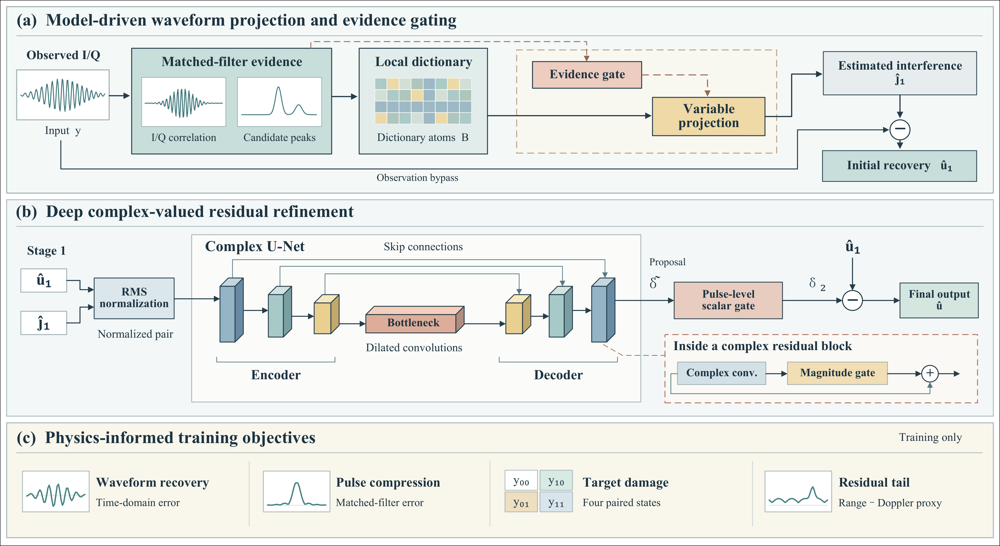
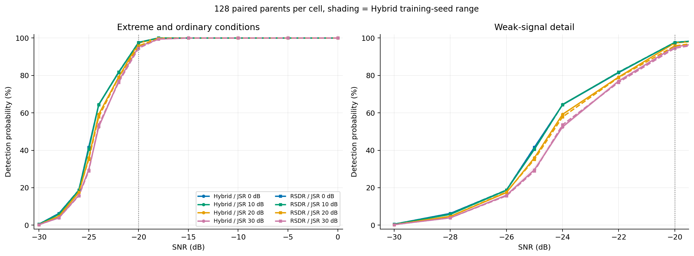
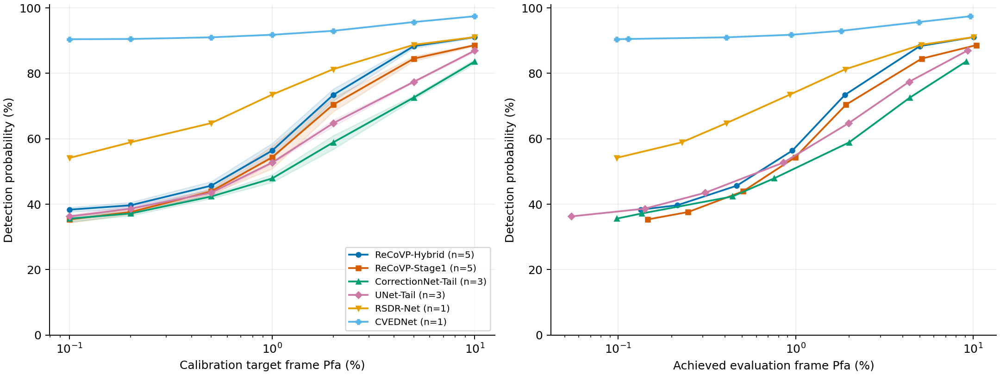

# Target-preserving waveform restoration under interrupted-sampling repeater jamming by regularized variable projection and complex residual refinement

**Abstract**　Interrupted-sampling repeater jamming resembles parts of the target echo, so removing interference can also change the amplitude and phase of the target response. We propose ReCoVP-Hybrid, a two-stage waveform restorer. A local complex dictionary derived from the observation and the known transmit waveform supports an interference estimate by regularized variable projection. A complex residual network then refines the preliminary restoration using both that restoration and the estimated interference. Training preserves the original noise realization and measures the output increment produced by adding a target to the same background. In simulations covering two signal-to-noise regimes, the proposed model reduced waveform error and jammed-frame false alarms relative to a similarly sized convolutional network, with a small increase in target-increment distortion. It preserved the target response better than a frozen dual-path restorer, but its detection probability was lower under stringent false-alarm calibration. These differences show why residual interference, target distortion, and background statistics must be assessed together.

**Keywords**　Complex-valued neural networks; Interrupted-sampling repeater jamming; Target fidelity; Variable projection; Waveform restoration

## 1. Introduction

Pulse compression concentrates the energy of a target echo, but fragments of a retransmitted waveform can also produce distinct peaks. Both originate from the transmitted waveform, so attenuating a strong peak can weaken a nearby target [1,2]. This raises a question that a reduction in interference energy alone cannot answer. If a target is added to an otherwise identical noise and interference background, how much of its complex echo survives in the output increment?

Time–frequency filtering exploits the local support of signal fragments, whereas Gaussian mixture modeling and sparse reconstruction distinguish usable samples from contaminated ones [3,4]. Sparse recovery in noise depends on the selection of candidate components [5]. Learned alternatives represent waveform variability through multidomain networks, residual encoders, and complex-valued attention [6–8]. End-to-end complex restoration, joint recognition and suppression, and complex autoencoders provide further receiver-side alternatives [9–11]. Across these architectures, one choice is independent of network depth: whether the desired output is a clean target or the target in its original noise background.

We retain the same-noise reference and shared-background supervision used in selective waveform restoration. The change concerns the representation of the waveform to be subtracted. Model-based learning combines explicit computation with learned representations, as illustrated by optimization-inspired networks and variable projection networks [12–14]. We restrict the initial correction to a local dictionary supported by the observation, then use a network to correct what the dictionary leaves unexplained. The intermediate and final outputs can therefore be examined on exactly the same signal. In particular, a reduction in restoration error can be tested against a separate measurement of target amplitude.

## 2. Same-noise reference and target fidelity

Let $\boldsymbol{S}$, $\boldsymbol{J}$, and $\boldsymbol{E}$ denote the target echo, interference, and noise. Four observations are formed from the same underlying components in each physical scene. The first subscript indicates target presence and the second indicates interference presence. Paired observations are available for training and evaluation. At inference, the restorer $F$ receives a single observation and uses the known transmit template.

$$\boldsymbol{Y}_{00}=\boldsymbol{E},\quad \boldsymbol{Y}_{10}=\boldsymbol{S}+\boldsymbol{E},\quad \boldsymbol{Y}_{01}=\boldsymbol{J}+\boldsymbol{E},\quad \boldsymbol{Y}_{11}=\boldsymbol{S}+\boldsymbol{J}+\boldsymbol{E}. \tag{1}$$

The restoration reference is $\boldsymbol{S}+\boldsymbol{E}$. In the absence of interference, the ideal output equals the input. When interference is present, the component removed by ideal processing is exactly $\boldsymbol{J}$. Retaining noise separates interference removal from denoising, but it does not guarantee target fidelity. A small overall error can conceal changes in the amplitude or phase of a weak echo. We therefore add the target to an unchanged $\boldsymbol{J}+\boldsymbol{E}$ background and define the paired response as $\boldsymbol{\Delta}_S=F(\boldsymbol{Y}_{11})-F(\boldsymbol{Y}_{01})$.

$$E_U=\frac{\|F(\boldsymbol{Y}_{11})-(\boldsymbol{S}+\boldsymbol{E})\|_F^2}{\|\boldsymbol{S}+\boldsymbol{E}\|_F^2},\qquad D_S=\frac{\|\boldsymbol{\Delta}_S-\boldsymbol{S}\|_F^2}{\|\boldsymbol{S}\|_F^2}. \tag{2}$$

With identical pairing and normalization, $D_S$ in (2) is the target-increment error also denoted by $e_S$. It is counted once throughout. Projecting $\boldsymbol{\Delta}_S$ onto $\boldsymbol{S}$ gives a complex gain $g$. Its magnitude measures amplitude retention, whereas $D_S$ also includes phase and orthogonal shape errors. We use $E_0$ for the sum of modification energies over both jamming-free states divided by their total input energy, and $E_\epsilon$ for the relative modification of noise alone. An almost unchanged input can yield small values of both $D_S$ and $E_0$ while retaining most of the interference. These quantities are therefore interpreted alongside $E_U$.

## 3. Structured estimation and complex refinement

### 3.1. Separating coefficient estimation from dictionary learning

Variable projection exploits the structure of separable least squares by eliminating linear coefficients conditional on the nonlinear parameters [15–17]. Here, the nonlinear part determines which local waveforms can explain the observation, and the linear coefficients determine their complex amplitudes. The transmit template supplies candidate shapes. Since both the target and retransmitted fragments can correlate with that template, a peak alone does not determine how much signal should be removed.

As shown in Fig. 1, the first stage selects candidates using matched-filter evidence and refines local delays and windows to form an observation-dependent complex dictionary. The regularization assigned to each candidate depends on the evidence supporting it, limiting the contribution of poorly supported atoms. The projection yields an initial interference estimate, which is subtracted from the observation. This provides a constrained starting point whose correction can be traced to local components in the dictionary. Overlapping target and interference structure can still lead to incorrect attribution, which is why the target-increment measurement remains necessary.

Let $\boldsymbol{x}$ denote the normalized observation, $\boldsymbol{B}$ the dictionary, $\boldsymbol{c}$ its complex coefficients, and $\boldsymbol{\Lambda}$ the regularization matrix. The structured part of the first stage is a regularized projection:

$$\widehat{\boldsymbol{c}}=\mathrm{arg\,min}_{\boldsymbol{c}}\left(\|\boldsymbol{x}-\boldsymbol{B}\boldsymbol{c}\|_2^2+\boldsymbol{c}^H\boldsymbol{\Lambda} \boldsymbol{c}\right). \tag{3}$$

In (3), learning determines the candidate representation and its evidence weights. Conditional on these quantities, the complex amplitudes are estimated by least squares. The resulting correction is returned to the observation scale. Equal fitting errors can correspond to different target-increment distortions, so dictionary fit and preservation of the target after fitting require separate measurements.

### 3.2. Refinement conditioned on both intermediate estimates

A finite dictionary cannot capture every waveform mismatch. The preliminary restoration indicates what remains in the observation, while the initial interference estimate records what the projection has already removed. The second stage receives both, preserving information about the first-stage decomposition. Its encoder and decoder exchange features through same-resolution skip connections, drawing on U-Net and residual learning [18–20]. Complex processing retains the relationship between in-phase and quadrature components, which matters when distinguishing a common amplitude error from a change in waveform shape [21,22]. Prior-guided processing and dilated convolutions have also been studied for interference restoration in other radar modalities [23,24].

The refiner processes the normalized pair with complex residual blocks and a dilated bottleneck. Feature magnitudes control radial gates within the network. A separate pulse-level scalar gate controls how much of the proposed correction is applied before the original scale is restored. The internal gates act on features, while the output gate acts on the correction to the preliminary restoration. The complete model contains 57,525 trainable real parameters. Eight pulses form a group for evaluation and training losses; the waveform network applies shared weights to each pulse.

Training constrains the endpoint waveform, pulse-compression response, target increment, and range–Doppler residual tail across the four states, with auxiliary supervision on the first stage. The first two terms measure errors in the waveform and its correlation with the transmit template. The latter two address effects that mean squared error can obscure: distortion of the response to an added weak target and large residuals in a small number of background cells. The tail term is a differentiable surrogate. Actual false alarms are measured on target-absent samples with independently calibrated thresholds.

Let $r$ denote the normalization scale, $\widetilde{\boldsymbol{\delta}}$ the refinement proposal, and $\alpha$ the pulse-level gate. The outputs are related by

$$\widehat{\boldsymbol{u}}_1=\boldsymbol{y}-\widehat{\boldsymbol{j}}_1,\qquad \widehat{\boldsymbol{u}}=\widehat{\boldsymbol{u}}_1-r\alpha\widetilde{\boldsymbol{\delta}}. \tag{4}$$

Equation (4) retains a direct path from the observation to the output. The initial interference estimate determines the first restoration and also conditions the second stage. The stages are trained jointly. The first-stage auxiliary loss has a weight of 0.25 relative to the final-stage loss, so the intermediate output is itself subject to waveform-fidelity supervision.

## 4. Simulation study

### 4.1. Comparisons and statistical units

The training set contained 512 base scenes, divided equally between ordinary and very low signal-to-noise ratios (SNRs). We evaluated the five ReCoVP-Hybrid instances with common epoch-256 assessments (seeds 17, 29, 41, 53, and 67) and three epoch-256 instances of the U-Net family (17, 29, and 41). The prespecified endpoints were retained. U-Net-Tail has 59,714 parameters and provides a similar-size convolutional control trained with a tail loss. RSDR-Net is a frozen dual-path restorer trained with its own data and computational budget. It provides a system-level comparison, from which the causal effect of architecture alone cannot be identified.

Three comparisons address different questions. First, intermediate and final outputs from the same checkpoint are compared on 256 development scenes. Second, thresholds are calibrated separately for each model on 1,024 other scenes and evaluated on 2,048 scenes to measure achieved false alarms and detection probability. Third, the same 128 physical scenes are evaluated across signal-to-noise and jamming-to-signal ratios (JSRs) to test whether the operating points transfer. Twelve SNRs (−30, −28, −26, −25, −24, −22, −20, −18, −15, −10, −5, and 0 dB) and four JSRs (0, 10, 20, and 30 dB) yield 48 conditions. Direct, repetitive, and cyclic retransmission variants within a scene share the target and noise. Conditions receive equal weight. Paired 95% intervals use 4,000 bootstrap draws of physical scenes [25], retaining all conditions and variants for each draw. Standard deviations across training instances are reported separately.

All methods use common pulse compression, slow-time processing, and detection definitions. Detection probability is the fraction of target-present frames with a hit at the target. Jammed-frame false-alarm probability is the fraction of jammed target-absent frames containing at least one false alarm. The nominal cell probability, calibration target for whole frames, and achieved frame probability have different denominators. The signal-to-jamming ratio improvement factor (SJRIF) is the change, in decibels, in the ratio of target-bin power to the strongest nontarget-bin power after pulse compression. The latter bin can also contain noise or sidelobes.

### 4.2. Refinement reduces waveform error while changing target gain

Moving from the first-stage output to the final output under the same weights reduced mean $E_U$ from 0.3958 to 0.0428 and $D_S$ from 0.1247 to 0.0581. SJRIF increased from 10.467 to 11.127 dB. At the same time, mean target-gain magnitude fell from 0.9861 to 0.9217. Refinement improved overall waveform and paired-response agreement while increasing average amplitude attenuation. Fig. 2 places this comparison in individual scenes. Three examples were selected by quantile of the target-distortion difference, with common pulse-compression and range–Doppler references within each row. They illustrate variation across scenes rather than estimating the frequency of a favorable outcome.

Table 1 compares methods on the same development set. Relative to U-Net-Tail, Hybrid reduced overall restoration error, jamming-free modification, and jammed-frame false alarms, but target-increment distortion increased from 0.04883 to 0.05806. Relative to RSDR-Net, it had lower target distortion and higher overall restoration error. The different rankings reflect different references. One metric compares the entire restored noisy waveform, while the other isolates the complex response induced by introducing a target into the same background.

**Table 1. Restoration, fidelity, and detection on 256 development scenes. FA denotes the jammed target-absent frame probability.**

| Model | $E_U$ | $D_S$ | $E_0$ | Detection (%) | FA (%) | SJRIF (dB) |
| --- | --- | --- | --- | --- | --- | --- |
| ReCoVP-Hybrid | 0.04285 | 0.05806 | 1.77 × 10⁻⁵ | 87.58 | 5.65 | 11.127 |
| U-Net-Tail | 0.05364 | 0.04883 | 8.56 × 10⁻⁵ | 86.63 | 10.63 | 10.670 |
| RSDR-Net | 0.03343 | 0.09470 | 1.35 × 10⁻⁵ | 86.98 | 5.08 | 11.338 |

### 4.3. Dependence on signal-to-noise ratio and retransmission scheme

Fig. 3 shows near-saturation of detection probability at ordinary SNRs and a steep decline at very low SNRs. Table 2 separates the two ranges, assigning −20 dB to the ordinary group. Hybrid yielded lower target distortion than RSDR-Net in 47 of 48 conditions. Mean paired differences were −0.02386 (95% interval −0.02708 to −0.02072) in the very-low-SNR group and −0.04062 (−0.04629 to −0.03509) in the ordinary group. RSDR-Net nevertheless had a lower mean frame false-alarm probability in both groups. A consistent advantage in target preservation therefore does not determine the false-alarm or detection ranking.

**Table 2. Equal-weight condition means. Very low denotes −30 ≤ SNR < −20 dB and ordinary denotes −20 ≤ SNR ≤ 0 dB, with 24 conditions per group.**

| SNR group | Model | $E_U$ | $D_S$ | Gain magnitude | Detection (%) | FA (%) |
| --- | --- | --- | --- | --- | --- | --- |
| Very low | ReCoVP-Hybrid | 0.01788 | 0.00875 | 0.9872 | 33.36 | 6.22 |
| Very low | U-Net-Tail | 0.02808 | 0.00580 | 0.9891 | 32.71 | 11.60 |
| Very low | RSDR-Net | 0.01421 | 0.03261 | 0.9633 | 33.27 | 3.37 |
| Ordinary | ReCoVP-Hybrid | 0.05042 | 0.03098 | 0.9501 | 99.48 | 7.88 |
| Ordinary | U-Net-Tail | 0.06257 | 0.02435 | 0.9623 | 99.30 | 15.63 |
| Ordinary | RSDR-Net | 0.04778 | 0.07160 | 0.9127 | 99.37 | 5.71 |

At ordinary SNRs, Hybrid yielded $E_U$ and $D_S$ of approximately 0.020 and 0.019 for direct retransmission, compared with 0.083 and 0.042 for repetitive retransmission. Cyclic retransmission lay between these cases. False alarms followed a different ordering: direct retransmission produced a jammed-frame false-alarm rate of about 9.0%, higher than the other two. Because the three schemes share base scenes, the differences characterize within-scene changes in conditions. They do not establish generalization to a retransmission mechanism absent from training.

### 4.4. Background preservation and low-false-alarm operation

A common detector facilitates comparison of system outputs, but restoration can change the target-absent distribution. Fig. 4 therefore reports both the calibration target and the achieved false-alarm rate. At the 1% frame calibration target, detection probabilities were 56.38% for Hybrid, 51.0% for plain U-Net, 52.7% for U-Net-Tail, and 73.5% for RSDR-Net. Their achieved false-alarm rates were 0.96%, 0.82%, 0.85%, and 0.93%, respectively. The comparison favors Hybrid over the similar-size convolutional networks at this operating point, while showing a substantial remaining gap to the frozen dual-path restorer.

At the same calibration target, detection probabilities for Max-TF, GMM-OMP, and the complex encoder–decoder CVEDNet were 18.7%, 21.6%, and 91.8%, with achieved false-alarm rates of 1.11%, 0.98%, and 0.94%. For CVEDNet, $E_\epsilon$ was approximately one and $D_S$ was 0.646. A system trained against a noise-free target can attain a high detection probability at this operating point while substantially altering target-absent inputs. Its detection rate cannot be read as accuracy against a same-noise waveform reference. Capacity and training procedures also differ across these systems.

Table 3 reports all five Hybrid instances. Seed 67 modified noise-only inputs about 72 times more than the mean of the other four, yet achieved the highest detection probability of the five at the 1% calibration target. Retaining this instance gave a between-seed standard deviation of only 0.00195 for overall restoration error. Mean waveform error alone therefore conceals variation in background preservation. Threshold transfer raises a related issue: Hybrid achieved a 1.83% false-alarm rate in the ordinary-SNR group after calibration to 1% on the independent calibration set.

**Table 3. Five epoch-256 instances. The first three performance columns describe the development set; the last two describe the independently calibrated evaluation set. SD is the between-instance standard deviation.**

| Seed | $E_U$ | $D_S$ | FA (%) | $E_\epsilon$ | Detection at 1% (%) |
| --- | --- | --- | --- | --- | --- |
| 17 | 0.04312 | 0.05967 | 5.60 | 1.02 × 10⁻⁶ | 52.75 |
| 29 | 0.04588 | 0.06333 | 6.77 | 1.34 × 10⁻⁶ | 57.13 |
| 41 | 0.04078 | 0.05499 | 5.08 | 4.45 × 10⁻⁷ | 57.34 |
| 53 | 0.04158 | 0.05625 | 5.47 | 1.21 × 10⁻⁶ | 56.04 |
| 67 | 0.04289 | 0.05605 | 5.34 | 7.23 × 10⁻⁵ | 58.66 |
| Mean | 0.04285 | 0.05806 | 5.65 | 1.5 × 10⁻⁵ | 56.38 |
| SD | 0.00195 | 0.00343 | 0.65 | 3.2 × 10⁻⁵ | 2.23 |

## 5. Discussion and conclusions

The first stage gives the interference estimate an inspectable waveform representation, while the second allows the correction to extend beyond that approximation. With both stages active, lower restoration error can coexist with greater target amplitude attenuation. The evidence for target fidelity is clearest when the background is held fixed: Hybrid had lower target distortion than frozen RSDR-Net in both SNR ranges, whereas U-Net-Tail outperformed Hybrid on this metric. The relevant comparator and operating point therefore qualify any claim of improved fidelity.

A graph-Laplacian constraint provides a counterexample to the assumption that adding structure must improve restoration. Across four conditions at one frozen checkpoint, mean $E_U$ was 0.02923 without graph coupling and increased to 0.10430 and 0.11983 under weak and strong atom-similarity constraints. Similar-looking atoms need not arise from a common physical fragment, and coupling their coefficients did not improve this model. The result concerns an intervention on fixed weights. The main method uses candidate-specific regularization; causal attribution to individual components requires independently retrained controls.

Parameter count also gives an incomplete picture of computational cost. On the same RTX 4060, median end-to-end restoration time for eight pulses was 17.0 ms for Hybrid and 1.5 ms for U-Net-Tail. The parameter budgets are similar, but the structured estimate incurs a numerical-solve cost. Parameter count describes model size here, whereas latency describes the cost of applying the fitted model.

The evidence is limited to controlled simulations. The 48-condition comparison estimates an equal-weight mean over a specified grid. Environmental prevalence, clutter, and receiver mismatch may change these results. Independent threshold evaluation supports an operating-point comparison but does not replace validation on measured data. Within this scope, ReCoVP-Hybrid connects a structured interference estimate to complex refinement in a single, testable restoration path. Paired target responses and background measurements quantify both the gains and the costs of that choice.

## Declaration of generative AI and AI-assisted technologies in the writing process

OpenAI Codex assisted with condensing, translating, and formatting the existing research materials.

## References
[1] X. Wang, J. Liu, W. Zhang, et al., Mathematic principles of interrupted-sampling repeater jamming (ISRJ), Science in China Series F: Information Sciences 50 (1) (2007) 113–123. https://doi.org/10.1007/s11432-007-2017-y

[2] Y. Zhang, B. Jiu, X. Peng, et al., A new scheme of target detection for pulse Doppler radar in interrupted sampling repeater jamming environment, IET Radar, Sonar & Navigation 16 (11) (2022) 1836–1850. https://doi.org/10.1049/rsn2.12300

[3] J. Chen, W. Wu, S. Xu, et al., Band pass filter design against interrupted‐sampling repeater jamming based on time‐frequency analysis, IET Radar, Sonar & Navigation 13 (10) (2019) 1646–1654. https://doi.org/10.1049/iet-rsn.2018.5658

[4] Z. Liu, W. Liang, N. Fu, et al., Interrupted sampling repeater jamming suppression based on Gaussian mixture model and sparse reconstruction, Digital Signal Processing 161 (2025) 105132. https://doi.org/10.1016/j.dsp.2025.105132

[5] T.T. Cai, L. Wang, Orthogonal Matching Pursuit for Sparse Signal Recovery With Noise, IEEE Transactions on Information Theory 57 (7) (2011) 4680–4688. https://doi.org/10.1109/TIT.2011.2146090

[6] X. He, K. Liao, S. Peng, et al., Interrupted-Sampling Repeater Jamming-Suppression Method Based on a Multi-Stages Multi-Domains Joint Anti-Jamming Depth Network, Remote Sensing 14 (14) (2022) 3445. https://doi.org/10.3390/rs14143445

[7] H. Wang, B. Chen, Q. Ye, et al., MREDNet: A Multi-Residual Encoder-Decoder Network for recovering LFM interfered by intra-pulse retransmission interferences, Signal Processing 217 (2024) 109329. https://doi.org/10.1016/j.sigpro.2023.109329

[8] Y. Wang, Y. Li, Z. Zhou, et al., An Attention-Guided Complex-Valued Transformer for Intra-Pulse Retransmission Interference Suppression, Remote Sensing 16 (11) (2024) 1989. https://doi.org/10.3390/rs16111989

[9] G. Dai, X. Yang, S. Huan, et al., End-to-End Interrupted Sampling Repeater Jamming Countermeasure Network Under Low Signal-to-Noise Ratio, Sensors 25 (13) (2025) 3925. https://doi.org/10.3390/s25133925

[10] Y. Wu, L. Duan, L. Yang, et al., Fine-Grained Recognition and Suppression of ISRJ Based on UNet-A, IEEE Geoscience and Remote Sensing Letters 21 (2024) 1–5. https://doi.org/10.1109/LGRS.2024.3448611

[11] Y. Meng, L. Yu, Y. Wei, Interrupted sampling repeater jamming suppression based on multiple extended complex‐valued convolutional auto‐encoders, IET Radar, Sonar & Navigation 18 (8) (2024) 1274–1290. https://doi.org/10.1049/rsn2.12568

[12] N. Shlezinger, J. Whang, Y.C. Eldar, et al., Model-Based Deep Learning, Proceedings of the IEEE 111 (5) (2023) 465–499. https://doi.org/10.1109/JPROC.2023.3247480

[13] J. Zhang, B. Ghanem, ISTA-Net: Interpretable Optimization-Inspired Deep Network for Image Compressive Sensing, 2018 IEEE/CVF Conference on Computer Vision and Pattern Recognition (2018) 1828–1837. https://doi.org/10.1109/CVPR.2018.00196

[14] P. Kovács, G. Bognár, C. Huber, et al., VPNET: Variable Projection Networks, International Journal of Neural Systems 32 (01) (2022) 2150054. https://doi.org/10.1142/S0129065721500544

[15] G.H. Golub, V. Pereyra, The Differentiation of Pseudo-Inverses and Nonlinear Least Squares Problems Whose Variables Separate, SIAM Journal on Numerical Analysis 10 (2) (1973) 413–432. https://doi.org/10.1137/0710036

[16] G. Golub, V. Pereyra, Separable nonlinear least squares: the variable projection method and its applications, Inverse Problems 19 (2) (2003) R1–R26. https://doi.org/10.1088/0266-5611/19/2/201

[17] D.P. O’Leary, B.W. Rust, Variable projection for nonlinear least squares problems, Computational Optimization and Applications 54 (3) (2013) 579–593. https://doi.org/10.1007/s10589-012-9492-9

[18] O. Ronneberger, P. Fischer, T. Brox, U-Net: Convolutional Networks for Biomedical Image Segmentation, Lecture Notes in Computer Science (2015) 234–241. https://doi.org/10.1007/978-3-319-24574-4_28

[19] K. He, X. Zhang, S. Ren, et al., Deep Residual Learning for Image Recognition, 2016 IEEE Conference on Computer Vision and Pattern Recognition (CVPR) (2016) 770–778. https://doi.org/10.1109/CVPR.2016.90

[20] K. Zhang, W. Zuo, Y. Chen, et al., Beyond a Gaussian Denoiser: Residual Learning of Deep CNN for Image Denoising, IEEE Transactions on Image Processing 26 (7) (2017) 3142–3155. https://doi.org/10.1109/TIP.2017.2662206

[21] A. Fuchs, J. Rock, M. Toth, et al., Complex-valued Convolutional Neural Networks for Enhanced Radar Signal Denoising and Interference Mitigation, 2021 IEEE Radar Conference (RadarConf21) (2021) 1–6. https://doi.org/10.1109/RadarConf2147009.2021.9455296

[22] N.C. Ristea, A. Anghel, R.T. Ionescu, Estimating the Magnitude and Phase of Automotive Radar Signals Under Multiple Interference Sources With Fully Convolutional Networks, IEEE Access 9 (2021) 153491–153507. https://doi.org/10.1109/ACCESS.2021.3128151

[23] J. Wang, R. Li, Y. He, et al., Prior-Guided Deep Interference Mitigation for FMCW Radars, IEEE Transactions on Geoscience and Remote Sensing 60 (2022) 1–16. https://doi.org/10.1109/TGRS.2022.3211605

[24] J. Wang, R. Li, X. Zhang, et al., Interference Mitigation for Automotive FMCW Radar Based on Contrastive Learning With Dilated Convolution, IEEE Transactions on Intelligent Transportation Systems 25 (1) (2024) 545–558. https://doi.org/10.1109/TITS.2023.3306576

[25] B. Efron, Bootstrap Methods: Another Look at the Jackknife, The Annals of Statistics 7 (1) (1979) 1–26. https://doi.org/10.1214/aos/1176344552
