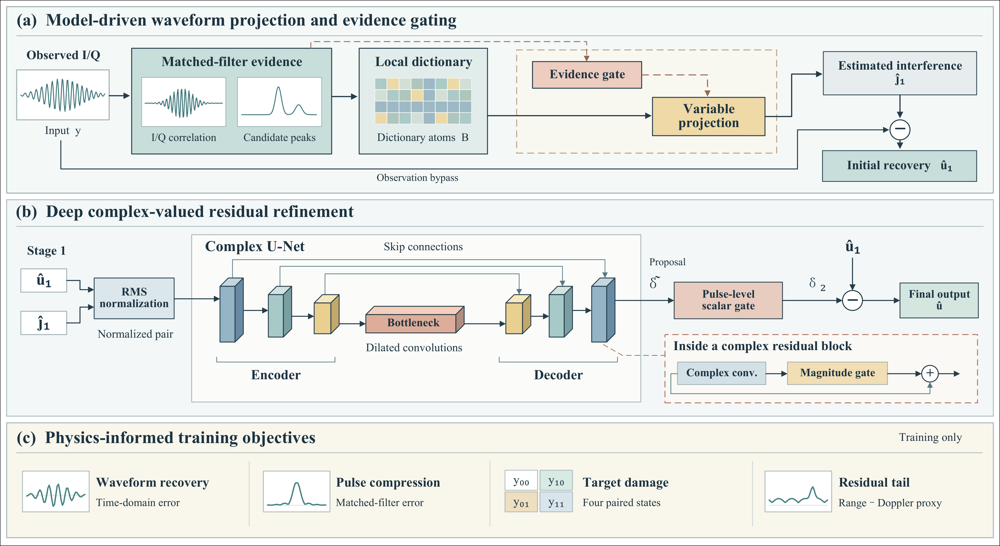
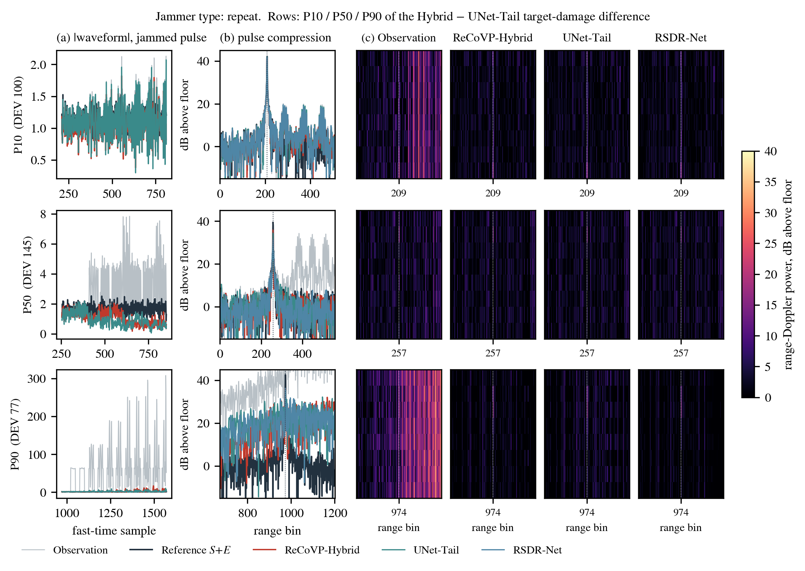
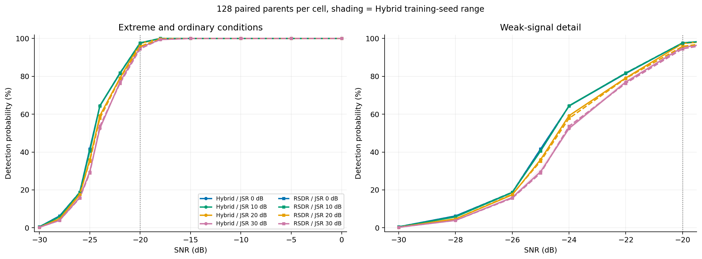
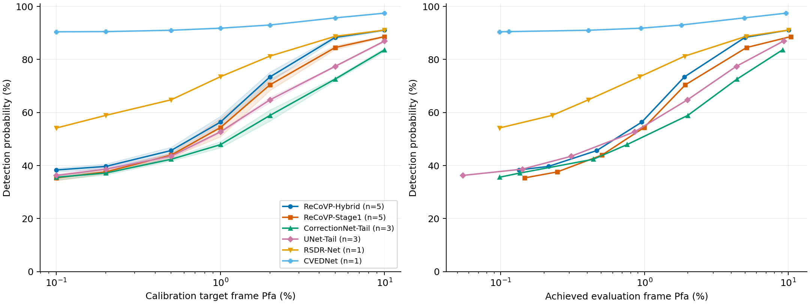

# 间歇采样转发干扰下兼顾目标响应的波形恢复：正则化变量投影与复值残差精修

**摘要**　间歇采样转发干扰与目标回波共享发射波形的局部结构。消除干扰残余时，目标的幅相响应也可能随之改变。本文提出两阶段波形恢复模型 ReCoVP-Hybrid。模型利用观测与已知发射模板构造局部复值字典，通过证据加权的正则化变量投影估计干扰，再将初步恢复波形和干扰估计共同送入复值残差网络。训练参考保留观测中的噪声实现，并在同一背景上度量加入目标所引起的输出增量。在受控仿真中，与规模相近的卷积网络相比，两阶段校正在两个信噪比区间内均降低了整体恢复误差和受扰帧虚警率，但目标增量损伤略高。与冻结的双路径恢复模型相比，其目标响应保持更好，而在严格低虚警工作点的检测概率较低。这些差异表明，恢复质量取决于干扰残余、目标失真和背景统计三者之间的平衡。

**关键词**　复值神经网络；间歇采样转发干扰；目标保真；变量投影；波形恢复

## 1. 引言

脉冲压缩能集中目标回波的能量，也会使转发波形的局部片段形成峰值。由于两者来自同一发射波形，压低一个强峰可能同时削弱附近目标 [1,2]。这给波形恢复提出了一个比干扰能量下降更严格的问题：在同一个噪声与干扰背景上加入目标，处理器输出的增量还能保留多少原始回波？

时频滤波利用片段的局部支撑，高斯混合建模与稀疏重构则利用受扰样本与可用样本之间的差异 [3,4]。噪声下的稀疏恢复对候选选择敏感 [5]。学习型方法通过多域联合网络、残差编码器或复值注意力建模更丰富的波形变化 [6–8]。端到端复值恢复、识别与抑制联合建模以及复值自编码器，也为接收端处理提供了不同选择 [9–11]。这些方法中，输出应当是纯净目标还是原目标与背景噪声之和，是一个独立于网络结构的选择。

本文沿用同噪声参考与共享背景配对监督。方法上的变化在于如何表示待减去的波形。模型驱动学习可将显式求解与数据驱动表示结合，优化展开和变量投影网络是两种不同的实现途径 [12–14]。我们把初始校正限制在与当前观测相符的局部字典中，再让网络修正字典解释不充分的部分。由此得到两个可分别观察的输出：结构化估计之后的波形，以及精修后的波形。二者的配对比较可以检验，误差下降时目标幅度是否也更接近参考。

## 2. 同噪声参考与目标保真

记目标回波、干扰与噪声分别为 $\boldsymbol{S}$、$\boldsymbol{J}$ 和 $\boldsymbol{E}$。对每个物理场景，共享这些分量构造四种观测。第一下标表示目标是否存在，第二下标表示干扰是否存在。训练与评价时可以取得配对样本；推理时，恢复器 $F$ 仅接收单个观测，并使用系统已知的发射模板。

$$\boldsymbol{Y}_{00}=\boldsymbol{E},\quad \boldsymbol{Y}_{10}=\boldsymbol{S}+\boldsymbol{E},\quad \boldsymbol{Y}_{01}=\boldsymbol{J}+\boldsymbol{E},\quad \boldsymbol{Y}_{11}=\boldsymbol{S}+\boldsymbol{J}+\boldsymbol{E}. \tag{1}$$

恢复参考为 $\boldsymbol{S}+\boldsymbol{E}$。只要干扰缺席，理想输出就与输入一致。对受扰输入，理想处理中被减去的量恰为 $\boldsymbol{J}$。这一参考避免把去噪和干扰消除混作同一任务，但并不自动保证目标完好：较小的整体误差仍可能掩盖弱目标的幅相变化。为此，在相同的 $\boldsymbol{J}+\boldsymbol{E}$ 上加入目标，定义配对响应 $\boldsymbol{\Delta}_S=F(\boldsymbol{Y}_{11})-F(\boldsymbol{Y}_{01})$。

$$E_U=\frac{\|F(\boldsymbol{Y}_{11})-(\boldsymbol{S}+\boldsymbol{E})\|_F^2}{\|\boldsymbol{S}+\boldsymbol{E}\|_F^2},\qquad D_S=\frac{\|\boldsymbol{\Delta}_S-\boldsymbol{S}\|_F^2}{\|\boldsymbol{S}\|_F^2}. \tag{2}$$

式（2）的 $D_S$ 对应同一配对与归一化口径下的目标增量误差 $e_S$，全文只统计一次。将 $\boldsymbol{\Delta}_S$ 投影到 $\boldsymbol{S}$ 得到复增益 $g$；$|g|$ 衡量总体幅度保持，而 $D_S$ 还包含相位与正交形状误差。另以 $E_0$ 衡量两个无干扰状态下改动能量之和与输入能量之和的比值，以 $E_\epsilon$ 表示仅在纯噪声状态下的相对改动。一个近似恒等的处理器可以取得很小的 $D_S$ 和 $E_0$，同时留下几乎全部干扰，因此三项指标需要联合解释。

## 3. 结构化估计与复值精修

### 3.1. 将幅度估计与字典学习分开

变量投影利用可分最小二乘的结构，将给定非线性参数后的线性系数从外层学习问题中消去 [15–17]。在这里，非线性部分决定哪些局部波形有资格解释观测，线性系数决定各自的复幅度。发射模板提供候选形状，但目标与转发片段都能与模板相关；单凭相关峰并不足以决定应该减去多少信号。

如图1所示，第一阶段根据匹配滤波证据选择候选，细化局部时延与窗，形成随观测而变的复值字典。各候选使用与其证据相关的正则强度，限制支持不足的原子对拟合结果的贡献。投影得到初始干扰估计，再从观测中扣除。其作用在于给校正提供受限的起点：估计可以追溯到字典中哪些局部成分解释了观测。目标与干扰结构重叠时，也可能出现误归属，仍需通过目标增量检验其影响。

将归一化观测写作 $\boldsymbol{x}$，字典、复系数与正则矩阵分别写作 $\boldsymbol{B}$、$\boldsymbol{c}$ 与 $\boldsymbol{\Lambda}$。第一阶段的结构由一个正则化投影给出：

$$\widehat{\boldsymbol{c}}=\mathrm{arg\,min}_{\boldsymbol{c}}\left(\|\boldsymbol{x}-\boldsymbol{B}\boldsymbol{c}\|_2^2+\boldsymbol{c}^H\boldsymbol{\Lambda} \boldsymbol{c}\right). \tag{3}$$

式（3）中被学习的是候选表示及其证据权重；给定这些量后，复幅度由最小二乘求解。所得校正被还原至观测尺度。相同的拟合误差可以对应不同的目标增量损伤，因此字典是否能拟合观测和拟合后目标是否保持是两个需要分别验证的问题。

### 3.2. 将两路中间估计共同送入精修器

局部字典无法覆盖所有波形失配。初步恢复说明哪些成分仍在观测中，初始干扰估计说明第一阶段已经减去了什么。第二阶段同时利用两者，从而保留第一阶段的分解信息。其编码器与解码器通过同尺度跳跃连接交换特征，继承了 U-Net 与残差学习的思想 [18–20]。复值处理保留同相与正交分量之间的联系；这对区分单一幅度偏差与波形形状变化尤其重要 [21,22]。在其他雷达体制中，先验引导和膨胀卷积也用于干扰恢复 [23,24]。

精修器对归一化的两路输入使用复值残差块与膨胀卷积瓶颈。特征幅度控制径向门，输出端另以脉冲级标量门控制修正提案的采用量，再恢复原尺度。两种门作用于不同对象：前者调制中间特征，后者决定对初步恢复追加多少修正。完整模型包含 57,525 个可训练实参数。八个脉冲在评价和训练损失中组成一组；网络对每个脉冲使用共享权重。

训练在四种状态上同时约束终点波形、脉压响应、目标增量和距离–多普勒残余尾部，并对第一阶段施加辅助监督。前两项分别衡量整段波形及其与发射模板的相关响应。后两项处理均方误差容易忽略的两类偏差：加入弱目标后处理器响应失真，以及少数背景单元出现高残余。尾部项是可微代理，实际虚警由独立门限校准和无目标样本测量。

记 $r$ 为归一化尺度，$\widetilde{\boldsymbol{\delta}}$ 为精修提案，$\alpha$ 为脉冲级门。输出关系为

$$\widehat{\boldsymbol{u}}_1=\boldsymbol{y}-\widehat{\boldsymbol{j}}_1,\qquad \widehat{\boldsymbol{u}}=\widehat{\boldsymbol{u}}_1-r\alpha\widetilde{\boldsymbol{\delta}}. \tag{4}$$

式（4）保留了从观测到输出的直接通路。初始干扰估计既决定第一项恢复结果，也作为第二阶段的输入。两个阶段联合训练；第一阶段辅助损失的权重为最终阶段损失的0.25，使中间输出本身也接受波形保真约束。

## 4. 仿真评价

### 4.1. 比较设计与统计单位

训练集含512个基础场景，常规与极低信噪比场景各占一半。主模型采用五个完成统一评测的第256轮实例（种子17、29、41、53、67），U-Net系列采用三个第256轮实例（17、29、41）。所有模型均保留预定终点。U-Net-Tail 有59,714个参数，作为规模相近且包含尾部损失的对照。RSDR-Net 则是使用自身训练数据和预算训练的冻结双路径恢复器；它提供完整系统对照，但不能单独识别架构改变的因果效应。

实验分别回答三个问题。首先，在256个开发场景中逐一比较同一检查点的中间输出与最终输出。其次，在另外1,024个场景上为每个模型独立校准门限，并在2,048个评价场景中检验实测虚警与检测概率。最后，对同一批128个物理场景改变信噪比和干信比（JSR），考察工作点能否迁移。12个SNR（−30、−28、−26、−25、−24、−22、−20、−18、−15、−10、−5、0 dB）与4个JSR（0、10、20、30 dB）构成48个条件；每个场景内的直接、重复和循环转发变体共享目标与噪声。各条件等权，95%区间由4,000次物理场景配对自助重采样得到 [25]。一个场景的全部条件与变体一起重采样，训练实例间的标准差另行报告。

所有方法共用脉压、慢时间处理与检测定义。检测概率为有目标帧中命中目标的比例；受扰帧虚警率为无目标、含干扰帧中至少出现一次虚警的比例。单元设计虚警概率、校准集上的目标帧虚警率与评价集上的实测帧虚警率具有不同分母。脉压信干比改善因子（SJRIF）按处理前后目标距离单元与最强非目标单元的功率比之差计算，以 dB 表示；非目标峰也可能含噪声或旁瓣。

### 4.2. 精修降低整体误差，但改变目标增益

在同一组权重下从第一阶段走到最终输出，平均 $E_U$ 由0.3958降至0.0428，$D_S$ 由0.1247降至0.0581，SJRIF 由10.467 dB升至11.127 dB。但平均目标增益幅值也由0.9861降至0.9217。精修改善了总体波形与配对目标波形的一致性，同时引入较大的平均幅度衰减。图2将配对比较放回具体场景：三个例子按目标损伤差的分位数选取，同一行的各方法使用相同的脉压与距离–多普勒参考底。这种选例能展示相对表现随场景变化的原因，不能用于估计胜率。

表1给出相同开发集上的模型对照。相对 U-Net-Tail，Hybrid 的整体恢复误差、无干扰改动和受扰虚警均下降，但目标增量损伤由0.04883升至0.05806。相对 RSDR-Net，目标增量损伤较低，而整体恢复误差较高。两种排序的差别来自参考量的不同：一项比较恢复后的整段含噪波形，另一项只比较在相同背景中加入目标产生的复数响应。

**表1　256个开发场景的恢复、保真与检测结果。虚警为无目标受扰帧的整帧概率。**

| 模型 | $E_U$ | $D_S$ | $E_0$ | 检测/% | 虚警/% | SJRIF/dB |
| --- | --- | --- | --- | --- | --- | --- |
| ReCoVP-Hybrid | 0.04285 | 0.05806 | 1.77 × 10⁻⁵ | 87.58 | 5.65 | 11.127 |
| U-Net-Tail | 0.05364 | 0.04883 | 8.56 × 10⁻⁵ | 86.63 | 10.63 | 10.670 |
| RSDR-Net | 0.03343 | 0.09470 | 1.35 × 10⁻⁵ | 86.98 | 5.08 | 11.338 |

### 4.3. 信噪比与转发方式对比较结论的影响

图3显示，普通信噪比下的检测概率接近饱和，而极低信噪比下迅速下降。表2将这两个区间分开，−20 dB 归入普通组。相对 RSDR-Net，Hybrid 在48格中的47格获得较低的目标损伤；极低与普通组的平均配对差分别为 −0.02386（95%区间 −0.02708 至 −0.02072）和 −0.04062（−0.04629 至 −0.03509）。然而，在两个区间，RSDR-Net 均有更低的平均整帧虚警率。因此，即使目标响应保持的差异方向稳定，也不能据此判定虚警或检测排序。

**表2　48个条件的等权宏平均。极低组为 −30 ≤ SNR < −20 dB，普通组为 −20 ≤ SNR ≤ 0 dB，每组24格。**

| SNR 组 | 模型 | $E_U$ | $D_S$ | 增益幅值 | 检测/% | 虚警/% |
| --- | --- | --- | --- | --- | --- | --- |
| 极低 | ReCoVP-Hybrid | 0.01788 | 0.00875 | 0.9872 | 33.36 | 6.22 |
| 极低 | U-Net-Tail | 0.02808 | 0.00580 | 0.9891 | 32.71 | 11.60 |
| 极低 | RSDR-Net | 0.01421 | 0.03261 | 0.9633 | 33.27 | 3.37 |
| 普通 | ReCoVP-Hybrid | 0.05042 | 0.03098 | 0.9501 | 99.48 | 7.88 |
| 普通 | U-Net-Tail | 0.06257 | 0.02435 | 0.9623 | 99.30 | 15.63 |
| 普通 | RSDR-Net | 0.04778 | 0.07160 | 0.9127 | 99.37 | 5.71 |

在普通组，Hybrid 对直接转发的 $E_U$ 和 $D_S$ 分别约为0.020和0.019，对重复转发则为0.083和0.042。循环转发介于二者之间。虚警呈现不同排序：直接转发的受扰帧虚警率约为9.0%，高于另外两类。三类共享基础场景，因而这些差别反映相同场景内的条件变化；它们不能替代对未参与训练的转发机制的外部验证。

### 4.4. 背景保持与低虚警工作点

固定检测设置有助于比较端到端输出，但不同恢复器会改变无目标帧的统计分布。图4同时给出校准目标与实测虚警。在1%帧虚警校准点，Hybrid 的检测概率为56.38%，普通 U-Net 为51.0%，U-Net-Tail 为52.7%，RSDR-Net 为73.5%；对应实测虚警率分别为0.96%、0.82%、0.85%和0.93%。这组结果支持 Hybrid 相对规模相近卷积网络的优势，同时也显示结构化估计和目标保持尚不足以消除严格工作点下的差距。

同一校准点评价 Max-TF、GMM-OMP 和复值编码解码网络 CVEDNet 时，三者的检测概率分别为18.7%、21.6%和91.8%，实测虚警分别为1.11%、0.98%和0.94%。CVEDNet 的 $E_\epsilon$ 约为1，$D_S$ 为0.646。以纯净目标为参考的系统可以在该工作点具有很高的检测概率，同时显著改写无目标输入。由此不能将高检测率直接解释为同噪声波形恢复更准确；几种模型在训练参考、模型容量和训练方式上也有差别。

五个 Hybrid 实例的结果见表3。种子67在纯噪声上的改动约为其余四个实例均值的72倍，但在1%校准点取得五者中最高的检测概率。对这一实例保留原有权重后，整体恢复误差的种子间标准差仍只有0.00195。由此可见，只报告平均恢复误差会掩盖背景改动的实例差异。门限迁移也有同样的问题：普通组内 Hybrid 的实测虚警率为1.83%，已偏离1%的独立校准目标。

**表3　五个第256轮实例。前三列性能量取自开发集，末两列取自独立校准后的评价集。SD 为训练实例间标准差。**

| 种子 | $E_U$ | $D_S$ | 虚警/% | $E_\epsilon$ | 检测@1%/% |
| --- | --- | --- | --- | --- | --- |
| 17 | 0.04312 | 0.05967 | 5.60 | 1.02 × 10⁻⁶ | 52.75 |
| 29 | 0.04588 | 0.06333 | 6.77 | 1.34 × 10⁻⁶ | 57.13 |
| 41 | 0.04078 | 0.05499 | 5.08 | 4.45 × 10⁻⁷ | 57.34 |
| 53 | 0.04158 | 0.05625 | 5.47 | 1.21 × 10⁻⁶ | 56.04 |
| 67 | 0.04289 | 0.05605 | 5.34 | 7.23 × 10⁻⁵ | 58.66 |
| 均值 | 0.04285 | 0.05806 | 5.65 | 1.5 × 10⁻⁵ | 56.38 |
| 标准差 | 0.00195 | 0.00343 | 0.65 | 3.2 × 10⁻⁵ | 2.23 |

## 5. 讨论与结论

第一阶段赋予干扰估计可检查的波形表示，第二阶段使校正可以超出这一表示的近似范围。两者结合后，恢复误差下降与目标幅度衰减可以同时发生。目标保真的证据在固定背景的比较中最清楚：Hybrid 在两个信噪比区间内的目标损伤均低于冻结的 RSDR-Net，而 U-Net-Tail 在这项指标上又优于 Hybrid。因而有意义的结论需要注明比较对象和工作点。

对结构先验的一个反例来自图拉普拉斯约束。在一个冻结检查点的四个条件上，无图模型的平均 $E_U$ 为0.02923；按原子相似性增加弱或强图约束后分别升至0.10430和0.11983。外观相似的原子未必源自同一物理片段，耦合系数并未改善这一模型的恢复。该结果仅针对冻结模型上的干预。本文主方法采用逐候选正则；对各子模块的因果贡献仍需结合独立重训对照解释。

参数量也不能单独代表计算开销。在同一台 RTX 4060 上，八脉冲端到端恢复的中位耗时为17.0 ms，U-Net-Tail 为1.5 ms。两者参数量接近，但结构化估计带来了实际求解成本。因而本文将参数规模用于说明比较预算，将延迟单独报告。

本文结果限于受控仿真。48格条件比较刻画的是既定网格的等权平均；实际环境中不同条件的频率、杂波和接收链失配均可能改变结果。独立门限评价支持工作点比较，但不等同于实测数据验证。就现有证据而言，ReCoVP-Hybrid 的贡献是把结构化干扰估计与复值精修接入同一条可检验的恢复路径，并用配对目标响应和背景统计明确量化这一选择的收益与代价。

## 写作过程中生成式人工智能及辅助技术使用声明

本文在既有中英文研究材料的基础上使用 OpenAI Codex 辅助精简、翻译和排版。

## 参考文献
[1] X. Wang, J. Liu, W. Zhang, et al., Mathematic principles of interrupted-sampling repeater jamming (ISRJ), Science in China Series F: Information Sciences 50 (1) (2007) 113–123. https://doi.org/10.1007/s11432-007-2017-y

[2] Y. Zhang, B. Jiu, X. Peng, et al., A new scheme of target detection for pulse Doppler radar in interrupted sampling repeater jamming environment, IET Radar, Sonar & Navigation 16 (11) (2022) 1836–1850. https://doi.org/10.1049/rsn2.12300

[3] J. Chen, W. Wu, S. Xu, et al., Band pass filter design against interrupted‐sampling repeater jamming based on time‐frequency analysis, IET Radar, Sonar & Navigation 13 (10) (2019) 1646–1654. https://doi.org/10.1049/iet-rsn.2018.5658

[4] Z. Liu, W. Liang, N. Fu, et al., Interrupted sampling repeater jamming suppression based on Gaussian mixture model and sparse reconstruction, Digital Signal Processing 161 (2025) 105132. https://doi.org/10.1016/j.dsp.2025.105132

[5] T.T. Cai, L. Wang, Orthogonal Matching Pursuit for Sparse Signal Recovery With Noise, IEEE Transactions on Information Theory 57 (7) (2011) 4680–4688. https://doi.org/10.1109/TIT.2011.2146090

[6] X. He, K. Liao, S. Peng, et al., Interrupted-Sampling Repeater Jamming-Suppression Method Based on a Multi-Stages Multi-Domains Joint Anti-Jamming Depth Network, Remote Sensing 14 (14) (2022) 3445. https://doi.org/10.3390/rs14143445

[7] H. Wang, B. Chen, Q. Ye, et al., MREDNet: A Multi-Residual Encoder-Decoder Network for recovering LFM interfered by intra-pulse retransmission interferences, Signal Processing 217 (2024) 109329. https://doi.org/10.1016/j.sigpro.2023.109329

[8] Y. Wang, Y. Li, Z. Zhou, et al., An Attention-Guided Complex-Valued Transformer for Intra-Pulse Retransmission Interference Suppression, Remote Sensing 16 (11) (2024) 1989. https://doi.org/10.3390/rs16111989

[9] G. Dai, X. Yang, S. Huan, et al., End-to-End Interrupted Sampling Repeater Jamming Countermeasure Network Under Low Signal-to-Noise Ratio, Sensors 25 (13) (2025) 3925. https://doi.org/10.3390/s25133925

[10] Y. Wu, L. Duan, L. Yang, et al., Fine-Grained Recognition and Suppression of ISRJ Based on UNet-A, IEEE Geoscience and Remote Sensing Letters 21 (2024) 1–5. https://doi.org/10.1109/LGRS.2024.3448611

[11] Y. Meng, L. Yu, Y. Wei, Interrupted sampling repeater jamming suppression based on multiple extended complex‐valued convolutional auto‐encoders, IET Radar, Sonar & Navigation 18 (8) (2024) 1274–1290. https://doi.org/10.1049/rsn2.12568

[12] N. Shlezinger, J. Whang, Y.C. Eldar, et al., Model-Based Deep Learning, Proceedings of the IEEE 111 (5) (2023) 465–499. https://doi.org/10.1109/JPROC.2023.3247480

[13] J. Zhang, B. Ghanem, ISTA-Net: Interpretable Optimization-Inspired Deep Network for Image Compressive Sensing, 2018 IEEE/CVF Conference on Computer Vision and Pattern Recognition (2018) 1828–1837. https://doi.org/10.1109/CVPR.2018.00196

[14] P. Kovács, G. Bognár, C. Huber, et al., VPNET: Variable Projection Networks, International Journal of Neural Systems 32 (01) (2022) 2150054. https://doi.org/10.1142/S0129065721500544

[15] G.H. Golub, V. Pereyra, The Differentiation of Pseudo-Inverses and Nonlinear Least Squares Problems Whose Variables Separate, SIAM Journal on Numerical Analysis 10 (2) (1973) 413–432. https://doi.org/10.1137/0710036

[16] G. Golub, V. Pereyra, Separable nonlinear least squares: the variable projection method and its applications, Inverse Problems 19 (2) (2003) R1–R26. https://doi.org/10.1088/0266-5611/19/2/201

[17] D.P. O’Leary, B.W. Rust, Variable projection for nonlinear least squares problems, Computational Optimization and Applications 54 (3) (2013) 579–593. https://doi.org/10.1007/s10589-012-9492-9

[18] O. Ronneberger, P. Fischer, T. Brox, U-Net: Convolutional Networks for Biomedical Image Segmentation, Lecture Notes in Computer Science (2015) 234–241. https://doi.org/10.1007/978-3-319-24574-4_28

[19] K. He, X. Zhang, S. Ren, et al., Deep Residual Learning for Image Recognition, 2016 IEEE Conference on Computer Vision and Pattern Recognition (CVPR) (2016) 770–778. https://doi.org/10.1109/CVPR.2016.90

[20] K. Zhang, W. Zuo, Y. Chen, et al., Beyond a Gaussian Denoiser: Residual Learning of Deep CNN for Image Denoising, IEEE Transactions on Image Processing 26 (7) (2017) 3142–3155. https://doi.org/10.1109/TIP.2017.2662206

[21] A. Fuchs, J. Rock, M. Toth, et al., Complex-valued Convolutional Neural Networks for Enhanced Radar Signal Denoising and Interference Mitigation, 2021 IEEE Radar Conference (RadarConf21) (2021) 1–6. https://doi.org/10.1109/RadarConf2147009.2021.9455296

[22] N.C. Ristea, A. Anghel, R.T. Ionescu, Estimating the Magnitude and Phase of Automotive Radar Signals Under Multiple Interference Sources With Fully Convolutional Networks, IEEE Access 9 (2021) 153491–153507. https://doi.org/10.1109/ACCESS.2021.3128151

[23] J. Wang, R. Li, Y. He, et al., Prior-Guided Deep Interference Mitigation for FMCW Radars, IEEE Transactions on Geoscience and Remote Sensing 60 (2022) 1–16. https://doi.org/10.1109/TGRS.2022.3211605

[24] J. Wang, R. Li, X. Zhang, et al., Interference Mitigation for Automotive FMCW Radar Based on Contrastive Learning With Dilated Convolution, IEEE Transactions on Intelligent Transportation Systems 25 (1) (2024) 545–558. https://doi.org/10.1109/TITS.2023.3306576

[25] B. Efron, Bootstrap Methods: Another Look at the Jackknife, The Annals of Statistics 7 (1) (1979) 1–26. https://doi.org/10.1214/aos/1176344552
