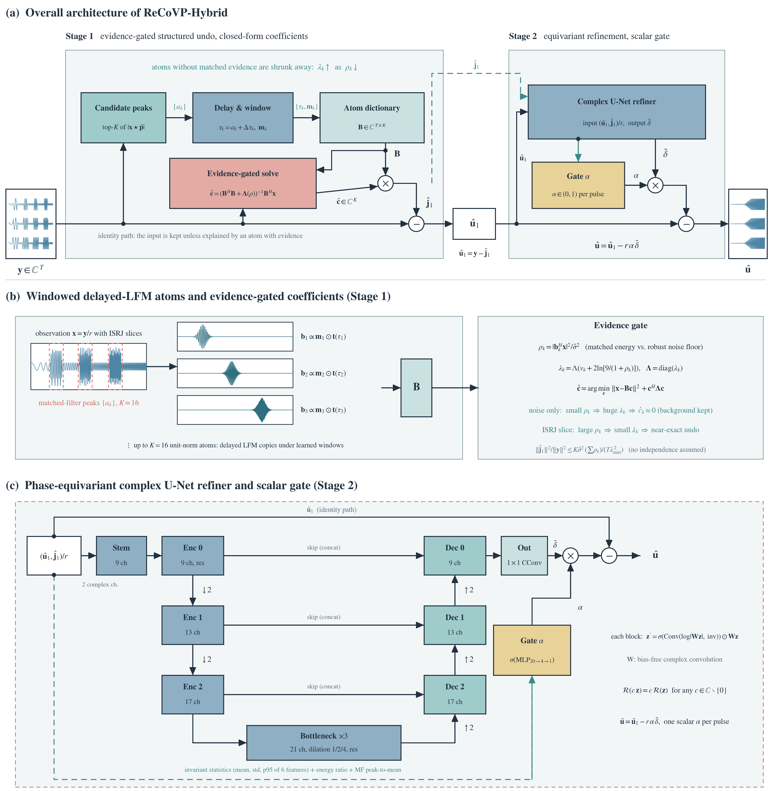

## 3 ReCoVP-Hybrid波形恢复方法

### 3.1 总体结构与设计思路

ReCoVP-Hybrid对每个脉冲独立处理，输入与输出均为长度$T$的复数向量。方法的设计依据来自式（3）：ISRJ的每个片段可以看作“局部窗×时延LFM”的形式，而时延LFM的形状对接收端是已知的。只要能从观测中找到干扰所在的时延并估计其窗形，干扰就落在一组已知结构原子的张成空间里，复幅度可以通过线性最小二乘直接求出，无须由网络回归。网络在这一阶段只承担两类非线性估计：在哪里放原子（时延），以及原子的时间支撑是什么形状（窗）。

这一表示并不完整。候选时延可能漏检，窗形可能估计偏差，干扰频偏没有逐原子建模，正则化又使系数向零收缩，这些都会在第一阶段输出中留下残余（3.5节给出了具体分解）。第二阶段因此不再受字典张成空间的限制，以复值卷积网络估计附加修正。它同时读取两路输入：初步恢复结果$\widehat{\boldsymbol u}_1$提供“还剩下什么”，已估计干扰$\widehat{\boldsymbol j}_1$提供“已经撤掉了什么”，两者结合可以判断残余是否与已撤销的干扰同源。两个阶段的修正都从观测中减去：

$$
\widehat{\boldsymbol j}_1=\mathcal S_1(\boldsymbol y),\qquad
\widehat{\boldsymbol u}_1=\boldsymbol y-\widehat{\boldsymbol j}_1,\qquad
\boldsymbol\delta_2=\mathcal S_2(\widehat{\boldsymbol u}_1,\widehat{\boldsymbol j}_1),\qquad
\widehat{\boldsymbol u}=\widehat{\boldsymbol u}_1-\boldsymbol\delta_2. \tag{11}
$$

故总修正为$C_\theta(\boldsymbol y)=\widehat{\boldsymbol j}_1+\boldsymbol\delta_2$。整个流程只使用观测和已知发射波形，不读取目标位置、干扰支撑或真实系数；四状态真值只用于训练与评价。

方法中实值与复值两类计算的分工也由同一原则决定。凡是需要在全局相位旋转下保持不变的判断（候选位置、窗形、正则强度、门控强度），都由相位不变的实值特征计算；凡是需要保留相位关系的量（字典原子、系数、修正波形），都在复数域计算。3.8节将说明，这一分工使整个映射对输入的复数缩放保持等变。

图2　ReCoVP-Hybrid总体框架。(a) 总体结构：第一阶段由匹配滤波输出选取候选峰，估计时延与窗，构成原子字典$\boldsymbol B$，在证据门控下解析求出系数，得到$\widehat{\boldsymbol j}_1$与$\widehat{\boldsymbol u}_1=\boldsymbol y-\widehat{\boldsymbol j}_1$；第二阶段以$(\widehat{\boldsymbol u}_1,\widehat{\boldsymbol j}_1)/r$为输入，输出$\widehat{\boldsymbol u}=\widehat{\boldsymbol u}_1-r\alpha\widetilde{\boldsymbol\delta}$。(b) 开窗时延LFM原子与证据门：$\rho_k$为原子匹配能量与稳健噪声底之比，决定正则强度$\lambda_k$，无证据的原子被压向零。(c) 复值精修网络：三层复值U-Net，通道宽度9/13/17/21，瓶颈膨胀率1/2/4；每个块为无偏置复卷积加相位不变的幅度门；标量门$\alpha$由不变特征统计量与两个物理标量驱动。实线为复数数据流，青色虚线为实值条件流。

算法1概括了推理过程。

> **算法1 ReCoVP-Hybrid单脉冲推理**
> 输入：受扰脉冲$\boldsymbol y\in\mathbb C^T$；已知LFM模板$\boldsymbol p$。
> 1. 计算RMS尺度$r$与归一化输入$\boldsymbol x=\boldsymbol y/r$（式（12））；
> 2. 提取四路相位不变特征$\boldsymbol\phi$（式（13）），经特征编码—解码网络得到共享特征$\boldsymbol h\in\mathbb R^{13\times T}$；
> 3. 由模板相关幅值选出$K$个候选峰$a_k$，并按式（14）细化得到时延$\tau_k$；
> 4. 按式（15）生成时延模板$\boldsymbol t_k$，由窗网络得到实窗$\boldsymbol m_k$，按式（16）构成字典$\boldsymbol B$；
> 5. 由正则头得到$\boldsymbol\Lambda$（式（17）），求解式（19）得到$\widehat{\boldsymbol j}_1$，并令$\widehat{\boldsymbol u}_1=\boldsymbol y-\widehat{\boldsymbol j}_1$；
> 6. 将$(\widehat{\boldsymbol u}_1/r,\widehat{\boldsymbol j}_1/r)$送入复值精修网络，得到修正提案$\widetilde{\boldsymbol\delta}$与脉冲级门$\alpha$（式（23）—（25））；
> 7. 输出$\widehat{\boldsymbol u}=\widehat{\boldsymbol u}_1-r\alpha\widetilde{\boldsymbol\delta}$。

### 3.2 尺度归一化与相位不变特征

接收信号的幅度随目标距离和干扰功率在很大范围内变化。对非零输入，以均方根尺度归一化：

$$
r(\boldsymbol y)=\Big(\tfrac1T\textstyle\sum_{n=0}^{T-1}|y_n|^2\Big)^{1/2},\qquad
\boldsymbol x=\boldsymbol y/r(\boldsymbol y), \tag{12}
$$

全零输入单独定义$r=1$、$\boldsymbol x=\boldsymbol 0$。所有修正量在归一化坐标中估计，再乘以$r$回到物理尺度，因而输出保留了输入的绝对幅度。

记单位能量模板为$\widetilde{\boldsymbol p}$，相关幅值$\boldsymbol a=|\boldsymbol x\star\widetilde{\boldsymbol p}|$。对每个采样点构造四路特征

$$
\boldsymbol\phi_n=\big[\,|x_n|,\;a_n,\;\operatorname{Re}\ell_n,\;\operatorname{Im}\ell_n\,\big]^\top,\qquad
\ell_n=x_nx_{n-1}^{*},\ \ell_0=0. \tag{13}
$$

三类特征各有分工：$|x_n|$描述局部能量，能量突变处往往对应干扰片段的边界；$a_n$描述观测与已知LFM的匹配程度，峰值位置给出可能的延迟波形；相邻样点共轭积$\ell_n$的相位等于局部瞬时频率乘以采样间隔，在LFM信号上随时间线性变化，干扰片段的转发延迟和频偏会使这一规律出现跳变。若输入乘以单位模复数$e^{\mathrm j\varphi}$，三类特征均不变，因此后续候选选择和窗形估计不会因整体相位变化而改变。

特征编码器为一维U-Net形式[49]，通道宽度依次为$4\to13\to26\to44$，长度依次为$T\to T/2\to T/4$，每级卷积后接组归一化[50]和ReLU。解码器经两次上采样与跳跃连接回到$13\times T$的共享特征$\boldsymbol h$。跳跃连接保留了片段边界附近的细节，下采样路径则汇聚较长时间范围的上下文，便于区分重复转发造成的多个相似片段。

### 3.3 候选时延的选择与细化

以未归一化LFM模板计算观测的相关幅值，在索引$2\le n\le T-3$内用13点最大池化寻找局部峰，选出幅值最大的$K=16$个峰作为候选，并要求任意两个候选间隔不小于6个采样点；局部峰不足$K$个时，从其余位置按幅值补足，幅值并列时取较小索引。候选只依赖观测与已知模板。

整数位置的候选不足以描述非整数时延，也不足以吸收频偏引起的峰值偏移。为此，对每个候选$a_k$提取其邻域内的共享特征、全局池化特征、归一化位置与峰值信息，组成59维向量$\boldsymbol h_k$，由一个$59\to64\to1$的多层感知机给出有界细化：

$$
\tau_k=a_k+2\tanh\big(f_\tau(\boldsymbol h_k)\big). \tag{14}
$$

细化范围被限制在$\pm2$个采样点以内，使网络只在候选附近微调，而不会把一个候选移到另一个峰上。其代价是，被池化漏掉的干扰片段无法由细化补回，这部分误差留给第二阶段。

### 3.4 局部窗字典

为了表示非整数时延，在$N=4096$点频域对单位能量模板施加线性相位，再截取前$T$点：

$$
\boldsymbol t_k=\mathcal T_T\,\mathcal F_N^{-1}\Big[\widetilde{\boldsymbol P}\odot\exp(-\mathrm j2\pi\boldsymbol f\tau_k)\Big], \tag{15}
$$

其中$\widetilde{\boldsymbol P}$为模板零填充后的DFT，$\boldsymbol f$为与DFT排列一致的归一化频率向量，$\mathcal T_T$表示截取前$T$个样点。

候选时延只确定了“哪一段LFM”，没有确定这段LFM中哪些样点属于转发片段。按式（3），干扰片段是时延LFM被采样窗截断后的结果，因此需要为每个候选估计一个时间窗。窗网络的输入由两部分组成：一部分是13路共享特征$\boldsymbol h$；另一部分是候选专属的匹配特征，即对共轭乘积$\boldsymbol x\odot\boldsymbol t_k^{*}$分别做5、15、31点滑动平均，取每个尺度的幅值及相邻共轭积的实部与虚部，共9路。观测中与$\boldsymbol t_k$匹配的片段在$\boldsymbol x\odot\boldsymbol t_k^{*}$上表现为近似常数的复包络，其幅值高、相邻相位差接近零；不匹配的部分则表现为快速旋转的相位。多尺度平滑使窗网络能够同时看到窄片段和宽片段。22路输入经$22\to12\to1$的逐点卷积得到窗权重，经sigmoid、三点均值平滑后按峰值归一化（分母下限0.05），得到实窗$\boldsymbol m_k\in[0,1]^T$。原子定义为

$$
\boldsymbol b_k=\frac{\boldsymbol m_k\odot\boldsymbol t_k}{\|\boldsymbol m_k\odot\boldsymbol t_k\|_2+10^{-12}},\qquad
\boldsymbol B=[\boldsymbol b_1,\ldots,\boldsymbol b_K]\in\mathbb C^{T\times K}. \tag{16}
$$

所有候选共享同一个窗网络，不同候选因模板位置和匹配特征不同而得到不同的窗。原子被归一化为单位能量，其实际复幅度由下一步的系数求解决定。这里不要求原子与物理片段一一对应：一个片段可以由几个原子共同表示，一个原子的窗也可以覆盖多个相邻片段。

### 3.5 正则化变量投影

**系数子问题。** 给定字典$\boldsymbol B$，干扰系数可由最小二乘确定。由于候选间隔只有数个采样点，相邻原子高度相关，$\boldsymbol B^H\boldsymbol B$可能病态，直接求解会产生幅值很大、符号相反的系数组合。为此为每个候选引入正则强度$\lambda_k>0$。设$\widehat\sigma^2$为归一化输入的稳健离差估计（以三次反距离加权迭代求中心，再取到中心距离平方的中位数除以$\log2$），候选的相关强度为$\rho_k=|\boldsymbol b_k^H\boldsymbol x|^2/\widehat\sigma^2$。正则头（$61\to16\to1$）输出实数$v_k$，并令

$$
z_k=v_k+2\big[\log 9-\log(1+\rho_k)\big],\qquad
\lambda_k=10^{-4}+\exp\{30\tanh(z_k/30)\},\qquad
\boldsymbol\Lambda=\operatorname{diag}(\lambda_1,\ldots,\lambda_K). \tag{17}
$$

偏置项$-2\log(1+\rho_k)$使相关强度高的候选默认获得较小正则、相关强度低的候选获得较大正则，网络输出$v_k$在此基础上调整；$\tanh$限幅与正下限保证$\lambda_k\in(10^{-4},10^{-4}+e^{30})$。系数子问题为

$$
\widehat{\boldsymbol c}=\arg\min_{\boldsymbol c\in\mathbb C^K}\;
\|\boldsymbol x-\boldsymbol B\boldsymbol c\|_2^2+\boldsymbol c^H\boldsymbol\Lambda\boldsymbol c. \tag{18}
$$

目标函数关于$\boldsymbol c^{*}$的Wirtinger导数为零，得到正规方程$(\boldsymbol B^H\boldsymbol B+\boldsymbol\Lambda)\widehat{\boldsymbol c}=\boldsymbol B^H\boldsymbol x$。对任意$\boldsymbol v\neq\boldsymbol0$，有$\boldsymbol v^H(\boldsymbol B^H\boldsymbol B+\boldsymbol\Lambda)\boldsymbol v=\|\boldsymbol B\boldsymbol v\|_2^2+\sum_k\lambda_k|v_k|^2>0$，系数矩阵正定，故无论字典列是否相关，式（18）都有唯一解。第一阶段干扰估计为

$$
\widehat{\boldsymbol j}_1=r\,\boldsymbol B\widehat{\boldsymbol c}=\boldsymbol P\boldsymbol y,\qquad
\boldsymbol P\triangleq\boldsymbol B(\boldsymbol B^H\boldsymbol B+\boldsymbol\Lambda)^{-1}\boldsymbol B^H. \tag{19}
$$

这一做法沿用了变量投影的思想[45–47]：在可分离的非线性最小二乘问题中，线性参数在给定非线性参数时有闭式解，可以先被消去，从而只需优化非线性参数。在本文中，非线性参数（时延、窗、正则）由网络估计，线性系数由式（19）解析求出，梯度通过线性方程的解反向传播到网络[31]。与展开固定步数的迭代算法[4,30,34]相比，这样处理的好处是系数在给定字典时总是精确最优的，网络不需要学习迭代本身。实现中以线性方程求解器计算$\widehat{\boldsymbol c}$，不显式求逆；系数求解使用双精度复数，其余计算使用单精度。

**命题1（固定表示下的收缩性质）。** 若$\boldsymbol B$固定且$\boldsymbol\Lambda\succ0$，则$\boldsymbol P$为Hermitian半正定矩阵，其特征值位于$[0,1)$；记$\boldsymbol B\boldsymbol\Lambda^{-1/2}$的奇异值为$\sigma_1\ge\cdots\ge\sigma_K$，则$\boldsymbol P$的非零特征值为$\sigma_k^2/(1+\sigma_k^2)$，且$\operatorname{tr}\boldsymbol P=\sum_k\sigma_k^2/(1+\sigma_k^2)<K$。

证明见附录A。命题1有两层含义。第一，$\|\boldsymbol P\boldsymbol y\|_2\le\frac{\sigma_1^2}{1+\sigma_1^2}\|\boldsymbol y\|_2<\|\boldsymbol y\|_2$，第一阶段在任何方向上撤销的能量都严格少于观测在该方向上的能量，$\boldsymbol I-\boldsymbol P$是非扩张的。第二，$\boldsymbol P$通常不满足$\boldsymbol P^2=\boldsymbol P$，它不是正交投影；正则越强，收缩越明显。$\operatorname{tr}\boldsymbol P$可以理解为第一阶段的有效自由度，它小于候选数$K$。

**推论1（固定字典下的修正自由度）。** 在命题1的条件下，若噪声$\boldsymbol\epsilon\sim\mathcal{CN}(\boldsymbol0,\sigma^2\boldsymbol I_T)$且与$\boldsymbol B,\boldsymbol\Lambda$独立，则

$$
\frac{\mathbb E\|\boldsymbol P\boldsymbol\epsilon\|_2^2}{\mathbb E\|\boldsymbol\epsilon\|_2^2}=\frac{\operatorname{tr}(\boldsymbol P^2)}{T}\le\frac{\operatorname{tr}\boldsymbol P}{T}<\frac{K}{T}. \tag{19a}
$$

证明只需利用$\mathbb E\|\boldsymbol P\boldsymbol\epsilon\|_2^2=\sigma^2\operatorname{tr}(\boldsymbol P^H\boldsymbol P)=\sigma^2\operatorname{tr}(\boldsymbol P^2)$，以及特征值$\mu_k\in[0,1)$时$\mu_k^2\le\mu_k$。在本文设置$K=16$、$T=1800$下，右端不超过0.89%。该上界只对与噪声独立的固定字典成立。实际字典由观测选取，数据自适应的选择会把原子推向噪声中最强的相关峰，使投影带走的能量超过$K/T$。设各位置的匹配能量近似为独立的单位均值指数变量，且原子近似正交，则选出的$K$个最大值之和的期望为$K(1+H_T-H_K)\approx K[1+\ln(T/K)]$，其中$H_n$为第$n$个调和数。在$K=16$、$T=1800$时该值约为91，即不加正则的最小二乘会移除约5.1%的噪声能量，约为式（19a）上界的6倍；5.7节的零训练诊断实测为5.6%。因此，仅凭$K$个候选的结构并不能解释背景几乎不被改动，这一性质来自式（17）中依赖证据的正则。

**推论2（证据门控下的修正能量）。** 对任意列向量为单位范数的字典$\boldsymbol B$（允许$\boldsymbol B$依赖于$\boldsymbol y$）及$\boldsymbol\Lambda=\operatorname{diag}(\lambda_1,\ldots,\lambda_K)$，记$\lambda_{\min}=\min_k\lambda_k>0$，第一阶段修正满足

$$
\frac{\|\widehat{\boldsymbol j}_1\|_2^2}{\|\boldsymbol y\|_2^2}\le\frac{K\,\widehat\sigma^2}{T\,\lambda_{\min}^2}\sum_{k=1}^{K}\rho_k. \tag{19b}
$$

证明：记$\boldsymbol G=\boldsymbol B^H\boldsymbol B$，$\boldsymbol v=(\boldsymbol G+\boldsymbol\Lambda)^{-1}\boldsymbol B^H\boldsymbol x$，则$\widehat{\boldsymbol j}_1=r\boldsymbol B\boldsymbol v$。一方面$\|\boldsymbol B\boldsymbol v\|_2^2=\boldsymbol v^H\boldsymbol G\boldsymbol v\le\|\boldsymbol G\|_2\|\boldsymbol v\|_2^2$，列为单位范数时$\|\boldsymbol G\|_2\le\operatorname{tr}\boldsymbol G=K$；另一方面$\boldsymbol G\succeq0$，故$\boldsymbol G+\boldsymbol\Lambda$的最小特征值不小于$\lambda_{\min}$，$\|\boldsymbol v\|_2\le\|\boldsymbol B^H\boldsymbol x\|_2/\lambda_{\min}$。再由$\|\boldsymbol B^H\boldsymbol x\|_2^2=\widehat\sigma^2\sum_k\rho_k$、$\|\boldsymbol y\|_2^2=r^2\|\boldsymbol x\|_2^2$与$\|\boldsymbol x\|_2^2=T$即得式（19b）。$\square$

式（19b）对每个样本成立，与候选如何选出无关，右端各量都由同一次观测算出，因而不需要推论1的独立性假设。它说明修正能量由证据$\rho_k$与最小正则强度共同控制，而不是由候选数$K$控制。按式（17），匹配能量小的原子对应很大的$\lambda_k$：所有原子都缺少证据时，式（19b）右端极小，第一阶段几乎不触碰观测；出现干扰片段时，相应原子的$\rho_k$变大、$\lambda_k$变小，修正接近该原子上的最小二乘解。强、弱原子并存时$\lambda_{\min}$由强原子决定，式（19b）随之变松，所以它刻画的是机制，不用于预测数值；实测值见5.7节。

**第一阶段误差的来源。** 将真实干扰分解为字典张成空间内外两部分，$\boldsymbol j=\boldsymbol B\boldsymbol c^\star+\boldsymbol j_\perp$，其中$\boldsymbol c^\star$为$\boldsymbol j$在$\operatorname{span}(\boldsymbol B)$上的最小二乘系数，$\boldsymbol B^H\boldsymbol j_\perp=\boldsymbol 0$。

**命题2（第一阶段误差分解）。** 在命题1的条件下，第一阶段恢复误差满足

$$
\widehat{\boldsymbol u}_1-\boldsymbol u=
\underbrace{\boldsymbol B(\boldsymbol B^H\boldsymbol B+\boldsymbol\Lambda)^{-1}\boldsymbol\Lambda\,\boldsymbol c^\star}_{\text{正则收缩偏差}}
+\underbrace{\boldsymbol j_\perp}_{\text{表示残差}}
-\underbrace{\boldsymbol P(\boldsymbol s+\boldsymbol\epsilon)}_{\text{目标与噪声泄漏}}. \tag{20}
$$

证明只需利用$\boldsymbol P\boldsymbol j_\perp=\boldsymbol 0$以及$(\boldsymbol I-\boldsymbol P)\boldsymbol B=\boldsymbol B(\boldsymbol B^H\boldsymbol B+\boldsymbol\Lambda)^{-1}\boldsymbol\Lambda$，见附录A。式（20）中的三项分别对应三种失效方式。第一项随$\boldsymbol\Lambda$增大而增大：正则使系数稳定，同时让一部分可表示的干扰残留下来；它位于字典张成空间内，且与$\widehat{\boldsymbol j}_1$方向相近。第二项来自候选漏检、窗形偏差和未建模的频偏，正则无法消除它。第三项是第一阶段对目标与噪声的附带修改，当某个原子与目标在时延和窗形上重合时最为明显。三项的方向各不相同：减小$\boldsymbol\Lambda$可以降低第一项，却会放大病态字典下的第三项；扩充字典可以降低第二项，却增加了原子与目标重合的机会。单靠调节第一阶段很难同时压低三项，这是引入第二阶段的直接原因。第二阶段同时读取$\widehat{\boldsymbol u}_1$与$\widehat{\boldsymbol j}_1$：第一项与$\widehat{\boldsymbol j}_1$同源，可由两路输入的相关性识别；第二项保留在$\widehat{\boldsymbol u}_1$中，表现为未被撤销的类LFM片段；第三项则要求第二阶段在修正时不进一步削弱目标，这一要求由第4节的目标增量损失约束。

### 3.6 自适应字典对目标响应的影响

命题1和命题2都在字典固定的前提下成立。实际上，$\boldsymbol B$与$\boldsymbol\Lambda$都由观测估计，目标的加入会改变候选、窗和正则，因而改变整个算子。记$\boldsymbol y_0=\boldsymbol j+\boldsymbol\epsilon$为无目标受扰观测，$\boldsymbol P_0=\boldsymbol P(\boldsymbol y_0)$，$\boldsymbol P_1=\boldsymbol P(\boldsymbol y_0+\boldsymbol s)$，第一阶段的输出为$F_1(\boldsymbol y)=(\boldsymbol I-\boldsymbol P(\boldsymbol y))\boldsymbol y$。由定义直接得到第一阶段的目标增量误差

$$
\boldsymbol\eta_1=F_1(\boldsymbol y_0+\boldsymbol s)-F_1(\boldsymbol y_0)-\boldsymbol s
=-\boldsymbol P_1\boldsymbol s-(\boldsymbol P_1-\boldsymbol P_0)\boldsymbol y_0, \tag{21}
$$

并由三角不等式得到

$$
\|\boldsymbol\eta_1\|_2\le\|\boldsymbol P_1\boldsymbol s\|_2+\|\boldsymbol P_1-\boldsymbol P_0\|_2\,\|\boldsymbol y_0\|_2. \tag{22}
$$

式（21）右侧第一项是当前算子对目标的直接修改，第二项是算子变化作用在背景上产生的附加项。在强干扰下$\|\boldsymbol y_0\|_2$很大，即使目标只引起很小的算子变化，第二项也可能超过第一项。这说明，只检验冻结字典下的$\boldsymbol P\boldsymbol s$不足以评价目标保真：候选在峰值排序发生变化处会不连续地切换，算子变化不存在全局的Lipschitz界。因此，本文在训练和评价中都对完整重估的输出计算目标增量（式（7）），而不是用冻结部分模块的结果代替。式（22）同时给出了一个可检查的量：若在实验中记录$\|\boldsymbol P_1-\boldsymbol P_0\|_2$与目标损伤的关系，可以判断损伤主要来自直接修改还是算子切换。
