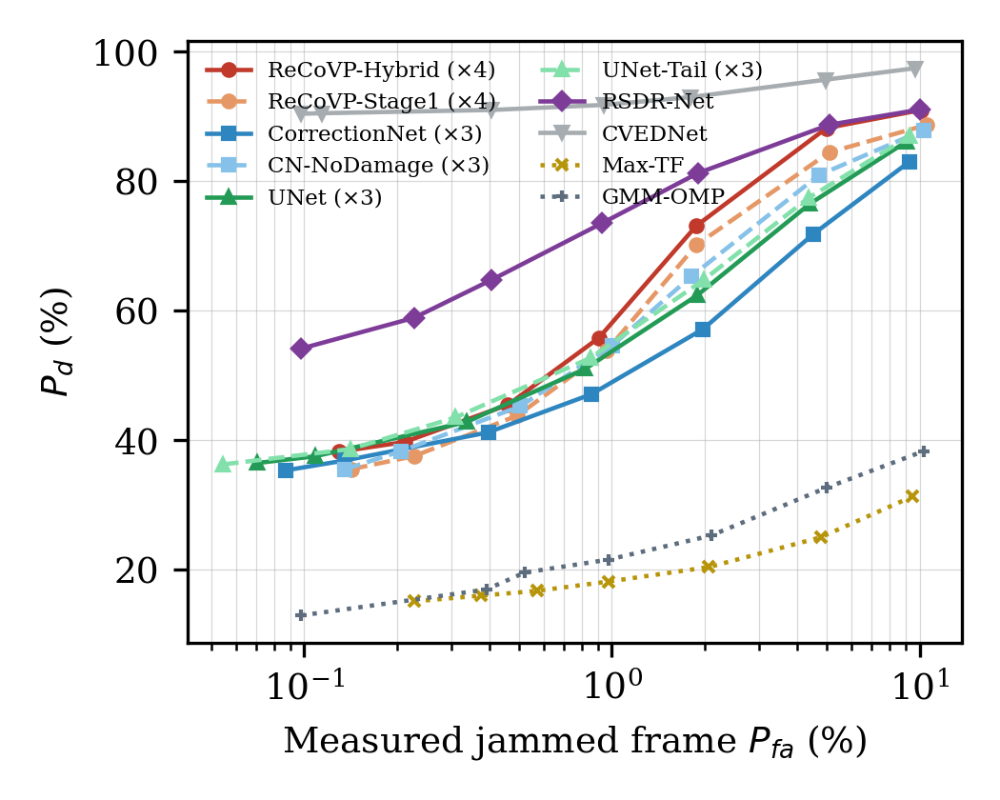
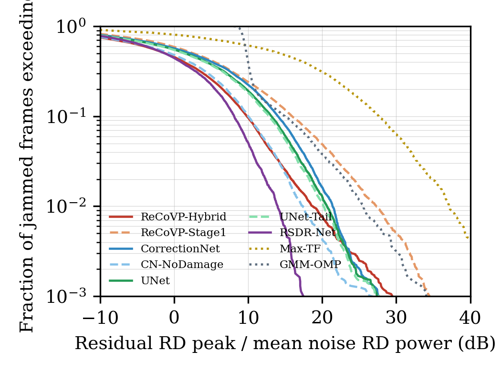

## 5 仿真实验与结果分析

### 5.1 仿真设置

每个相参处理间隔包含8个脉冲。组内目标的时延、幅度和多普勒保持不变，慢时间相位按式（2）演化；噪声按脉冲独立生成。每组的受扰脉冲数从$\{1,2,4,6,8\}$中抽取，每个受扰脉冲的采样与转发参数独立抽取。同一基础场景生成直接、重复和循环三种转发变体，三者共享目标与噪声，只有干扰不同。主要参数见表2。

**表2 雷达与干扰仿真参数**

|参数|取值|
|---|---|
|采样率／带宽／脉宽|60 MHz／30 MHz／10 μs|
|单脉冲接收长度／模板长度|1800点／600点|
|脉冲数／脉冲重复间隔|8／30 μs|
|目标幅度／目标时延|0.15～2.0／[64, 1136)个采样点|
|目标多普勒|−200～200 kHz|
|转发方式|直接、重复、循环|
|采样窗宽度／采样周期|6～72点／36～260点|
|转发延迟／转发次数／最大重放间隔|1～96点／1～10／64点|
|干扰频偏|−200～200 kHz|
|训练集|512个基础场景：常规条件256个（SNR [−20, 15] dB，JSR [−12, 35] dB），极端条件256个（SNR [−30, −20) dB，JSR [−12, 45] dB）|
|评价集|256个基础场景，SNR [−30, 15] dB，JSR [−12, 45] dB|

SNR定义为目标有效支撑内的平均功率与噪声功率之比，JSR定义为干扰非零支撑内的平均功率与目标有效支撑内平均功率之比；SNR按脉冲抽取，JSR按受扰脉冲抽取，因而一个基础场景并不对应唯一的SNR与JSR。慢时间采样率约为33.33 kHz，较大的多普勒会发生混叠，评价时将其折叠到一个PRF周期内并取最近的多普勒单元。

评价集包含256个基础场景、768条记录。由于三种转发变体共享目标与噪声，统计时以基础场景为独立单元：每个基础场景先对三种变体等权平均，再在256个基础场景间平均。该评价集在方法设计阶段已被使用，本节结果属于开发集上的评价。

### 5.2 评价指标与检测设置

对8脉冲矩阵采用Frobenius范数，定义恢复误差、目标增量损伤和无干扰误差：

$$
E_U=\frac{\|\widehat U_{11}-(S+E)\|_F^2}{\|S+E\|_F^2},\quad
D_S=\frac{\|\widehat U_{11}-\widehat U_{01}-S\|_F^2}{\|S\|_F^2},\quad
E_0=\frac{\|\widehat U_{00}-E\|_F^2+\|\widehat U_{10}-(S+E)\|_F^2}{\|E\|_F^2+\|S+E\|_F^2}, \tag{34}
$$

其中$\widehat U_{ab}$为状态$ab$下的处理输出，分母下限为$10^{-24}$。$E_0$衡量处理器对两种无干扰输入的改动，理想值为零。目标复增益幅值$|g|$按式（9）在8脉冲矩阵上计算，理想值为1。

脉冲压缩采用600点模板，保留0～1200的有效延迟单元。设脉冲平均距离功率为$P_v[k]$，目标单元$k_\star$由无干扰目标的脉压峰确定，干扰抑制后的信干比改善量为

$$
\mathrm{SJRIF}=10\log_{10}\frac{P_{\widehat U}[k_\star]}{\max_{k\neq k_\star}P_{\widehat U}[k]}-10\log_{10}\frac{P_{Y}[k_\star]}{\max_{k\neq k_\star}P_{Y}[k]}. \tag{35}
$$

分母中的非目标最大值包含旁瓣、干扰残余与噪声。

检测采用8点慢时间FFT与二维CA-CFAR。距离维保护单元与参考单元半宽分别为12与24，多普勒维分别为1与2，慢时间方向按周期边界处理，共436个参考单元、9032个有效检测单元，名义单元虚警概率为$10^{-6}$。目标在最近的混叠多普勒单元内、目标距离单元及其左右各一个单元中至少有一次检测即记为检出。无目标受扰状态下报告两种虚警指标：单元虚警率，即虚警单元数占全部有效单元的比例；整帧虚警率，即至少出现一次虚警的处理间隔所占比例。处理会改变背景的统计分布，因此实测虚警率一般不等于名义值。

置信区间采用基础场景层面的bootstrap[54]，重采样4000次，取均值的2.5%与97.5%分位数；比较两个输出时，对同一组重采样索引计算配对差值。

### 5.3 对比方法

对比方法分为四组。

**（1）同一模型的两个阶段输出。** 仅使用第一阶段的输出$\widehat{\boldsymbol u}_1$（记为Stage1）和最终输出$\widehat{\boldsymbol u}$（记为Final）。二者来自同一组参数，比较的是推理时加入精修分支带来的变化。

**（2）参数量相近的学习型恢复网络。** 包括仅含结构化字典求解的ReCoVP-Base、不含去斜处理的卷积残差修正网络P0-NoDechirp-Tail，以及12类卷积恢复网络：CorrectionNet及其去掉去斜、去掉RMS归一化、去掉脉压损失、去掉目标损伤损失的四种变体，原损失下重新训练的对照与加入匹配滤波尾峰损失的版本；普通实值I/Q U-Net及其加尾峰损失、观测噪声归一化、频域坐标和膨胀卷积四种变体。12类网络的有效参数均为59,714个，与本文方法的57,525个相当，训练数据、更新次数与本文方法相同，每类包含3个独立训练实例。

**（3）传统方法。** Max-TF在去斜后的时频平面上识别并抑制受扰时频单元[9]，窗长65点、帧移16点、频率平滑5点、能量分位0.7；另以窗长51点、帧移12点、平滑3点的配置作参数敏感性对照，二者结论一致，正文只报告前者。GMM-OMP用两分量高斯混合模型区分受扰与未受扰样本，再在未受扰样本上以正交匹配追踪重构目标回波[12]，稀疏度取8。两种方法只使用观测与公开的LFM参数，不需要训练。

**（4）参数规模较大的学习方法。** CVEDNet是复值编解码网络，以时域与脉压域联合损失、无噪目标为监督[19]，采用官方实现，参数量11.02 M。RSDR-Net是作者先前提出的可靠度引导复数恢复模型，参数量3.02 M。两者的权重均在另一套仿真数据上按各自原训练流程得到，本文未在当前训练集上重新训练，因此这一组比较反映的是直接使用已训练模型时的表现，与第（2）组的同预算比较性质不同。

表4c汇总了各方法的参数量与训练方式。

表4c　对比方法概况

|组别|方法|有效参数量|是否训练|训练数据|
|---|---|---:|---|---|
|本文|ReCoVP-Hybrid|57,525|是|本文训练集|
|同预算|12类卷积恢复网络、ReCoVP-Base、P0-NoDechirp-Tail|58,943–59,714|是|本文训练集|
|传统|Max-TF[9]、GMM-OMP[12]|—|否|—|
|大规模|RSDR-Net|3.02 M|是|另一套仿真数据|
|大规模|CVEDNet[19]|11.02 M|是|另一套仿真数据|

### 5.4 精修阶段的作用

表3比较同一训练实例的两个阶段输出。

**表3 第一阶段输出与最终输出的比较**（概率以百分数表示，概率差以百分点表示）

|指标|Stage1|Final|配对差值［95%置信区间］|
|---|---:|---:|---|
|$E_U$ ↓|0.40185|0.04312|−0.35873［−0.46821, −0.26552］|
|$D_S$ ↓|0.12559|0.05967|−0.06591［−0.13931, −0.01359］|
|SJRIF／dB ↑|10.4168|11.0968|+0.6801［+0.5301, +0.8342］|
|受扰整帧虚警率／% ↓|7.422|5.599|−1.823［−3.125, −0.521］|
|检测概率／% ↑|85.42|87.11|+1.693［−0.130, +3.646］|
|目标复增益幅值$\lvert g\rvert$（理想为1）|0.98582|0.91518|−0.07064［−0.07636, −0.06482］|
|无干扰误差$E_0$ ↓|$2.551\times10^{-6}$|$4.566\times10^{-6}$|$+2.016\times10^{-6}$［$1.248\times10^{-6}$, $3.265\times10^{-6}$］|
|受扰单元虚警率 ↓|$5.781\times10^{-5}$|$6.026\times10^{-5}$|$+2.451\times10^{-6}$［$-5.767\times10^{-6}$, $1.283\times10^{-5}$］|

精修使平均恢复误差从0.402降至0.043，约为原来的十分之一，平均目标损伤下降约一半，SJRIF提高0.68 dB，受扰整帧虚警率下降1.8个百分点，四项差值的置信区间均不含零。这与命题2的分析相符：第一阶段的收缩偏差与表示残差占恢复误差的大部分，精修分支能够有效地补偿它们。

但精修也带来了可测的代价。目标复增益幅值从0.986降至0.915，即平均幅度衰减从约1.4%增加到约8.5%；无干扰误差虽然绝对值仍在$10^{-6}$量级，配对差值的区间为正。此外，目标损伤配对差值的中位数为+0.0079，第95百分位数为+0.0496，与均值的符号相反。配对中位数为正意味着至少一半场景的目标损伤有所增加，均值的下降来自少数场景的较大改善。结合式（10），平均损伤下降与平均幅值下降同时出现，一种可能的解释是精修在少数场景中显著降低了形状误差，同时在较多场景中引入了轻微的幅度收缩；确认这一解释需要逐场景的复增益分解（图6）。

检测概率的点估计提高1.7个百分点，但区间包含零；受扰单元虚警率的差值区间同样包含零，与整帧虚警率的变化方向不同。整帧虚警率衡量“是否出现虚警”，单元虚警率衡量“虚警单元有多少”，精修减少了出现虚警的处理间隔，但没有明显减少虚警单元的总数。

需要指出，Stage1是联合训练模型的中间输出，其参数同时受最终损失影响，因此表3回答的是“在推理时加入精修分支有什么变化”，而不是“两阶段结构是否优于同等预算的单阶段结构”。后者由5.7节的匹配对照回答。

〔图5占位：典型场景的复数波形与脉压结果。按预先设定的规则（损伤配对差值的第10、50、90百分位场景）各选一例，每例给出观测、含噪参考、Stage1输出、Final输出与精修量$\boldsymbol\delta_2$的实部波形，以及相应的脉压结果；所有子图采用共同的绝对功率参考。〕

〔图6占位：阶段差值的分布。(a) 恢复误差配对差值的直方图；(b) 目标损伤配对差值的直方图。标出零线、均值与中位数；(c) 逐场景的复增益偏差$|g-1|^2$与形状误差$\|\boldsymbol q\|_2^2/\|\boldsymbol s\|_2^2$（式（10））在两阶段之间的变化散点图。〕

### 5.5 与其他模型的比较

表4列出各模型在同一评价集上的结果。

**表4 不同模型的比较**（点估计）

|模型|有效实参数|$E_U$ ↓|$D_S$ ↓|$E_0$ ↓|$P_d$／% ↑|受扰帧虚警率／% ↓|SJRIF／dB ↑|
|---|---:|---:|---:|---:|---:|---:|---:|
|ReCoVP-Base|58,943|0.49665|0.07162|$1.94\times10^{-6}$|84.90|6.90|10.244|
|P0-NoDechirp-Tail|59,714|0.04866|0.04479|$9.19\times10^{-5}$|87.63|10.29|10.807|
|UNet-Tail|59,714|0.05449|0.05078|$1.17\times10^{-4}$|86.46|10.81|10.657|
|ReCoVP-Hybrid|57,525|0.04312|0.05967|$4.57\times10^{-6}$|87.11|5.60|11.097|
|RSDR-Net|3,017,877|0.03343|0.09470|$1.35\times10^{-5}$|86.98|5.08|11.338|

与ReCoVP-Base相比，加入精修分支后恢复误差由0.497降至0.043，目标损伤也有所降低。仅有结构化字典的模型对干净输入的改动最小，但恢复误差最大，这与命题2中正则收缩与表示残差的分析相符。

与参数规模相当的两个卷积修正网络相比，ReCoVP-Hybrid的恢复误差、无干扰误差与受扰帧虚警率更低，无干扰误差低一个多数量级，受扰帧虚警率低约5个百分点，SJRIF高0.29～0.44 dB；但其目标损伤较高，检测概率与P0-NoDechirp-Tail接近。两类模型的差异反映了不同的修正方式：通用卷积网络直接回归修正量，对干净输入和目标的修改更大，但目标增量更接近真实目标；ReCoVP-Hybrid把大部分修正限制在字典张成空间内，对背景的修改更小、残余峰值更低，但字典原子与目标重合时会对目标产生收缩。

与参数量约为其52倍的RSDR-Net相比，ReCoVP-Hybrid的目标损伤更低，受扰帧虚警率与SJRIF与之接近，恢复误差略高。也就是说，该大模型依靠约300万参数获得的低虚警水平，本文方法用5.75万参数即可接近（两者的配对区间待补）。

表 4 只是单个训练实例的点估计。为了判断上述差异是否由训练随机性引起，并覆盖更多的卷积恢复结构，我们将 ReCoVP-Hybrid 与12类参数量相近的卷积恢复网络逐场景配对比较。这12类包括作者前期的 CorrectionNet 及其复训对照、加尾峰损失版本、四种结构或损失消融，以及普通 U-Net 和依次加入尾峰损失、噪声归一、频域坐标、膨胀卷积的四个变体。每类均以随机种子17、29、41各训练256轮，训练数据与更新次数与本文方法相同，取最后一轮参数。对每个场景取三个训练实例的平均值作为该类的结果，再计算 Hybrid 减去该值的配对差。表 4b 列出其中代表性的六类，完整结果见补充材料。

**表 4b 与卷积恢复网络的逐场景配对比较**（基线为3个训练实例的平均；括号内为 Hybrid 减基线的配对差及95%置信区间；概率差以百分点表示）

|模型|$E_U$ ↓|$D_S$ ↓|$E_0$ ↓|受扰帧虚警率／% ↓|SJRIF／dB ↑|$P_d$／% ↑|
|---|---|---|---|---|---|---|
|ReCoVP-Hybrid|0.0431|0.0597|$4.6\times10^{-6}$|5.60|11.10|87.11|
|CorrectionNet|0.0599（−0.0168［−0.0208,−0.0128］）|0.0634（−0.0037［−0.0100,+0.0047］）|$1.25\times10^{-4}$|15.32（−9.72［−12.0,−7.64］）|10.30（+0.80［+0.64,+0.97］）|85.98（+1.13［+0.26,+2.04］）|
|CorrectionNet+尾峰|0.0582（−0.0151［−0.0190,−0.0113］）|0.0636（−0.0039［−0.0102,+0.0043］）|$1.28\times10^{-4}$|14.54（−8.94［−11.1,−6.90］）|10.40（+0.69［+0.54,+0.85］）|86.46（+0.65［−0.17,+1.56］）|
|CorrectionNet去去斜|0.0509（−0.0077［−0.0109,−0.0045］）|0.0452（+0.0144［+0.0083,+0.0226］）|$1.23\times10^{-4}$|10.85（−5.25［−7.03,−3.52］）|10.70（+0.40［+0.28,+0.53］）|87.33（−0.22［−1.22,+0.74］）|
|U-Net|0.0545（−0.0114［−0.0148,−0.0080］）|0.0481（+0.0115［+0.0056,+0.0198］）|$7.6\times10^{-5}$|11.11（−5.51［−7.34,−3.82］）|10.61（+0.49［+0.37,+0.62］）|86.81（+0.30［−0.56,+1.13］）|
|U-Net+尾峰|0.0536（−0.0105［−0.0139,−0.0072］）|0.0488（+0.0109［+0.0045,+0.0187］）|$8.6\times10^{-5}$|10.63（−5.04［−6.81,−3.30］）|10.67（+0.43［+0.31,+0.55］）|86.63（+0.48［−0.39,+1.39］）|
|U-Net+膨胀卷积|0.0571（−0.0139［−0.0176,−0.0104］）|0.0505（+0.0092［+0.0031,+0.0171］）|$7.5\times10^{-5}$|11.46（−5.86［−7.68,−4.17］）|10.58（+0.52［+0.39,+0.65］）|87.11（0.00［−1.00,+0.96］）|

表中 $E_0$ 的配对差区间均不含零，为省略篇幅未列出。在全部12类中，Hybrid 的恢复误差、无干扰改动和受扰帧虚警率均低于对应基线，SJRIF 均高于对应基线，四项配对差区间无一含零。差异最稳定的是无干扰改动：Hybrid 较各类基线低10至65倍，且在至少99%的场景中更低。受扰帧虚警率在基线中为9.1%至16.5%，Hybrid 为5.6%，约为同规模 U-Net 类的一半、CorrectionNet 类的三分之一。基线各类帧虚警率的跨训练实例标准差仅0.3至0.8个百分点，远小于上述差距，因此这一差距不是基线训练波动造成的；Hybrid 自身的训练波动将由表7给出。

代价体现在目标一侧。与 U-Net 类和去去斜的 CorrectionNet 相比，Hybrid 的目标损伤高约0.01，差值区间不含零；与完整 CorrectionNet 类相比则无显著差异。目标幅度保持在十类基线中都优于 Hybrid。检测概率只在与 CorrectionNet、其复训对照、去目标损伤损失、噪声归一和频域坐标五类比较时显著更高，其余七类区间包含零。换言之，在名义CFAR参数下，Hybrid 用约一半的受扰帧虚警取得了不低于基线的检测概率；这一优势在相同实测虚警率下的体现由 5.6 节给出。

这些结果与第3节的分析一致。卷积网络直接回归 $T$ 点修正波形，对干净输入的改动只能靠训练损失压低；Hybrid 的主体修正受依赖证据的正则约束（推论2）：缺少匹配证据的原子被压向零，干净输入因而几乎不变；仅凭$K$个候选的自由度约束并不足以解释这一点（见5.7节）。受扰背景的虚警主要由残余中仍与发射波形相干的成分在脉压后聚成的峰值造成，而第一阶段的原子恰是时延 LFM 片段，系数又由最小二乘精确对齐，设计上优先撤销的正是这部分相干成分；这一点是否成立由下文的残余相干度检验。目标损伤偏高则来自同一机制的另一面：目标本身也是时延 LFM，当某个原子与目标时延重合时，式（20）的泄漏项会使目标收缩。

〔补充材料表格占位：12类基线全部指标的三实例均值、标准差、配对差及区间；ReCoVP-Base、P0-NoDechirp-Tail 与 RSDR-Net 的逐场景配对结果。〕

残余相干度的检验见图7(b)：在受扰无目标帧上，取残余的距离–多普勒峰值功率与平均噪声功率之比，统计其超越概率。以13 dB（略高于名义CFAR门限因子约11.5 dB）为界，完整模型超过该值的帧占比为4.2%，12类卷积网络为4.5%至22.4%（CorrectionNet为12.6%，U-Net为10.4%）；仅用第一阶段时为16.2%，高于多数卷积网络；参数量约为52倍的RSDR-Net为1.6%。在低于$10^{-3}$的极端尾部，本文方法与卷积网络的曲线接近并交叉，少数帧仍留有较强的相干残余。可见低虚警并非第一阶段单独带来，而是两阶段共同作用的结果：第一阶段在证据门控下撤销大部分干扰而不扰动背景，第二阶段在门控允许的范围内清除剩余的相干残余。

### 5.6 相同实测虚警率下的检测性能

名义虚警参数相同时，不同处理器输出的背景分布不同，实测虚警率也不同，直接比较检测概率并不公平。为此对每个方法单独标定检测门限：在独立的校准集（1024个物理场景，每个场景含三种转发方式）上取该方法受扰无目标输出的距离–多普勒帧统计量，即有效单元功率与其局部CA参考均值之比的帧内最大值，以其经验99%分位作为该方法自身的门限；再在另一组2048个物理场景上统计受扰整帧虚警率与检测概率。校准集与评价集互不重叠，也与训练集和5.5节的评价集无重叠。按此标定后，各方法在评价集上的实测帧虚警率在0.51%至1.00%之间。表5给出结果，差值为本文方法减对比方法，区间为评价场景的配对bootstrap 95%区间，多实例方法先在场景内对训练实例取平均。

表5　受扰整帧虚警率标定为1%时的检测性能

|方法|有效参数量|训练实例|检测概率/%|实测帧虚警/%|$E_0$|$D_S$|检测概率差/百分点|
|---|---:|---:|---:|---:|---:|---:|---|
|**ReCoVP-Hybrid**|57,525|4|**55.8±2.1**|0.91|$1.0\times10^{-6}$|0.059|—|
|Stage1（同一模型）|—|4|53.9±3.9|0.96|$2.7\times10^{-7}$|0.142|+1.90 [+1.25, +2.53]|
|CN-NoDamage|59,714|3|54.7±0.8|1.00|$2.5\times10^{-4}$|0.125|+1.16 [+0.62, +1.71]|
|UNet-Tail|59,714|3|52.7±0.2|0.85|$8.2\times10^{-5}$|0.047|+3.10 [+2.63, +3.62]|
|CN-NoDechirp|59,714|3|51.9±0.7|0.90|$1.2\times10^{-4}$|0.044|+3.90 [+3.36, +4.45]|
|UNet-Dilation|59,714|3|51.6±0.2|0.87|$7.2\times10^{-5}$|0.049|+4.20 [+3.65, +4.75]|
|UNet|59,714|3|51.0±1.0|0.82|$7.3\times10^{-5}$|0.046|+4.78 [+4.19, +5.37]|
|CN-NoRMS|59,714|3|49.6±0.5|0.61|$4.8\times10^{-5}$|0.062|+6.24 [+5.54, +6.99]|
|CorrectionNet-Tail|59,714|3|47.9±1.2|0.75|$1.2\times10^{-4}$|0.061|+7.94 [+7.12, +8.78]|
|UNet-NoiseNorm|59,714|3|47.8±1.0|0.80|$1.3\times10^{-4}$|0.057|+7.98 [+7.18, +8.80]|
|CorrectionNet（复训对照）|59,714|3|47.2±0.6|0.80|$1.2\times10^{-4}$|0.060|+8.58 [+7.69, +9.47]|
|CorrectionNet|59,714|3|47.1±1.2|0.86|$1.2\times10^{-4}$|0.061|+8.71 [+7.84, +9.61]|
|CN-NoPC|59,714|3|46.5±0.7|0.83|$1.3\times10^{-4}$|0.057|+9.35 [+8.42, +10.30]|
|UNet-Freq|59,714|3|32.2±0.3|0.51|$2.2\times10^{-4}$|0.136|+23.57 [+22.04, +25.04]|
|Max-TF[9]|—|—|18.2|0.98|$1.6\times10^{-3}$|18.5|+37.62 [+35.83, +39.39]|
|GMM-OMP[12]|—|—|21.6|0.98|1.00|8.78|+34.23 [+32.19, +36.36]|
|RSDR-Net|3.02 M|1|73.5|0.93|$1.1\times10^{-5}$|0.091|−17.69 [−19.02, −16.34]|
|CVEDNet[19]|11.02 M|1|91.8|0.94|1.00|0.646|−35.97 [−38.00, −33.98]|

注：检测概率一栏的“±”为训练实例间的标准差；$E_0$为无干扰输入的相对改动量，$D_S$为目标损伤，均在同一评价集上计算。

在参数量相当的一组中，本文方法的检测概率最高，相对全部12类卷积恢复网络的配对差值均为正且区间不含零，幅度为1.2至23.6个百分点。与此同时，它对无干扰输入的改动比这些网络低约50至250倍。5.5节在名义CFAR下观察到的背景侧优势，即受扰帧虚警明显更低，在门限对齐以后转化成了检测增益：背景残余越少形成假峰，同样1%的帧虚警所需的门限越低，目标越容易越过门限。差值最小的CN-NoDamage去掉了目标损伤损失，它的目标损伤是本文方法的2.1倍，检测概率的接近是以放弃目标保护换来的。与同一模型的Stage1相比，最终输出的检测概率高1.9个百分点，目标损伤由0.142降至0.059，精修阶段的作用主要体现在目标保真上。

两种传统方法在门限对齐后检测概率只有18%至22%，目标损伤为8.8至18.5，GMM-OMP的$E_0$接近1，说明它的重构结果替换了整段观测。

参数规模更大的两种方法检测概率更高，但代价不同。RSDR-Net参数量约为本文方法的52倍，检测概率高17.7个百分点，对无干扰输入的改动约为本文方法的10倍，目标损伤也更高（配对差值区间为[−0.038, −0.023]）。CVEDNet检测概率达91.8%，但$E_0\approx1$、目标损伤0.646、5.5节评价集上的幅度比为0.52：它输出的是去噪后的目标估计，接收机噪声与目标幅度都不再保留，与本文“只撤除干扰、背景保持不变”的设定不同，它的检测增益来自非线性去噪带来的信噪比提升。这两者的训练数据也与本文不同，比较结论只说明在各自的使用方式下所处的位置。综合来看，本文方法的定位是同等参数预算下、对接收链透明的干扰撤除器；在这一约束下它的检测性能最好，更大模型的检测增益需要以参数量或波形保真为代价。

图7　(a) 各方法在自身校准输出上按目标帧虚警率0.1%、0.2%、0.5%、1%、2%、5%、10%取门限后，评价集上的实测受扰帧虚警率与检测概率；多实例方法为训练实例均值，括号内为实例数。(b) 受扰无目标帧上残余距离–多普勒峰值与平均噪声功率之比的超越概率。CVEDNet去除了接收机噪声，其残余以噪声本身为主，未画出。为便于阅读，卷积网络只画出4类，全部数据见补充材料。

图7(a)显示，帧虚警率不高于0.2%时，本文方法与图中卷积网络的差距不到3个百分点；优势集中在1%至5%区间，在目标帧虚警率2%的门限下，本文方法的检测概率为73.1%，CorrectionNet、U-Net+尾峰与去目标损伤损失的CorrectionNet分别为57.1%、64.7%与65.4%。帧虚警率达到5%及以上时，本文方法的曲线与RSDR-Net几乎重合（5%时为88.2%对88.7%，10%时为91.0%对91.1%），即用约1/52的参数量达到了相近的检测概率；帧虚警率低于2%时RSDR-Net仍明显领先。CVEDNet全程高于90%，但如前所述，这来自改写整段输入的去噪。

### 5.7 消融实验

**推理期结构诊断。** 为检验各结构组件在已训练模型中的作用，只在推理时修改结构、不重新训练。从同一次第一阶段前向计算中取出字典$\boldsymbol B$、Gram矩阵与学到的正则$\boldsymbol\Lambda$，再重新求解系数：只保留前$k$个候选（$k=4,8,12,16$，候选按匹配滤波峰值由强到弱排列），或把$\boldsymbol\Lambda$换成常数$10^{-6}\boldsymbol I$（相当于不加正则的投影）。对每个变体重新运行第二阶段；另把脉冲级门强制设为$\alpha=1$。评价集与名义CFAR设置同5.5节。“纯噪声移除比例”为处理器从只含噪声的输入$\boldsymbol y_{00}$中移除的能量占比，与推论1的$K/T$对照。

表6a　推理期结构诊断（单一训练实例，评价集256个场景）

|变体|无干扰改动$E_0$|纯噪声移除比例|$K/T$|$E_U$|$D_S$|$\lvert g\rvert$|检测概率/%|受扰帧虚警/%|
|---|---:|---:|---:|---:|---:|---:|---:|---:|
|完整模型（$K=16$）|$4.6\times10^{-6}$|$9.7\times10^{-7}$|0.0089|0.043|0.060|0.915|87.1|5.60|
|完整模型，$K=8$|$4.5\times10^{-6}$|$8.7\times10^{-7}$|0.0044|0.065|0.063|0.916|86.2|6.25|
|完整模型，$K=4$|$4.3\times10^{-6}$|$7.6\times10^{-7}$|0.0022|0.208|0.131|0.920|85.8|10.29|
|完整模型，$\boldsymbol\Lambda=10^{-6}\boldsymbol I$|$6.4\times10^{-2}$|$5.9\times10^{-2}$|0.0089|0.090|1.13|0.460|39.5|0.78|
|完整模型，$\alpha=1$|3.57|3.48|0.0089|26.2|24.5|1.67|62.4|10.03|
|仅第一阶段（$K=16$）|$2.6\times10^{-6}$|$1.5\times10^{-7}$|0.0089|0.402|0.126|0.986|85.4|7.42|
|仅第一阶段，$K=4$|$2.4\times10^{-6}$|$5.2\times10^{-8}$|0.0022|1.78|0.162|0.990|83.3|14.32|
|仅第一阶段，$\boldsymbol\Lambda=10^{-6}\boldsymbol I$|$6.0\times10^{-2}$|$5.6\times10^{-2}$|0.0089|0.438|1.33|0.531|38.3|2.34|

注：仅第一阶段、不加正则时，$K=4$、8、12的纯噪声移除比例分别为1.9%、3.3%、4.5%，分别为对应$K/T$的8.6、7.5、6.8倍。

表中有三点结果。

第一，证据门是背景透明的来源。把$\boldsymbol\Lambda$换成接近零的常数后，第一阶段从纯噪声中移除5.6%的能量，是$K/T$的6.3倍；$K=4,8,12,16$的实测值为1.9%、3.3%、4.5%、5.6%，3.5节的次序统计量估计为1.6%、2.8%、4.0%、5.1%，趋势一致、略偏低，证实了数据自适应选择会突破推论1的上界。完整模型的无干扰改动随之由$4.6\times10^{-6}$升至$6.4\times10^{-2}$，目标损伤由 0.060升至1.13，幅度降至0.46，检测概率由87.1%降至39.5%。受扰帧虚警虽降至0.78%，但那是投影把干扰和目标一并撤掉的结果，正是证据门要避免的情形。保留学到的正则时，第一阶段只移除约$1.5\times10^{-7}$的纯噪声能量，比$K/T$低约5个数量级，与推论2的描述一致。

第二，候选数$K$决定的是干扰覆盖，而不是背景改动。保持学到的正则，$K$从4增至16时，完整模型的无干扰改动只在$4.3\times10^{-6}$至$4.6\times10^{-6}$之间变化，恢复误差却由0.208降至0.043，受扰帧虚警由10.3%降至5.6%，检测概率由85.8%升至87.1%；仅第一阶段的恢复误差由1.78降至0.402。多给候选几乎不增加背景侧的代价，因此$K$可以按干扰片段数宽松选取。

第三，脉冲级门是修正幅度的组成部分。强制$\alpha=1$后，精修提案被全部采用，恢复误差升至26.2，无干扰改动达3.57。精修网络的原始提案$\widetilde{\boldsymbol\delta}$只有经过$\alpha$（无干扰约$4.5\times10^{-4}$、受扰约$2.5\times10^{-2}$，见5.9节）缩放后才是合理的修正量，门不是可有可无的安全阀，而是第二阶段的结构组件。

这些诊断只在已训练的模型上替换组件，说明的是各组件在该模型中的作用，不能替代匹配训练的消融（表6）。其余训练实例的结果随表7给出。

〔表6占位：匹配消融。各行在相同训练数据、损失与更新次数下训练：(1) 仅第一阶段（与Hybrid第一阶段结构相同，单独训练至收敛）；(2) 仅复值精修网络（输入为观测本身）；(3) 精修分支去掉$\widehat{\boldsymbol j}_1$输入；(4) 去掉相位不变实门（改用逐分量非线性）；(5) 去掉脉冲级标量门（$\alpha=1$）；(6) 去掉目标增量损失；(7) 去掉尾峰损失；(8) 完整模型。列为有效参数、$E_U$、$D_S$、$|g|$、$E_0$、受扰帧虚警率与检测概率。〕

ReCoVP-Base系列已有的结构消融表明，去掉复数缩放等变结构后，检测概率变化约为−1.04个百分点（区间约［−2.08, 0.00］），目标损伤变化为−0.0021（区间约［−0.0084, +0.0043］），两者均未显示出稳定的方向。

### 5.8 训练随机性

〔表7占位：8个训练实例（随机种子17、29、41、53、67、79、97、109）在评价集上的结果。列为$E_U$、$D_S$、$|g|$、受扰帧虚警率、检测概率与SJRIF；末两行给出跨训练实例的均值与标准差。〕

〔图8占位：8个训练实例的训练损失曲线，以及每32轮在评价集上的$E_U$与$D_S$。〕

### 5.9 门控行为与数值等变性

标量门$\alpha$在四种状态$\boldsymbol y_{00},\boldsymbol y_{10},\boldsymbol y_{01},\boldsymbol y_{11}$下的均值分别为0.00045、0.00053、0.02481与0.02301。无干扰输入几乎不采用精修提案，受扰输入的采用比例高出约两个数量级，说明标量门能够区分两类输入。由于$\alpha$只是采用比例，实际修正量还取决于提案$\widetilde{\boldsymbol\delta}$的幅度。

为检验命题3在实现中的偏差，对每个基础场景随机抽取复数因子（幅度$[0.2,5.0]$、相位$[-\pi,\pi]$），比较缩放输入的输出与原输出乘以同一因子的差异。在小规模检查中，最大相对误差为$2.54\times10^{-7}$，候选列置换引起的误差为零；在整个评价集上，相对误差的均值为$2.33\times10^{-5}$，第95百分位数为$8.72\times10^{-5}$，检测概率与虚警率的汇总值没有变化。整个评价集上的误差高于小规模检查，可能来自单精度下相关幅值舍入引起的个别候选切换。

### 5.10 条件分析

按基础场景的组内平均SNR分箱，检测概率由[−20, −15) dB内的46.2%上升至[−5, 0) dB内的99.4%。按平均JSR分箱时，样本集中于[10, 20) dB（162个基础场景），[30, 40) dB仅有3个基础场景。评价集为随机抽样，各箱内其他参数并未固定，上述结果描述的是条件关联，不是单因素响应。

为得到单因素响应，另行生成了受控扫描集：SNR取−25、−20、−15、−10、−5、0、5、10 dB，JSR取0、10、20、30 dB，共32个条件，每个条件64个物理场景，各含三种转发方式；扫描集只用于评价，不参与训练、门限标定或模型选择，与其他各数据集均无场景重叠。全部方法使用名义CFAR设置。表9列出各SNR下对四档JSR取平均的受扰整帧虚警率。

表9　受控扫描下的受扰整帧虚警率（%，名义CFAR，四档JSR平均）

|方法|−25 dB|−20 dB|−15 dB|−10 dB|−5 dB|0 dB|5 dB|10 dB|
|---|---:|---:|---:|---:|---:|---:|---:|---:|
|**ReCoVP-Hybrid**|6.8|6.9|8.0|10.2|10.6|11.6|9.9|6.2|
|CorrectionNet|14.2|16.5|21.3|24.0|24.0|28.0|25.7|26.4|
|UNet|12.9|14.9|16.0|19.1|20.6|21.4|16.5|10.5|
|RSDR-Net|2.1|3.1|3.3|7.0|8.5|15.4|16.9|16.2|
|CVEDNet[19]|100.0|99.9|99.7|96.0|91.2|84.5|78.8|72.9|
|Max-TF[9]|11.2|17.3|29.8|39.8|46.5|60.2|67.6|74.9|
|GMM-OMP[12]|100.0|100.0|100.0|100.0|100.0|100.0|99.9|99.9|

注：本文方法为4个训练实例的平均，CorrectionNet与UNet为3个训练实例的平均。

检测概率方面，SNR不低于−15 dB时本文方法、CorrectionNet、UNet与RSDR-Net均为100%，−20 dB时为96%至97%，−25 dB时为32%至34%，彼此接近；CVEDNet在SNR不高于−15 dB时检测概率低于8%，与其在低SNR下输出接近零的现象一致。差异主要在虚警一侧。本文方法的受扰帧虚警率在整个SNR范围内保持在6.2%至11.6%之间，在每个SNR下都不到CorrectionNet的一半，也都低于UNet。RSDR-Net在低SNR时虚警更低，但随SNR升高而上升，SNR不低于0 dB时反而高于本文方法（15.4%至16.9%对6.2%至11.6%）。在JSR为30 dB、SNR为−15、−10、0 dB的强干扰条件下，本文方法的受扰帧虚警率为6.4%、9.5%、4.2%，CorrectionNet为26.2%、15.6%、20.7%。目标损伤方面，本文方法在全部SNR下不超过0.08，在SNR不低于0 dB时低于CorrectionNet（0.08至0.12）与RSDR-Net（0.12至0.13）。Max-TF的虚警随SNR升高而显著上升，GMM-OMP与CVEDNet在多数条件下几乎每帧都报警。

〔图9占位：受控扫描下各模型的检测概率、受扰整帧虚警率与目标损伤随SNR（分JSR）的变化曲线；三种转发方式分别绘制。〕

〔图10占位：采样窗宽度与受扰脉冲数变化时的结果。〕

### 5.11 计算开销

在NVIDIA GeForce RTX 5060 Ti上以CUDA事件计时，经5次预热、40次测量，单脉冲推理的中位数与第95百分位数分别为27.86 ms与29.26 ms，8脉冲批量推理为29.28 ms与30.66 ms。批量处理8个脉冲的耗时与单脉冲接近，提示固定的调用与同步开销在总耗时中占比较大。该计时只包含模型的前向计算，不含数据传输与检测后处理。〔表8占位：各模型在同一硬件上的单脉冲与批量耗时，以及第一阶段与第二阶段的分项耗时。〕
