# 基于正则化变量投影与复值残差精修的间歇采样转发干扰波形恢复

## 摘要

间歇采样转发干扰与真实目标回波共享发射波形的局部结构。受扰波形与参考波形更接近时，目标响应仍可能衰减。为分别度量两种变化，本文沿用同次噪声实现下的无干扰观测作为恢复参考，在共享背景中加入或撤去目标，并比较处理前后的目标增量。本文提出两阶段复数波形恢复模型 ReCoVP-Hybrid。第一阶段依据观测与已知发射波形的匹配程度构造局部字典，以正则化变量投影估计干扰分量。第二阶段利用初步恢复波形和已估计的干扰进行复值残差精修，以补偿有限字典留下的误差。训练同时考虑波形恢复、脉压响应、目标增量和残余尾峰。仿真开发评测表明，与有效参数量相近的 U-Net-tail 相比，该模型降低了平均恢复误差和受扰整帧虚警率，目标幅度衰减略大。与前期 RSDR-Net 的冻结模型相比，该模型对目标增量的损伤较小，但在严格低虚警工作点上的检测概率较低。考虑到重复转发可能产生来自同一片段的多个分量，本文还在冻结模型上检验了基于字典原子相似度的图拉普拉斯约束。该约束使平均恢复误差上升；保留原有连边虽优于打乱连边，仍未达到原模型的恢复水平。这个结果界定了从波形相似性推断片段关系的证据边界。

**关键词：** 间歇采样转发干扰；波形恢复；变量投影；证据门控；复值神经网络；目标保真；模型驱动深度学习

## 1 引言

脉冲压缩雷达通过发射线性调频（LFM）等大时宽带宽积信号获得距离分辨率和处理增益。数字射频存储（DRFM）技术成熟以后，干扰机可以在一个脉冲持续期内截取、存储并转发信号片段。间歇采样转发干扰（interrupted-sampling repeater jamming，ISRJ）以“采样—转发”交替的方式工作，只需单天线收发即可实现，且转发片段与原发射信号相干[1]。这些片段经过匹配滤波后会形成一串具有处理增益的假目标峰，其位置、数量和幅度由采样宽度、采样周期和转发方式决定[1,2]。当假峰落在真实目标附近或主瓣以内时，后续检测、跟踪和成像都会受到影响[3,4]。

ISRJ的难点在于它与目标回波的相似性。与噪声压制类干扰不同，ISRJ的每个片段在时频面上都位于发射信号的调频轨迹上，只是时间支撑不完整并带有转发延迟。单纯依据幅度或能量剔除样本，很可能把真实目标的一部分一并剔除；对目标而言，幅度衰减和相位偏移会进一步影响多脉冲相参积累。因此，衡量一种抑制方法，不仅要看干扰残余是否减少，还要看真实目标的复数响应是否被保留。

现有抑制方法大致可分为三类。第一类是发射端或收发联合设计，通过频率捷变、脉间参差、波形与失配滤波器联合设计等手段提高目标与干扰的可分性[5–8]。这类方法通常有效，但依赖于发射波形和系统调度的配合，不能直接用于波形固定的接收端处理。第二类是接收端信号处理方法，利用干扰的间歇时间支撑、时频轨迹或稀疏结构进行分离。时频分析与带通滤波方法根据干扰片段在时频面上的位置构造滤波器[2,9,10]；Su等在波形域构造累积相干函数并设计自适应匹配滤波[11]；Liu等以高斯混合模型识别未受扰片段，再进行稀疏重构[12]；Wei等利用参数估计构造短时傅里叶字典，并结合形态成分分析联合重构目标与干扰[13]，并进一步提出多模型融合滤波[14]。这类方法物理含义清楚，但其性能取决于片段边界、转发参数或字典的估计精度。低信噪比或干扰参数变化时，片段漏检会损失目标能量，误判则使干扰残留在重构结果中[12]。

第三类是数据驱动方法。He等构造多级多域联合网络[16]；Wang等提出多残差编码—解码网络MREDNet，从受脉内转发干扰污染的LFM信号中恢复目标[17]；复值Transformer[18]和复值编码—解码网络CVEDNet[19]直接在复数域处理接收信号，后者还在训练中同时使用波形域与脉压域约束。另有研究将识别与抑制结合[20]，对复合ISRJ进行分离和参数测量[21]，利用自监督学习抑制复合转发干扰[22]，或以Transformer与CFAR融合检测密集干扰[23]。在汽车调频连续波雷达的互干扰抑制中，复值卷积网络[24,25]、先验引导网络[26]和对比学习方法[27]也表明，学习方法能够利用难以用规则完整描述的干扰特征；近期的系统性评估同时指出，数据驱动方法的结论高度依赖评价指标与测试条件[28]。

介于两者之间的是模型驱动的学习方法。这类方法把稀疏重构或迭代优化中的计算步骤显式保留在网络中[29–31]。Meng等串联复值片段提取、片段去噪与压缩感知重构[32]；Lei等依次执行逐点时间分类、I/Q残差去噪和稀疏重构[33]；Huang和Zhang把复值FISTA展开为网络[4]；Wei等以时延LFM字典和局部傅里叶字典分别表示目标与干扰，展开ADMM进行双分量稀疏求解[34]；Liu等则在高分辨距离像上利用目标的结构先验约束滤波网络[35]。这些工作把物理模型与学习模型结合起来，提高了结果的可解释性；但多数方法仍以重构纯净目标或干扰抑制比为主要目标，较少单独检验处理器对真实目标的复数响应。

跨领域研究为恢复模型提供了若干可比较的设计选择。Conv-TasNet 在语音分离中学习信号表示与掩码[36]。残差学习用于图像识别和去噪[37,38]，多阶段渐进恢复则直接研究阶段间的信息传递[39]。针对真实照片的盲去噪[40]、条件特征调制[41]和视频对齐[42]分别处理噪声、条件与对齐问题。物理信息学习[43]和逆变换学习[44]进一步讨论了先验如何进入计算过程。这些工作为结构分工提供了参照，其结果来自不同任务。

作者前期的 RSDR-Net 研究[^rsdr]采用同噪声参考、残差输出及共享背景四状态监督，考察处理器在撤除干扰后能否保留原有目标响应。本文沿用这一任务定义，从修正量的表示方式出发研究同一问题。发射波形已知，而观测中哪些局部成分属于干扰仍有歧义。结构化估计可以说明处理器撤去了什么，也可能因字典不完整而留下残余。为此，需要区分解析估计与残差学习各自承担的部分，并检验两阶段处理后的目标响应。

重复转发又提出了一个问题。一段信号可以被多次重放，如果已知哪些分量出自同一采样片段，估计时就有理由考虑它们之间的复幅相关系。然而，两个候选波形相似，也可能仅仅因为它们都继承了相同的发射波形。前者是关于片段来源的判断，后者是从观测中计算出的相似程度。图拉普拉斯提供了一种检验这种区别的方式：将相似候选连边，对相邻系数间的差异施加惩罚，再考察该约束是否改善完整波形恢复。这样，使用图的合理性可以由实验判断。

ReCoVP-Hybrid 的主模型在每次观测上先估计局部字典，再以正则化变量投影求解复系数。精修网络同时接收初步恢复和已估计干扰，因而可以利用第一阶段做过的修正。本文从以下三个方面研究这一结构。

1. 将匹配滤波引导的局部字典与复值残差精修结合。给定字典后，第一阶段的修正限定在其列空间内。第二阶段保留复数波形信息，补偿初始估计的残差。字典与两阶段输出都可在推理时单独检查。
2. 区分固定字典与观测自适应字典下的修正能量，给出第一阶段恢复误差的分解，并用共享背景的配对输出度量目标增量损伤。该分析解释了设计第二阶段的动机，也明确了单看整体恢复误差会遗漏哪些变化。
3. 在同预算卷积基线与前期冻结模型两组对照中，分别报告背景改动、目标增量、恢复误差与检测工作点。主模型的结果按物理场景配对，并单列训练种子间波动。另以冻结检查点比较无图、相似性图及其对照，将“连边是否影响估计”与“引入图是否优于原模型”作为两个分别检验的问题。

[^rsdr]: Huang X, Xiang H, Zhou B, Zeng X. *Reliability-guided selective waveform restoration against interrupted-sampling repeater jamming*. 作者稿，2026。

本文其余部分安排如下：第2节建立信号模型并定义恢复问题和目标响应；第3节介绍ReCoVP-Hybrid各模块及其数学性质；第4节给出四状态联合训练目标；第5节报告仿真实验；第6节讨论方法的作用机制与适用范围；第7节总结全文。

## 2 信号模型与问题描述

### 2.1 目标回波与间歇采样转发干扰

设基带LFM发射脉冲为

$$
p(t)=\operatorname{rect}\!\left(\frac{t}{T_p}\right)\exp(\mathrm j\pi\mu t^2),\qquad \mu=\frac{B}{T_p}, \tag{1}
$$

其中$T_p$为脉宽，$B$为带宽，$\operatorname{rect}(\cdot)$为$[-1/2,1/2)$上的矩形窗。一个相参处理间隔内共有$M$个脉冲，脉冲重复间隔为$T_r$。在窄带、单目标且组内目标参数不变的假设下，第$m$个脉冲的目标回波为

$$
s_m(t)=a\,p(t-\tau)\exp\{\mathrm j2\pi f_D(t+mT_r)\},\qquad m=0,\ldots,M-1, \tag{2}
$$

其中复数$a$包含目标幅度与初始相位，$\tau$为目标时延，$f_D$为多普勒频率。

干扰机以周期$T_s$、宽度$T_w$对截获信号进行间歇采样，第$\ell$个采样窗记为$w_\ell(t)$。每个采样片段经一次或多次转发，记转发集合为$\mathcal R_\ell$，第$r$次转发相对于采样时刻的延迟为$d_{\ell r}$。统一直接转发、重复转发与循环转发三种方式，接收端第$m$个脉冲中的干扰可写为

$$
j_m(t)=\sum_{\ell}\sum_{r\in\mathcal R_{m\ell}}\beta_{m\ell r}\,
w_{m\ell}(t-d_{m\ell r})\,p(t-d_{m\ell r}-\tau_J)\,
\exp\{\mathrm j2\pi\nu_{m\ell r}t\}, \tag{3}
$$

其中$\tau_J$为干扰机所在位置对应的基准时延，$\beta_{m\ell r}$为转发复增益，$\nu_{m\ell r}$为附加频偏。三种转发方式的区别只体现在集合$\mathcal R_{m\ell}$与延迟$d_{m\ell r}$的排列规则上[1,2]。式（3）说明，每个干扰片段都是“窗函数×时延LFM×频偏”的乘积，这一结构是第3节构造字典的依据。处理器在推理时并不知道上述参数。

### 2.2 观测模型与恢复参考

以采样率$f_s$对单个脉冲采样$T$点，得到

$$
\boldsymbol y=\boldsymbol s+\boldsymbol j+\boldsymbol\epsilon\in\mathbb C^T,\qquad
\boldsymbol u\triangleq\boldsymbol s+\boldsymbol\epsilon, \tag{4}
$$

其中$\boldsymbol\epsilon$为复高斯噪声。本文以$\boldsymbol u$为恢复参考，即要求处理器去除干扰，但不要求同时消除接收机噪声。这样做有两方面考虑：一是干扰抑制与噪声抑制本来是两个任务，后续的脉冲压缩与相参积累已经承担了噪声抑制的作用；二是以$\boldsymbol u$为参考时，理想修正恰好是干扰本身，处理器对无干扰输入的任何改动都可以被单独度量。

记处理器为$F_\theta:\mathbb C^T\to\mathbb C^T$，并定义其修正量$C_\theta(\boldsymbol y)\triangleq\boldsymbol y-F_\theta(\boldsymbol y)$。由式（4）直接可得

$$
F_\theta(\boldsymbol y)-\boldsymbol u=\boldsymbol j-C_\theta(\boldsymbol y). \tag{5}
$$

式（5）表明，相对含噪参考的恢复误差等于干扰估计误差。因此，以$\boldsymbol u$为参考的恢复问题等价于从观测中估计应当减去的干扰。需要说明的是，这一等价关系是监督目标的定义，并不意味着干扰可以从任意单次观测中被唯一辨识；当目标与干扰在某段时间内具有相同的局部结构时，估计仍存在模糊性。

### 2.3 共享背景四状态与目标响应

恢复误差只描述处理器在受扰观测上的整体表现，不能区分误差来自干扰残留还是目标损伤。为此，对同一组$(\boldsymbol s,\boldsymbol j,\boldsymbol\epsilon)$构造四种状态：

$$
\boldsymbol y_{00}=\boldsymbol\epsilon,\quad
\boldsymbol y_{10}=\boldsymbol s+\boldsymbol\epsilon,\quad
\boldsymbol y_{01}=\boldsymbol j+\boldsymbol\epsilon,\quad
\boldsymbol y_{11}=\boldsymbol s+\boldsymbol j+\boldsymbol\epsilon, \tag{6}
$$

下标依次表示目标与干扰是否存在。四种状态共享同一次噪声和同一组干扰；去掉目标时，干扰保持不变。物理上，干扰机转发的是被照射目标反射之前的发射信号，因此固定干扰、单独切换目标是一种合理的离线干预，其目的在于分离处理器对目标的响应。

在受扰背景下，定义目标增量及其误差

$$
\boldsymbol d\triangleq F_\theta(\boldsymbol y_{11})-F_\theta(\boldsymbol y_{01}),\qquad
\boldsymbol\eta\triangleq\boldsymbol d-\boldsymbol s. \tag{7}
$$

若处理器对目标是“透明”的，则$\boldsymbol d=\boldsymbol s$。对非线性、输入自适应的处理器，$\boldsymbol d$一般不等于$\boldsymbol s$。令$\boldsymbol e_{11}=F_\theta(\boldsymbol y_{11})-\boldsymbol u$，$\boldsymbol e_{01}=F_\theta(\boldsymbol y_{01})-\boldsymbol\epsilon$分别为两种受扰状态的恢复残差，则$\boldsymbol\eta=\boldsymbol e_{11}-\boldsymbol e_{01}$，且

$$
\|\boldsymbol\eta\|_2^2=\|\boldsymbol e_{11}\|_2^2+\|\boldsymbol e_{01}\|_2^2
-2\operatorname{Re}\left(\boldsymbol e_{01}^{H}\boldsymbol e_{11}\right). \tag{8}
$$

式（8）表明，目标增量误差取决于两种状态残差的差。相同的残余分量在取差时抵消。若两项残差都很小，其差也受三角不等式约束；只知道含目标状态的误差，则不足以推出目标增量误差。这是本文分别报告恢复误差和目标损伤的原因。

为进一步区分目标损伤的类型，设$\boldsymbol s\neq\boldsymbol 0$，将$\boldsymbol d$投影到目标方向：

$$
g\triangleq\frac{\boldsymbol s^{H}\boldsymbol d}{\|\boldsymbol s\|_2^2},\qquad
\boldsymbol q\triangleq\boldsymbol d-g\boldsymbol s,\qquad \boldsymbol s^{H}\boldsymbol q=0. \tag{9}
$$

由$\boldsymbol\eta=(g-1)\boldsymbol s+\boldsymbol q$及正交性得到

$$
\frac{\|\boldsymbol\eta\|_2^2}{\|\boldsymbol s\|_2^2}=|g-1|^2+\frac{\|\boldsymbol q\|_2^2}{\|\boldsymbol s\|_2^2}. \tag{10}
$$

式（10）的第一项衡量复增益偏差，第二项衡量单一复增益无法解释的形状误差。例如，目标增量仅发生公共相位旋转时，幅度比仍为 1，复增益偏差却可大于零。因此，报告平均幅度比时，还需给出目标增量损伤。

## 3 ReCoVP-Hybrid波形恢复方法

### 3.1 总体结构与设计思路

ReCoVP-Hybrid对每个脉冲独立处理，输入与输出均为长度$T$的复数向量。方法的设计依据来自式（3）：ISRJ的每个片段可以看作“局部窗×时延LFM”的形式，而时延LFM的形状对接收端是已知的。只要能从观测中找到干扰所在的时延并估计其窗形，干扰就落在一组已知结构原子的张成空间里，复幅度可以通过线性最小二乘直接求出，无须由网络回归。网络在这一阶段只承担两类非线性估计：在哪里放原子（时延），以及原子的时间支撑是什么形状（窗）。

这一表示并不完整。候选时延可能漏检，窗形可能估计偏差，干扰频偏没有逐原子建模，正则化又使系数向零收缩，这些都会在第一阶段输出中留下残余（3.5节给出了具体分解）。第二阶段因此不再受字典张成空间的限制，以复值卷积网络估计附加修正。它同时读取两路输入：初步恢复结果$\widehat{\boldsymbol u}_1$提供“还剩下什么”，已估计干扰$\widehat{\boldsymbol j}_1$提供“已经撤掉了什么”，两者结合可以判断残余是否与已撤销的干扰同源。两个阶段的修正都从观测中减去：

$$
\widehat{\boldsymbol j}_1=\mathcal S_1(\boldsymbol y),\qquad
\widehat{\boldsymbol u}_1=\boldsymbol y-\widehat{\boldsymbol j}_1,\qquad
\boldsymbol\delta_2=\mathcal S_2(\widehat{\boldsymbol u}_1,\widehat{\boldsymbol j}_1),\qquad
\widehat{\boldsymbol u}=\widehat{\boldsymbol u}_1-\boldsymbol\delta_2. \tag{11}
$$

故总修正为$C_\theta(\boldsymbol y)=\widehat{\boldsymbol j}_1+\boldsymbol\delta_2$。整个流程只使用观测和已知发射波形，不读取目标位置、干扰支撑或真实系数；四状态真值只用于训练与评价。

方法中实值与复值两类计算的分工也由同一原则决定。凡是需要在全局相位旋转下保持不变的判断（候选位置、窗形、正则强度、门控强度），都由相位不变的实值特征计算；凡是需要保留相位关系的量（字典原子、系数、修正波形），都在复数域计算。3.8节将说明，这一分工使理想映射对整个观测的公共复数缩放保持等变。

表1将设计动机与检验方式对应起来。式（19）给出了第一阶段修正的取值空间。背景改动与目标损伤则需要用完整处理器的输出分别测量。

**表1 ReCoVP-Hybrid各设计的出发点**

|问题|若不处理的后果|本文的设计|理论或实验检验|
|---|---|---|---|
|通用网络可以改动任意样点|干净输入被改写，CFAR参考窗统计变化；残余中的相干成分在脉压后聚峰|主体修正限制在$K$个开窗时延LFM原子的张成空间内，复幅度闭式求解|式（19）、命题1；表7、图4(b)|
|原子取自观测，纯投影会把噪声中最强的相关峰当作干扰|无干扰输入也被移除约5%的噪声能量，远超$K/T$|逐原子正则强度由匹配能量相对稳健噪声底的大小决定（证据门）|推论1、推论2；表9|
|字典有限，正则又使系数收缩|第一阶段留下收缩偏差与表示残差，恢复误差约为0.4|第二阶段同时读取$\widehat{\boldsymbol u}_1$与$\widehat{\boldsymbol j}_1$，按误差来源补偿|命题2；表5|
|精修网络对干净输入也会给出提案|第一阶段的背景透明被第二阶段抵消|相位不变的逐点门与脉冲级标量门|式（26）；5.9节、表9中$\alpha=1$一行|
|目标也是时延LFM，目标的加入还会改变字典|只看恢复误差时，目标收缩与算子切换不可见|共享背景四状态下的目标增量损失，并在完整重估的输出上评价|式（21）—（22）、（31）|
|虚警来自残余中少数相干峰值，波形损失对它不敏感|恢复误差下降而虚警不降|脉压损失与距离–多普勒尾峰损失|式（29）、（32）；表8|
|目标幅度与初始相位任意|网络需要从数据中学习这种对称性|判断用相位不变的实值特征，波形用无偏置复卷积，整体复数缩放等变|命题3；5.9节|

有限字典和正则项约束了第一阶段可以撤去的分量。第二阶段允许修正转到字典空间之外，因此第一阶段的数学上界不能直接用于最终输出。第5节分别比较两个阶段的恢复误差、目标响应与无干扰改动。

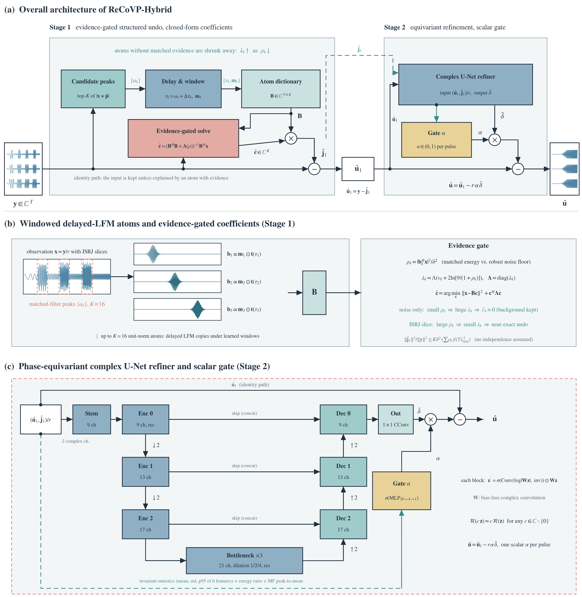

图1　ReCoVP-Hybrid总体框架。(a) 总体结构：第一阶段由匹配滤波输出选取候选峰，估计时延与窗，构成原子字典$\boldsymbol B$，在证据门控下解析求出系数，得到$\widehat{\boldsymbol j}_1$与$\widehat{\boldsymbol u}_1=\boldsymbol y-\widehat{\boldsymbol j}_1$；第二阶段以$(\widehat{\boldsymbol u}_1,\widehat{\boldsymbol j}_1)/r$为输入，输出$\widehat{\boldsymbol u}=\widehat{\boldsymbol u}_1-r\alpha\widetilde{\boldsymbol\delta}$。(b) 开窗时延LFM原子与证据门：$\rho_k$为原子匹配能量与稳健噪声底之比，决定正则强度$\lambda_k$，无证据的原子被压向零。(c) 复值精修网络：四级复值U-Net，通道宽度9/13/17/21，瓶颈膨胀率1/2/4；每个块为无偏置复卷积加相位不变的幅度门；标量门$\alpha$由不变特征统计量与两个物理标量驱动。实线为复数数据流，青色虚线为实值条件流。

算法1概括了推理过程。

> **算法1 ReCoVP-Hybrid单脉冲推理**
> 输入：受扰脉冲$\boldsymbol y\in\mathbb C^T$；已知LFM模板$\boldsymbol p$。
> 1. 计算RMS尺度$r$与归一化输入$\boldsymbol x=\boldsymbol y/r$（式（12））；
> 2. 提取四路相位不变特征$\boldsymbol\phi$（式（13）），经特征编码—解码网络得到共享特征$\boldsymbol h\in\mathbb R^{13\times T}$；
> 3. 由模板相关幅值选出$K$个候选峰$a_k$，并按式（14）细化得到时延$\tau_k$；
> 4. 按式（15）生成时延模板$\boldsymbol t_k$，由窗网络得到实窗$\boldsymbol m_k$，按式（16）构成字典$\boldsymbol B$；
> 5. 由正则头得到$\boldsymbol\Lambda$（式（17）），求解式（19）得到$\widehat{\boldsymbol j}_1$，并令$\widehat{\boldsymbol u}_1=\boldsymbol y-\widehat{\boldsymbol j}_1$；
> 6. 将$(\widehat{\boldsymbol u}_1/r,\widehat{\boldsymbol j}_1/r)$送入复值精修网络，得到修正提案$\widetilde{\boldsymbol\delta}$与脉冲级门$\alpha$（式（23）—（25））；
> 7. 输出$\widehat{\boldsymbol u}=\widehat{\boldsymbol u}_1-r\alpha\widetilde{\boldsymbol\delta}$。

### 3.2 尺度归一化与相位不变特征

接收信号的幅度随目标距离和干扰功率在很大范围内变化。对非零输入，以均方根尺度归一化：

$$
r(\boldsymbol y)=\Big(\tfrac1T\textstyle\sum_{n=0}^{T-1}|y_n|^2\Big)^{1/2},\qquad
\boldsymbol x=\boldsymbol y/r(\boldsymbol y), \tag{12}
$$

全零输入单独定义$r=1$、$\boldsymbol x=\boldsymbol 0$。所有修正量在归一化坐标中估计，再乘以$r$回到物理尺度，使输出与输入具有相同的物理单位。

记单位能量模板为$\widetilde{\boldsymbol p}$，相关幅值$\boldsymbol a=|\boldsymbol x\star\widetilde{\boldsymbol p}|$。对每个采样点构造四路特征

$$
\boldsymbol\phi_n=\big[\,|x_n|,\;a_n,\;\operatorname{Re}\ell_n,\;\operatorname{Im}\ell_n\,\big]^\top,\qquad
\ell_n=x_nx_{n-1}^{*},\ \ell_0=0. \tag{13}
$$

三类特征各有分工：$|x_n|$描述局部能量，能量突变处往往对应干扰片段的边界；$a_n$描述观测与已知LFM的匹配程度，峰值位置给出可能的延迟波形；相邻样点共轭积$\ell_n$的相位等于局部瞬时频率乘以采样间隔，在LFM信号上随时间线性变化，干扰片段的转发延迟和频偏会使这一规律出现跳变。若输入乘以单位模复数$e^{\mathrm j\varphi}$，三类特征均不变，因此后续候选选择和窗形估计不会因整体相位变化而改变。

特征编码器为一维U-Net形式[45]，通道宽度依次为$4\to13\to26\to44$，长度依次为$T\to T/2\to T/4$，每级卷积后接组归一化[46]和ReLU。解码器经两次上采样与跳跃连接回到$13\times T$的共享特征$\boldsymbol h$。跳跃连接保留了片段边界附近的细节，下采样路径则汇聚较长时间范围的上下文，便于区分重复转发造成的多个相似片段。

### 3.3 候选时延的选择与细化

以未归一化LFM模板计算观测的相关幅值，在索引$2\le n\le T-3$内用13点最大池化寻找局部峰，选出幅值最大的$K=16$个峰作为候选，并要求任意两个候选间隔不小于6个采样点；局部峰不足$K$个时，从其余位置按幅值补足，幅值并列时取较小索引。候选只依赖观测与已知模板。

整数位置的候选不足以描述非整数时延，也不足以吸收频偏引起的峰值偏移。为此，对每个候选$a_k$提取其邻域内的共享特征、全局池化特征、归一化位置与峰值信息，组成59维向量$\boldsymbol h_k$，由一个$59\to64\to1$的多层感知机给出有界细化：

$$
\tau_k=a_k+2\tanh\big(f_\tau(\boldsymbol h_k)\big). \tag{14}
$$

细化范围被限制在$\pm2$个采样点以内，使网络只在候选附近微调，而不会把一个候选移到另一个峰上。其代价是，被池化漏掉的干扰片段无法由细化补回，这部分误差留给第二阶段。

### 3.4 局部窗字典

为了表示非整数时延，在$N=4096$点频域对单位能量模板施加线性相位，再截取前$T$点：

$$
\boldsymbol t_k=\mathcal T_T\,\mathcal F_N^{-1}\Big[\widetilde{\boldsymbol P}\odot\exp(-\mathrm j2\pi\boldsymbol f\tau_k)\Big], \tag{15}
$$

其中$\widetilde{\boldsymbol P}$为模板零填充后的DFT，$\boldsymbol f$为与DFT排列一致的归一化频率向量，$\mathcal T_T$表示截取前$T$个样点。

候选时延只确定了“哪一段LFM”，没有确定这段LFM中哪些样点属于转发片段。按式（3），干扰片段是时延LFM被采样窗截断后的结果，因此需要为每个候选估计一个时间窗。窗网络的输入由两部分组成：一部分是13路共享特征$\boldsymbol h$；另一部分是候选专属的匹配特征，即对共轭乘积$\boldsymbol x\odot\boldsymbol t_k^{*}$分别做5、15、31点滑动平均，取每个尺度的幅值及相邻共轭积的实部与虚部，共9路。观测中与$\boldsymbol t_k$匹配的片段在$\boldsymbol x\odot\boldsymbol t_k^{*}$上表现为近似常数的复包络，其幅值高、相邻相位差接近零；不匹配的部分则表现为快速旋转的相位。多尺度平滑使窗网络能够同时看到窄片段和宽片段。22路输入经$22\to12\to1$的逐点卷积得到窗权重，经sigmoid、三点均值平滑后按峰值归一化（分母下限0.05），得到实窗$\boldsymbol m_k\in[0,1]^T$。原子定义为

$$
\boldsymbol b_k=\frac{\boldsymbol m_k\odot\boldsymbol t_k}{\|\boldsymbol m_k\odot\boldsymbol t_k\|_2+10^{-12}},\qquad
\boldsymbol B=[\boldsymbol b_1,\ldots,\boldsymbol b_K]\in\mathbb C^{T\times K}. \tag{16}
$$

所有候选共享同一个窗网络，不同候选因模板位置和匹配特征不同而得到不同的窗。原子被归一化为单位能量，其实际复幅度由下一步的系数求解决定。这里不要求原子与物理片段一一对应：一个片段可以由几个原子共同表示，一个原子的窗也可以覆盖多个相邻片段。

### 3.5 正则化变量投影

**系数子问题。** 给定字典$\boldsymbol B$，干扰系数可由最小二乘确定。由于候选间隔只有数个采样点，相邻原子高度相关，$\boldsymbol B^H\boldsymbol B$可能病态，直接求解会产生幅值很大、符号相反的系数组合。为此为每个候选引入正则强度$\lambda_k>0$。设$\widehat\sigma^2$为归一化输入的稳健离差估计（以三次反距离加权迭代求中心，再取到中心距离平方的中位数除以$\log2$），候选的相关强度为$\rho_k=|\boldsymbol b_k^H\boldsymbol x|^2/\widehat\sigma^2$。正则头（$61\to16\to1$）输出实数$v_k$，并令

$$
z_k=v_k+2\big[\log 9-\log(1+\rho_k)\big],\qquad
\lambda_k=10^{-4}+\exp\{30\tanh(z_k/30)\},\qquad
\boldsymbol\Lambda=\operatorname{diag}(\lambda_1,\ldots,\lambda_K). \tag{17}
$$

偏置项$-2\log(1+\rho_k)$使相关强度高的候选默认获得较小正则、相关强度低的候选获得较大正则，网络输出$v_k$在此基础上调整；$\tanh$限幅与正下限保证$\lambda_k\in(10^{-4},10^{-4}+e^{30})$。系数子问题为

$$
\widehat{\boldsymbol c}=\arg\min_{\boldsymbol c\in\mathbb C^K}\;
\|\boldsymbol x-\boldsymbol B\boldsymbol c\|_2^2+\boldsymbol c^H\boldsymbol\Lambda\boldsymbol c. \tag{18}
$$

目标函数关于$\boldsymbol c^{*}$的Wirtinger导数为零，得到正规方程$(\boldsymbol B^H\boldsymbol B+\boldsymbol\Lambda)\widehat{\boldsymbol c}=\boldsymbol B^H\boldsymbol x$。对任意$\boldsymbol v\neq\boldsymbol0$，有$\boldsymbol v^H(\boldsymbol B^H\boldsymbol B+\boldsymbol\Lambda)\boldsymbol v=\|\boldsymbol B\boldsymbol v\|_2^2+\sum_k\lambda_k|v_k|^2>0$，系数矩阵正定，故无论字典列是否相关，式（18）都有唯一解。第一阶段干扰估计为

$$
\widehat{\boldsymbol j}_1=r\,\boldsymbol B\widehat{\boldsymbol c}=\boldsymbol P\boldsymbol y,\qquad
\boldsymbol P\triangleq\boldsymbol B(\boldsymbol B^H\boldsymbol B+\boldsymbol\Lambda)^{-1}\boldsymbol B^H. \tag{19}
$$

这一做法沿用了变量投影的思想[47–49]：在可分离的非线性最小二乘问题中，线性参数在给定非线性参数时有闭式解，可以先被消去，从而只需优化非线性参数。在本文中，非线性参数（时延、窗、正则）由网络估计，线性系数由式（19）解析求出，梯度通过线性方程的解反向传播到网络[31]。与展开固定步数的迭代算法[4,30,34]相比，这样处理的好处是给定字典与正则项时，系数子问题有唯一最优解，网络不需要学习迭代本身。实现中以线性方程求解器计算$\widehat{\boldsymbol c}$，不显式求逆；系数求解使用双精度复数，其余计算使用单精度。

**命题1（固定表示下的收缩性质）。** 若$\boldsymbol B$固定且$\boldsymbol\Lambda\succ0$，则$\boldsymbol P$为Hermitian半正定矩阵，其特征值位于$[0,1)$；记$\boldsymbol B\boldsymbol\Lambda^{-1/2}$的奇异值为$\sigma_1\ge\cdots\ge\sigma_K$，则$\boldsymbol P$对应正奇异值的非零特征值为$\sigma_k^2/(1+\sigma_k^2)$，且$\operatorname{tr}\boldsymbol P=\sum_k\sigma_k^2/(1+\sigma_k^2)<K$。

对给定的$\boldsymbol B,\boldsymbol\Lambda$，命题1约束算子的特征方向增益及整体范数。对非零$\boldsymbol y$，$\|\boldsymbol P\boldsymbol y\|_2<\|\boldsymbol y\|_2$。$\boldsymbol I-\boldsymbol P$在该固定表示下非扩张。不同输入可生成不同字典，因而上述不等式没有给出完整自适应映射的 Lipschitz 常数。$\operatorname{tr}\boldsymbol P$描述固定线性平滑算子的有效自由度。

**推论1（固定字典下的修正自由度）。** 固定$\boldsymbol B,\boldsymbol\Lambda$，对与二者独立的噪声$\boldsymbol\epsilon\sim\mathcal{CN}(\boldsymbol0,\sigma^2\boldsymbol I_T)$取期望，则

$$
\frac{\mathbb E\|\boldsymbol P\boldsymbol\epsilon\|_2^2}{\mathbb E\|\boldsymbol\epsilon\|_2^2}=\frac{\operatorname{tr}(\boldsymbol P^2)}{T}\le\frac{\operatorname{tr}\boldsymbol P}{T}<\frac{K}{T}. \tag{19a}
$$

证明只需利用$\mathbb E\|\boldsymbol P\boldsymbol\epsilon\|_2^2=\sigma^2\operatorname{tr}(\boldsymbol P^H\boldsymbol P)=\sigma^2\operatorname{tr}(\boldsymbol P^2)$，以及特征值$\mu_k\in[0,1)$时$\mu_k^2\le\mu_k$。在本文设置$K=16$、$T=1800$下，右端不超过0.89%。该上界只对与噪声独立的固定字典成立。实际字典由观测选取，数据自适应的选择会把原子推向噪声中最强的相关峰，使投影带走的能量超过$K/T$。设各位置的匹配能量近似为独立的单位均值指数变量，且原子近似正交，则选出的$K$个最大值之和的期望为$K(1+H_T-H_K)\approx K[1+\ln(T/K)]$，其中$H_n$为第$n$个调和数。在$K=16$、$T=1800$时该值约为91，即不加正则的最小二乘会移除约5.1%的噪声能量，约为式（19a）上界的6倍；5.7节的零训练诊断实测为5.6%。因此，仅凭$K$个候选的结构并不能解释背景几乎不被改动，这一性质来自式（17）中依赖证据的正则。

**推论2（证据门控下的修正能量）。** 对非零观测$\boldsymbol y$及列为单位范数的字典$\boldsymbol B$（可依赖于$\boldsymbol y$），设$\boldsymbol\Lambda=\operatorname{diag}(\lambda_1,\ldots,\lambda_K)$、$\lambda_{\min}=\min_k\lambda_k>0$，则

$$
\frac{\|\widehat{\boldsymbol j}_1\|_2^2}{\|\boldsymbol y\|_2^2}\le\frac{K\,\widehat\sigma^2}{T\,\lambda_{\min}^2}\sum_{k=1}^{K}\rho_k. \tag{19b}
$$

证明：记$\boldsymbol G=\boldsymbol B^H\boldsymbol B$，$\boldsymbol v=(\boldsymbol G+\boldsymbol\Lambda)^{-1}\boldsymbol B^H\boldsymbol x$，则$\widehat{\boldsymbol j}_1=r\boldsymbol B\boldsymbol v$。一方面$\|\boldsymbol B\boldsymbol v\|_2^2=\boldsymbol v^H\boldsymbol G\boldsymbol v\le\|\boldsymbol G\|_2\|\boldsymbol v\|_2^2$，列为单位范数时$\|\boldsymbol G\|_2\le\operatorname{tr}\boldsymbol G=K$；另一方面$\boldsymbol G\succeq0$，故$\boldsymbol G+\boldsymbol\Lambda$的最小特征值不小于$\lambda_{\min}$，$\|\boldsymbol v\|_2\le\|\boldsymbol B^H\boldsymbol x\|_2/\lambda_{\min}$。再由$\|\boldsymbol B^H\boldsymbol x\|_2^2=\widehat\sigma^2\sum_k\rho_k$、$\|\boldsymbol y\|_2^2=r^2\|\boldsymbol x\|_2^2$与$\|\boldsymbol x\|_2^2=T$即得式（19b）。$\square$

式（19b）对每个样本成立，与候选如何选出无关，右端各量都由同一次观测算出，因而不需要推论1的独立性假设。上界同时包含候选数、匹配能量和最小正则强度。按式（17），匹配能量小的原子对应很大的$\lambda_k$：所有原子都缺少证据时，式（19b）右端极小，第一阶段几乎不触碰观测；出现干扰片段时，相应原子的$\rho_k$变大、$\lambda_k$变小，修正接近该原子上的最小二乘解。强、弱原子并存时$\lambda_{\min}$由强原子决定，式（19b）随之变松，所以它刻画的是机制，不用于预测数值；实测值见5.7节。

**第一阶段误差的来源。** 将真实干扰分解为字典张成空间内外两部分，$\boldsymbol j=\boldsymbol B\boldsymbol c^\star+\boldsymbol j_\perp$，其中$\boldsymbol c^\star$为$\boldsymbol j$在$\operatorname{span}(\boldsymbol B)$上的最小二乘系数，$\boldsymbol B^H\boldsymbol j_\perp=\boldsymbol 0$。

**命题2（第一阶段误差分解）。** 在命题1的条件下，第一阶段恢复误差满足

$$
\widehat{\boldsymbol u}_1-\boldsymbol u=
\underbrace{\boldsymbol B(\boldsymbol B^H\boldsymbol B+\boldsymbol\Lambda)^{-1}\boldsymbol\Lambda\,\boldsymbol c^\star}_{\text{正则收缩偏差}}
+\underbrace{\boldsymbol j_\perp}_{\text{表示残差}}
-\underbrace{\boldsymbol P(\boldsymbol s+\boldsymbol\epsilon)}_{\text{目标与噪声泄漏}}. \tag{20}
$$

附录A给出式（20）的推导。前两项分别来自字典空间内的正则收缩和空间外的表示残差，第三项是对目标与噪声的附带修正。空间外的表示残差与字典列空间正交，收缩项与泄漏项则可能相互抵消。因此，误差恒等式本身不能确定三项在实测误差中的占比。精修器以初步恢复和已估计干扰为输入，其净效果由第5节的阶段比较检验。

式（18）的正则项为对角形式，对每个候选系数分别施加惩罚；字典列之间的相关性仍通过数据拟合项进入求解。因此，“未显式约束候选间的关系”并不等于“各系数独立估计”。若再引入图拉普拉斯惩罚，新增的是对相邻节点系数关系的先验。对于复数系数，同源片段也可能有不同的增益和相位，波形相似并不直接给出这种关系。本文先用原模型评价两阶段恢复，再于第5.13节单独检验相似性图。

### 3.6 自适应字典对目标响应的影响

命题1和命题2都在字典固定的前提下成立。实际上，$\boldsymbol B$与$\boldsymbol\Lambda$都由观测估计，目标的加入会改变候选、窗和正则，因而改变整个算子。记$\boldsymbol y_0=\boldsymbol j+\boldsymbol\epsilon$为无目标受扰观测，$\boldsymbol P_0=\boldsymbol P(\boldsymbol y_0)$，$\boldsymbol P_1=\boldsymbol P(\boldsymbol y_0+\boldsymbol s)$，第一阶段的输出为$F_1(\boldsymbol y)=(\boldsymbol I-\boldsymbol P(\boldsymbol y))\boldsymbol y$。由定义直接得到第一阶段的目标增量误差

$$
\boldsymbol\eta_1=F_1(\boldsymbol y_0+\boldsymbol s)-F_1(\boldsymbol y_0)-\boldsymbol s
=-\boldsymbol P_1\boldsymbol s-(\boldsymbol P_1-\boldsymbol P_0)\boldsymbol y_0, \tag{21}
$$

并由三角不等式得到

$$
\|\boldsymbol\eta_1\|_2\le\|\boldsymbol P_1\boldsymbol s\|_2+\|\boldsymbol P_1-\boldsymbol P_0\|_2\,\|\boldsymbol y_0\|_2. \tag{22}
$$

式（21）的两项分别来自对目标的直接修改和背景算子的变化。式（22）给出后者的范数上界。上界较大时，实际误差仍可能很小，两项之间也可能发生抵消。本文对加入目标前后的输入分别重新估计字典，用完整输出评价目标增量；该比较包含两项的合计效应。

### 3.7 复值残差精修

**输入与复值卷积。** 第二阶段在归一化坐标中工作，输入为两路复数信号$\boldsymbol r_1=\widehat{\boldsymbol u}_1/r$与$\boldsymbol j_1=\widehat{\boldsymbol j}_1/r$。网络主干由无偏置复值卷积构成[50]。复数权重$\boldsymbol W=\boldsymbol W_R+\mathrm j\boldsymbol W_I$与复数特征$\boldsymbol z=\boldsymbol z_R+\mathrm j\boldsymbol z_I$的卷积按实部与虚部展开为

$$
\boldsymbol W*\boldsymbol z=(\boldsymbol W_R*\boldsymbol z_R-\boldsymbol W_I*\boldsymbol z_I)+\mathrm j(\boldsymbol W_R*\boldsymbol z_I+\boldsymbol W_I*\boldsymbol z_R). \tag{23}
$$

去掉偏置项是为了让每一层都与全局复数缩放交换：若输入乘以复数$c$，输出也恰好乘以$c$。

**相位不变的实值门。** 复值网络的难点在于非线性。对实部和虚部分别施加ReLU或tanh等逐分量非线性，会使输出依赖于输入的绝对相位，破坏上述交换性质。本文把非线性全部放在一个相位不变的实值分支中，再把其输出作为乘性门作用回复数特征。每一层复卷积的输出$\boldsymbol v$乘以门$\boldsymbol g$：

$$
\boldsymbol z^{+}=\boldsymbol g\odot\boldsymbol v,\qquad
\boldsymbol g=\operatorname{sigmoid}\Big(\operatorname{SiLU}\big(\mathcal K[\log(|\boldsymbol v|_\varepsilon+10^{-3}),\,\boldsymbol\psi]\big)\Big),\qquad
|v|_\varepsilon=\sqrt{|v|^2+10^{-14}}, \tag{24}
$$

其中$\mathcal K$为实值卷积，$\boldsymbol\psi$为6路相位不变条件特征：两路输入的逐点对数幅值，$\boldsymbol r_1$相邻样点共轭积的实部与虚部，以及$\boldsymbol r_1\odot\boldsymbol j_1^{*}$的实部与虚部。最后两路衡量初步恢复与已撤销干扰在每个时刻的相关程度，是识别式（20）中收缩偏差的主要依据；低分辨率层的$\boldsymbol\psi$由平均池化得到。门只缩放复数特征的模，不改变其相位。这种以条件特征调制中间特征的做法在图像恢复中有类似形式[41]，区别在于本文的调制只有乘性项，没有会破坏相位关系的加性偏移。由于SiLU有下界$-0.278$，门的取值范围约为$(0.431,1)$，它是一个连续的强度调节器，不能把某个位置完全关闭。

**网络层级。** 精修网络为四级复值U-Net：通道宽度依次为$9,13,17,21$，长度依次为$T,T/2,T/4,T/8$，每级包含复值残差块[37]；最低分辨率处设置膨胀率为1、2、4的三个复值卷积块，以扩大时间感受野而不进一步降低分辨率，使网络能够覆盖重复转发产生的相隔数十个样点的相似片段；解码端经三次上采样与跳跃连接回到全分辨率，最后由一个无偏置复卷积输出单通道修正提案$\widetilde{\boldsymbol\delta}$。上采样采用对实部与虚部分别做线性插值的方式，下采样采用平均池化，两者都与复数缩放交换。

**脉冲级标量门。** 层内门在每个位置、每个通道上调节特征，但不能决定整个脉冲是否需要精修。例如无干扰输入的第一阶段输出已经接近参考，此时最好几乎不采用精修提案。为此设置一个独立的标量头：它汇总6路条件特征在全脉冲上的均值、标准差与第95百分位数（18维），再加上第一阶段干扰估计能量与观测能量之比、初步恢复结果的脉压峰均功率比，共20维输入，经$20\to4\to1$的多层感知机输出

$$
\alpha=\operatorname{sigmoid}\big(f_\alpha(\boldsymbol h_\alpha)\big)\in(0,1),\qquad
\boldsymbol\delta_2=r\,\alpha\,\widetilde{\boldsymbol\delta}. \tag{25}
$$

前一个能量比反映第一阶段撤销了多少，后一个峰均比反映初步恢复的脉压结果是否仍有明显的假峰，两者都是判断“是否需要继续修正”的直接线索。$\alpha$只限制对当前提案的采用比例，不限制提案本身的能量。

**精修何时有效。** 记第一阶段误差为$\boldsymbol e_1=\widehat{\boldsymbol u}_1-\boldsymbol u$。由$\widehat{\boldsymbol u}-\boldsymbol u=\boldsymbol e_1-\boldsymbol\delta_2$得

$$
\|\widehat{\boldsymbol u}-\boldsymbol u\|_2^2-\|\boldsymbol e_1\|_2^2=\|\boldsymbol\delta_2\|_2^2-2\operatorname{Re}\big(\boldsymbol e_1^H\boldsymbol\delta_2\big). \tag{26}
$$

因此，单个样本的恢复误差下降当且仅当$2\operatorname{Re}(\boldsymbol e_1^H\boldsymbol\delta_2)>\|\boldsymbol\delta_2\|_2^2$，即修正量与第一阶段误差在方向上足够一致，且幅度不超过该方向上误差投影的两倍。式（26）对单个样本精确成立，不依赖于独立性或线性化假设。它也说明了标量门的作用：给定方向，$\alpha$的最优值为$\operatorname{Re}(\boldsymbol e_1^H\widetilde{\boldsymbol\delta})/(r\|\widetilde{\boldsymbol\delta}\|_2^2)$截断到$(0,1)$，当提案方向不可靠时，较小的$\alpha$可以限制误差增大的幅度。同样的分析适用于目标损伤，只需把$\boldsymbol\delta_2$换为两种受扰状态精修量之差。

表2列出了网络各部分的接口与规模。

**表2 ReCoVP-Hybrid的模块与接口**（批量维省略）

|模块|输入→输出|结构|作用|
|---|---|---|---|
|RMS归一化|$\mathbb C^{1800}\to\mathbb C^{1800}$，尺度$r$|式（12）|统一幅度尺度，保留物理输出尺度|
|特征编码—解码|实$4\times1800\to13\times1800$|宽度13/26/44，两次下采样，GN+ReLU，跳连|融合能量、模板匹配和局部相位变化|
|候选选择|相关幅值$\to$16个整数位置|13点最大池化，间隔≥6|定位可能的延迟波形|
|时延细化头|$59\to64\to1$|MLP，$\pm2$点有界输出|吸收非整数时延与峰值偏移|
|窗网络|实$22\times1800\to1\times1800$（每个候选）|$22\to12\to1$逐点卷积，sigmoid，平滑|估计每个原子的时间支撑|
|字典与正则头|$\mathbb C^{1800\times16}$；$61\to16\to1$|式（16）、（17）|构造原子，确定每个候选的正则强度|
|系数求解|$16\times16$正定线性方程|式（19），双精度|求干扰复幅度，得到$\widehat{\boldsymbol j}_1$|
|复值编码器|2路复数$\to$复$9\times1800\to13\times900\to17\times450\to21\times225$|无偏置复卷积，残差块，相位不变实门|聚合多尺度残余结构|
|膨胀瓶颈|复$21\times225$|膨胀率1/2/4|扩大时间感受野|
|复值解码器|复$21\times225\to1\times1800$|三次上采样，跳连|恢复全分辨率修正提案$\widetilde{\boldsymbol\delta}$|
|标量门|实20维$\to$标量$\alpha$|$20\to4\to1$ MLP，sigmoid|决定整个脉冲对提案的采用比例|

整个网络共有57,525个有效实参数（每个复数参数计为两个实参数）。参数主要集中在特征编码器与复值精修网络中，字典构造与系数求解本身没有可训练参数。

### 3.8 复数缩放等变性与计算复杂度

**命题3（理想映射的复数缩放等变性）。** 固定发射模板。设$\boldsymbol y\ne\boldsymbol0$，采用式（12）的齐次归一化、精确算术及对相同幅值序列一致的并列处理规则。对同一观测整体乘以非零复数$c$时，有

$$
F_\theta(c\boldsymbol y)=c\,F_\theta(\boldsymbol y). \tag{27}
$$

证明见附录A。整体缩放在归一化后只留下公共相位旋转。匹配幅值和实值条件特征对该旋转不变，无偏置复线性运算与旋转可交换，故输出按同一复数因子变换。群等变网络[51]给出更一般的概念。式（27）涉及对整个观测施加同一因子，单独改变目标、干扰或噪声的幅相超出了这一假设。

需要注意的是，命题3依赖精确算术与确定的并列规则。在单精度实现中，相关幅值的舍入误差可能改变峰值排序，从而引起候选切换。5.9节给出了实测的数值偏差。

**计算复杂度。** 设$K$为候选数，$L$为模板长度。模板相关与非整数时延模板生成均可通过FFT实现，复杂度为$O(KN\log N)$；构造$\boldsymbol B^H\boldsymbol B$需要$O(TK^2)$，求解$K\times K$线性方程需要$O(K^3)$；两阶段卷积网络的复杂度与$T$成线性关系。在$T=1800$、$K=16$的设置下，字典相关计算与卷积网络在总计算量中处于同一量级。

## 4 四状态联合训练

第3节的结构限定了修正量的形式，但没有规定如何在撤销干扰与保留目标之间取舍。训练目标在四状态（式（6））上同时约束这两件事：端点损失要求每种状态的修正量逼近该状态应当撤销的干扰，目标增量损失则要求目标加入后修正量不发生不必要的变化。

### 4.1 波形与脉压约束

对状态$ab$，应撤销的修正量为$\boldsymbol j^\star_{ab}=b\,\boldsymbol j$，参考为$\boldsymbol u_{ab}=\boldsymbol\epsilon+a\boldsymbol s$。记$\langle\cdot\rangle$为在训练记录、脉冲和四种状态上的算术平均。对任一阶段的修正量$C$，波形损失为

$$
\mathcal L_{\mathrm{wav}}(C)=\Big\langle\frac{\|C(\boldsymbol y_{ab})-\boldsymbol j^\star_{ab}\|_2^2}{\max(\|\boldsymbol u_{ab}\|_2^2,10^{-12})}\Big\rangle. \tag{28}
$$

两种无干扰状态的监督目标为零修正，式（28）因而直接惩罚处理器对干净输入的改动。以$\boldsymbol u_{ab}$的能量归一化，使不同信噪比的样本对损失的贡献处于同一量级。

波形误差在时域上平均分布，但检测只关心脉压后的峰值。参照CVEDNet[19]在波形域与脉压域同时施加约束的做法，加入脉压损失

$$
\mathcal L_{\mathrm{pc}}(C)=\Big\langle\frac{\|\mathcal H[C(\boldsymbol y_{ab})-\boldsymbol j^\star_{ab}]\|_2^2}{\max(\|\mathcal H\boldsymbol u_{ab}\|_2^2,10^{-12})}\Big\rangle, \tag{29}
$$

其中$\mathcal H$为已知LFM模板的零填充相关算子。

### 4.2 目标增量约束

由$F(\boldsymbol y)=\boldsymbol y-C(\boldsymbol y)$与式（6），两种受扰状态的目标增量误差恰好等于修正量之差的相反数：

$$
F(\boldsymbol y_{11})-F(\boldsymbol y_{01})-\boldsymbol s=-\big[C(\boldsymbol y_{11})-C(\boldsymbol y_{01})\big]. \tag{30}
$$

目标损伤损失因此写为

$$
\mathcal L_{\mathrm{tar}}(C)=\Big\langle\frac{\|C(\boldsymbol y_{11})-C(\boldsymbol y_{01})\|_2^2}{\max(\|\boldsymbol s\|_2^2,10^{-12})}\Big\rangle. \tag{31}
$$

式（31）惩罚的是“加入目标后干扰估计的变化”，它与式（21）中的两项都直接相关：既约束当前算子对目标的修改，也约束目标引起的算子变化。该损失只在训练时需要四状态样本，推理时不需要。

### 4.3 残余尾峰约束

虚警主要来自无目标单元中的残余峰值，而这些峰值在总残余能量中所占比例很小，波形损失对其不敏感。对无目标受扰状态，令残余$\boldsymbol v=\boldsymbol j-C(\boldsymbol y_{01})$（不含噪声），对一个相参处理间隔的$M$个脉冲做脉冲压缩与$M$点慢时间FFT，得到距离—多普勒功率图。以同次噪声在全部距离—多普勒单元上的平均功率为分母，取距离索引$[36,1165)$内残余功率与之的比值（dB），记前8个最大值为$q_l$，$l=1,\ldots,8$。以理想CA-CFAR的门限因子$\gamma=N_r(p_0^{-1/N_r}-1)$定义参考水平$q_0=10\log_{10}\gamma$，其中$N_r=436$、$p_0=10^{-6}$。尾峰损失为

$$
\mathcal L_{\mathrm{tail}}(C)=\frac1{q_0}\Big\langle\Big[3\log\{1+e^{(q_l-q_0)/3}\}-3\log2\Big]_+\Big\rangle_{l=1,\ldots,8}, \tag{32}
$$

其中$[x]_+=\max(x,0)$。该项只对超过检测门限水平的少数峰值施加惩罚，softplus使惩罚在门限附近平滑增长。由于前8选择与截断，该损失分段光滑；它约束的是已知干扰残余相对于噪声的峰值，并非对实际虚警率的可微替代。

### 4.4 联合目标与优化设置

每个阶段的损失为

$$
\mathcal L_{\mathrm{stage}}(C)=\mathcal L_{\mathrm{wav}}(C)+0.1\,\mathcal L_{\mathrm{pc}}(C)+\mathcal L_{\mathrm{tar}}(C)+0.05\,\mathcal L_{\mathrm{tail}}(C), \tag{33}
$$

总损失为$\mathcal L=\mathcal L_{\mathrm{stage}}(C_{\mathrm{final}})+0.25\,\mathcal L_{\mathrm{stage}}(C_1)$，其中$C_1=\widehat{\boldsymbol j}_1$为第一阶段修正，$C_{\mathrm{final}}=\widehat{\boldsymbol j}_1+\boldsymbol\delta_2$为总修正。第一阶段辅助项使字典分支即使在精修分支存在时也保持有意义的干扰估计，避免两阶段退化为“第一阶段任意、第二阶段全包”。两个阶段联合优化，第一阶段不单独预训练或冻结。各项权重为固定值；GradNorm[52]等自适应加权方法可用于平衡多个损失的梯度尺度，本文未采用。

优化器为Adam[53]（$\beta_1=0.9$，$\beta_2=0.999$，$\varepsilon=10^{-8}$，无权重衰减）。学习率在第一轮内线性预热至$10^{-3}$，按余弦计划在第128轮降至$2\times10^{-5}$，第256轮降至$2\times10^{-6}$。有效批量为32条记录，由4个8条记录的微批次梯度累积得到，梯度范数裁剪为5。每轮48次更新，共训练256轮（12,288次更新），取最后一轮的模型参数，不依据评价集挑选轮次。

## 5 仿真实验与结果分析

### 5.1 仿真设置

每个相参处理间隔包含8个脉冲。组内目标的时延、幅度和多普勒保持不变，慢时间相位按式（2）演化；噪声按脉冲独立生成。每组的受扰脉冲数从$\{1,2,4,6,8\}$中抽取，每个受扰脉冲的采样与转发参数独立抽取。同一基础场景生成直接、重复和循环三种转发变体，三者共享目标与噪声，只有干扰不同。主要参数见表3。

**表3 雷达与干扰仿真参数**

|参数|取值|
|---|---|
|采样率／带宽／脉宽|60 MHz／30 MHz／10 μs|
|单脉冲接收长度／模板长度|1800点／600点|
|脉冲数／脉冲重复间隔|8／30 μs|
|目标幅度／目标时延|0.15～2.0／[64, 1136)个采样点|
|目标多普勒|−200～200 kHz|
|转发方式|直接、重复、循环|
|采样窗宽度／采样周期|6～72点／36～260点|
|转发延迟／转发次数／最大重放间隔|1～96点／1～10／64点|
|干扰频偏|−200～200 kHz|
|训练集|512个基础场景：常规条件256个（SNR [−20, 15] dB，JSR [−12, 35] dB），极端条件256个（SNR [−30, −20) dB，JSR [−12, 45] dB）|
|评价集|256个基础场景，SNR [−30, 15] dB，JSR [−12, 45] dB|

SNR定义为目标有效支撑内的平均功率与噪声功率之比，JSR定义为干扰非零支撑内的平均功率与目标有效支撑内平均功率之比；SNR按脉冲抽取，JSR按受扰脉冲抽取，因而一个基础场景并不对应唯一的SNR与JSR。慢时间采样率约为33.33 kHz，较大的多普勒会发生混叠，评价时将其折叠到一个PRF周期内并取最近的多普勒单元。

评价集包含256个基础场景、768条记录。由于三种转发变体共享目标与噪声，统计时以基础场景为独立单元：每个基础场景先对三种变体等权平均，再在256个基础场景间平均。该评价集在方法设计阶段已被使用，本节结果属于开发集上的评价。

### 5.2 评价指标与检测设置

对8脉冲矩阵采用Frobenius范数，定义恢复误差、目标增量损伤和无干扰误差：

$$
E_U=\frac{\|\widehat U_{11}-(S+E)\|_F^2}{\|S+E\|_F^2},\quad
D_S=\frac{\|\widehat U_{11}-\widehat U_{01}-S\|_F^2}{\|S\|_F^2},\quad
E_0=\frac{\|\widehat U_{00}-E\|_F^2+\|\widehat U_{10}-(S+E)\|_F^2}{\|E\|_F^2+\|S+E\|_F^2}, \tag{34}
$$

其中$\widehat U_{ab}$为状态$ab$下的处理输出，分母下限为$10^{-24}$。$E_0$衡量处理器对两种无干扰输入的改动，理想值为零。目标复增益幅值$|g|$按式（9）在8脉冲矩阵上计算，理想值为1。 等虚警评价集另报纯噪声输入的相对改动 $E_{\epsilon}=\|\widehat U_{00}-E\|_F^2/\max(\|E\|_F^2,10^{-24})$。该量只使用状态00，与式（34）合并状态00和10的 $E_0$ 分别统计。

脉冲压缩采用600点模板，保留0～1200的有效延迟单元。设脉冲平均距离功率为$P_v[k]$，目标单元$k_\star$由无干扰目标的脉压峰确定，干扰抑制后的信干比改善量为

$$
\mathrm{SJRIF}=10\log_{10}\frac{P_{\widehat U}[k_\star]}{\max_{k\neq k_\star}P_{\widehat U}[k]}-10\log_{10}\frac{P_{Y}[k_\star]}{\max_{k\neq k_\star}P_{Y}[k]}. \tag{35}
$$

分母中的非目标最大值包含旁瓣、干扰残余与噪声。

检测采用8点慢时间FFT与二维CA-CFAR。距离维保护单元与参考单元半宽分别为12与24，多普勒维分别为1与2，慢时间方向按周期边界处理，共436个参考单元、9032个有效检测单元，名义单元虚警概率为$10^{-6}$。目标在最近的混叠多普勒单元内、目标距离单元及其左右各一个单元中至少有一次检测即记为检出。无目标受扰状态下报告两种虚警指标：单元虚警率，即虚警单元数占全部有效单元的比例；整帧虚警率，即至少出现一次虚警的处理间隔所占比例。处理会改变背景的统计分布，因此实测虚警率一般不等于名义值。

开发集及主要对照的区间采用百分位 bootstrap[54]。先在同一物理场景内汇总相应的重复观测和训练实例，再对物理场景进行 4,000 次配对重采样，取差值分布的 2.5% 和 97.5% 分位数。共享同一场景的条件、干扰类型和脉冲随场景一起抽取。区间以现有检查点和已标定门限为条件；另报种子间标准差。多指标区间分别计算，未作多重比较校正。第5.13节的图拉普拉斯筛查按其登记方案重采样 10,000 次。

### 5.3 对比方法

对比方法分为四组。

**（1）同一模型的两个阶段输出。** 仅使用第一阶段的输出$\widehat{\boldsymbol u}_1$（记为Stage1）和最终输出$\widehat{\boldsymbol u}$（记为Final）。二者来自同一组参数，比较的是推理时加入精修分支带来的变化。

**（2）参数量相近的学习型恢复网络。** 包括仅含结构化字典求解的ReCoVP-Base、不含去斜处理的卷积残差修正网络P0-NoDechirp-Tail，以及12类卷积恢复网络：CorrectionNet及其去掉去斜、去掉RMS归一化、去掉脉压损失、去掉目标损伤损失的四种变体，原损失下重新训练的对照与加入匹配滤波尾峰损失的版本；普通实值I/Q U-Net及其加尾峰损失、观测噪声归一化、频域坐标和膨胀卷积四种变体。原实验清单将12类网络的有效参数记为59,714个，与本文方法的57,525个相当，训练预算的具体口径见各方法的训练记录，每类包含3个独立训练实例（随机种子17、29、41）；本文方法包含5个训练实例（随机种子17、29、41、53、67）。CorrectionNet系列沿用了旧骨干的参数登记，另有门控与可靠度传播模块的53,042个参数在当前配置下不参与前向计算，登记总数为112,756；本次在两种批量下以 CPU 前向和反向传播直接核验了 CorrectionNet-Tail 与标准 U-Net。表中其余变体采用各自实验记录的口径。

**（3）传统方法。** Max-TF在去斜后的时频平面上识别并抑制受扰时频单元[9]，窗长65点、帧移16点、频率平滑5点、能量分位0.7；另以窗长51点、帧移12点、平滑3点的配置作参数敏感性对照，两套配置的结果按各表所注明的口径汇总。GMM-OMP用两分量高斯混合模型区分受扰与未受扰样本，再在未受扰样本上以正交匹配追踪重构目标回波[12]，带噪正交匹配追踪的一般性分析见文献[15]，稀疏度取8。两种方法只使用观测与公开的LFM参数，不需要训练。

**（4）参数规模较大的学习方法。** CVEDNet是复值编解码网络，以时域与脉压域联合损失、无噪目标为监督[19]，采用官方实现，参数量11.02 M。RSDR-Net是作者先前提出的可靠度引导复数恢复模型，参数量3.02 M。两者的权重均在另一套仿真数据上按各自原训练流程得到，本文未在当前训练集上重新训练，因此这一组比较反映的是直接使用已训练模型时的表现，与第（2）组的同预算比较性质不同。

表4汇总了各方法的参数量与训练方式。

表4　对比方法概况

|组别|方法|有效参数量|是否训练|训练数据|
|---|---|---:|---|---|
|本文|ReCoVP-Hybrid|57,525|是|本文训练集|
|同预算|12类卷积恢复网络、ReCoVP-Base、P0-NoDechirp-Tail|58,943–59,714|是|本文训练集|
|传统|Max-TF[9]、GMM-OMP[12]|—|否|—|
|大规模|RSDR-Net|3.02 M|是|另一套仿真数据|
|大规模|CVEDNet[19]|11.02 M|是|另一套仿真数据|

### 5.4 精修阶段的作用

表5在每个训练实例内配对比较中间输出与最终输出，再汇总五个实例。末列单列实例17的场景配对差。

**表5 第一阶段输出与最终输出的比较**（概率以百分数表示，概率差以百分点表示）

|指标|Stage1（5实例）|Final（5实例）|实例17的配对差值［95%置信区间］|
|---|---:|---:|---|
|$E_U$ ↓|0.3958±0.0038|0.0428±0.0020|−0.35873［−0.46821, −0.26552］|
|$D_S$ ↓|0.1247±0.0079|0.0581±0.0034|−0.06591［−0.13931, −0.01359］|
|SJRIF／dB ↑|10.467±0.060|11.127±0.044|+0.6801［+0.5301, +0.8342］|
|受扰整帧虚警率／% ↓|7.19±0.76|5.65±0.65|−1.823［−3.125, −0.521］|
|检测概率／% ↑|85.37±0.15|87.58±0.39|+1.693［−0.130, +3.646］|
|目标复增益幅值$\lvert g\rvert$（理想为1）|0.9861±0.0006|0.9217±0.0040|−0.07064［−0.07636, −0.06482］|
|无干扰误差$E_0$ ↓|$2.0\times10^{-6}$|$1.8\times10^{-5}$（中位实例$3.8\times10^{-6}$）|$+2.016\times10^{-6}$［$1.248\times10^{-6}$, $3.265\times10^{-6}$］|
|受扰单元虚警率 ↓|$5.44\times10^{-5}$|$5.56\times10^{-5}$|$+2.451\times10^{-6}$［$-5.767\times10^{-6}$, $1.283\times10^{-5}$］|

注：前两列为5个训练实例的均值±标准差；末列为实例17在256个基础场景上的配对bootstrap区间。Final的$E_0$均值受实例67（$7.5\times10^{-5}$）影响，其余四个实例在$1.7\times10^{-6}$至$4.6\times10^{-6}$之间，见5.8节。

表5中，精修后五实例平均恢复误差由 0.396 降至 0.043，平均目标损伤约减半。名义检测概率平均提高 2.2 个百分点，实例17的场景配对区间包含零。前两项变化支持精修对整体恢复的贡献，式（20）中各项分别贡献多少仍未直接测得。

精修也带来了可测的代价。目标复增益幅值从0.986降至0.922，即平均幅度衰减从约1.4%增加到约7.8%；无干扰误差在全部实例上都有所增加。图3给出了逐场景的阶段差值分布（五个实例平均）：恢复误差在96.5%的场景中下降，目标幅度在全部256个场景中都有所下降（中位数−0.059），目标损伤却只在31.6%的场景中下降，配对差值的中位数为+0.0055。也就是说，平均损伤的下降来自约三分之一场景的大幅改善，多数场景的损伤略有增加。结合式（10），精修在少数场景中显著降低了形状误差，同时在几乎所有场景中引入了幅度收缩；在等虚警评价集上按式（10）分解，第一阶段的复增益偏差与形状误差分别为0.0005与0.140，最终输出为0.0096与0.048，与这一解释一致。两项变化的相关系数只有0.04，幅度收缩与形状改善是两件不同的事。

受扰单元虚警率几乎不变（$5.44\times10^{-5}$对$5.56\times10^{-5}$），与整帧虚警率的变化方向不同。整帧虚警率衡量“是否出现虚警”，单元虚警率衡量“虚警单元有多少”，精修减少了出现虚警的处理间隔，但没有明显减少虚警单元的总数。

Stage1 的权重由两阶段损失联合训练。表5给出同一模型在精修前后的输出变化。若要估计相同训练预算下精修架构的独立贡献，还需重新训练匹配对照。

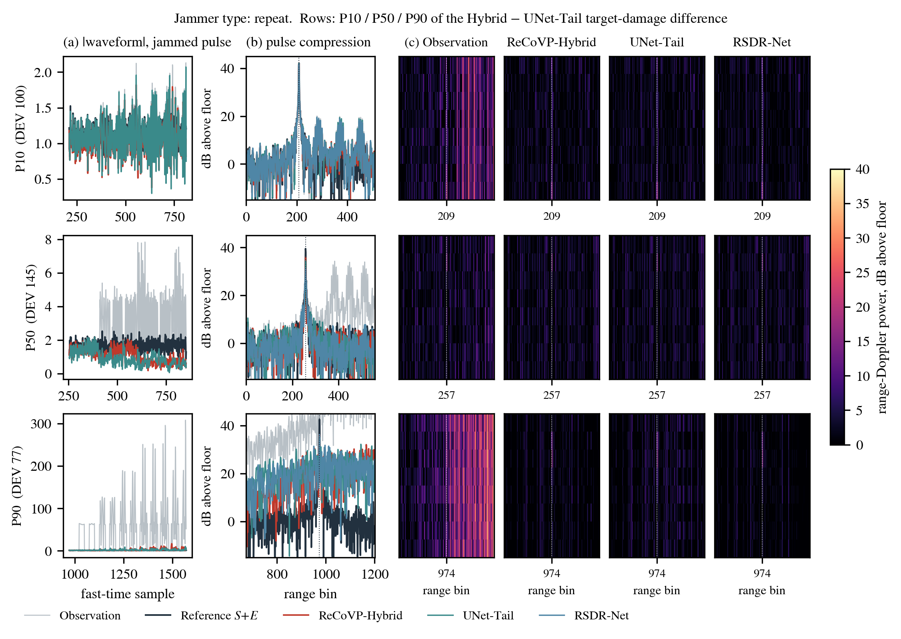

图2　重复转发干扰下的典型场景。三行按预先固定的规则选取：在开发集上计算每个基础场景的目标损伤差（本文方法五实例均值减去UNet-Tail三实例均值），取最接近第10、50、90百分位的场景，第三行是本文方法相对UNet-Tail最不利的一端。(a) 受扰脉冲的波形幅度；(b) 脉冲压缩结果；(c) 距离–多普勒功率图，虚线为目标距离单元，所有子图采用共同的绝对功率参考。直接转发与循环转发的同类图见补充材料。

图2前两行中，三种方法都把约+25 dB的假峰压到底噪附近并保住了目标峰。第三行是强干扰、弱目标场景，三种方法都留下20–30 dB的残余，目标峰被淹没。这类场景对应5.6节严格低虚警端的尾部问题。

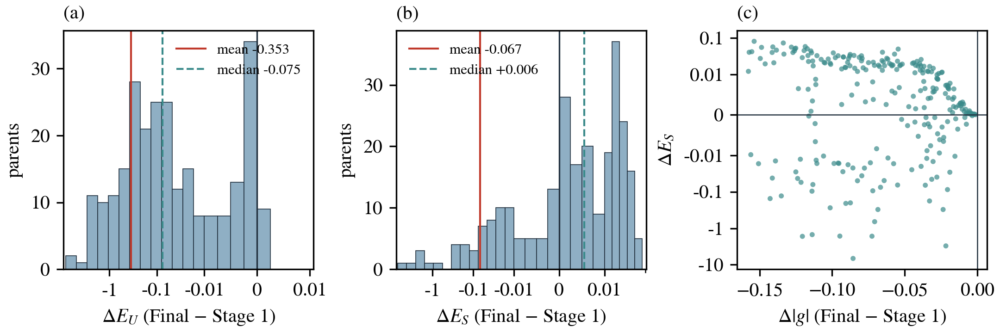

图3　开发集256个基础场景上最终输出减第一阶段输出的差值（五个训练实例平均）。(a) 恢复误差差值；(b) 目标损伤差值，红线为均值、虚线为中位数；(c) 目标幅度差值与目标损伤差值的散点，纵轴为对称对数刻度。

### 5.5 与其他模型的比较

表6列出各模型在同一评价集上的结果。

**表6 不同模型的比较**（开发集，训练实例均值）

|模型|有效实参数|训练实例|$E_U$ ↓|$D_S$ ↓|$E_0$ ↓|$P_d$／% ↑|受扰帧虚警率／% ↓|SJRIF／dB ↑|
|---|---:|---:|---:|---:|---:|---:|---:|---:|
|ReCoVP-Base|58,943|1|0.49665|0.07162|$1.94\times10^{-6}$|84.90|6.90|10.244|
|P0-NoDechirp-Tail|59,714|1|0.04866|0.04479|$9.19\times10^{-5}$|87.63|10.29|10.807|
|UNet-Tail|59,714|3|0.05364|0.04883|$8.56\times10^{-5}$|86.63|10.63|10.670|
|**ReCoVP-Hybrid**|57,525|5|**0.04285**|0.05806|$1.77\times10^{-5}$|**87.58**|5.65|11.127|
|RSDR-Net|3,017,877|1|0.03343|0.09470|$1.35\times10^{-5}$|86.98|5.08|11.338|

注：多实例方法为训练实例均值。ReCoVP-Base与P0-NoDechirp-Tail只有单个训练实例的结果。本文方法$E_0$的五个实例值为$1.7\times10^{-6}$至$4.6\times10^{-6}$（四个）与$7.5\times10^{-5}$（实例67）。

表6中的 ReCoVP-Base 是独立训练的模型，Hybrid 是五个实例的均值。两者的恢复误差分别为 0.49665 和 0.04285。要比较同一组权重下精修前后的差异，应读表5的 Stage1 与 Final 两列。

与冻结的 RSDR-Net 相比，在固定开发集上，Hybrid 的目标损伤低 0.037（配对区间 [−0.044, −0.029]），目标幅度比高 0.031（[+0.028, +0.034]）。RSDR-Net 的恢复误差低约 0.009，SJRIF 高 0.21 dB。名义检测概率与受扰整帧虚警率的差值区间均包含零。本比较没有预设等效界值，因此不能据此判定两种系统等效。

为了判断与卷积网络的差异是否来自训练随机性，并覆盖更多的卷积恢复结构，我们把本文方法与12类参数量相近的卷积恢复网络逐场景配对比较。这12类包括作者前期的CorrectionNet及其复训对照、加尾峰损失版本、四种结构或损失消融，以及普通U-Net和依次加入尾峰损失、噪声归一、频域坐标、膨胀卷积的四个变体。每类以随机种子17、29、41各训练256轮，训练数据与更新次数与本文方法相同，取最后一轮参数。对每个场景，先在训练实例间取平均（本文方法5个，基线3个），再计算本文方法减基线的配对差。表7列出全部12类。

**表7 与卷积恢复网络的逐场景配对比较**（括号内为本文方法减基线的配对差及95%置信区间；概率差以百分点表示）

|模型|$E_U$ ↓|$D_S$ ↓|$E_0$／$10^{-5}$ ↓|受扰帧虚警率／% ↓|SJRIF／dB ↑|$P_d$／% ↑|
|---|---|---|---|---|---|---|
|**ReCoVP-Hybrid（5）**|0.0428|0.0581|1.77|5.65|11.13|87.58|
|CorrectionNet|0.0599（−0.0170［−0.0214,−0.0130］）|0.0634（−0.0053［−0.0109,+0.0012］）|12.5（−10.8［−11.0,−10.6］）|15.32（−9.67［−11.80,−7.62］）|10.30（+0.83［+0.67,+0.99］）|85.98（+1.60［+0.77,+2.49］）|
|CorrectionNet复训|0.0600（−0.0171［−0.0215,−0.0131］）|0.0625（−0.0044［−0.0100,+0.0020］）|12.7（−10.9［−11.1,−10.7］）|15.23（−9.58［−11.68,−7.53］）|10.31（+0.81［+0.66,+0.98］）|86.20（+1.38［+0.58,+2.23］）|
|CorrectionNet+尾峰|0.0582（−0.0154［−0.0195,−0.0114］）|0.0636（−0.0055［−0.0111,+0.0010］）|12.8（−11.1［−11.3,−10.8］）|14.54（−8.89［−10.89,−6.95］）|10.40（+0.72［+0.58,+0.88］）|86.46（+1.12［+0.35,+1.97］）|
|CN去去斜|0.0509（−0.0080［−0.0113,−0.0047］）|0.0452（+0.0128［+0.0073,+0.0192］）|12.3（−10.5［−10.7,−10.4］）|10.85（−5.20［−6.91,−3.61］）|10.70（+0.43［+0.32,+0.55］）|87.33（+0.25［−0.57,+1.05］）|
|CN去RMS|0.0594（−0.0165［−0.0209,−0.0122］）|0.0640（−0.0059［−0.0115,+0.0005］）|4.75（−2.98［−4.22,−2.00］）|14.58（−8.93［−11.05,−6.93］）|10.34（+0.79［+0.62,+0.95］）|87.20（+0.38［−0.61,+1.38］）|
|CN去脉压损失|0.0627（−0.0198［−0.0244,−0.0155］）|0.0590（−0.0010［−0.0065,+0.0054］）|12.9（−11.1［−11.3,−10.9］）|16.54（−10.89［−13.09,−8.72］）|10.22（+0.91［+0.74,+1.08］）|86.46（+1.12［+0.26,+2.05］）|
|CN去目标损伤损失|0.0490（−0.0062［−0.0099,−0.0023］）|0.1303（−0.0723［−0.0808,−0.0635］）|29.6（−27.8［−31.3,−25.2］）|9.11（−3.46［−5.14,−1.88］）|10.86（+0.27［+0.16,+0.37］）|83.64（+3.94［+2.39,+5.63］）|
|U-Net|0.0545（−0.0117［−0.0151,−0.0081］）|0.0481（+0.0099［+0.0043,+0.0163］）|7.61（−5.84［−5.98,−5.68］）|11.11（−5.46［−7.14,−3.85］）|10.61（+0.52［+0.40,+0.65］）|86.81（+0.77［−0.02,+1.61］）|
|U-Net+尾峰|0.0536（−0.0108［−0.0142,−0.0073］）|0.0488（+0.0092［+0.0037,+0.0156］）|8.56（−6.79［−6.96,−6.62］）|10.63（−4.98［−6.65,−3.39］）|10.67（+0.46［+0.34,+0.58］）|86.63（+0.95［+0.08,+1.85］）|
|U-Net+噪声归一|0.0656（−0.0228［−0.0298,−0.0168］）|0.0596（−0.0015［−0.0071,+0.0049］）|13.8（−12.0［−12.2,−11.8］）|13.67（−8.02［−9.96,−6.16］）|10.34（+0.78［+0.64,+0.93］）|86.28（+1.29［+0.51,+2.14］）|
|U-Net+频域坐标|0.0997（−0.0568［−0.0665,−0.0478］）|0.1358（−0.0778［−0.0875,−0.0676］）|22.6（−20.9［−21.0,−20.7］）|15.58（−9.93［−12.26,−7.80］）|9.16（+1.97［+1.69,+2.26］）|74.22（+13.36［+10.56,+16.36］）|
|U-Net+膨胀卷积|0.0571（−0.0142［−0.0182,−0.0103］）|0.0505（+0.0076［+0.0022,+0.0138］）|7.50（−5.73［−5.86,−5.58］）|11.46（−5.81［−7.53,−4.11］）|10.58（+0.55［+0.43,+0.68］）|87.11（+0.47［−0.36,+1.34］）|

在全部12类中，本文方法的恢复误差、无干扰改动和受扰帧虚警率均低于对应基线，SJRIF均高于对应基线，这四项的48个配对差区间无一含零。受扰帧虚警率在基线中为9.1%至16.5%，本文方法为5.65%（五个实例在5.08%至6.77%之间），约为同规模U-Net类的一半、CorrectionNet类的三分之一。基线各类帧虚警率的跨训练实例标准差为0.3至0.8个百分点，本文方法为0.66个百分点，都远小于上述差距。无干扰改动的五实例均值比各类基线低2.7至17倍；若不计实例67，其余四个实例比基线低一到两个数量级。实例67的背景改动约为其余实例的40倍，其来源在5.8节分析。

代价体现在目标一侧。与U-Net、U-Net+尾峰、U-Net+膨胀卷积和去去斜的CorrectionNet四类相比，本文方法的目标损伤高0.008至0.013，差值区间不含零；与其余部分变体的配对差区间包含零；只对去掉目标损伤损失和频域坐标两类显著更低。目标幅度比为0.922，低于上述四类（0.930至0.937）。检测概率在八类比较中显著更高，在去去斜、去RMS、U-Net和U-Net+膨胀卷积四类比较中区间包含零。换言之，在名义CFAR参数下，本文方法用约一半的受扰帧虚警取得了高于这12类卷积对照均值的名义检测概率；这一背景侧的优势在相同实测虚警率下如何转化，由5.6节给出。

固定字典时的能量界适用于第一阶段。完整模型与卷积基线之间的差异还包含精修、损失函数和训练随机性的影响。图4(b)据此进一步考察受扰无目标帧的残余分布。

逐项开发集指标的训练实例差异及配对区间见补充数据索引。

残余相干度的检验见图4(b)：在受扰无目标帧上，取残余的距离–多普勒峰值功率与平均噪声功率之比，统计其超越概率。以13 dB（略高于名义CFAR门限因子约11.5 dB）为界，完整模型（4个训练实例）超过该值的帧占比为4.2%，12类卷积网络为4.5%至22.4%（CorrectionNet为12.6%，U-Net为10.4%）；仅用第一阶段时为16.2%，高于多数卷积网络；参数量约为52倍的RSDR-Net为1.6%。在低于$10^{-3}$的极端尾部，本文方法与卷积网络的曲线接近并交叉，少数帧仍留有较强的相干残余。可见低虚警并非第一阶段单独带来，而是两阶段共同作用的结果：第一阶段在证据门控下撤销大部分干扰而不扰动背景，第二阶段在门控允许的范围内清除剩余的相干残余。

### 5.6 相同目标帧虚警率校准下的检测性能

名义虚警参数相同时，不同处理器输出的背景分布不同，实测虚警率也不同，直接比较检测概率并不公平。为此对每种方法的每个训练实例分别标定检测门限：在独立的校准集（1024个物理场景，每个场景含三种转发方式）上取该方法受扰无目标输出的距离–多普勒帧统计量，即有效单元功率与其局部CA参考均值之比的帧内最大值，以其经验99%（或98%）分位作为该方法自身的门限；再在另一组2048个物理场景上统计受扰整帧虚警率与检测概率。校准集与评价集互不重叠，也与训练集和5.5节的评价集无重叠。按此标定后，各方法在1%目标下的实测帧虚警率在0.51%至1.11%之间。表8给出结果，差值为本文方法减对比方法，区间为评价场景的配对bootstrap 95%区间，多实例方法先在场景内对训练实例取平均。

表8　受扰整帧虚警率的校准目标为1%与2%时的检测性能

|方法|有效参数量|训练实例|检测概率@1%/%|实测帧虚警@1%/%|检测概率@2%/%|实测帧虚警@2%/%|$E_{\epsilon}$|$D_S$|检测概率差@1%/百分点|检测概率差@2%/百分点|
|---|---:|---:|---:|---:|---:|---:|---:|---:|---|---|
|**ReCoVP-Hybrid**|57,525|5|**56.4±2.2**|0.96|**73.4±1.8**|1.89|$1.5\times10^{-5}$|0.058|—|—|
|Stage1（同一模型）|—|5|54.3±3.5|0.99|70.4±2.1|1.92|$4.9\times10^{-7}$|0.141|+2.05 [+1.43, +2.65]|+2.98 [+2.40, +3.54]|
|CN-NoDamage|59,714|3|54.7±0.8|1.00|65.4±3.8|1.82|$2.5\times10^{-4}$|0.125|+1.73 [+1.16, +2.29]|+8.03 [+7.19, +8.87]|
|UNet-Tail|59,714|3|52.7±0.2|0.85|64.7±1.0|1.99|$8.2\times10^{-5}$|0.047|+3.67 [+3.15, +4.21]|+8.64 [+7.71, +9.54]|
|CN-NoDechirp|59,714|3|51.9±0.7|0.90|63.1±0.7|1.86|$1.2\times10^{-4}$|0.044|+4.47 [+3.90, +5.05]|+10.27 [+9.21, +11.30]|
|UNet-Dilation|59,714|3|51.6±0.2|0.87|62.9±1.5|1.89|$7.2\times10^{-5}$|0.049|+4.77 [+4.19, +5.36]|+10.46 [+9.45, +11.48]|
|UNet|59,714|3|51.0±1.0|0.82|62.3±0.2|1.89|$7.3\times10^{-5}$|0.046|+5.35 [+4.73, +5.99]|+11.05 [+9.97, +12.10]|
|CN-NoRMS|59,714|3|49.6±0.5|0.61|60.8±0.5|1.77|$4.8\times10^{-5}$|0.062|+6.81 [+6.04, +7.60]|+12.64 [+11.46, +13.79]|
|CorrectionNet-Tail|59,714|3|47.9±1.2|0.75|58.9±2.1|2.00|$1.2\times10^{-4}$|0.061|+8.50 [+7.67, +9.40]|+14.51 [+13.29, +15.74]|
|UNet-NoiseNorm|59,714|3|47.8±1.0|0.80|57.3±1.2|1.77|$1.3\times10^{-4}$|0.057|+8.55 [+7.70, +9.44]|+16.13 [+14.80, +17.43]|
|CorrectionNet（复训对照）|59,714|3|47.2±0.6|0.80|57.7±1.0|2.03|$1.2\times10^{-4}$|0.060|+9.14 [+8.26, +10.08]|+15.66 [+14.36, +16.94]|
|CorrectionNet|59,714|3|47.1±1.1|0.86|57.1±1.5|1.97|$1.2\times10^{-4}$|0.061|+9.28 [+8.42, +10.22]|+16.24 [+14.93, +17.54]|
|CN-NoPC|59,714|3|46.5±0.7|0.83|56.2±1.0|2.00|$1.3\times10^{-4}$|0.057|+9.92 [+9.00, +10.89]|+17.19 [+15.83, +18.54]|
|UNet-Freq|59,714|3|32.2±0.3|0.51|41.0±0.3|1.75|$2.2\times10^{-4}$|0.136|+24.14 [+22.63, +25.66]|+32.38 [+30.68, +34.11]|
|Max-TF[9]|—|—|18.7|1.11|21.0|2.12|$3.9\times10^{-3}$|19.4|+37.65 [+35.91, +39.45]|+52.38 [+50.57, +54.20]|
|GMM-OMP[12]|—|—|21.6|0.98|25.3|2.10|1.00|8.78|+34.80 [+32.71, +36.92]|+48.10 [+46.15, +50.04]|
|RSDR-Net|3.02 M|1|73.5|0.93|81.3|1.90|$1.1\times10^{-5}$|0.091|−17.12 [−18.52, −15.76]|−7.86 [−8.71, −7.06]|
|CVEDNet[19]|11.02 M|1|91.8|0.94|93.0|1.81|1.00|0.646|−35.40 [−37.34, −33.34]|−19.60 [−21.39, −17.76]|

注：“±”为训练实例间的标准差；$E_{\epsilon}$为纯噪声输入的相对改动量，$D_S$为目标损伤（式（10）两项之和），均在同一评价集上计算。Max-TF为两种参数配置的平均。

表8中，Hybrid 的五实例平均检测概率在两个校准目标下均高于所列12类卷积对照的模型均值。目标为 1% 和 2% 时，逐项配对差分别为 1.7 至 24.1 和 8.0 至 32.4 个百分点。1% 点上，Hybrid 的单种子范围为 52.75% 至 58.66%，与最接近的 CN-NoDamage 均值 54.7% 有交叠。均值排序并不保证每个训练实例具有相同排序。

两种传统方法在门限对齐后检测概率只有19%至25%，目标损伤为8.8至19.4，GMM-OMP的$E_{\epsilon}$接近1，说明它的重构结果替换了整段观测。

两种较大模型沿用各自训练数据、监督目标和冻结检查点。RSDR-Net 在 1% 和 2% 校准点的检测概率分别高约 17.1 和 7.9 个百分点，目标损伤也较高。CVEDNet 在 1% 点的检测概率为 91.8%，同时其无干扰输入改动接近 1，与其去噪监督目标一致。这组迁移比较描述不同系统的结果，无法单独估计模型规模或训练目标的贡献。

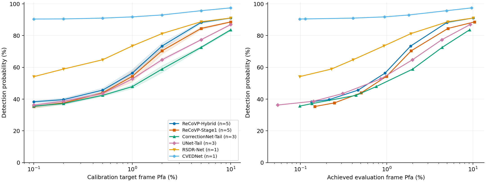

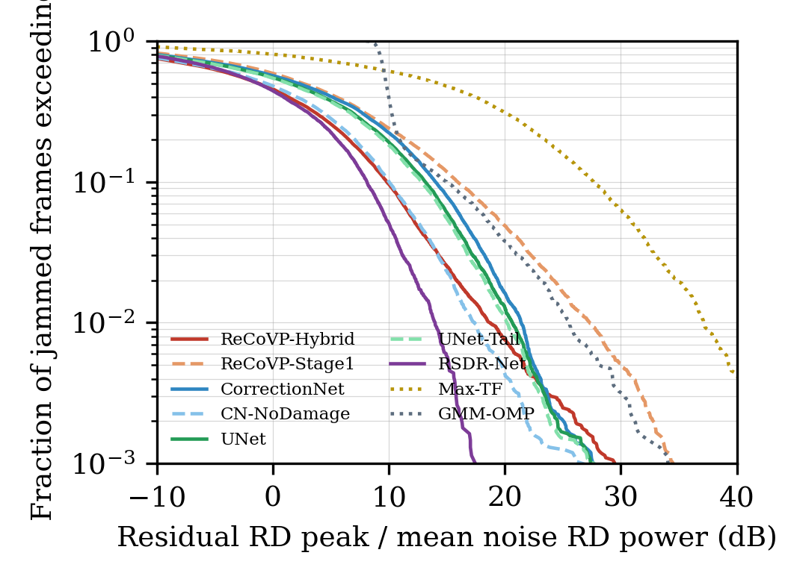

图4　(a) 各方法在自身校准输出上按目标帧虚警率0.1%、0.2%、0.5%、1%、2%、5%、10%取门限后的检测概率：左图横轴为校准目标，阴影为训练实例间的标准差；右图横轴为评价集上的实测受扰帧虚警率。多实例方法为训练实例均值，括号内为实例数；连线只用于引导阅读。(b) 受扰无目标帧上残余距离–多普勒峰值与平均噪声功率之比的超越概率。CVEDNet去除了接收机噪声，其残余以噪声本身为主，未画出。(a)中卷积网络只画出两类，(b)中只画出四类，全部数据见补充材料；(b)的本文方法为4个训练实例。

图4(a)中，Hybrid 在 5% 校准点的检测概率为 88.3%，RSDR-Net 为 88.7%，配对差 −0.41 个百分点，95% 区间 [−0.76, −0.06]。10% 点二者均约为 91.1%，差值区间包含零。1% 点上两者相差 17.1 个百分点。因此，即使中、高虚警点的均值接近，也不足以概括低虚警端的差异。

### 5.7 推理期诊断与既有消融

**推理期结构诊断。** 为检验各结构组件在已训练模型中的作用，只在推理时修改结构、不重新训练。从同一次第一阶段前向计算中取出字典$\boldsymbol B$、Gram矩阵与学到的正则$\boldsymbol\Lambda$，再重新求解系数：只保留前$k$个候选（$k=4,8,12,16$，候选按匹配滤波峰值由强到弱排列），或把$\boldsymbol\Lambda$换成常数$10^{-6}\boldsymbol I$（相当于不加正则的投影）。对每个变体重新运行第二阶段；另把脉冲级门强制设为$\alpha=1$。评价集与名义CFAR设置同5.5节。“纯噪声移除比例”为处理器从只含噪声的输入$\boldsymbol y_{00}$中移除的能量占比，与推论1的$K/T$对照。

表9　推理期结构诊断（训练实例17，开发集256个场景）

|变体|无干扰改动$E_0$|纯噪声移除比例|$K/T$|$E_U$|$D_S$|$\lvert g\rvert$|检测概率/%|受扰帧虚警/%|
|---|---:|---:|---:|---:|---:|---:|---:|---:|
|完整模型（$K=16$）|$4.6\times10^{-6}$|$9.7\times10^{-7}$|0.0089|0.043|0.060|0.915|87.1|5.60|
|完整模型，$K=8$|$4.5\times10^{-6}$|$8.7\times10^{-7}$|0.0044|0.065|0.063|0.916|86.2|6.25|
|完整模型，$K=4$|$4.3\times10^{-6}$|$7.6\times10^{-7}$|0.0022|0.208|0.131|0.920|85.8|10.29|
|完整模型，$\boldsymbol\Lambda=10^{-6}\boldsymbol I$|$6.4\times10^{-2}$|$5.9\times10^{-2}$|0.0089|0.090|1.13|0.460|39.5|0.78|
|完整模型，$\alpha=1$|3.57|3.48|0.0089|26.2|24.5|1.67|62.4|10.03|
|仅第一阶段（$K=16$）|$2.6\times10^{-6}$|$1.5\times10^{-7}$|0.0089|0.402|0.126|0.986|85.4|7.42|
|仅第一阶段，$K=4$|$2.4\times10^{-6}$|$5.2\times10^{-8}$|0.0022|1.78|0.162|0.990|83.3|14.32|
|仅第一阶段，$\boldsymbol\Lambda=10^{-6}\boldsymbol I$|$6.0\times10^{-2}$|$5.6\times10^{-2}$|0.0089|0.438|1.33|0.531|38.3|2.34|

注：仅第一阶段、不加正则时，$K=4$、8、12的纯噪声移除比例分别为1.9%、3.3%、4.5%，分别为对应$K/T$的8.6、7.5、6.8倍。

表中有三点结果。

第一，证据门是背景透明的来源。把$\boldsymbol\Lambda$换成接近零的常数后，第一阶段从纯噪声中移除5.6%的能量，是$K/T$的6.3倍；$K=4,8,12,16$的实测值为1.9%、3.3%、4.5%、5.6%，3.5节的次序统计量估计为1.6%、2.8%、4.0%、5.1%，趋势一致、略偏低，证实了数据自适应选择会突破推论1的上界。完整模型的无干扰改动随之由$4.6\times10^{-6}$升至$6.4\times10^{-2}$，目标损伤由 0.060升至1.13，幅度降至0.46，检测概率由87.1%降至39.5%。受扰帧虚警虽降至0.78%，但那是投影把干扰和目标一并撤掉的结果，正是证据门要避免的情形。保留学到的正则时，第一阶段只移除约$1.5\times10^{-7}$的纯噪声能量，比$K/T$低约5个数量级，与推论2的描述一致。

第二，候选数$K$决定的是干扰覆盖，而不是背景改动。保持学到的正则，$K$从4增至16时，完整模型的无干扰改动只在$4.3\times10^{-6}$至$4.6\times10^{-6}$之间变化，恢复误差却由0.208降至0.043，受扰帧虚警由10.3%降至5.6%，检测概率由85.8%升至87.1%；仅第一阶段的恢复误差由1.78降至0.402。多给候选几乎不增加背景侧的代价，因此$K$可以按干扰片段数宽松选取。

第三，脉冲级门是修正幅度的组成部分。强制$\alpha=1$后，精修提案被全部采用，恢复误差升至26.2，无干扰改动达3.57。精修网络的原始提案$\widetilde{\boldsymbol\delta}$只有经过$\alpha$（无干扰约$4.5\times10^{-4}$、受扰约$2.5\times10^{-2}$，见5.9节）缩放后才是合理的修正量，门不是可有可无的安全阀，而是第二阶段的结构组件。

这些诊断只在已训练的模型上替换组件，说明的是各组件在该模型中的作用，不能替代重新训练的匹配消融。在全部五个训练实例上重复同一诊断，三点结论不变：去掉学到的正则后，完整模型的无干扰改动由$1.5\times10^{-5}$升至$7.9\times10^{-2}$，目标损伤由 0.058升至1.25，检测概率由 87.6%降至31.5%；仅第一阶段时，$K$从4增至16使恢复误差由 1.77降至0.396，无干扰改动只由$2.1\times10^{-7}$变为$4.4\times10^{-7}$；强制$\alpha=1$后恢复误差升至13.2。

ReCoVP-Base系列已有的结构消融表明，去掉复数缩放等变结构后，检测概率变化约为−1.04个百分点（区间约［−2.08, 0.00］），目标损伤变化为−0.0021（区间约［−0.0084, +0.0043］），两者均未显示出稳定的方向。

### 5.8 训练随机性

表10只纳入完成统一评测的五个第256轮检查点。另三个种子及另行登记的第512轮延长训练使用独立的结果记录。检查点保存进度不作为性能观测，表内各列使用相同的五个训练实例。

表10　五个训练实例的结果（开发集；最后两列为等虚警评价集）

|随机种子|$E_U$|$D_S$|$\lvert g\rvert$|受扰帧虚警/%|检测概率/%|SJRIF/dB|$E_{\epsilon}$|检测概率@1%/%|
|---|---:|---:|---:|---:|---:|---:|---:|---:|
|17|0.04312|0.05967|0.9152|5.60|87.11|11.097|$1.0\times10^{-6}$|52.75|
|29|0.04588|0.06333|0.9217|6.77|87.63|11.066|$1.3\times10^{-6}$|57.13|
|41|0.04078|0.05499|0.9217|5.08|87.37|11.158|$4.4\times10^{-7}$|57.34|
|53|0.04158|0.05625|0.9251|5.47|87.63|11.145|$1.2\times10^{-6}$|56.04|
|67|0.04289|0.05605|0.9249|5.34|88.15|11.168|$7.2\times10^{-5}$|58.66|
|均值|0.04285|0.05806|0.9217|5.65|87.58|11.127|$1.5\times10^{-5}$|56.38|
|标准差|0.00195|0.00343|0.0040|0.66|0.39|0.044|$3.2\times10^{-5}$|2.23|

表10中，1%、5%、10% 校准点检测概率的种子间标准差分别为 2.23、0.57 和 0.23 个百分点。五个训练实例在严格工作点上的差异最大。表中单种子结果可用于判断均值受个别实例影响的程度。

纯噪声输入改动的种子间差异最突出。实例67的$E_{\epsilon}$约为$7.2\times10^{-5}$，是其余四个实例均值的约70倍，但它的检测指标在五个实例中反而最好。该实例第一阶段的$E_{\epsilon}$为$1.3\times10^{-6}$，与其余实例（$1.5\times10^{-7}$至$3.3\times10^{-7}$）同在$10^{-7}$至$10^{-6}$量级，差异主要来自第二阶段：在纯噪声输入上，其余四个实例的标量门均值与受扰输入相差约44至317倍，实例67只差约5.6倍，纯噪声上的门均值约为0.035。由于修正量由$\alpha$与精修提案$\widetilde{\boldsymbol\delta}$的乘积决定，两者之间存在尺度上的不可辨识性，训练损失不能唯一确定门在纯噪声上应关闭到什么程度；该差异在早期里程碑中已出现。因此，“背景几乎不被改动”在第一阶段对全部实例成立，在最终输出上对多数实例成立，第二阶段的门控还需要更明确的约束（例如对纯噪声输入的$\alpha$加入显式惩罚）。

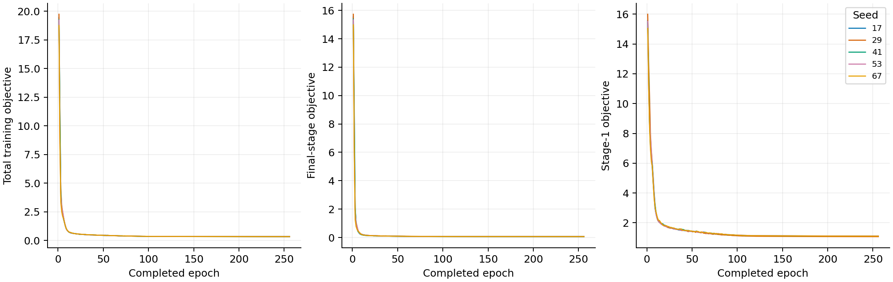

图5　五个训练实例的256轮训练目标曲线。训练目标包含各项损失的加权，不用于挑选轮次；全部实例取最后一轮参数。

### 5.9 门控行为与数值等变性

以训练实例17为例，标量门$\alpha$在四种状态$\boldsymbol y_{00},\boldsymbol y_{10},\boldsymbol y_{01},\boldsymbol y_{11}$下的均值分别为0.00045、0.00053、0.02481与0.02301。无干扰输入几乎不采用精修提案，受扰输入的采用比例高出约两个数量级，说明标量门能够区分两类输入。由于$\alpha$只是采用比例，实际修正量还取决于提案$\widetilde{\boldsymbol\delta}$的幅度。

为检验命题3在实现中的偏差，对每个基础场景随机抽取复数因子（幅度$[0.2,5.0]$、相位$[-\pi,\pi]$），比较缩放输入的输出与原输出乘以同一因子的差异。在小规模检查中，最大相对误差为$2.54\times10^{-7}$，候选列置换引起的误差为零；在整个评价集上，相对误差的均值为$2.33\times10^{-5}$，第95百分位数为$8.72\times10^{-5}$，检测概率与虚警率的汇总值没有变化。整个评价集上的误差高于小规模检查，可能来自单精度下相关幅值舍入引起的个别候选切换。

### 5.10 条件分析

开发集按随机参数抽样，各SNR、JSR箱内其他参数并不固定，只能描述条件关联。为比较固定物理场景上的条件响应，另行生成了受控条件数据集：保存512个独立物理场景的目标、干扰与噪声分量，按登记的幅度变换缩放到21个SNR点与7个JSR点。本节使用其中前128个物理场景，SNR取−30、−28、−26、−25、−24、−22、−20、−18、−15、−10、−5、0 dB，JSR取0、10、20、30 dB，共48个条件，即 6,144 个场景–条件组合，独立物理场景数仍为128。每个场景含三种转发方式、四种状态和8个脉冲。该数据集与训练集、开发集和等虚警校准/评价集无场景重叠，只用于评价。结果按两组分别报告：极端组为$-30\le\mathrm{SNR}<-20$ dB，普通组为$-20\le\mathrm{SNR}\le0$ dB，共同端点−20 dB归入普通组，每组24个条件。组内对条件等权平均；由于条件共享物理场景，置信区间以物理场景为单位联合重采样。对比方法取同规模中最强的两类卷积网络（UNet-Tail与CorrectionNet-Tail，各3个训练实例）和RSDR-Net；名义检测使用5.2节的CFAR设置，1%校准检测沿用5.6节各方法及各训练实例自己的全局门限，并列出本组的实测虚警。

表11　极端组与普通组的结果（条件等权平均）

|分组|方法|检测概率/%|受扰帧虚警/%|$E_U$|$D_S$|SJRIF/dB|$\lvert g\rvert$|1%校准检测概率/%（实测虚警/%）|
|---|---|---:|---:|---:|---:|---:|---:|---:|
|极端|**ReCoVP-Hybrid**|33.36|6.22|0.0179|0.0088|1.92|0.987|2.55（0.97）|
|极端|RSDR-Net|33.27|3.37|0.0142|0.0326|2.36|0.963|13.22（0.10）|
|极端|UNet-Tail|32.71|11.60|0.0281|0.0058|1.04|0.989|1.83（0.58）|
|极端|CorrectionNet-Tail|32.47|12.83|0.0329|0.0069|0.85|0.985|1.12（0.45）|
|普通|**ReCoVP-Hybrid**|99.48|7.88|0.0504|0.0310|4.06|0.950|91.30（1.83）|
|普通|RSDR-Net|99.37|5.71|0.0478|0.0716|4.33|0.913|96.09（1.14）|
|普通|UNet-Tail|99.30|15.63|0.0626|0.0243|3.83|0.962|88.89（0.95）|
|普通|CorrectionNet-Tail|99.18|19.12|0.0741|0.0359|3.69|0.949|86.13（1.04）|

表12　本文方法减对比方法的配对差（95%置信区间，概率差以百分点表示）

|分组|对比方法|检测概率|受扰帧虚警|$E_U$|$D_S$|SJRIF/dB|
|---|---|---|---|---|---|---|
|极端|RSDR-Net|+0.10［−0.20, +0.38］|+2.85［+2.08, +3.65］|+0.0037［+0.0030, +0.0044］|−0.0239［−0.0271, −0.0207］|−0.44［−0.54, −0.35］|
|极端|UNet-Tail|+0.66［+0.43, +0.89］|−5.38［−6.37, −4.44］|−0.0102［−0.0116, −0.0088］|+0.0030［+0.0017, +0.0044］|+0.88［+0.80, +0.95］|
|极端|CorrectionNet-Tail|+0.90［+0.64, +1.17］|−6.61［−7.68, −5.57］|−0.0150［−0.0171, −0.0130］|+0.0019［+0.0007, +0.0033］|+1.07［+0.99, +1.16］|
|普通|RSDR-Net|+0.11［+0.00, +0.24］|+2.17［+0.87, +3.55］|+0.0026［−0.0006, +0.0058］|−0.0406［−0.0463, −0.0351］|−0.28［−0.36, −0.20］|
|普通|UNet-Tail|+0.18［+0.06, +0.31］|−7.76［−9.29, −6.40］|−0.0122［−0.0146, −0.0098］|+0.0066［+0.0050, +0.0086］|+0.23［+0.18, +0.27］|
|普通|CorrectionNet-Tail|+0.30［+0.16, +0.46］|−11.25［−13.08, −9.52］|−0.0237［−0.0302, −0.0185］|−0.0049［−0.0069, −0.0028］|+0.37［+0.31, +0.43］|

两组的结论方向一致。与两类卷积网络相比，本文方法的受扰帧虚警在极端组低5.4至6.6个百分点，在普通组低7.8至11.2个百分点，恢复误差与SJRIF也都更好，名义检测概率略高；目标损伤比UNet-Tail高0.003至0.007。与RSDR-Net相比，本文方法的目标损伤在极端组低73%、在普通组低57%，目标幅度比更接近1，名义检测概率几乎相同；代价是受扰帧虚警高2.2至2.8个百分点、SJRIF低0.28至0.44 dB，极端组的恢复误差也更高。

表13　各SNR下的结果（对四档JSR等权平均）

|SNR/dB|检测概率/%：本文 / RSDR / UNet-Tail|$D_S$：本文 / RSDR / UNet-Tail|$\lvert g\rvert$：本文 / RSDR|1%校准检测概率/%：本文 / RSDR / UNet-Tail|
|---|---|---|---|---|
|−30|0.4 / 0.4 / 0.3|0.0035 / 0.0238 / 0.0014|0.994 / 0.973|0.0 / 0.0 / 0.0|
|−28|5.1 / 5.2 / 5.0|0.0051 / 0.0290 / 0.0037|0.991 / 0.968|0.0 / 0.0 / 0.0|
|−26|17.7 / 17.7 / 17.4|0.0065 / 0.0324 / 0.0061|0.988 / 0.965|0.0 / 1.8 / 0.0|
|−25|37.0 / 36.6 / 36.4|0.0076 / 0.0339 / 0.0069|0.986 / 0.963|0.1 / 6.1 / 0.0|
|−24|60.1 / 60.0 / 58.4|0.0124 / 0.0357 / 0.0077|0.984 / 0.960|1.3 / 12.3 / 0.6|
|−22|79.8 / 79.7 / 78.7|0.0172 / 0.0409 / 0.0089|0.980 / 0.951|13.9 / 59.0 / 10.4|
|−20|97.0 / 96.4 / 96.1|0.0163 / 0.0462 / 0.0104|0.976 / 0.944|63.6 / 80.2 / 55.8|
|−18|99.9 / 99.8 / 99.7|0.0224 / 0.0513 / 0.0130|0.970 / 0.938|84.6 / 96.4 / 78.5|
|−15|100.0 / 100.0 / 100.0|0.0239 / 0.0577 / 0.0170|0.961 / 0.930|99.6 / 99.9 / 99.1|
|−10|100.0 / 100.0 / 100.0|0.0322 / 0.0732 / 0.0225|0.944 / 0.909|100.0 / 100.0 / 99.9|
|−5|100.0 / 100.0 / 100.0|0.0405 / 0.0946 / 0.0342|0.930 / 0.886|100.0 / 100.0 / 100.0|
|0|100.0 / 100.0 / 100.0|0.0505 / 0.1067 / 0.0490|0.919 / 0.870|100.0 / 100.0 / 100.0|

名义CFAR下，三种方法的检测概率在每个SNR点都几乎相同：SNR不高于−26 dB时低于20%，−24 dB时约60%，−20 dB时约97%，−15 dB以上达到100%。极低SNR下检测主要受噪声限制：即使用真值撤除干扰、保留噪声，弱目标也常常检不出，这一段的瓶颈不在干扰抑制。该真值参照依赖不可部署的信息，只用于诊断。目标损伤随SNR升高而增大，在每个SNR点上本文方法都只有RSDR-Net的约一半或更低，目标幅度比在每个点都更接近1。差别集中在1%校准门限下的弱目标检测：SNR为−24至−18 dB时，RSDR-Net高11至45个百分点，本文方法比UNet-Tail高0.7至7.8个百分点。也就是说，本文方法在严格门限下的弱目标检测处于两者之间。

**相同干噪比条件下的比较。** 在本次共享物理场景与幅度变换的48格扫描中，30种干噪比（JNR = SNR + JSR，以 dB 计）对应的 Hybrid 组内实测虚警极差均为零。图6(d)保留每格的观测值。这个结果以本数据集固定的其他条件为前提；在其他片段结构或噪声分布下，同一 JNR 未必对应相同的虚警率。

**干扰类型。** 在两组中，三种转发方式的排序相同：重复转发的恢复误差与目标损伤最高（普通组$E_U$ 0.083、$D_S$ 0.042），直接转发最低（0.020、0.019）；本文方法的受扰帧虚警在直接转发上最高（极端组8.5%、普通组9.0%），在重复与循环转发上为5.0%至8.3%。RSDR-Net在三类上的虚警都低于本文方法，UNet-Tail与CorrectionNet-Tail在三类上都高于本文方法。

**训练实例。** 五个训练实例在两组上的检测概率极差不超过0.15个百分点，受扰帧虚警在极端组为5.50%至6.65%、在普通组为7.11%至8.46%，目标损伤的极差不超过0.0035，1%校准检测概率在普通组为89.3%至92.3%。实例67的纯噪声输入改动仍约为其余实例的70倍（$7.2\times10^{-5}$），与5.8节一致。

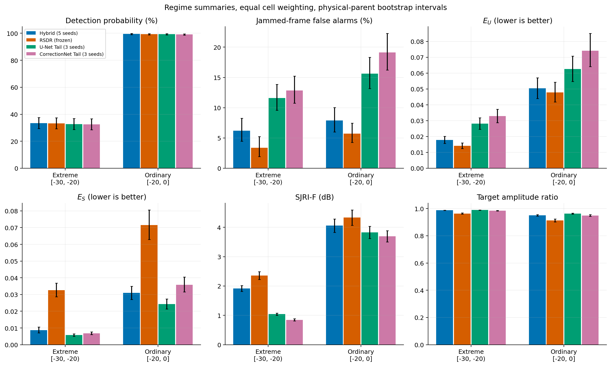

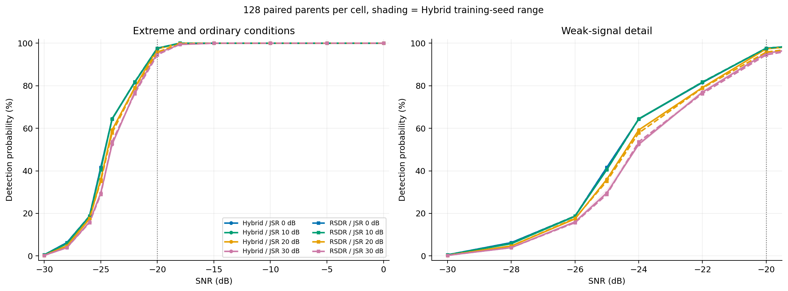

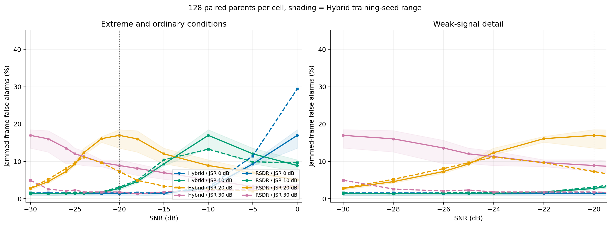

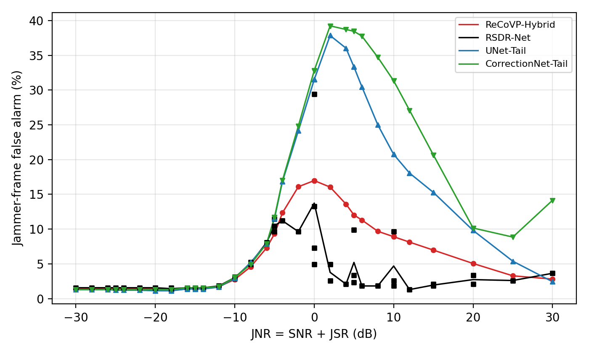

图6　受控条件集上的结果。(a) 极端组与普通组的六项指标；(b) 检测概率随SNR的变化，颜色对应JSR，实线为本文方法、虚线为RSDR-Net，浅色带为本文方法五个训练实例的取值范围；(c) 受扰帧虚警随SNR与JSR的变化；(d) 受扰帧虚警随干噪比JNR = SNR + JSR的变化，点为单个条件，线为同一JNR的均值，散布表示同一JNR下不同工况的实测差异。全部48个条件、四种方法的逐格数值见补充材料。

此前按8个SNR点（−25至10 dB）与4个JSR点构成的32条件扫描覆盖了全部17个方法。在该网格上，本文方法的目标损伤在32个条件上都低于RSDR-Net，平均恢复误差低36.5%；但该网格含较多检测饱和的正SNR条件，在−30至−20 dB只有−25 dB一个采样点，因此本文以上述48条件结果为主，32条件结果放入补充材料。

### 5.11 采样窗宽度与适用边界

为检验方法对干扰结构的适用范围，固定SNR为−10 dB、JSR为20 dB，按作者前期工作登记的网格扫描采样窗宽度与未受扰比例：重复转发，转发次数$M=2$，采样窗宽度$w$取6、18、36、54、72个采样点，周期取$(M+1)w+1$；另在$w=36$时取周期145与217，使未受扰比例分别为0.52与0.64。每格64个配对场景。$w=6$对应的周期19低于训练集下限36，属于外推点。每个脉冲的回放片段数按捕获次数$\lfloor(600-w)/\text{周期}\rfloor+1$乘以$M$估算。

表14　采样窗宽度与未受扰比例扫描（重复转发，本文方法为5个训练实例均值）

|条件|回放片段/脉冲|本文$E_U$|本文$D_S$|本文受扰帧虚警/%|Stage1受扰帧虚警/%|UNet-Tail受扰帧虚警/%|RSDR-Net受扰帧虚警/%|
|---|---:|---:|---:|---:|---:|---:|---:|
|$w=6$（外推）|64|0.229|0.723|95.3|99.7|78.6|29.7|
|$w=18$|22|0.109|0.247|63.7|75.9|13.5|3.1|
|$w=36$|12|0.056|0.083|4.7|8.4|3.1|1.6|
|$w=54$|8|0.042|0.049|5.0|5.6|22.9|3.1|
|$w=72$|6|0.036|0.044|4.1|9.4|42.7|3.1|
|未受扰比例0.52|8|0.043|0.054|3.8|4.7|1.6|1.6|
|未受扰比例0.64|6|0.078|0.116|3.4|3.8|2.6|3.1|

$w\ge36$时各方法检测概率均为100%。在中等宽度（$w=36$至72）上，本文方法的恢复误差低于全部卷积网络（相对UNet-Tail低0.021至0.034），与RSDR-Net相当，目标损伤比RSDR-Net低0.12至0.14；受扰帧虚警保持在4%至5%，而UNet-Tail随宽度增大升到22.9%与42.7%。

表14中，两种最窄采样窗的受扰帧虚警明显较高。窗宽变化时，片段数和周期也随之变化，最窄一格还超出了训练周期范围。观察结果与有限字典覆盖不足的解释相容，但单个原子与物理片段并无一一对应关系（第3.4节）。这些数据尚不能给出以片段数为界的普适失效判据。

未受扰比例0.64的一格另有特点：片段数只有6，虚警正常（3.4%），但恢复误差与目标损伤比卷积网络高0.04至0.07。同周期、$w=72$的格子表现正常，问题不在周期本身。在固定的有效支撑JSR下，该格的总干扰能量约为$w=72$同周期格的一半，每个原子的匹配证据更弱，可能落入6.1节的收缩不足机理，尚待验证。

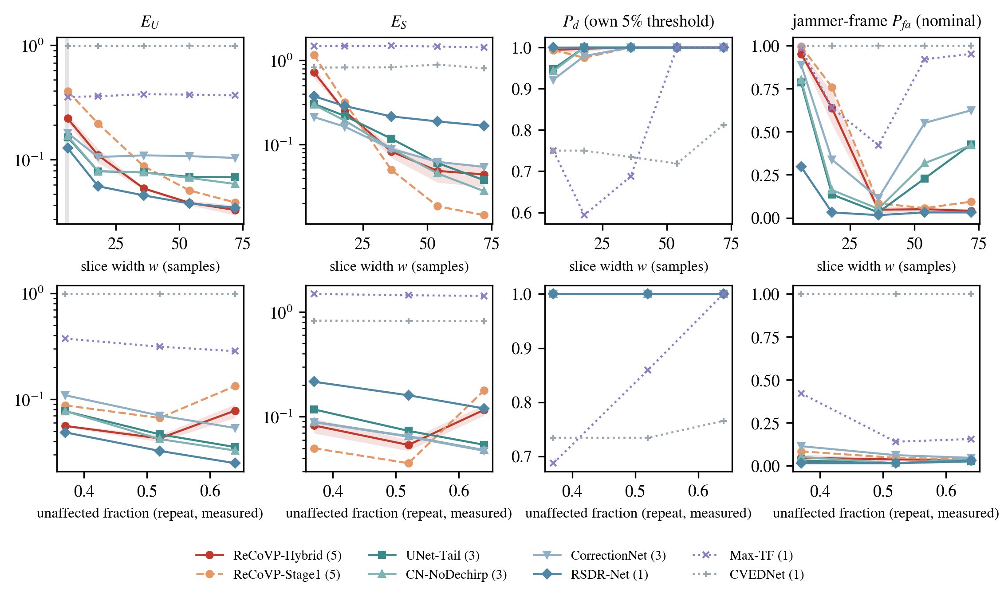

图7　采样窗宽度与未受扰比例扫描。全部18个方法标签的结果见补充材料。

### 5.12 计算开销

在同一台计算机（NVIDIA GeForce RTX 4060，主干 FP32，Hybrid 系数求解采用双精度复数，关闭 TF32）上对表15所列方法计时。为消除桌面负载波动，把全部配置在5轮中按随机顺序交错测量，每轮每个配置预热5次、测量40次，报告各轮中位数的中位数，括号内为各轮中位数的最小与最大值。计时包含对实际观测的端到端处理，不含评价用的四状态构造与检测后处理。

表15　推理耗时（ms）

|方法|有效参数|1个脉冲|8个脉冲（1个相参处理间隔）|64个脉冲|
|---|---:|---:|---:|---:|
|ReCoVP-Hybrid|57,525|14.4［13.4, 14.7］|17.0［14.7, 17.1］|55.5［49.6, 56.7］|
|　其中第一阶段|28,948|8.2|11.5|46.2|
|　其中第二阶段|28,577|6.1|5.6|8.4|
|UNet-Tail|59,714|1.3［1.1, 1.4］|1.5［1.3, 1.6］|7.3［7.1, 8.7］|
|CorrectionNet-Tail|59,714|2.2［1.9, 2.6］|2.3［2.1, 2.6］|7.8［7.7, 8.3］|
|RSDR-Net|3.02 M|—|25.5［25.1, 28.5］|172.8［171, 188］|
|CVEDNet[19]|11.02 M|28.3［27.1, 29.5］|43.0［42.7, 49.2］|567.5［559, 568］|

表15的八脉冲中位耗时为 Hybrid 17.0 ms、UNet-Tail 1.5 ms、RSDR-Net 25.5 ms。Hybrid 的有效参数量与 UNet-Tail 接近，但前向计算包含额外的模板运算和复数线性求解。参数量与处理时间应分别报告。这一测量只对应表中硬件、精度和批量，17.0 ms 已超过本仿真中八脉冲的 240 μs 时长。

### 5.13 图拉普拉斯约束的冻结模型筛查

前述主结果回答两阶段校正取得了怎样的恢复质量。本节固定 seed 17 的第256轮检查点及精修网络，仅改变第一阶段的正则项，考察在已有解上施加候选间关系约束的影响。图中的节点对应字典原子，边权来自原子间的相似度。置换图打乱节点对应，保留边权；对角对照保留对角惩罚，去除节点间耦合。由此可以分别比较原有连边与对照之间的差异，以及添加约束相对无图基线的净效果。

表16　图拉普拉斯筛查结果。四个预注册工况等权平均，共用128个物理场景。各变体分别在独立校准集上标定门限。检测概率以百分数表示。

| 正则设置 | 恢复误差 $E_U$ | 目标增量损伤 $D_S$ | 目标幅度比 | 1% 帧虚警校准点的检测概率 |
|---|---:|---:|---:|---:|
| 原模型（无图） | 0.029229 | 0.017046 | 0.975568 | 28.06% |
| 相似性图，弱约束 | 0.104296 | 0.847168 | 0.986987 | 7.16% |
| 相似性图，强约束 | 0.119833 | 0.643723 | 0.989009 | 6.05% |
| 置换图，强约束 | 0.127305 | 1.168300 | 0.719516 | 5.79% |
| 对角对照，强约束 | 0.134648 | 0.616646 | 0.990537 | 5.86% |

在相同强约束下，相似性图的恢复误差低于置换图，配对差为 −0.007472（95% 区间 [−0.009295, −0.005715]），也低于对角对照。这表明连边的选择确实影响结果。以原模型为参照，差值却转为 +0.090604（95% 区间 [+0.077568, +0.104469]）。预注册要求平均恢复误差至少降低 5%，并同时满足目标保持与检测条件。两种强度均未通过筛查。表16还给出了一个幅度指标容易掩盖的现象：强图使平均幅度比更接近 1，目标增量损伤却大幅增加。按式（10），幅度比只描述复增益的模，无法单独反映相位和形状误差。

四格结果的差别也很大。极端组仅取 SNR = −30 dB，在 JSR 为 10、30 dB 时，基线与强图的恢复误差分别为 0.000877 对 0.000877、0.045357 对 0.079619。普通组仅取 SNR = −20 dB，对应两格为 0.008688 对 0.008733、0.061994 对 0.390103。此处区间按物理场景联合重采样，反映给定检查点和门限时的场景差异；单个训练种子无法估计种子间离散度。

## 6 讨论

### 6.1 背景改动、目标损伤与检测工作点

固定开发集上，Hybrid 相对同预算卷积网络的主要改善出现在背景一侧。图4(b)中，四实例子集在选定阈值上的高残余帧占比低于卷积对照，但更远的尾部出现曲线交叉。五实例结果中，无干扰改动还受到实例67的影响。较小的平均改动与受扰整帧虚警均有实测依据；仅凭这两个指标无法判定每个 CFAR 参考窗的分布保持不变。

图8把背景改动和目标损伤画在同一坐标系中。四个 Hybrid 实例的背景改动接近，另一个实例偏高。RSDR-Net 的背景改动较小，但目标损伤较大。对各系统的排序取决于考察哪一项误差。

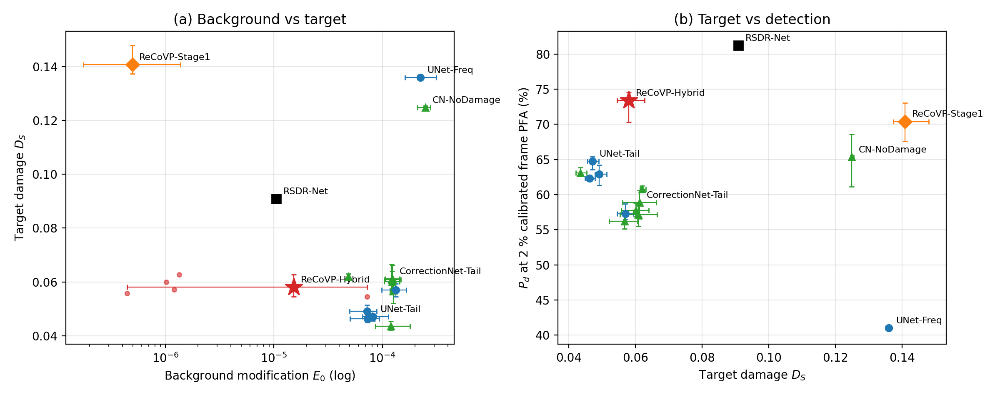

图8　等虚警评价集上各方法的工作点。(a) 纯噪声输入改动$E_{\epsilon}$（对数轴）与目标损伤$D_S$；(b) 目标损伤与2%校准虚警下的检测概率。标记为训练实例均值，误差线为实例的最小值至最大值；(a)中的小圆点为本文方法的五个实例，最右一点为实例67。CVEDNet（$E_{\epsilon}\approx1$，$D_S=0.65$）、GMM-OMP与Max-TF（$D_S$为8.8与19.4）超出坐标范围，未画出。 图内沿用原评价程序的 E0 标签，对应正文的纯噪声指标。

三个现象界定了上述结果的适用范围。

首先，目标增量的形状和幅度可向不同方向变化。精修后，平均目标增量损伤下降，但同一开发集全部256个场景的五实例平均幅度比均下降。图3的逐场景结果解释了表5中两个均值为何给出不同的印象。

其次，严格低虚警端仍有少数强残余。修正后的极端帧分析按种子分别选取残余峰值最高的 1%。五个种子合计提供评价记录310条、校准记录155条，分别涉及104和55个不同物理场景。按整帧合并比值分类，评价记录中的 50.0% 归入收缩不足（场景重采样95%区间 [39.7%, 59.9%]），30.0% 接近字典可达下界，11.9% 为表示残差，8.1% 为其他。按脉冲分别求比再平均，前述收缩不足和表示残差的比例变为 32.3% 和 34.5%。这项诊断描述入选记录的组成。它不能确定不同方法在 1% 工作点上的检测差距有多少由任一类别造成。

最后，固定重复次数的宽度扫描显示，两种窄窗条件下的受扰整帧虚警显著升高。第5.11节给出了条件与样本范围，容量与窗宽效应尚未分离。

### 6.2 结构化估计与残差补偿的分工

ReCoVP-Hybrid把干扰修正拆成两部分：能够由“局部窗×时延LFM”表示的部分由字典与闭式系数解决，其余部分由复值网络补偿。与把迭代算法展开为固定层数的网络[4,34]相比，本文在给定字典时直接消去线性系数，网络只需估计时延、窗和正则这三类非线性参数；与先分类片段再重构目标的串联方法[32,33]相比，本文不对观测做硬性的片段取舍，而是在全长观测上估计应当减去的修正量。ISRJ-FNet利用目标的结构先验约束滤波网络[35]，本文则直接以目标增量误差约束修正量。上述区别体现在计算接口和约束对象上，其性能意义需要由同协议的对比实验检验。

同一模型的两阶段输出比较表明，精修降低了平均恢复误差和目标损伤，但也带来了幅度衰减。另行训练的 Base 模型提供了系统间参照。当前证据可以评价实际使用精修分支的净效果，尚不能把收益唯一归给式（20）中的某个误差项。

### 6.3 目标保真的度量

式（8）与式（10）说明，恢复误差、目标损伤和幅度保持是三个相互关联但不能互相推出的量。表6中各模型排序不一致，正是这一点的体现：通用卷积网络的目标损伤较低而背景改动较大，RSDR-Net的恢复误差较低而目标损伤较高，ReCoVP-Hybrid则处在背景改动与虚警较低、目标幅度有一定收缩的位置。若只报告恢复误差或SJRIF，这些差别都无法被观察到。共享背景四状态提供了一种在仿真条件下单独度量目标响应的方法；对实测数据，目标真值不可得，需要通过已知目标注入或合作目标实验近似实现。

式（21）—（22）还指出，自适应处理器的目标损伤可以分为直接修改与算子变化两部分。本文目前只报告了完整输出的目标损伤，尚未区分这两部分。记录目标加入前后的候选集合与$\|\boldsymbol P_1-\boldsymbol P_0\|_2$，可以判断损伤是否集中在候选切换的场景中；局部归因图[55]与表示相似性分析[56]等可解释性工具也可用于检查两阶段特征对目标区域的响应。

### 6.4 恢复与检测

恢复损失、尾峰损失与CFAR检测作用于不同的对象：恢复损失约束全部样点，尾峰损失约束剥离噪声后的干扰残余峰值，而CFAR面对的是含噪输出及其自适应门限。表5中SJRIF与整帧虚警率均有改善，名义检测概率在五个实例上都有提高，但单元虚警率几乎不变；反过来，相对12类卷积网络，本文方法的名义检测概率只高0.3至4个百分点（个别类别为13个百分点），在2%等虚警工作点上却高8至32个百分点，同一背景侧优势在两种检测设置下的体现差别很大。恢复指标的改善并不自动转化为相同虚警水平下的检测增益。比较检测性能时，应在相同的实测虚警工作点上进行（5.6节）。

### 6.5 局限性

结论限于单目标、窄带仿真以及用于方法开发的评价集。主要对照包含 Hybrid 的五个训练实例、卷积基线的三个实例及各一个冻结的大模型实例。物理场景配对区间没有包含重新训练和重新标定门限的波动。推理时关闭或替换组件可衡量既有模型对该组件的依赖，同预算重新训练后的比较仍缺少完整结果。独立确认集、多目标与实测数据的性能尚待验证。

### 6.6 从原子相似性到同源关系

第5.13节的两组参照回答了不同的问题。若只与置换图比较，可以得出“保留原有连边有利于这一设置下的恢复”；若问是否应将该约束纳入主模型，参照必须是无图模型。两项比较可以同时成立，因为前者比较两种附加约束，后者衡量施加约束本身的代价。

原始设想关心的是哪些回放来自同一次采样，以及它们之间应当保持何种复幅相关系。原始设想中的磁图拉普拉斯试图表达边上的相位关系。本次采用普通相似性图的拉普拉斯，边权只记录原子在波形上的相似程度，没有独立的同源标签来核实边的物理含义。因此，表16给出了放弃当前相似性图扩展的实验依据，但无法从中判定退化有多少来自边的选择、系数关系的假设，或冻结精修网络对改变后输入的响应。五种子结果所支持的结构仍是逐候选正则化变量投影与复值残差精修。同源共享关系保留为研究假设。

## 7 结论

本文以同噪声参考和配对目标增量衡量接收波形的恢复质量。ReCoVP-Hybrid 的主要贡献是将校正分为可检查的字典估计和复值残差精修，并在同一模型上测量两阶段对背景与目标的不同影响。第一阶段收缩算子的性质可以在给定字典时推导；最终恢复质量则取决于字典选择和精修输出。

固定开发集上，五个第256轮模型的平均恢复误差由第一阶段的 0.3958 降至最终输出的 0.0428，平均目标损伤由 0.1247 降至 0.0581，而平均目标幅度比由 0.9861 降至 0.9217。精修同时带来形状恢复与幅度衰减，单看整体误差会遗漏后一项代价。

与同预算 UNet-Tail 相比，Hybrid 在开发集上的恢复误差和受扰整帧虚警较低，UNet-Tail 的目标损伤较小。与冻结的 RSDR-Net 相比，Hybrid 在极端与普通信噪比组均较好地保持了目标增量，但在 1% 虚警校准点上的检测概率较低。图拉普拉斯筛查进一步表明，即使候选之间的连接含有可测量的信息，将这种连接作为系数约束也可能增大恢复误差。现有结果支持在主模型中保留逐候选正则；关于同源片段的物理共享假设，尚需直接证据。主模型的泛化结论仍待独立确认。

## 参考文献

[1] Wang X, Liu J, Zhang W, Fu Q, Liu Z, Xie X. Mathematic principles of interrupted-sampling repeater jamming (ISRJ). Science in China Series F: Information Sciences, 2007, 50(1): 113–123. https://doi.org/10.1007/s11432-007-2017-y

[2] Zhou C, Liu Q, Hu C. Time-frequency analysis techniques for recognition and suppression of interrupted sampling repeater jamming. Journal of Radars, 2019, 8(1): 100–106. https://doi.org/10.12000/JR18080

[3] Zhang Y, Jiu B, Peng X, Liu H, Jiang W. A new scheme of target detection for pulse Doppler radar in interrupted sampling repeater jamming environment. IET Radar, Sonar & Navigation, 2022, 16(11): 1836–1850. https://doi.org/10.1049/rsn2.12300

[4] Huang Q, Zhang L. Interrupted sampling repeater jamming suppression using complex-valued FISTA-Net. IEEE Transactions on Aerospace and Electronic Systems, 2026, 62: 3270–3286. https://doi.org/10.1109/TAES.2025.3646182

[5] Guo T, Zhan H, Su X, Wang T. Anti-interrupted sampling repeater jamming method for random pulse repetition interval and intra-pulse frequency agile radar. IET Radar, Sonar & Navigation, 2023, 17(12): 1796–1811. https://doi.org/10.1049/rsn2.12465

[6] Zhou Y, Zhou Z, Shi Q, Cui G, Fan P. Complementary ISAC waveform and filter design based on minimized AF sidelobes against interrupted sampling repeater jamming. Signal Processing, 2026, 245: 110574. https://doi.org/10.1016/j.sigpro.2026.110574

[7] Liu Y, Yu L, Wei Y. Parameter estimation and suppression of nonperiodic interrupted sampling repeater jamming based on joint transmit-receive design. Signal Processing, 2027, 253: 110998. https://doi.org/10.1016/j.sigpro.2026.110998

[8] Li J, Liu H, Wang W. An anti-interrupted sampling repeater jamming method based on SSFA-MCPC waveform design combined with segmented mismatched filtering. Progress In Electromagnetics Research C, 2026, 167: 254–264. https://doi.org/10.2528/PIERC26012303

[9] Chen J, Wu W, Xu S, Chen Z, Zou J. Band pass filter design against interrupted-sampling repeater jamming based on time-frequency analysis. IET Radar, Sonar & Navigation, 2019, 13(10): 1646–1654. https://doi.org/10.1049/iet-rsn.2018.5658

[10] Li J-M, Li B-Z. Anti-interrupted sampling repeater jamming via linear canonical Wigner distribution lightweight LFM detection. Signal Processing, 2026, 239: 110230. https://doi.org/10.1016/j.sigpro.2025.110230

[11] Su H, Bao Q, Pan J, Guo F, Hu W. Waveform domain adaptive matched filtering for suppressing interrupted sampling repeater jamming. IEEE Transactions on Aerospace and Electronic Systems, 2024, 60(6): 9247–9260. https://doi.org/10.1109/TAES.2024.3439493

[12] Liu Z, Liang W, Fu N, Qiao L, Zhang J. Interrupted sampling repeater jamming suppression based on Gaussian mixture model and sparse reconstruction. Digital Signal Processing, 2025, 161: 105132. https://doi.org/10.1016/j.dsp.2025.105132

[13] Wei S, Han H, Wei S, Zhang L, Zhou Y. ISRJ suppression using joint morphological component analysis and signal reconstruction based on jamming parameters estimation. IEEE Transactions on Aerospace and Electronic Systems, 2026, 62: 3773–3797. https://doi.org/10.1109/TAES.2025.3648973

[14] Wei S, Zhang H, Zhou Y, Zhang L. Multiple models fusion filtering for interrupted sampling repeated jamming suppression. Digital Signal Processing, 2026, 168: 105487. https://doi.org/10.1016/j.dsp.2025.105487

[15] Cai T T, Wang L. Orthogonal matching pursuit for sparse signal recovery with noise. IEEE Transactions on Information Theory, 2011, 57(7): 4680–4688. https://doi.org/10.1109/TIT.2011.2146090

[16] He X, Liao K, Peng S, Tian Z, Huang J. Interrupted-sampling repeater jamming-suppression method based on a multi-stages multi-domains joint anti-jamming depth network. Remote Sensing, 2022, 14(14): 3445. https://doi.org/10.3390/rs14143445

[17] Wang H, Chen B, Ye Q, Huang F. MREDNet: A multi-residual encoder-decoder network for recovering LFM interfered by intra-pulse retransmission interferences. Signal Processing, 2024, 217: 109329. https://doi.org/10.1016/j.sigpro.2023.109329

[18] Wang Y, Li Y, Zhou Z, Yu G, Li Y. An attention-guided complex-valued transformer for intra-pulse retransmission interference suppression. Remote Sensing, 2024, 16(11): 1989. https://doi.org/10.3390/rs16111989

[19] Dai G, Yang X, Huan S, Chen Z, Peng C, Xu Y. End-to-end interrupted sampling repeater jamming countermeasure network under low signal-to-noise ratio. Sensors, 2025, 25(13): 3925. https://doi.org/10.3390/s25133925

[20] Wu Y, Duan L, Yang L, Liu Z, Xing M, Quan Y. Fine-grained recognition and suppression of ISRJ based on UNet-A. IEEE Geoscience and Remote Sensing Letters, 2024, 21: 1–5. https://doi.org/10.1109/LGRS.2024.3448611

[21] Wang G, Lv Q, Liu L, Yang R, Bie B, Wu Y, Quan Y. An end-to-end deep learning framework for separation and parameter measurement of composite intermittent sampling repeater jamming. Aerospace Science and Technology, 2026, 168: 111218. https://doi.org/10.1016/j.ast.2025.111218

[22] Wu Z, Ji T, Cao Y, Zhang L, Zhou C, Yang L. Suppression of radar compound interrupted sampling and repeating jamming based on self-supervised learning method. IEEE Transactions on Aerospace and Electronic Systems, 2025, 61(4): 9374–9391. https://doi.org/10.1109/TAES.2025.3555247

[23] Zhang H, Wei S, Wei S, Zhang L, Ren P, Zhou Y. Intensive interrupted sampling repeater jamming detection based on Transformer–CFAR fusion detection model. IEEE Transactions on Radar Systems, 2024, 2: 936–949. https://doi.org/10.1109/TRS.2024.3465017

[24] Fuchs A, Rock J, Tóth M, Meissner P, Pernkopf F. Complex-valued convolutional neural networks for enhanced radar signal denoising and interference mitigation. In: Proc. IEEE Radar Conference (RadarConf21), 2021: 1–6. https://doi.org/10.1109/RadarConf2147009.2021.9455296

[25] Ristea N-C, Anghel A, Ionescu R T. Estimating the magnitude and phase of automotive radar signals under multiple interference sources with fully convolutional networks. IEEE Access, 2021, 9: 153491–153507. https://doi.org/10.1109/ACCESS.2021.3128151

[26] Wang J, Li R, He Y, Yang Y. Prior-guided deep interference mitigation for FMCW radars. IEEE Transactions on Geoscience and Remote Sensing, 2022, 60: 5118316. https://doi.org/10.1109/TGRS.2022.3211605

[27] Wang J, Li R, Zhang X, He Y. Interference mitigation for automotive FMCW radar based on contrastive learning with dilated convolution. IEEE Transactions on Intelligent Transportation Systems, 2024, 25(1): 545–558. https://doi.org/10.1109/TITS.2023.3306576

[28] Rameez M, Javadi S, Dahl M, Pettersson M I. Evaluating deep learning approaches for mitigating interference in automotive radar systems. Computers and Electrical Engineering, 2026, 140: 111496. https://doi.org/10.1016/j.compeleceng.2026.111496

[29] Shlezinger N, Whang J, Eldar Y C, Dimakis A G. Model-based deep learning. Proceedings of the IEEE, 2023, 111(5): 465–499. https://doi.org/10.1109/JPROC.2023.3247480

[30] Zhang J, Ghanem B. ISTA-Net: Interpretable optimization-inspired deep network for image compressive sensing. In: Proc. IEEE/CVF CVPR, 2018: 1828–1837. https://doi.org/10.1109/CVPR.2018.00196

[31] Kovács P, Bognár G, Huber C, Huemer M. VPNET: Variable projection networks. International Journal of Neural Systems, 2022, 32(1): 2150054. https://doi.org/10.1142/S0129065721500544

[32] Meng Y, Yu L, Wei Y. Interrupted sampling repeater jamming suppression based on multiple extended complex-valued convolutional auto-encoders. IET Radar, Sonar & Navigation, 2024, 18(8): 1274–1290. https://doi.org/10.1049/rsn2.12568

[33] Lei C, Ke W, Xiaoyi P, Zhaoyu G, Shunping X. Interrupted sampling repeater jamming suppression based on point-wise temporal classification and sparse signal reconstruction. IET Radar, Sonar & Navigation, 2026, 20(1): e70251. https://doi.org/10.1049/rsn2.70251

[34] Wei S, Han H, Zhang H, Wei S, Zhou Y, Zhang L. Interrupted sampling repeater jamming suppression for wideband radar with MCA-ADMM-Net. IEEE Transactions on Neural Networks and Learning Systems, 2026: 1–15. https://doi.org/10.1109/TNNLS.2026.3736439

[35] Liu M, Gao X, Qiu X, Zhao Y. Structure-informed deep filtering for radar HRRP ISRJ mitigation. IEEE Signal Processing Letters, 2026, 33: 3601–3605. https://doi.org/10.1109/LSP.2026.3726844

[36] Luo Y, Mesgarani N. Conv-TasNet: Surpassing ideal time-frequency magnitude masking for speech separation. IEEE/ACM Transactions on Audio, Speech, and Language Processing, 2019, 27(8): 1256–1266. https://doi.org/10.1109/TASLP.2019.2915167

[37] He K, Zhang X, Ren S, Sun J. Deep residual learning for image recognition. In: Proc. IEEE CVPR, 2016: 770–778. https://doi.org/10.1109/CVPR.2016.90

[38] Zhang K, Zuo W, Chen Y, Meng D, Zhang L. Beyond a Gaussian denoiser: Residual learning of deep CNN for image denoising. IEEE Transactions on Image Processing, 2017, 26(7): 3142–3155. https://doi.org/10.1109/TIP.2017.2662206

[39] Zamir S W, Arora A, Khan S, Hayat M, Khan F S, Yang M-H, Shao L. Multi-stage progressive image restoration. In: Proc. IEEE/CVF CVPR, 2021: 14821–14831.

[40] Guo S, Yan Z, Zhang K, Zuo W, Zhang L. Toward convolutional blind denoising of real photographs. In: Proc. IEEE/CVF CVPR, 2019: 1712–1722.

[41] Wang X, Yu K, Dong C, Loy C C. Recovering realistic texture in image super-resolution by deep spatial feature transform. In: Proc. IEEE/CVF CVPR, 2018: 606–615.

[42] Wang X, Chan K C K, Yu K, Dong C, Loy C C. EDVR: Video restoration with enhanced deformable convolutional networks. In: Proc. IEEE/CVF CVPR Workshops, 2019.

[43] Karniadakis G E, Kevrekidis I G, Lu L, Perdikaris P, Wang S, Yang L. Physics-informed machine learning. Nature Reviews Physics, 2021, 3(6): 422–440. https://doi.org/10.1038/s42254-021-00314-5

[44] Zhu B, Liu J Z, Cauley S F, Rosen B R, Rosen M S. Image reconstruction by domain-transform manifold learning. Nature, 2018, 555(7697): 487–492. https://doi.org/10.1038/nature25988

[45] Ronneberger O, Fischer P, Brox T. U-Net: Convolutional networks for biomedical image segmentation. In: Proc. MICCAI, 2015: 234–241. https://doi.org/10.1007/978-3-319-24574-4_28

[46] Wu Y, He K. Group normalization. In: Proc. ECCV, 2018: 3–19.

[47] Golub G H, Pereyra V. The differentiation of pseudo-inverses and nonlinear least squares problems whose variables separate. SIAM Journal on Numerical Analysis, 1973, 10(2): 413–432. https://doi.org/10.1137/0710036

[48] Golub G, Pereyra V. Separable nonlinear least squares: the variable projection method and its applications. Inverse Problems, 2003, 19(2): R1–R26. https://doi.org/10.1088/0266-5611/19/2/201

[49] O'Leary D P, Rust B W. Variable projection for nonlinear least squares problems. Computational Optimization and Applications, 2013, 54(3): 579–593. https://doi.org/10.1007/s10589-012-9492-9

[50] Trabelsi C, Bilaniuk O, Zhang Y, et al. Deep complex networks. In: Proc. ICLR, 2018.

[51] Cohen T, Welling M. Group equivariant convolutional networks. In: Proc. ICML, PMLR 48, 2016: 2990–2999.

[52] Chen Z, Badrinarayanan V, Lee C-Y, Rabinovich A. GradNorm: Gradient normalization for adaptive loss balancing in deep multitask networks. In: Proc. ICML, PMLR 80, 2018: 794–803.

[53] Kingma D P, Ba J. Adam: A method for stochastic optimization. In: Proc. ICLR, 2015.

[54] Efron B. Bootstrap methods: Another look at the jackknife. The Annals of Statistics, 1979, 7(1): 1–26. https://doi.org/10.1214/aos/1176344552

[55] Gu J, Dong C. Interpreting super-resolution networks with local attribution maps. In: Proc. IEEE/CVF CVPR, 2021: 9199–9208.

[56] Kornblith S, Norouzi M, Lee H, Hinton G. Similarity of neural network representations revisited. In: Proc. ICML, PMLR 97, 2019: 3519–3529.

## 附录A 证明

**命题1的证明。** 令$\boldsymbol A=\boldsymbol B\boldsymbol\Lambda^{-1/2}$，则$\boldsymbol B^H\boldsymbol B+\boldsymbol\Lambda=\boldsymbol\Lambda^{1/2}(\boldsymbol A^H\boldsymbol A+\boldsymbol I)\boldsymbol\Lambda^{1/2}$，于是
$$
\boldsymbol P=\boldsymbol A(\boldsymbol A^H\boldsymbol A+\boldsymbol I)^{-1}\boldsymbol A^H .
$$
设$\boldsymbol A=\boldsymbol U\boldsymbol\Sigma\boldsymbol V^H$为奇异值分解，则$\boldsymbol P=\boldsymbol U\boldsymbol\Sigma(\boldsymbol\Sigma^H\boldsymbol\Sigma+\boldsymbol I)^{-1}\boldsymbol\Sigma^H\boldsymbol U^H$，其特征值为$\sigma_k^2/(1+\sigma_k^2)\in[0,1)$及$T-K$个零。$\boldsymbol P$显然为Hermitian半正定矩阵，迹等于非零特征值之和。由于特征值严格小于1，$\|\boldsymbol P\boldsymbol y\|_2\le\frac{\sigma_1^2}{1+\sigma_1^2}\|\boldsymbol y\|_2$，且$\boldsymbol I-\boldsymbol P$的特征值位于$(0,1]$，为非扩张算子。若某个$\sigma_k\in(0,\infty)$，则对应特征值$\sigma_k^2/(1+\sigma_k^2)\neq\{\sigma_k^2/(1+\sigma_k^2)\}^2$，故$\boldsymbol P^2\neq\boldsymbol P$。证毕。

**命题2的证明。** 由$\widehat{\boldsymbol u}_1=(\boldsymbol I-\boldsymbol P)\boldsymbol y$和$\boldsymbol u=\boldsymbol s+\boldsymbol\epsilon$，
$$
\widehat{\boldsymbol u}_1-\boldsymbol u=(\boldsymbol I-\boldsymbol P)\boldsymbol j-\boldsymbol P(\boldsymbol s+\boldsymbol\epsilon).
$$
以$\boldsymbol c^\star$表示$\boldsymbol j$在$\operatorname{span}(\boldsymbol B)$上的最小二乘系数（$\boldsymbol B$列不满秩时取最小范数解），则$\boldsymbol j_\perp=\boldsymbol j-\boldsymbol B\boldsymbol c^\star$满足$\boldsymbol B^H\boldsymbol j_\perp=\boldsymbol0$，从而$\boldsymbol P\boldsymbol j_\perp=\boldsymbol0$。又
$$
(\boldsymbol I-\boldsymbol P)\boldsymbol B=\boldsymbol B-\boldsymbol B(\boldsymbol B^H\boldsymbol B+\boldsymbol\Lambda)^{-1}\boldsymbol B^H\boldsymbol B
=\boldsymbol B(\boldsymbol B^H\boldsymbol B+\boldsymbol\Lambda)^{-1}\boldsymbol\Lambda,
$$
代入即得式（20）。证毕。

**命题3的证明。** 设$c=|c|e^{\mathrm j\varphi}\neq0$。(i) 由式（12），$r(c\boldsymbol y)=|c|r(\boldsymbol y)$，$\boldsymbol x'=e^{\mathrm j\varphi}\boldsymbol x$。(ii) 式（13）中$|x_n'|=|x_n|$，$a_n'=a_n$，$\ell_n'=x_n'x_{n-1}'^{*}=\ell_n$，故特征编码器输出、候选位置（在相同并列规则下）、时延、窗与$\boldsymbol B$均不变；$\rho_k'=|\boldsymbol b_k^He^{\mathrm j\varphi}\boldsymbol x|^2/\widehat\sigma'^2=\rho_k$（稳健离差只依赖距离，不受旋转影响），故$\boldsymbol\Lambda$不变。(iii) 正规方程右端乘以$e^{\mathrm j\varphi}$，故$\widehat{\boldsymbol c}'=e^{\mathrm j\varphi}\widehat{\boldsymbol c}$，$\widehat{\boldsymbol j}_1'=|c|r\boldsymbol B e^{\mathrm j\varphi}\widehat{\boldsymbol c}=c\widehat{\boldsymbol j}_1$，$\widehat{\boldsymbol u}_1'=c\widehat{\boldsymbol u}_1$。(iv) 第二阶段输入$\boldsymbol r_1'=e^{\mathrm j\varphi}\boldsymbol r_1$，$\boldsymbol j_1'=e^{\mathrm j\varphi}\boldsymbol j_1$；条件特征$\boldsymbol\psi$中的对数幅值、共轭积均不变；无偏置复卷积、复数线性插值、平均池化与相位旋转交换；门$\boldsymbol g$的输入$|\boldsymbol v|$不变，故每层输出乘以$e^{\mathrm j\varphi}$。标量门输入中的能量比与峰均比不变，故$\alpha'=\alpha$。于是$\boldsymbol\delta_2'=|c|r\alpha e^{\mathrm j\varphi}\widetilde{\boldsymbol\delta}=c\boldsymbol\delta_2$，$F_\theta(c\boldsymbol y)=c\widehat{\boldsymbol u}_1-c\boldsymbol\delta_2=cF_\theta(\boldsymbol y)$。证毕。

## 数据与代码可用性

本文的主要开发结果由固定检查点、场景清单与校准策略共同定义。五种子逐项比较、48工况逐格结果、分组种子统计与图扩展筛查的版本记录见[基础稿的补充数据索引](https://github.com/Hxin0203/ISRJ_2/blob/0ea034bb88a45b0b4dc1c9803858bcc52fd7607f/manuscript/recovp_draft_v4_20261127/审核与证据索引.md)和[图拉普拉斯筛查记录](https://github.com/Hxin0203/ISRJ_2/blob/338c09d/reports/RECoVP_graph_extension_20261127/REPORT.md)。训练数据和模型权重的公开安排尚待作者确认。
