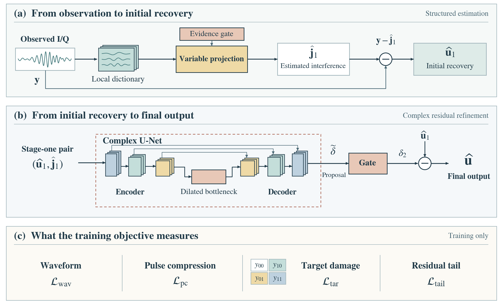

# ReCoVP-Hybrid 分层架构图

**建议图注**　（a）模型根据观测 I/Q 建立局部字典，结合证据门进行变量投影，得到初始干扰估计。观测信号减去该估计后得到初步恢复结果。（b）复值 U-Net 接收第一阶段的两路估计，编码器和解码器之间的横向连线表示同尺度跳跃连接。网络产生的修正提案经过门控和尺度还原后，用于修正初步恢复结果。（c）训练目标涵盖波形恢复、脉压域误差、四状态配对的目标损伤，以及距离–多普勒残余尾部代理。四格色块标记共享背景的四个状态。图中字典和波形为示意，叠层的厚度不代表实际通道数。尾部代理量与实测虚警率应分别报告。

[排版 PDF](ReCoVP_Hybrid_layered.pdf) · [可编辑 SVG](ReCoVP_Hybrid_layered.svg)
