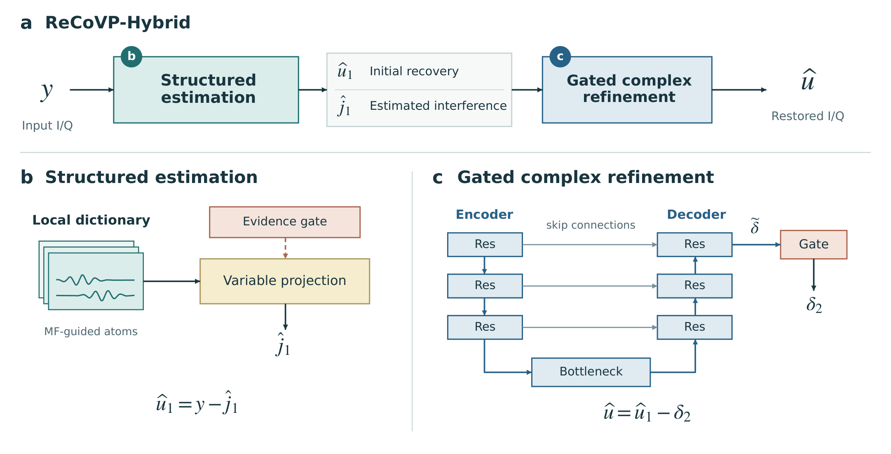

# ReCoVP-Hybrid 双栏结构图

**建议图注**　ReCoVP-Hybrid 的总体结构与两阶段处理流程。**a**，观测 I/Q 经结构化估计和复值残差细化后得到恢复信号。中间框列出第二阶段接收的两路信号。**b**，结构化估计模块，叠放的波形卡片示意局部字典。**c**，门控复值细化模块，同一高度的横向箭头表示编码器到解码器的跳跃连接。Res 表示残差块，MF 表示匹配滤波。波形线条仅作示意。

## 阅读顺序与排版依据

- **总览先交代接口。** AlphaFold 图 1e 把重复计算收进模块框，用箭头交代信息流。本图将中间的两路信号排成上下两行，使读者能直接辨认两个阶段之间传递了什么。[Jumper 等，Nature，图 1e](https://www.nature.com/articles/s41586-021-03819-2/figures/1)
- **按字母找到局部。** 两个圆形小标位于模块上沿，对应下排 b 和 c。取消跨面板的长引线，让读者在灰度打印时也能依靠字母和位置找到对应模块。两个面板右下方或下沿的留白留给公式，图注负责解释缩写。
- **按实际刊宽导出。** PDF 和 SVG 宽 183 mm，高约 93.45 mm。PNG 为 300 dpi 预览。183 mm 取自 Nature 的双栏规格，用于本次排版比较，定投后应按目标期刊版心复核。正文优先插入矢量 PDF，后续修改标签使用 SVG。[Nature 终稿制图指南](https://www.nature.com/nature/for-authors/final-submission)
