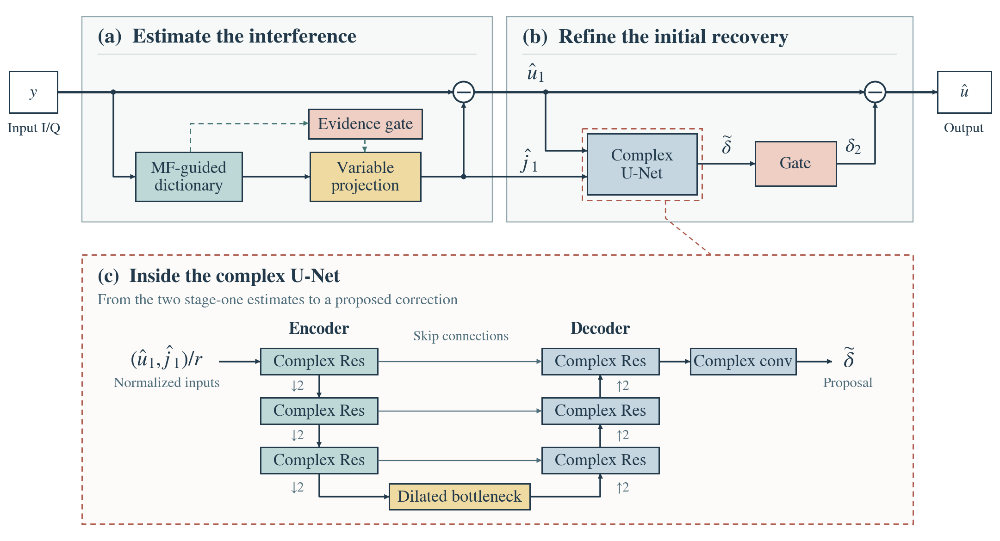

# ReCoVP-Hybrid 推理流程

**图注**　（a）模型利用观测信号的匹配滤波响应构建局部字典，在证据门的正则约束下通过变量投影得到干扰估计 $\hat j_1$。观测信号减去该估计，得到初步恢复 $\hat u_1$。（b）复值 U-Net 接收这两路中间量并提出修正，经门控和尺度还原得到 $\delta_2$。初步恢复减去该修正，得到输出 $\hat u$。（c）红色虚线框展开（b）中的复值 U-Net。左侧为按尺度因子 $r$ 归一化的输入，右侧的 $\widetilde\delta$ 对应（b）中进入门控前的修正提案。水平细箭头表示同尺度跳跃连接，向下和向上的数字表示二倍下采样和上采样。MF 表示匹配滤波，Res 表示残差块。

[排版 PDF](ReCoVP_Hybrid_architecture_detail_revised.pdf) · [可编辑 SVG](ReCoVP_Hybrid_architecture_detail_revised.svg)
