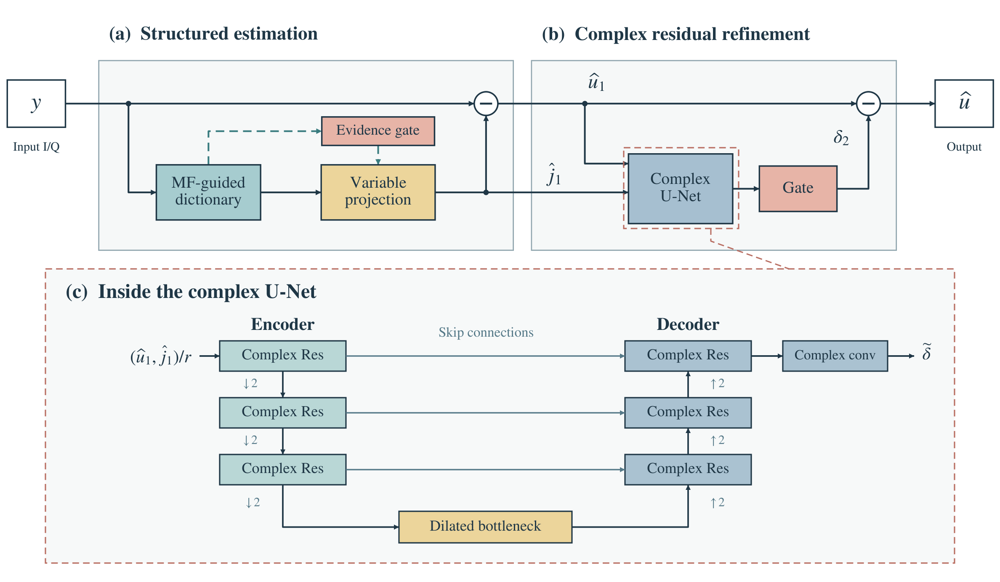

# ReCoVP-Hybrid 模型结构图与投稿实验说明

**建议图注。** 图 1　ReCoVP-Hybrid 的推理流程。（a）依据观测与已知发射模板的匹配滤波（MF）响应构建局部字典，以证据门给出的正则强度进行变量投影，得到初始干扰估计 \(\hat j_1\) 和初步恢复 \(\hat u_1=y-\hat j_1\)。（b）复值 U-Net 接收归一化后的两路中间量，经门控得到校正量 \(\delta_2\)，输出 \(\hat u=\hat u_1-\delta_2\)。虚线表示证据正则的条件通路，圆圈表示从左侧输入减去下方校正量。（c）虚线框展开复值 U-Net：三条同尺度跳跃连接将编码特征送至解码端，底部为膨胀卷积瓶颈。网络输出归一化修正提案 $\widetilde{\delta}$；经上方脉冲级标量门并恢复原尺度后，才得到最终校正量 $\delta_2$。

[可编辑矢量图](ReCoVP_Hybrid_architecture_detail.svg) · [论文排版用 PDF](ReCoVP_Hybrid_architecture_detail.pdf)

## 当前能讲到哪里

以 v7 的五个第 256 轮实例为依据，这张图的两路中间量均有对应的实验输出。固定开发集上，从第一阶段到最终输出，恢复误差均值由 0.3958 降至 0.0428，目标损伤均值由 0.1247 降至 0.0581，目标幅度比同时由 0.9861 降至 0.9217。按物理场景展开，256 个场景中有 81 个的总目标损伤下降，全部 256 个的幅度比均下降。因此可以写“精修改变了恢复误差、目标损伤和幅度保持之间的折中”。这项同检查点比较无法单独回答重新训练一个单阶段模型后两者还差多少。[v7 主稿，第 5.4 节](https://github.com/Hxin0203/ISRJ_2/blob/53a27db35d8897c12ef5d3a92ba552f1596192e8/manuscript/recovp_draft_v7_20261127/ReCoVP_Hybrid_中文_draft_v7.md)

现有开发证据也足以区分两个参照对象。相近规模的 U-Net-Tail 在部分比较中较好地保持目标增量，Hybrid 的优势集中在整体恢复与受扰帧虚警。与沿用原训练流程的 RSDR-Net 冻结模型相比，Hybrid 的目标响应保留较好，严格低虚警校准点的检测概率较低。这是两套系统在指定数据上的比较，参数规模、监督和训练数据均可能影响结果。

## 还缺的实验，按论文主张决定

| 论文希望回答的问题 | 建议补充的比较与交付物 | 结果怎样进入正文 |
|---|---|---|
| **换训练种子，原有结论是否稳定？** | 以已有五种子第 256 轮评测作为固定参照，用同一套开发场景、指标和预先确定的门限标定方式补齐 79、97、109。列出八个实例各自的结果、均值和种子间标准差，保留原五实例汇总供追溯。 | 报告新增实例是否改变了恢复、目标保真和虚警三个方向的判断。实例 67 的纯噪声改动偏高，应报告全部实例的范围；不可因其偏高而将它剔除。 |
| **两阶段设计本身是否优于独立训练的单阶段方案？** | 核查已有单阶段对照的训练数据、有效参数量、损失、更新预算与共同种子。若正文保留架构收益主张，而现有训练记录未满足可比条件，再补独立训练的匹配对照。将“同检查点 Stage 1／Final”“独立训练系统比较”分成两行报告。 | 前一行支持精修对已训练模型的净影响；后一行衡量在规定训练条件下的架构差异。若差值小或种子间方向不同，正文应如实报告，让主贡献落在可检查的两阶段设计与已测得的工作点上。 |
| **开发期间观察到的折中，在作者选定模型后是否重现？** | 先锁定模型版本、对照、种子集合、主指标和门限策略，再用未参与这些决定的独立物理场景做一次确认。独立确认表单列 Hybrid 对 U-Net-Tail 的恢复误差、目标增量损伤、受扰整帧虚警，以及共同校准目标下各自实际达到的虚警和检测率；RSDR-Net 单列为冻结系统参照。 | 这是支撑泛化主张的首要证据。报告效应量和物理场景配对区间；结果方向相反或区间较宽时，分别列出开发与确认结果。确认结果一旦用于重新选型，其用途就已改变。 |

**训练端点与已评测实例应分开计数。** v7 主表为种子 17、29、41、53、67。2026-11-28 02:43 UTC 的本地恢复快照已登记八个种子的第 256 轮端点；这个时间是归档时间，不代表实时服务器状态。第 512 轮属于另一个训练日程。若作者要从 256 和 512 轮中选主版本，可在开发集上比较同一种子的两个端点，记录选择理由后再独立确认。一个种子的两个端点只算一对。若论文固定描述第 256 轮模型，延长训练的比较可以单独报告。

**确认集需要审核历史用途。** 现有 512 场景确认文件上已有普通 U-Net 的评测回执。应列出谁在何时看过哪些结果、这些结果是否影响当前选择。若用途可追溯，可按实际独立程度披露；若曾参与选型或用途无法核实，最终确认宜采用另行登记的独立物理场景。48 格扫描所用的 128 个物理场景及预留作开发的场景，应保留原登记用途。[已有评测与确认集使用记录说明](https://github.com/Hxin0203/ISRJ_2/blob/c23df51202a48f5377c7be1d4adb05c17792a87a/reports/21_实验总结与投稿前规划_20261127.md)

## 如何报告，才能和已有结果接上

- 固定条件仍按极端组 \(-30\leq\mathrm{SNR}<-20\) dB 与普通组 \(-20\leq\mathrm{SNR}\leq0\) dB 汇总，逐 SNR、逐 JSR 和逐种子明细放补充材料。对共享目标和噪声的条件、变体及脉冲按物理场景一起重采样，同时列逻辑工况数与独立场景数。
- 保留受扰帧虚警、纯噪声改动和目标增量损伤各自的状态定义。凡报告某个校准目标下的检测概率，旁列评价集的实测帧虚警。主要比较使用同一物理场景，训练种子间离散度与给定检查点的场景区间分别报告。
- 记录用于评价的模型、数据版本及其摘要值，给出门限来源与主指标。正文只用一个选定版本作主比较。现有 48 格和 32 格扫描覆盖范围不同，各自保留原有的条件权重与表头。

## 拉普拉斯、实测数据与部署分别放在哪里

**拉普拉斯。** 当前图描述产生五种子主表的无图模型。已有单检查点筛查比较了无附加图、相似性图、置换图和对角对照，足以支撑“当前相似性图未通过筛查”的讨论。若文章保留这一负结果，无需为补全架构图启动新的图训练。若以后主张候选确实同源且满足特定的复幅相关系，则需独立的来源证据；现有相似度与误差排名不能代替该证据。[图筛查报告](https://github.com/Hxin0203/ISRJ_2/blob/338c09d/reports/RECoVP_graph_extension_20261127/REPORT.md)

**实测与部署。** 若论文的结论限定在单目标仿真，实测、多目标和实时部署可作为外部有效性的边界。若要声称实测条件泛化或实时运行，则分别需要独立实测评估或目标平台端到端计时。v7 已有指定硬件上的耗时表，不能由参数量较小推出实时性。

**投稿前优先顺序。** 先用现有端点回答种子稳定性，并查清独立确认集资格；根据正文是否保留架构因果主张决定是否补匹配结构对照；最后在版本与协议锁定后完成独立确认。论文的完成条件是每条主张都能对应到适当的比较及其适用范围。
