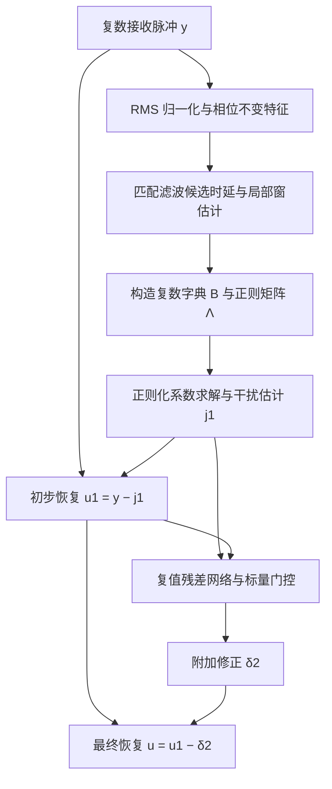

# 基于正则化变量投影与复值残差精修的间歇采样转发干扰波形恢复

## 摘要

间歇采样转发干扰保留了雷达发射波形的局部调频结构，抑制其相干分量时也可能削弱真实目标。针对这一问题，本文研究以同次噪声实现下的无干扰观测为参考的复数波形恢复方法，提出由正则化变量投影和复值残差精修组成的 ReCoVP-Hybrid。第一阶段从接收观测中选择候选时延，通过相位不变特征估计局部窗函数和正则强度，并在所构造的复数字典上求解干扰系数；第二阶段联合利用初步恢复结果与干扰估计，以实值门控调制复值卷积特征，对结构化估计未能解释的残差作进一步修正。训练同时约束波形恢复、脉冲压缩响应和共享背景下的目标增量，并对无目标受扰状态的残余峰值施加惩罚。本文推导固定字典系数解及自适应算子变化对目标响应的影响，说明恢复误差与目标损伤需要分别评价。固定开发集上的阶段对照显示，精修降低了场景平均恢复误差、平均目标增量损伤和受扰整帧虚警率，同时带来幅度衰减及部分场景损伤增加。本文据此分析两阶段恢复的收益与保真代价，其跨模型优势和独立泛化能力仍待检验。

**关键词：** 间歇采样转发干扰；含噪参考恢复；变量投影；复值网络；目标保真

## 1 引言

雷达依靠发射波形与目标回波之间的相关关系获得距离信息，并利用脉冲间相位变化估计运动参数。间歇采样转发干扰（interrupted-sampling repeater jamming，ISRJ）截取发射脉冲的局部片段，经延迟、重复或循环转发后重新进入接收机。转发片段继承了原波形的局部调频结构，因而可以在脉冲压缩后形成具有相干增益的虚假峰[1–5]。这类干扰的困难并不只是功率较强，而是有用回波与干扰共享部分波形结构。撤销干扰时，对真实回波幅度或相位的附带修改也会影响后续相参处理。

针对这一问题，已有方法从接收端结构估计和收发联合设计两方面展开。接收端方法利用干扰的间歇支撑、时频轨迹或去斜后的稀疏性，寻找可用于分离的结构差异。Liu等[1]通过高斯混合模型提取未受扰片段，再进行稀疏重构；Li和Li[8]利用线性正则Wigner分布与线段检测构造时频滤波；Su等[25]将局部匹配关系纳入波形域自适应匹配滤波，并结合补偿项形成输出。相应地，联合波形与滤波设计[10,11]以及SSFA-MCPC波形与分段失配滤波[32]通过改变照射或接收处理增加可分性。后一类方法需要相应的发射与系统条件，不能直接等同于固定LFM波形下的接收端恢复。

上述结构方法把抑制问题落实到可解释的参数和支撑，但它们对局部结构估计的依赖也带来误差传播。片段漏选会丢失可用信息，受扰片段被误保留则会污染后续重构；字典失配和噪声又会影响系数估计。有噪稀疏恢复的稳定性还依赖字典与噪声条件[24]。系数子问题可求解与正确识别真实分量是不同要求。因此，在结构可利用但不完全准确时，既需要明确的估计模型，也需要处理该模型无法解释的部分。

深度恢复方法通过训练数据学习这种复杂映射。MREDNet[3]采用多残差编码器与解码器恢复受脉内转发干扰污染的LFM信号，多级多域网络[4]和复值Transformer[5]进一步引入多域处理及特征交互。CVEDNet[6]结合复值网络和波形、脉压域目标研究低信噪比恢复，UNet-A[7]将细粒度识别与抑制结合，复合干扰的分离与参数测量也已有端到端框架[9]。这些工作说明，学习方法能够利用难以由单一阈值或规则完整刻画的差异；但恢复波形更接近参考，并不充分说明真实目标的复数响应也保持得更好。

模型与学习结合的研究进一步将某些中间处理显式保留。Meng等[2]串联复值片段提取、片段去噪与压缩感知重构；Lei等[31]依次执行逐点时间分类、I/Q残差去噪和稀疏信号重构。另一类方法把优化迭代映射为网络。CV-FISTA-Net[30]在FISTA框架中结合复值卷积与残差学习，MCA-ADMM-Net[27]分别以时延LFM字典和局部Fourier/STFT字典表示目标与干扰，再展开ADMM执行双分量稀疏求解。ISRJ-FNet[26]在多脉冲HRRP上利用距离分布对称性和目标稀疏性，并对原目标及距离翻转目标叠加相同干扰，约束两分支的掩码一致性。由此，复值处理、结构先验、阶段组合及保真约束均已有明确基础。新的方法需要说明具体估计对象、推理信息与约束位置，不能仅以增加模块或更换名称界定贡献。

跨领域恢复研究提供了相近的设计经验。Conv-TasNet[33]将表示、分离和波形重建连成清晰的数据流，强调相位与表示选择对输出的影响；多阶段图像恢复[34]通过不同阶段的明确分工组织上下文提取和细节恢复。更一般的物理信息学习与数据驱动逆变换研究[35,36]说明，先验可以进入表示、计算步骤或监督关系，而不是只在输入前作一次变换。这些经验支持在模型中明确划分结构估计和残差补偿，但不意味着图像或语音中的有效机制可以未经验证移植到雷达。

本文研究固定LFM条件下的复数波形恢复，以同次噪声实现下撤去干扰的观测作为参考，即从目标、干扰和噪声的混合观测恢复到目标与原噪声之和。该设定沿用作者前期研究[29]，把理想修改限定为干扰分量，并使无干扰输入上的不必要修改可以单独评价。相较于片段提取后重构完整目标，本文保留全长观测并估计应减去的修正；相较于展开有限步迭代，本文在给定学习字典时直接消去线性系数，再对表示残差进行精修。

这一设计包含两个相互关联的问题。首先，局部窗字典能够利用延迟波形的结构，但候选不完备、频偏及窗形失配会留下残余；完全依赖该表示可能限制恢复。其次，残差网络增加了补偿能力，也可能将目标方向上的能量一并撤销。因此，结构化求解需要与保留复数关系的精修路径结合，而恢复误差、目标增量损伤和背景虚警必须分别检验。

据此，本文提出ReCoVP-Hybrid。第一阶段以观测驱动的候选时延、局部窗和正则强度建立复数字典，通过正则化变量投影求解干扰系数；第二阶段联合读取初步恢复与干扰估计，利用复值卷积及相位不变实门控形成附加修正。本文的工作包括三方面：构建两阶段干扰估计与恢复流程，使结构表示、线性系数和残差补偿具有明确接口；分析固定字典求解及输入自适应变化对目标响应的不同影响，并据此组织四状态训练；通过同检查点阶段比较和同集模型参照，考察恢复收益、目标保真及虚警之间的取舍。变量投影[12–15]、模型驱动学习[16,28]及共享背景评价是方法依据，而非本文另行提出的普适理论。

下文先建立观测与目标响应的数学定义，再说明各估计模块及联合训练目标，随后报告恢复、保真和雷达检测结果，最后讨论结构约束与数据驱动补偿的适用范围。

## 2 信号模型与恢复问题

### 2.1 目标回波与采样转发干扰

设基带 LFM 发射脉冲为

$$
p(t)=\mathbf 1_{[-T_p/2,T_p/2)}(t)\exp(\mathrm i\pi\mu t^2),\qquad \mu=B_w/T_p. \tag{1}
$$

其中，$T_p$ 为脉宽，$B_w$ 为带宽。对于一个脉冲组中的第 $m$ 个脉冲，单目标回波写为

$$
s_m(t)=a\,p(t-\tau)\exp\{\mathrm i2\pi f_D(t+mT_r)\}. \tag{2}
$$

$a$ 包含幅度和初始相位，$\tau$ 为目标时延，$f_D$ 为多普勒频率，$T_r$ 为脉冲重复间隔。式（2）采用窄带、组内恒定目标参数模型，不包含距离迁移或扩展目标散射。

为统一表示不同采样与转发规则，令 $w_{m\ell}(t)$ 为第 $\ell$ 个截取窗，$\mathcal R_{m\ell}$ 为该片段对应的转发集合。接收端的干扰可表示为

$$
j_m(t)=\sum_{\ell}\sum_{r\in\mathcal R_{m\ell}}
\beta_{m\ell r}\,w_{m\ell}(t-d_{m\ell r})
p(t-d_{m\ell r}-\tau_J)
\exp\{\mathrm i2\pi\nu_{m\ell r}t\}. \tag{3}
$$

式中 $d_{m\ell r}$ 表示相对于截取片段的转发平移，$\tau_J$ 表示基准传播时延；两项各计入一次。复系数 $\beta_{m\ell r}$ 吸收幅相及常数相位偏置。直接转发、重复转发与循环转发对应不同的集合和排列规则。式（3）用于描述窗函数调制、时延与频偏共同形成的局部结构，不表示推理时已知这些参数，也不要求模型逐一辨识每个物理片段。

采样后，一个脉冲的观测满足

$$
\boldsymbol y=\boldsymbol s+\boldsymbol j+\boldsymbol\epsilon,
\qquad \boldsymbol u=\boldsymbol s+\boldsymbol\epsilon,\quad
\boldsymbol y,\boldsymbol u\in\mathbb C^T. \tag{4}
$$

训练中的 $\boldsymbol\epsilon$ 为复高斯噪声实现。恢复映射 $F_\theta$ 仅接收 $\boldsymbol y$，参考 $\boldsymbol u$ 和分量真值只用于合成监督与离线评价。记修正估计 $C_\theta(\boldsymbol y)=\boldsymbol y-F_\theta(\boldsymbol y)$，则

$$
F_\theta(\boldsymbol y)-\boldsymbol u
=\boldsymbol j-C_\theta(\boldsymbol y). \tag{5}
$$

因此，含噪参考误差恰好对应干扰估计误差。这是监督问题的定义，不意味着从任意单次混合观测都可以唯一恢复同次噪声。目标、干扰与噪声分布重叠时，仍存在估计的不确定性。

### 2.2 共享背景四状态与目标响应

对同一组 $\boldsymbol s,\boldsymbol j,\boldsymbol\epsilon$，构造

$$
\boldsymbol y_{00}=\boldsymbol\epsilon,\quad
\boldsymbol y_{10}=\boldsymbol s+\boldsymbol\epsilon,\quad
\boldsymbol y_{01}=\boldsymbol j+\boldsymbol\epsilon,\quad
\boldsymbol y_{11}=\boldsymbol s+\boldsymbol j+\boldsymbol\epsilon. \tag{6}
$$

下标依次表示目标与干扰是否存在。这里对 $\boldsymbol j$ 作固定背景干预；即使干扰在生成时来自被截取波形，删除目标状态中的 $\boldsymbol s$ 时也不重新生成 $\boldsymbol j$。这是一种离线目标保真诊断，用于隔离恢复器对新增目标的响应，不将其等同于目标出现后干扰机重新作出响应的完整物理过程。

在受扰背景上定义输出增量及其误差

$$
\boldsymbol d=F_\theta(\boldsymbol y_{11})-F_\theta(\boldsymbol y_{01}),
\qquad \boldsymbol\eta=\boldsymbol d-\boldsymbol s. \tag{7}
$$

令 $\boldsymbol e_{11}=F_\theta(\boldsymbol y_{11})-(\boldsymbol s+\boldsymbol\epsilon)$、$\boldsymbol e_{01}=F_\theta(\boldsymbol y_{01})-\boldsymbol\epsilon$。两恢复残差之差等于目标增量误差，其能量关系见式（A1）。

两个恢复残差之间的内积决定了它们取差后的行为。单独降低含目标状态的恢复误差，不能确定目标增量误差是否下降。对于非零目标，令目标增量在目标方向上的复增益为 $g=\boldsymbol s^H\boldsymbol d/\|\boldsymbol s\|_2^2$，其余正交部分记为 $\boldsymbol q=\boldsymbol d-g\boldsymbol s$。

由正交分解可知，损伤由复增益偏差与正交形状误差相加构成，完整恒等式及正交条件见附录A。

其中复增益项刻画幅相偏差，正交项刻画不能由单个复增益解释的形状误差。幅度保持、相位保持与形状保持均与目标损伤有关，但其中任何一个均值都不能单独重构平均损伤。

## 3 ReCoVP-Hybrid 波形恢复方法

### 3.1 总体结构

ReCoVP-Hybrid 对每个脉冲独立恢复，组内脉冲之间的相参信息用于尾峰损失和雷达评价。第一阶段产生干扰估计 $\widehat{\boldsymbol j}_1$ 及初步恢复结果 $\widehat{\boldsymbol u}_1$；第二阶段依据这两个复向量估计附加干扰修正 $\boldsymbol\delta_2$。最终输出为

$$
\widehat{\boldsymbol u}_1=\boldsymbol y-\widehat{\boldsymbol j}_1,\qquad
\widehat{\boldsymbol u}=\widehat{\boldsymbol u}_1-\boldsymbol\delta_2. \tag{8}
$$

两次修正均从观测中减去。第二阶段的 $\boldsymbol\delta_2$ 不是第一阶段恢复波形本身，也不是无噪目标预测。整个网络用含噪参考联合训练，第一阶段另有辅助监督。

两阶段估计的对象均为干扰修正，但表示方式不同。第一阶段将修正限制为学习字典的线性组合，显式系数负责匹配各候选分量的复幅度；第二阶段不再受该线性张成空间限制，用局部和多尺度复数特征补偿剩余误差。它同时读取初步恢复和已撤销部分，使网络既能检查残余结构，也能利用先前估计提供的上下文。这里的“精修”是估计职责，不表示每个样本必然改善。

从推理数据流看，输入与最终输出均为长度1800的复数脉冲。第一阶段的实值分支预测时延、实窗和正则强度，复数系数则由观测直接求解；第二阶段保留复数特征路径，实门控只决定调制强度。整个流程不读取目标位置、干扰支撑或真实系数。图1给出模块关系，图2和表1进一步给出网络层级与接口。

**图 1 两阶段恢复流程。** 实线为推理路径，四状态真值只进入训练和评价，不进入候选时延选择或门控。

### 3.2 归一化、候选时延与不变特征

对于非零输入，取均方根尺度

$$
r(\boldsymbol y)=\left(T^{-1}\sum_{n=0}^{T-1}|y_n|^2\right)^{1/2},\qquad
\boldsymbol x=\boldsymbol y/r(\boldsymbol y). \tag{9}
$$

全零输入单独定义为 $r=1,\boldsymbol x=0$。实现对非零输入不使用固定幅度下限。以已知单位能量 LFM 模板 $\widetilde{\boldsymbol p}$ 计算相关幅值 $\boldsymbol a=|\boldsymbol x\star\widetilde{\boldsymbol p}|$，并构造局部延迟积

$$
\ell_n=x_nx_{n-1}^*,\quad \ell_0=0,\qquad
\boldsymbol\phi_n=[|x_n|,a_n,\operatorname{Re}\ell_n,\operatorname{Im}\ell_n]^\top. \tag{10}
$$

幅值描述局部能量，相关幅值提供与已知LFM结构的匹配位置，相邻共轭积描述局部相位变化。三者承担不同信息角色，同时在全局相位旋转下不变。因此，表示参数可以由实值特征预测，而不必让一个整体相位变化改变候选解释。特征网络采用一维编码器与解码器，通道宽度为 $(13,26,44)$，卷积后使用 Group Normalization[21]和 ReLU。跳跃连接保留不同尺度的局部信息，结构沿用 U-Net 的编码与解码思想[19]。

候选生成器使用未归一化 LFM 模板计算相关幅值；它与特征通道的单位能量模板仅差正常数，理想算术下不改变排序。在整数索引 $2$ 至 $T-3$ 中，用十三点最大池化识别局部峰，再选取 $K=16$ 个候选，候选间隔至少六个采样点。若局部峰不足，则从剩余可用位置补选幅值峰；幅值并列时选取最小索引。候选只依赖观测和已知波形，不使用目标真值。网络对每个候选 $a_k$ 给出有界细化

$$
\tau_k=a_k+2\tanh f_\tau(\boldsymbol h_k), \tag{11}
$$

其中 $\boldsymbol h_k$ 由候选附近特征、全局特征、归一化位置和峰值信息组成。式（11）只允许在当前候选附近调整，不能挽回所有漏检候选；候选集合在峰值排序变化处也可能发生不连续切换。

### 3.3 局部窗字典与正则化变量投影

为允许非整数时延，在长度 $N=4096$ 的频域中对单位能量模板施加相位斜坡，再截取前 $T=1800$ 点，精确表达见式（A4）。

$\boldsymbol f$ 使用每采样点的归一化频率，故 $\tau_k$ 以采样点为单位。该式是实现采用的有限长 DFT 平移，不将其声称为任意连续时延的精确带限重建。

候选时延仅定位可能的延迟波形，并不确定其哪些片段对应转发干扰。局部窗网络因此联合读取共享特征和 $\boldsymbol x\odot\boldsymbol t_k^*$ 的多尺度平滑幅值及延迟积，生成实值窗 $m_k[n]$。窗经 sigmoid、三点均值平滑与峰值缩放后形成原子

$$
\boldsymbol b_k=\frac{\boldsymbol m_k\odot\boldsymbol t_k}
{\|\boldsymbol m_k\odot\boldsymbol t_k\|_2+10^{-12}},\qquad
\boldsymbol B=[\boldsymbol b_1,\ldots,\boldsymbol b_K]. \tag{12}
$$

窗的峰值缩放使用 $\max(\max_n m_k[n],0.05)$ 为分母。窗不被解释为已准确识别的物理干扰支撑；同一物理片段可能由多个原子共同表示，多个片段也可能被一个窗覆盖。当前字典不显式逐原子估计频偏，因此频偏失配由所学习的窗和后续精修共同承担。

具体而言，对每个候选模板，将其与归一化观测作共轭乘积，分别采用5、15、31点平均窗口提取局部匹配信息；各尺度的幅值及相邻共轭积实虚部组成九路候选特征。九路特征与13路共享解码特征拼接后，由窗网络给出逐点权重。不同候选可以共享同一特征提取器，但因模板位置和匹配响应不同而形成不同窗。归一化后的原子只约定表示的尺度，实际复幅度由下一步系数求解确定。

设 $\widehat\sigma^2>0$ 为归一化输入的稳健离差估计，相关强度 $\rho_k=|\boldsymbol b_k^H\boldsymbol x|^2/\widehat\sigma^2$。正则头输出实数 $v_k$，经有界指数变换并叠加正下限，逐候选得到 $\lambda_k>0$；数值形式见式（A5）。

稳健离差通过三次反距离加权中心更新，再取到中心距离平方的中位数并除以 $\log2$ 得到；实现包含数值下限。它是正则头的尺度特征，不据此宣称恢复后噪声方差保持不变。式（A5）保证每个正则系数严格为正。其作用是调节相关候选之间的拟合强度，而不是判定某个分量必为干扰；当多个原子解释同一观测结构时，正则项抑制不稳定的大系数组合。正则强度仍由受扰输入估计，因此不会自动排除目标方向。

记 $\boldsymbol\Lambda=\operatorname{diag}(\lambda_1,\ldots,\lambda_K)$。给定 $\boldsymbol B$ 与 $\boldsymbol\Lambda$，系数子问题为

$$
\widehat{\boldsymbol c}=\arg\min_{\boldsymbol c\in\mathbb C^K}
\left(\|\boldsymbol x-\boldsymbol B\boldsymbol c\|_2^2
+\boldsymbol c^H\boldsymbol\Lambda\boldsymbol c\right). \tag{13}
$$

对 $\boldsymbol c^*$ 求Wirtinger导数得到正规方程，见式（A6）。

对任意非零 $\boldsymbol v$，有 $\boldsymbol v^H(\boldsymbol B^H\boldsymbol B+\boldsymbol\Lambda)\boldsymbol v
=\|\boldsymbol B\boldsymbol v\|_2^2+\sum_k\lambda_k|v_k|^2>0$。因此，即使字典列相关，子问题也有唯一解。第一阶段干扰估计为

$$
\widehat{\boldsymbol j}_1=r(\boldsymbol y)\boldsymbol B
(\boldsymbol B^H\boldsymbol B+\boldsymbol\Lambda)^{-1}\boldsymbol B^H\boldsymbol x
=\boldsymbol P(\boldsymbol y)\boldsymbol y. \tag{14}
$$

式中 $\boldsymbol P=\boldsymbol B(\boldsymbol B^H\boldsymbol B+\boldsymbol\Lambda)^{-1}\boldsymbol B^H$。实现用线性方程求解器计算，而不显式形成逆矩阵。系数求解使用 complex128，特征提取和输出主要采用 float32/complex64。这里采用变量投影消去线性系数的思想[12–15]，不等同于对传统非线性参数问题执行完整的迭代最优化。

**命题 1 固定表示下的收缩性质。** 当 $\boldsymbol B$ 固定且 $\boldsymbol\Lambda\succ0$ 时，$\boldsymbol P$ 为 Hermitian 半正定矩阵，其特征值位于 $[0,1)$。

证明见附录A。该性质使 $\boldsymbol I-\boldsymbol P$ 也是非扩张的固定线性算子，但不保证它相对于任意参考都能降低恢复误差。$\boldsymbol P$ 通常也不满足 $\boldsymbol P^2=\boldsymbol P$，故不是通常意义下的正交投影矩阵。

### 3.4 自适应估计对目标保持的影响

记 $\boldsymbol y_0=\boldsymbol j+\boldsymbol\epsilon$、$\boldsymbol P_0=\boldsymbol P(\boldsymbol y_0)$、$\boldsymbol P_1=\boldsymbol P(\boldsymbol y_0+\boldsymbol s)$。第一阶段的目标增量误差严格满足

$$
F_1(\boldsymbol y_0+\boldsymbol s)-F_1(\boldsymbol y_0)-\boldsymbol s
=-\boldsymbol P_1\boldsymbol s-(\boldsymbol P_1-\boldsymbol P_0)\boldsymbol y_0. \tag{15}
$$

第一项是当前算子对目标的直接修改，第二项是目标加入后字典、候选和正则共同变化所产生的附加项。由三角不等式得到的误差界见式（A7），包含算子变化范数与背景能量的乘积。

即使对固定算子有 $\boldsymbol P_1\boldsymbol s\approx0$，强背景也可能放大第二项。式（A7）只给出需要控制的量，不提供当前网络已满足的统一 Lipschitz 常数；尤其不能越过候选切换直接假设全局光滑。本文因此对完整重估输出计算目标损伤，而不以冻结字典后的结果替代它。

### 3.5 复值残差精修与门控

第一阶段残余可能来自候选遗漏、窗形与频偏失配，也可能包含应当保留的目标和噪声。因此，第二阶段估计的是附加干扰修正，而不是将全部残余重建为纯净目标。它联合输入归一化后的恢复残差 $\boldsymbol r_1=\widehat{\boldsymbol u}_1/r$ 和干扰估计 $\boldsymbol j_1=\widehat{\boldsymbol j}_1/r$。复值卷积采用无偏置的复数线性形式[17]，通过实部与虚部卷积的交叉组合实现，代数展开见式（A8）。

每层的复数输出 $\boldsymbol v$ 乘以实值门 $\boldsymbol g$。门由归一化幅值的对数及六路不变特征生成，六路分别为两输入的逐点对数幅值、恢复残差延迟积的实虚部、恢复残差与干扰估计共轭乘积的实虚部。模长的数值平滑按式（16）计算，不额外进行时间滑动平滑；低分辨率层的不变特征由平均池化获得。写为

$$
\boldsymbol z^+=\boldsymbol g\odot\boldsymbol v,\qquad
\boldsymbol g=\operatorname{sigmoid}\!\left(\operatorname{SiLU}
(\mathcal K[\log(|\boldsymbol v|_\varepsilon+10^{-3}),\boldsymbol\psi])\right),
\quad |v|_\varepsilon=\sqrt{|v|^2+10^{-14}}. \tag{16}
$$

式（16）位于归一化坐标中。复数卷积通道承担带相位的特征变换；相位不变特征产生实值门，调节各位置和通道的响应。对实部与虚部分别施加普通非线性通常不能与任意相位旋转交换，因此这里将非线性集中到不变实分支，再把实门乘回复特征。条件特征调制也见于图像恢复[37]，但本文的门只作乘性调制，不加入会破坏相位关系的任意实值偏移。

精修网络的通道宽度为 $(9,13,17,21)$，采用三次下采样、跳跃连接和残差块[19,20]。瓶颈包含膨胀率为 $1,2,4$ 的卷积块。最终无偏置复卷积输出 $\widetilde{\boldsymbol\delta}$。一个独立标量头汇总六路不变特征的均值、标准差和第 95 百分位，再结合第一阶段干扰估计能量与原观测能量之比，以及初步恢复脉压峰均功率比，得到

$$
\alpha=\operatorname{sigmoid}(f_\alpha(\boldsymbol h_\alpha)),\qquad
\boldsymbol\delta_2=r\alpha\widetilde{\boldsymbol\delta}. \tag{17}
$$

特征门与最终标量门处于不同层级：前者逐位置、逐通道调整中间表示，后者决定整个脉冲采用当前提案的整体比例。两者都只由观测派生量产生，不是由真值选择的处理开关。层内门采用sigmoid与SiLU复合，因SiLU有有限下界，其理论下界约为0.431；它不是可将特征完全关闭的零一掩膜。该结构范围不等于实测门控分布。标量头共有二十个输入。$\alpha\in(0,1)$ 只限制对当前精修提案的采用比例，并不限制提案的绝对能量，也不能保证采用后误差一定下降。记第一阶段误差为 $\boldsymbol e_1=\widehat{\boldsymbol u}_1-\boldsymbol u$。

该修正只有在与第一阶段误差方向充分一致时才降低样本误差；精确能量差见式（A9）。

只有当 $2\operatorname{Re}(\boldsymbol e_1^H\boldsymbol\delta_2)>\|\boldsymbol\delta_2\|_2^2$ 时，该样本的恢复误差才下降。对目标损伤，应将 $\boldsymbol\delta_2$ 换为两状态精修量之差并单独检验。

> **图2位置｜两阶段网络展开图。** 左侧绘制实值不变编码器、候选条件窗和系数求解，右侧绘制复值编码器、三次降采样、膨胀瓶颈、跳连解码及脉冲级门。区分复数数据、实值条件和训练真值，标注长度、通道及共享连接。

**表1 网络层级与中间接口。** 批量维省略；“复通道”不能与有效实参数数混用。

|模块|表示或尺寸|职责|
|---|---|---|
|输入及RMS归一化|复数1800；尺度为实标量|保留物理输出尺度|
|不变特征编码|实通道4→13→26→44；长度1800→900→450|融合能量、匹配位置和局部相位变化|
|共享解码|44与26、13通道跳连，回到13×1800|提供全分辨率窗条件|
|候选及窗|16时延；59→64→1时延头；16×1800实窗；22→12→1窗头|定位并描述局部波形片段|
|正则系数求解|61→16→1正则头；复字典1800×16；16×16正定系统|求复幅度及第一阶段干扰|
|精修输入|两路复通道1800；六路不变实特征|联合读取恢复与撤销部分|
|复值编码/瓶颈|9×1800、13×900、17×450、21×225|聚合多尺度残余结构|
|膨胀瓶颈|21复通道，膨胀率1/2/4|增加低分辨率上下文|
|跳连解码及输出|17×450→13×900→9×1800→1×1800|恢复全分辨率修正提案|
|标量门|20→4→1实值头，sigmoid|调节脉冲级提案比例|

### 3.6 复缩放性质与计算代价

对于非零复数 $c$，理想算术下 $r(c\boldsymbol y)=|c|r(\boldsymbol y)$，归一化输入只发生全局相位旋转。式（10）的特征、相关幅值与确定性峰选择保持不变，因而字典和正则矩阵保持不变；式（14）的第一阶段输出相应乘以 $c$。第二阶段中，无偏置复卷积、实虚部分别进行的线性插值和平均池化均与相位旋转可交换，门控输入保持不变，故

$$
F_\theta(c\boldsymbol y)=cF_\theta(\boldsymbol y). \tag{18}
$$

这一推导采用同一确定性并列峰规则、有限非零尺度与精确算术。全零输入通过无偏置复数路径映射到零。实际 float32 实现还受到峰排序、消减误差及极端幅度的影响；式（18）的结构推导与有限样本误差测试应分开报告。群等变网络的一般思想见文献[18]，本文只讨论这里给定的全局复缩放作用，不将其扩展为任意时变相位或一般频偏等变。

字典的存储与相关计算涉及 $T\times K$ 个复数元素，系数求解的主要阶数为 $O(TK^2+K^3)$，另有模板 FFT 与两阶段卷积。总有效实参数为 57,525；复标量按两个实参数计数。参数规模只能衡量存储的一部分，complex128 求解、FFT 和实际计算调用同样影响延迟，需通过测量评价。

## 4 四状态联合训练

结构约束限定了估计的形式，却未指定如何在干扰撤销与目标保持之间选择参数。训练因而同时使用四状态端点和共享背景目标增量：前者拟合应撤销的分量，后者限制目标加入后修正量的不必要变化。两类约束分别对应第2节的恢复定义与目标响应定义。

### 4.1 波形与脉压约束

训练时将八个脉冲的每一种干扰变体视为一条记录。对状态 $ab$，修正标签为 $\boldsymbol j^*_{ab}=b\boldsymbol j$，参考为 $\boldsymbol u_{ab}=\boldsymbol\epsilon+a\boldsymbol s$。以下 $\langle\cdot\rangle$ 表示在训练记录、脉冲及规定状态上的算术平均。对任一阶段修正 $C$，波形项为

$$
\mathcal L_{\mathrm{wav}}(C)=
\left\langle\frac{\|C(\boldsymbol y_{ab})-\boldsymbol j^*_{ab}\|_2^2}
{\max(\|\boldsymbol u_{ab}\|_2^2,10^{-12})}\right\rangle. \tag{19}
$$

该项明确包含两种无干扰状态，因而零修正是其监督目标。脉压项为

$$
\mathcal L_{\mathrm{pc}}(C)=
\left\langle\frac{\|\mathcal H[C(\boldsymbol y_{ab})-\boldsymbol j^*_{ab}]\|_2^2}
{\max(\|\mathcal H\boldsymbol u_{ab}\|_2^2,10^{-12})}\right\rangle. \tag{20}
$$

$\mathcal H$ 是已知 LFM 的零填充相关算子。训练保留完整相关能量，雷达评价则选取物理有效距离单元，两者用途不同。CVEDNet[6]也强调波形域与脉压域约束的结合，本文进一步保留同次噪声参考与目标增量约束。

### 4.2 目标增量与残余尾峰约束

由 $F(y)=y-C(y)$ 和式（6）可知，两受扰状态的目标增量误差恰好等于修正差的相反数，推导见式（A10）。

目标损伤损失因此写为

$$
\mathcal L_{\mathrm{tar}}(C)=\left\langle
\frac{\|C(\boldsymbol y_{11})-C(\boldsymbol y_{01})\|_2^2}
{\max(\|\boldsymbol s\|_2^2,10^{-12})}\right\rangle. \tag{21}
$$

这直接惩罚目标加入后不应发生的干扰估计变化。它不要求推理时同时获取四状态，也不将所有非线性效应近似为一个固定 Jacobian。

对于无目标受扰状态，令 $\boldsymbol v=\boldsymbol j-C(\boldsymbol y_{01})$。注意这里没有加入噪声，实际恢复背景则为 $\boldsymbol\epsilon+\boldsymbol v$。将 $\boldsymbol v$ 经过脉压和八点慢时间 FFT，以同次噪声的全部 $8\times1201$ 个 RD 单元平均功率为分母，以残余在距离索引 $[36,1165)$ 的 $8\times1129$ 个单元功率为分子，二者使用 $10^{-20}$ 的功率下限。记比值的 dB 表示为 $q_l$，取最大的八个值。以理想 CA-CFAR 因子 $\gamma=N_r(p_0^{-1/N_r}-1)$ 定义 $q_0=10\log_{10}\gamma$，其中 $N_r=436,p_0=10^{-6}$。相应的尾峰代理采用超过阈值的Top-8平滑惩罚，精确表达见式（A11）。

$[x]_+=\max(x,0)$。softplus 平滑了指数阈值附近的增长，但 Top-8 选择与截断使整个损失仅分段光滑。该损失约束已知干扰残余相对于噪声功率的尾峰，不是可微的完整 CFAR，也不提供实际虚警率上界。

### 4.3 联合目标与训练实施

每个阶段使用

$$
\mathcal L_{\mathrm{new}}=\mathcal L_{\mathrm{wav}}+0.1\mathcal L_{\mathrm{pc}}
+\mathcal L_{\mathrm{tar}}+0.05\mathcal L_{\mathrm{tail}},\qquad
\mathcal L=\mathcal L_{\mathrm{new}}(C_{\mathrm{final}})
+0.25\mathcal L_{\mathrm{new}}(C_1). \tag{22}
$$

两阶段联合优化，不将第一阶段冻结为一个独立训练模型。采用 Adam[22]，初始一轮预热至 $10^{-3}$，按余弦计划在第 128 轮降至 $2\times10^{-5}$，第 256 轮降至 $2\times10^{-6}$。有效批量为 32 条记录，由四个八记录微批次累积，梯度范数裁剪为 5。优化器 $\beta_1=0.9,\beta_2=0.999,\varepsilon=10^{-8}$，不使用权重衰减。用于本文评价的 Hybrid seed 17 训练 256 轮，每轮 48 次更新，总计 12,288 次更新。

## 5 实验与结果分析

### 5.1 仿真设置、数据划分与对照

实验采用八脉冲组。组内目标时延、幅度及多普勒参数共享，慢时间相位按式（2）演化。噪声按脉冲独立生成，但同一基础场景的三种干扰变体使用相同目标与噪声。每组受扰脉冲数从 $\{1,2,4,6,8\}$ 选取，受扰脉冲中的采样和转发参数独立抽取。目标参数组内共享，但 SNR 按脉冲抽取，JSR 按每个受扰脉冲抽取；随机 DEV 的一组并不对应唯一的固定 SNR 和 JSR。表2 给出当前数据生成器和训练配置中可核验的范围。

**表2 雷达、干扰与数据配置。** 范围表示生成配置，不能解读为已逐格完成实验。JSR 使用干扰有效支撑内平均功率与目标有效支撑内平均功率之比。

|项目|设置|
|---|---|
|采样率、带宽、脉宽|60 MHz、30 MHz、10 μs|
|单脉冲接收长度、模板长度|1800 点、600 点|
|每组脉冲数、脉冲重复间隔|8、30 μs|
|目标幅度、时延|0.15–2.0；时延均匀分布于 [64,1136) 采样点|
|物理多普勒|−200 至 200 kHz，同一物理频率用于快时间调制与慢时间相位|
|干扰类型|direct、repeat、cyclic|
|采样窗宽度、采样周期|6–72 点、36–260 点，实际抽样同时满足有效性约束|
|转发延迟、转发次数、最大重放间隔|1–96 点、1–10、64 点|
|干扰频偏|−200 至 200 kHz|
|TRAIN 基础场景|512，其中 Main 与 Extreme 各 256|
|TRAIN Main 的 SNR / JSR|[−20,15] dB / [−12,35] dB|
|TRAIN Extreme 的 SNR / JSR|[−30,−20) dB / [−12,45] dB|
|DEV 基础场景|256，SNR [−30,15] dB，JSR [−12,45] dB|

SNR 由目标有效支撑功率与噪声功率参数之比定义；JSR 由干扰非零支撑功率定义。它们不等于全接收窗或整组总能量比。比较切片宽度、占空比或受扰脉冲数时，若切换为总能量归一化，必须另行标明。慢时间采样的 PRF 约为 33.33 kHz，较大的物理多普勒会混叠；评价将其折叠到 PRF 周期内并选择最近多普勒单元，不以零填充宣称额外物理分辨率。

本文结果来自固定 DEV256。三种干扰变体共有 768 个记录，但它们对应 256 个共享基础场景，不能按 768 个独立物理样本处理。该开发集参与了方案研究，不属于独立测试集。Hybrid结果来自seed17这一训练实例，不作为跨训练种子重复性证据。

阶段对照读取同一个 Hybrid 检查点的 Stage1Only 和 Final。模型间对照包括 ReCoVP-Base、P0-NoDechirp-Tail、UNet-Tail，以及作者前期 RSDR-Net。前四者中表4 所列轻量版本参数规模接近，RSDR-Net 使用其原生训练实例，训练预算不同。P0-NoDechirp-Tail 保留原 CorrectionNet 的恢复骨干和局部残差结构，去掉固定去斜及逆去斜；UNet-Tail 使用通道为 $(18,42,74)$ 的普通实值 I/Q 编码器与解码器，无局部残差块。两者均保留 RMS 归一化及修正输出，使用相同波形、脉压、目标损伤和 0.05 尾峰项。其有效参数同为 59,714，结构并不相同。Base 则只有结构化字典求解，没有复值精修分支。具体配置及训练预算在伴随复现说明中逐模型列出。已有传统方法记录尚未与 Hybrid 形成完整统一评价，因而本文不将其旧数值补入表4。

### 5.2 指标、检测设置与统计方法

对八脉冲矩阵使用 Frobenius 范数，定义总体恢复误差 $E_U$、目标增量损伤 $D_S$ 及无干扰合并误差 $E_0$ 为

$$
E_U=\frac{\|\widehat U_{11}-(S+E)\|_F^2}{\|S+E\|_F^2},\quad
D_S=\frac{\|\widehat U_{11}-\widehat U_{01}-S\|_F^2}{\|S\|_F^2},\quad
E_0=\frac{\|\widehat U_{00}-E\|_F^2+\|\widehat U_{10}-(S+E)\|_F^2}
{\|E\|_F^2+\|S+E\|_F^2}. \tag{23}
$$

数值实现对近零分母使用 $10^{-24}$ 下限。$E_0$ 在每个变体内合并两种无干扰状态的能量，再按变体与基础场景平均；它不是全数据集先合并总能量的比值。训练损失按单脉冲归一化，式（23）按整个脉冲组归一化，二者也不能直接作为同一统计量比较。

脉压采用已知 600 点模板，只保留完整模板对应的 0–1200 延迟单元。设脉冲平均距离功率为 $P_v[k]$，目标位置 $k_*$ 由无干扰目标脉压峰给出。峰值信干比改善量采用归档名称 SJRI-F，具体定义为

$$
\operatorname{SJRI\!\text{-}\!F}=10\log_{10}\frac{P_{\widehat U}[k_*]}{\max_{k\ne k_*}P_{\widehat U}[k]}
-10\log_{10}\frac{P_Y[k_*]}{\max_{k\ne k_*}P_Y[k]}. \tag{24}
$$

非目标最大值只排除目标单元，包含邻近旁瓣、干扰和噪声，不能称为纯干扰能量或常规全域 SJNR。另一个假峰抑制指标在模板主瓣保护区外比较处理前后最大功率，两者区域定义不同。

检测采用八点慢时间 FFT 和二维 CA-CFAR。距离保护与参考半宽分别为 12、24，多普勒保护与参考半宽分别为 1、2，慢时间方向周期处理。参考单元数为 436，有效检测单元共 9032。名义单元虚警参数为 $10^{-6}$。目标命中定义为最近混叠多普勒单元内、目标距离单元及其左右各一格中至少一次检测。无目标状态分别报告单元虚警率与整帧至少一次虚警的概率。恢复会改变单元间相关性与背景分布，因此名义参数不等于实测虚警率，整帧虚警率也不等于单元虚警率。

每个基础场景先对三种变体等权平均，再对 256 个基础场景平均。置信区间沿用评测归档中的 4000 次基础场景 bootstrap[23]，边际指标种子为 170000 加指标索引，阶段配对差种子为 340000 加配对指标索引，索引从零开始并沿归档顺序；取重采样均值的 2.5% 与 97.5% 分位数。阶段差值在相同重采样索引下计算，保留变体和阶段配对。区间反映当前固定训练实例的场景抽样变化，未覆盖跨训练种子的方差。本文报告逐指标区间，不作多重比较调整后的联合显著性声明。

### 5.3 两阶段输出的恢复与目标保真

首先检验同一检查点加入精修后的输出变化，以避免不同训练实例和参数规模同时变化。表3 给出 Final 减 Stage1Only 的配对结果。

**表3 同一 Hybrid 检查点的阶段输出比较。** 概率均以百分数显示，概率差以百分点显示；差值由未舍入结果计算。

|指标|Stage1Only|Final|配对差值及 95% 区间|
|---|---:|---:|---|
|$E_U$ ↓|0.40185|0.04312|−0.35873 [−0.46821, −0.26552]|
|$D_S$ ↓|0.12559|0.05967|−0.06591 [−0.13931, −0.01359]|
|SJRI-F / dB ↑|10.4168|11.0968|+0.6801 [+0.5301, +0.8342]|
|受扰背景整帧虚警率 / % ↓|7.422|5.599|−1.823 [−3.125, −0.521] 个百分点|
|检测概率 / % ↑|85.42|87.11|+1.693 [−0.130, +3.646] 个百分点|
|目标复增益幅值 $\lvert g\rvert$，理想值为 1|0.98582|0.91518|−0.07064 [−0.07636, −0.06482]|
|无干扰合并误差 $E_0$ ↓|2.551×10⁻⁶|4.566×10⁻⁶|+2.016×10⁻⁶ [1.248×10⁻⁶, 3.265×10⁻⁶]|
|受扰单元虚警率 ↓|5.781×10⁻⁵|6.026×10⁻⁵|+2.451×10⁻⁶ [−5.767×10⁻⁶, 1.283×10⁻⁵]|

精修降低了平均恢复误差与平均目标增量损伤，两项配对均值区间均未跨零。然而，损伤差的配对中位数为 +0.00790，第 95 百分位为 +0.04957；两个阶段各自的损伤中位数则由 0.03042 增至 0.04862。平均改善与配对中位数恶化同时出现，说明收益分布并不均匀，不能把均值下降解释为典型场景普遍受益。现有汇总量尚不足以确定改善和恶化的确切比例及对应条件。

目标复增益幅值的均值也从接近一降至约 0.915，表明精修增加了平均幅度衰减。式（A3）允许这种变化与总损伤均值下降并存，但不能用均值幅度比反推出逐场景的形状误差。SJRI-F 增加且受扰整帧虚警率下降，受扰单元虚警差的区间却包含零；帧内至少一次误警与全部误警单元负担应分别评价。这些结果共同体现了精修的恢复收益和保真代价，尚不能归因到某个原子、窗函数或门控决策。

检测概率的点差为正，但区间包含零。与恢复指标相比，这一离散指标还取决于目标位置附近能量、参考窗功率和 CFAR 门限。表3 支持阶段内的恢复和保真改善，不支持在当前样本量下确定检测概率改善的方向。

Stage1Only 是联合训练模型的中间输出。它同时受自己的辅助损失和最终损失影响，不等价于单独训练至收敛的第一阶段模型。因此，表3 回答推理时加入当前精修输出的变化，尚不能回答精修是否优于把相同参数和训练预算全部分配给第一阶段。

### 5.4 同集模型比较与恢复取舍

进一步将 Hybrid 与现有同集模型结果比较。表4 只列描述性点估计。各模型的逐基础场景配对评分和统一等虚警校准尚未齐备，不由单模型均值区间反推出跨模型差值区间。

**表4 固定 DEV256 上的模型对照。** 除 RSDR-Net 使用原生种子 40312102 外，其余为 seed 17。RSDR-Net 为不同预算参照。

|模型|有效实参数|$E_U$ ↓|$D_S$ ↓|$E_0$ ↓|$P_d$ / %|受扰帧虚警 / %|SJRI-F / dB|
|---|---:|---:|---:|---:|---:|---:|---:|
|ReCoVP-Base|58,943|0.49665|0.07162|1.94×10⁻⁶|84.90|6.90|10.244|
|P0-NoDechirp-Tail|59,714|0.04866|0.04479|9.19×10⁻⁵|87.63|10.29|10.807|
|UNet-Tail|59,714|0.05449|0.05078|1.17×10⁻⁴|86.46|10.81|10.657|
|ReCoVP-Hybrid|57,525|0.04312|0.05967|4.57×10⁻⁶|87.11|5.60|11.097|
|RSDR-Net|3,017,877|0.03343|0.09470|1.35×10⁻⁵|86.98|5.08|11.338|

与 Base 相比，Hybrid 的受扰恢复误差和目标损伤点估计均较低。该对照包含字典候选数、特征网络宽度、精修结构及训练目标等多项差异，不能据此将全部收益归结为单一模块。

与两个 Tail 对照相比，Hybrid 的恢复误差、无干扰误差及受扰整帧虚警点估计较低，但目标损伤较高。P0 的检测概率点估计也略高于 Hybrid。对于较大的 RSDR-Net，Hybrid 的目标损伤较低，参数约少 52.5 倍；RSDR-Net 的恢复误差、受扰帧虚警及 SJRI-F 点估计则更好。不同指标给出的排序并不一致，当前结果支持存在恢复与保真取舍，不能支持全面领先。

式（A1）为这种排序差异提供了分析框架，但并未测出每个模型的残差交叉项。要判断具体差距来自目标方向收缩、形状失真还是配对背景变化，需要保留各状态复数输出并按式（A3）分解，不能由本表的均值反推。

### 5.5 无干扰保持、门控与复缩放验证

Hybrid 的 $E_0$ 均值为 $4.57\times10^{-6}$，基础场景区间为 $[2.22\times10^{-6},8.26\times10^{-6}]$。该结果描述无干扰两状态的组内合并误差，说明当前输入分布下修改量的绝对规模较小。不过，精修相对第一阶段的配对增量区间为正，表3 显示了其引入的额外修改，低绝对误差不等于没有代价。它不证明逐点恒等，也不检验噪声白性、功率谱或全部弱目标的最大相对误差。

门控 $\alpha$ 的状态均值在 $Y_{00},Y_{10},Y_{01},Y_{11}$ 中分别为 0.00045、0.00053、0.02481、0.02301。该分布与无干扰时采用较少精修、受扰时部分样本采用较多精修相容。然而，$\alpha$ 小并不必然意味着实际修正小，仍需联合检查 $\|\boldsymbol\delta_2\|$；门控是否优于固定权重，还需要受控对照。

数值评价将同一基础场景的三变体、四状态和八脉冲输出展平。误差分子为缩放输入的输出与按同因子缩放的原输出之差的 L2 范数，分母为未缩放原输出的 L2 范数（下限10⁻²⁴）。随机因子按基础场景与变体抽取、各状态和脉冲共用。该归档量以原输出范数归一化，并非以缩放后期望输出范数归一化，因此不同缩放幅度的误差数值不能直接当作尺度不变的相对误差比较。有限预检中的最大相对复缩放误差为 $2.54\times10^{-7}$，候选列置换测试误差为零。覆盖 DEV 的随机复缩放测试中，相对输出误差均值为 $2.33\times10^{-5}$，第 95 百分位为 $8.72\times10^{-5}$，高于归档中 $10^{-5}$ 的严格误差界限。因而不能把小规模预检通过写成完整 DEV 已通过同一严格门槛。同一测试中 $P_d$ 与 $P_{fa}$ 的汇总变化为零，只说明汇总判决率没有变化，并不能推出逐帧判决完全一致。

### 5.6 消融证据及其解释范围

现有结构消融主要属于 Base 系列。seed 17 的 NoEquiv 减 Base 检测概率差约为 −1.04 个百分点，区间约为 [−2.08,0.00]；目标损伤差为 −0.00210，区间约为 [−0.00844,+0.00431]。这些结果不足以建立等变结构对所有任务指标的稳定优势，也不足以证明两结构等效。

Base 与 P0-Tail 在等帧虚警率 0.05 下的检测概率差为 +3.78 个百分点，区间约为 [−1.69,+7.81]；在 0.10 下为 −0.26 个百分点，区间约为 [−3.13,+2.34]。两区间均包含零，且仅涉及 Base 与 P0，不能移用于 Hybrid。该结果提示需要把名义 CFAR 参数比较与相同实测虚警工作点比较分开。

该比较未同时控制Hybrid的预算、目标、候选数和训练过程，因而不能分离阶段精修、复值门控与尾峰项的独立贡献。表3支持同检查点的输出比较，表4提供模型级参照。

> **表5位置｜匹配结构与训练对照。** 列为结构/损失、有效参数、更新数、训练种子、恢复误差、目标损伤、实测帧虚警及配对区间。未完成项留空，不以Base系列的数值替填Hybrid消融。

### 5.7 条件变化与场景分布

DEV原生SNR按组内均值分箱后，Hybrid的检测率点估计由[−20,−15) dB内的46.2%升至[−5,0) dB内的99.4%。这描述随机DEV的条件关联，不是固定其他因素后的SNR单因素响应。前一箱仅13个基础场景，两端的小样本区间尤需结合样本数解释。JSR均值位于[10,20) dB的箱包含162个基础场景，而[30,40) dB仅3个，后者的高检测率点估计不足以证明高JSR条件下的稳健性。

与RSDR历史168格扫描的同数值区间比较还涉及不同聚合权重。Hybrid在组均值桶内平均随机场景，RSDR则对桶内精确条件的点估计等权平均，两者并非共享基础场景。在同DEV表4中RSDR恢复误差点估计较低，与历史扫描总体均值的另一种排序并不矛盾；条件支持和权重改变了所估计的总体。因此，跨分布分箱结果不用于配对优越性推断，也不替换表4。

> **图3位置｜同场景的复数波形与脉压。** 展示观测、含噪参考、第一阶段、最终输出及实际精修量；实虚部与脉压采用共同绝对参考，同时包含获益和受损场景。

> **图4位置｜阶段收益与保真代价分布。** 左侧为配对恢复误差差值，右侧为配对目标损伤差值，标出零线、均值和中位数；不能只画均值柱状图掩盖方向差异。

> **图5位置｜原生条件分箱。** 并列SNR/JSR边际箱内的恢复、损伤、检测及帧虚警，并标独立基础场景数和区间。与固定条件扫描分图显示，不连线为受控响应曲线。

现有结果覆盖固定单目标合成分布。repeat高JSR的同定义联合分层、非周期切片、多目标、波形变化与硬件失配尚不能由这些边际桶确定。恢复与损伤的配对分布也表明，全体平均值不能代替对具体目标响应的检查。

### 5.8 计算开销

RTX 5060 Ti 上的 CUDA event 计时，单脉冲 P50/P95 为 27.86/29.26 ms，八脉冲批量为 29.28/30.66 ms。计时使用五次预热和四十次测量，覆盖两阶段恢复、门控及相关中间量计算的模型调用，不包含完整数据搬运、雷达后处理及系统调度。

八脉冲批量耗时不能解读为八个单脉冲时延的逐次相加，也不能只除以八就宣称满足实时要求。现有配置的 PRI 为 30 μs，单次脉冲组模型耗时并未达到按该 PRI 连续到达的在线处理节奏。模型仍可用于离线研究；部署判断需要明确 CPI 到达间隔、允许缓存、批处理吞吐和同机基线延迟。当前无 CPU 数据及阶段分项计时，不能断言瓶颈一定来自变量投影或某一卷积层。

## 6 讨论

### 6.1 结构化估计与残差补偿的分工

ReCoVP-Hybrid将可显式表示的延迟片段和难以由有限字典解释的残余分开建模。前者通过正则线性系数与观测联系，后者通过复值网络补偿。与CV-FISTA-Net[30]和MCA-ADMM-Net[27]的有限步迭代展开不同，这里的可分离线性系数在给定表示下直接求解；与片段分类、去噪和稀疏重构串联[2,31]不同，本文对全长观测施加加性修正，而不先把输入硬裁剪为保留片段。ISRJ-FNet约束HRRP掩码在特定目标扰动下的一致性，本文则对固定干扰和噪声下的复数输出增量直接评价；MCA-ADMM-Net联合表示两种分量，本文的二次子问题只求当前干扰字典的系数。Lei等[31]的去噪网络也已采用全局门控，故门控残差本身不作为独立创新。上述区别界定计算与信息接口，尚不单独证明性能优势。

同检查点的阶段比较显示，附加修正降低了平均恢复误差和平均目标损伤，也降低了受扰整帧虚警率。但目标幅度衰减增加、损伤差中位数为正、无干扰修改量上升，说明精修并未均匀改善保真。结构化第一阶段提供了可分析的中间估计，第二阶段扩展了修正能力，两者结合的价值应由收益与代价共同判断，不能用参数规模或均值改善代替匹配结构证据。

### 6.2 自适应表示与目标响应

固定字典下的谱性质回答系数估计是否定义良好，目标保持则涉及输入变化后字典与正则矩阵的共同变化。目标加入时，即使当前字典对目标方向的直接投影较小，背景经算子变化产生的附加项仍可能显著。第二阶段的特征门和标量门也随输入改变。因此，对完整映射计算共享背景目标增量，比冻结部分模块后单独评价更贴近实际恢复行为。

复增益偏差与正交形状误差的分解进一步解释了为何平均损伤和平均幅度保持可出现不同方向。当前统计揭示这种取舍，但尚不足以确认其来自候选漏选、窗形失配还是精修提案的哪一项变化。可解释的中间表示为分析提供接口，不等于中间量已经获得唯一物理解释。

### 6.3 波形恢复与检测条件

恢复损失、尾峰代理和CFAR检测分别作用于不同对象。尾峰项约束剥离已知噪声后的干扰残余，实际检测面对含噪输出和自适应参考窗。帧级误警衡量至少一次事件，单元误警衡量全部检测单元的负担。因此，恢复或尾峰改善不能直接推出相同实测虚警工作点的检测优势。表3的检测差区间跨零、单元与整帧虚警方向不同，均属于这一适用判断的一部分。

此外，随机DEV组均值分箱与固定条件扫描不是相同的条件实验。前者受组内参数平均及样本分布影响，后者改变了条件权重。两种结果用于描述各自支持范围，不能把不同总体间的数值差写成模型本身的配对增益。

### 6.4 适用范围

本文的定量结论限定于一个训练实例和参与方法研究的开发集。场景重采样区间不覆盖训练随机性或选型偏差；同集描述性参照也未建立统一等虚警的跨模型统计优势。数值复缩放的严格界限和按PRI连续处理的实时要求均未由当前结果满足。上述边界限制了泛化与部署结论，但不改变已报告的阶段输出取舍。对方法独立价值的进一步判断，需要在匹配训练、固定评价工作点和未参与选型的数据上检验同一问题。

## 7 结论

本文提出用于ISRJ含噪参考恢复的ReCoVP-Hybrid，将观测驱动的局部窗字典、正则化变量投影与复值残差精修组成统一恢复流程。第一阶段显式求解给定表示下的复数系数，第二阶段在相位不变实门的调制下补偿剩余结构。固定表示下的唯一解与谱性质明确了求解条件，自适应目标响应分析则指出，字典及门控随输入变化产生的影响必须纳入保真评价。

固定开发集上的同检查点比较表明，两阶段输出之间存在明确的平均恢复收益和可测的目标保真代价。平均损伤下降并未带来损伤差中位数和幅度保持的同步改善，检测概率的配对差区间亦包含零。本文由此将方法评价落实到恢复、目标响应和背景检测三个互补方面。结论适用于所报告的合成分布与训练实例，跨模型稳定优势、独立泛化及实时部署仍超出当前证据范围。

## 参考文献

[1] Liu Z, Liang W, Fu N, Qiao L, Zhang J. Interrupted sampling repeater jamming suppression based on Gaussian mixture model and sparse reconstruction. *Digital Signal Processing*, 2025, 161: 105132. https://doi.org/10.1016/j.dsp.2025.105132

[2] Meng Y, Yu L, Wei Y. Interrupted sampling repeater jamming suppression based on multiple extended complex-valued convolutional auto-encoders. *IET Radar, Sonar & Navigation*, 2024, 18(8): 1274–1290. https://doi.org/10.1049/rsn2.12568

[3] Wang H, Chen B, Ye Q, Huang F. MREDNet: A Multi-Residual Encoder-Decoder Network for recovering LFM interfered by intra-pulse retransmission interferences. *Signal Processing*, 2024, 217: 109329. https://doi.org/10.1016/j.sigpro.2023.109329

[4] He X, Liao K, Peng S, Tian Z, Huang J. Interrupted-Sampling Repeater Jamming-Suppression Method Based on a Multi-Stages Multi-Domains Joint Anti-Jamming Depth Network. *Remote Sensing*, 2022, 14(14): 3445. https://doi.org/10.3390/rs14143445

[5] Wang Y, Li Y, Zhou Z, Yu G, Li Y. An Attention-Guided Complex-Valued Transformer for Intra-Pulse Retransmission Interference Suppression. *Remote Sensing*, 2024, 16(11): 1989. https://doi.org/10.3390/rs16111989

[6] Dai G, Yang X, Huan S, Chen Z, Peng C, Xu Y. End-to-End Interrupted Sampling Repeater Jamming Countermeasure Network Under Low Signal-to-Noise Ratio. *Sensors*, 2025, 25(13): 3925. https://doi.org/10.3390/s25133925

[7] Wu Y, Duan L, Yang L, Liu Z, Xing M, Quan Y. Fine-Grained Recognition and Suppression of ISRJ Based on UNet-A. *IEEE Geoscience and Remote Sensing Letters*, 2024, 21: 1–5. https://doi.org/10.1109/LGRS.2024.3448611

[8] Li J-M, Li B-Z. Anti-interrupted sampling repeater jamming via linear canonical Wigner distribution lightweight LFM detection. *Signal Processing*, 2026, 239: 110230. https://doi.org/10.1016/j.sigpro.2025.110230

[9] Wang G, Lv Q, Liu L, Yang R, Bie B, Wu Y, Quan Y. An end-to-end deep learning framework for separation and parameter measurement of composite intermittent sampling repeater jamming. *Aerospace Science and Technology*, 2026, 168: 111218. https://doi.org/10.1016/j.ast.2025.111218

[10] Zhou Y, Zhou Z, Shi Q, Cui G, Fan P. Complementary ISAC waveform and filter design based on minimized AF sidelobes against interrupted sampling repeater jamming. *Signal Processing*, 2026, 245: 110574. https://doi.org/10.1016/j.sigpro.2026.110574

[11] Liu Y, Yu L, Wei Y. Parameter Estimation and Suppression of Nonperiodic Interrupted Sampling Repeater Jamming Based on Joint Transmit-Receive Design. *Signal Processing*, 2026, online pre-proof, article 110998. https://doi.org/10.1016/j.sigpro.2026.110998

[12] Golub G H, Pereyra V. The Differentiation of Pseudo-Inverses and Nonlinear Least Squares Problems Whose Variables Separate. *SIAM Journal on Numerical Analysis*, 1973, 10(2): 413–432. https://doi.org/10.1137/0710036

[13] Golub G, Pereyra V. Separable nonlinear least squares: the variable projection method and its applications. *Inverse Problems*, 2003, 19(2): R1–R26. https://doi.org/10.1088/0266-5611/19/2/201

[14] O'Leary D P, Rust B W. Variable projection for nonlinear least squares problems. *Computational Optimization and Applications*, 2013, 54: 579–593. https://doi.org/10.1007/s10589-012-9492-9

[15] Kovács P, Bognár G, Huber C, Huemer M. VPNET: Variable Projection Networks. *International Journal of Neural Systems*, 2022, 32(1): 2150054. https://doi.org/10.1142/S0129065721500544

[16] Shlezinger N, Eldar Y C. Model-Based Deep Learning. 2023. arXiv monograph. https://arxiv.org/abs/2306.04469

[17] Trabelsi C, Bilaniuk O, Zhang Y, et al. Deep Complex Networks. *ICLR*, 2018. https://arxiv.org/abs/1705.09792

[18] Cohen T, Welling M. Group Equivariant Convolutional Networks. *ICML*, 2016, PMLR 48: 2990–2999. https://proceedings.mlr.press/v48/cohenc16.html

[19] Ronneberger O, Fischer P, Brox T. U-Net: Convolutional Networks for Biomedical Image Segmentation. *MICCAI*, 2015: 234–241. https://doi.org/10.1007/978-3-319-24574-4_28

[20] He K, Zhang X, Ren S, Sun J. Deep Residual Learning for Image Recognition. *CVPR*, 2016: 770–778. https://doi.org/10.1109/CVPR.2016.90

[21] Wu Y, He K. Group Normalization. *ECCV*, 2018. https://openaccess.thecvf.com/content_ECCV_2018/html/Yuxin_Wu_Group_Normalization_ECCV_2018_paper.html

[22] Kingma D P, Ba J. Adam: A Method for Stochastic Optimization. *ICLR*, 2015. https://arxiv.org/abs/1412.6980

[23] Efron B. Bootstrap Methods: Another Look at the Jackknife. *The Annals of Statistics*, 1979, 7(1): 1–26. https://doi.org/10.1214/aos/1176344552

[24] Cai T T, Wang L. Orthogonal Matching Pursuit for Sparse Signal Recovery With Noise. *IEEE Transactions on Information Theory*, 2011, 57(7): 4680–4688. https://doi.org/10.1109/TIT.2011.2146090

[25] Su H, Bao Q, Pan J, Guo F, Hu W. Waveform-Domain Adaptive Matched Filtering for Suppressing Interrupted-Sampling Repeater Jamming. *IEEE Transactions on Aerospace and Electronic Systems*, 2024, 60(6): 9247–9260. https://doi.org/10.1109/TAES.2024.3439493

[26] Liu M, Gao X, Qiu X, Zhao Y. Structure-Informed Deep Filtering for Radar HRRP ISRJ Mitigation. *IEEE Signal Processing Letters*, 2026, 33: 3601–3605. https://doi.org/10.1109/LSP.2026.3726844

[27] Wei S, Han H, Zhang H, Wei S, Zhou Y, Zhang L. Interrupted Sampling Repeater Jamming Suppression for Wideband Radar With MCA-ADMM-Net. *IEEE Transactions on Neural Networks and Learning Systems*, 2026, early access: 1–15. https://doi.org/10.1109/TNNLS.2026.3736439

[28] Shlezinger N, Whang J, Eldar Y C, Dimakis A G. Model-Based Deep Learning. *Proceedings of the IEEE*, 2023, 111(5): 465–499. https://doi.org/10.1109/JPROC.2023.3247480

[29] 作者前期研究归档. Reliability-Guided Selective Waveform Restoration under Extreme Interrupted-Sampling Repeater Jamming: Recovery Error, Target Fidelity, and Operating Boundaries. 未发表研究工作稿，2026-10-20，冻结提交 417842c639bd6c4c9db9bb78273f3177a5f75856. https://github.com/Hxin0203/RGSSR-ISRJ/blob/417842c639bd6c4c9db9bb78273f3177a5f75856/paper/derived/paper_closeout_20261020/review_package/RGSSR_English_Research_Review.md

[30] Huang Q, Zhang L. Interrupted Sampling Repeater Jamming Suppression Using Complex-Valued FISTA-Net. *IEEE Transactions on Aerospace and Electronic Systems*, 2026, 62: 3270–3286. https://doi.org/10.1109/TAES.2025.3646182

[31] Lei C, Ke W, Xiaoyi P, Zhaoyu G, Shunping X. Interrupted Sampling Repeater Jamming Suppression Based on Point-Wise Temporal Classification and Sparse Signal Reconstruction. *IET Radar, Sonar & Navigation*, 2026, 20: e70251. https://doi.org/10.1049/rsn2.70251

[32] Li J, Liu H, Wang W. An Anti-Interrupted Sampling Repeater Jamming Method Based on SSFA-MCPC Waveform Design Combined with Segmented Mismatched Filtering. *Progress In Electromagnetics Research C*, 2026, 167: 254–264. https://doi.org/10.2528/PIERC26012303

[33] Luo Y, Mesgarani N. Conv-TasNet: Surpassing Ideal Time-Frequency Magnitude Masking for Speech Separation. *IEEE/ACM Transactions on Audio, Speech, and Language Processing*, 2019, 27(8): 1256–1266. https://doi.org/10.1109/TASLP.2019.2915167

[34] Zamir S W, Arora A, Khan S, et al. Multi-Stage Progressive Image Restoration. *CVPR*, 2021: 14821–14831. https://openaccess.thecvf.com/content/CVPR2021/html/Zamir_Multi-Stage_Progressive_Image_Restoration_CVPR_2021_paper.html

[35] Karniadakis G E, Kevrekidis I G, Lu L, Perdikaris P, Wang S, Yang L. Physics-informed machine learning. *Nature Reviews Physics*, 2021, 3: 422–440. https://doi.org/10.1038/s42254-021-00314-5

[36] Zhu B, Liu J Z, Cauley S F, Rosen B R, Rosen M S. Image reconstruction by domain-transform manifold learning. *Nature*, 2018, 555: 487–492. https://doi.org/10.1038/nature25988

[37] Wang X, Yu K, Dong C, Loy C C. Recovering Realistic Texture in Image Super-resolution by Deep Spatial Feature Transform. *CVPR*, 2018: 606–615. https://openaccess.thecvf.com/content_cvpr_2018/html/Wang_Recovering_Realistic_Texture_CVPR_2018_paper.html

## 附录 A 实现关系与目标响应分解

本附录依次保留共享背景残差与目标增量的关系、复增益分解、模板及正则头的数值定义、正规方程与自适应误差界、复值卷积展开、精修误差变化和尾峰代理。它们用于复现与解释，不构成额外的性能保证。目标增量分解要求目标非零；正规方程依赖正则系数严格为正；误差变化恒等式不要求独立性或线性近似。

$$
\boldsymbol\eta=\boldsymbol e_{11}-\boldsymbol e_{01},\qquad
\|\boldsymbol\eta\|_2^2=\|\boldsymbol e_{11}\|_2^2+\|\boldsymbol e_{01}\|_2^2
-2\operatorname{Re}(\boldsymbol e_{01}^H\boldsymbol e_{11}). \tag{A1}
$$

$$
g=\frac{\boldsymbol s^H\boldsymbol d}{\|\boldsymbol s\|_2^2},\qquad
\boldsymbol q=\boldsymbol d-g\boldsymbol s,\qquad \boldsymbol s^H\boldsymbol q=0,
\tag{A2}
$$

$$
\frac{\|\boldsymbol d-\boldsymbol s\|_2^2}{\|\boldsymbol s\|_2^2}
=|g-1|^2+\frac{\|\boldsymbol q\|_2^2}{\|\boldsymbol s\|_2^2}. \tag{A3}
$$

式（A4）中，$\widetilde{\boldsymbol P}$ 为单位能量模板零填充至 $N$ 点后的离散傅里叶变换，$\mathcal F_N^{-1}$ 为相应逆变换，$\mathcal T_T$ 表示截取前 $T$ 个采样点；归一化频率向量 $\boldsymbol f$ 与变换的频率排列一致。式（A7）中的 $\boldsymbol\eta_1$ 为式（15）左侧的第一阶段目标增量误差。

$$
\boldsymbol t_k=\mathcal T_T\mathcal F_N^{-1}
\left[\widetilde{\boldsymbol P}\odot\exp(-\mathrm i2\pi\boldsymbol f\tau_k)\right]. \tag{A4}
$$

$$
z_k=v_k+2\{\log9-\log(1+\rho_k)\},\qquad
\lambda_k=10^{-4}+\exp\{30\tanh(z_k/30)\},\quad
\boldsymbol\Lambda=\operatorname{diag}(\lambda_1,\ldots,\lambda_K). \tag{A5}
$$

$$
(\boldsymbol B^H\boldsymbol B+\boldsymbol\Lambda)\widehat{\boldsymbol c}
=\boldsymbol B^H\boldsymbol x. \tag{A6}
$$

$$
\|\boldsymbol\eta_1\|_2
\leq\|\boldsymbol P_1\boldsymbol s\|_2
+\|\boldsymbol P_1-\boldsymbol P_0\|_2\,\|\boldsymbol y_0\|_2. \tag{A7}
$$

$$
(\boldsymbol W_R+\mathrm i\boldsymbol W_I)*(\boldsymbol z_R+\mathrm i\boldsymbol z_I)
=(\boldsymbol W_R*\boldsymbol z_R-\boldsymbol W_I*\boldsymbol z_I)
+\mathrm i(\boldsymbol W_R*\boldsymbol z_I+\boldsymbol W_I*\boldsymbol z_R). \tag{A8}
$$

$$
\|\widehat{\boldsymbol u}-\boldsymbol u\|_2^2-\|\boldsymbol e_1\|_2^2
=-2\operatorname{Re}(\boldsymbol e_1^H\boldsymbol\delta_2)+\|\boldsymbol\delta_2\|_2^2. \tag{A9}
$$

$$
F(\boldsymbol y_{11})-F(\boldsymbol y_{01})-\boldsymbol s
=-[C(\boldsymbol y_{11})-C(\boldsymbol y_{01})]. \tag{A10}
$$

$$
\mathcal L_{\mathrm{tail}}(C)=\frac1{q_0}
\left\langle\left[3\log\{1+\exp((q_l-q_0)/3)\}-3\log2\right]_+\right\rangle_{l\in\mathrm{Top8}}.
\tag{A11}
$$

### 固定表示谱性质的证明

**证明。** 令 $\boldsymbol A=\boldsymbol B\boldsymbol\Lambda^{-1/2}$，则 $\boldsymbol P=\boldsymbol A(\boldsymbol A^H\boldsymbol A+\boldsymbol I)^{-1}\boldsymbol A^H$。由 $\boldsymbol A$ 的奇异值分解，非零特征值为 $\sigma_k^2/(1+\sigma_k^2)$，其余为零。证毕。

## 数据与代码说明

研究源码、配置及可公开的评测摘要归档于 https://github.com/Hxin0203/ISRJ_2 。数据生成与模型评价条件见正文，版本、来源哈希和复现范围见伴随材料。训练数据、检查点及原始数组未随本文公开。
