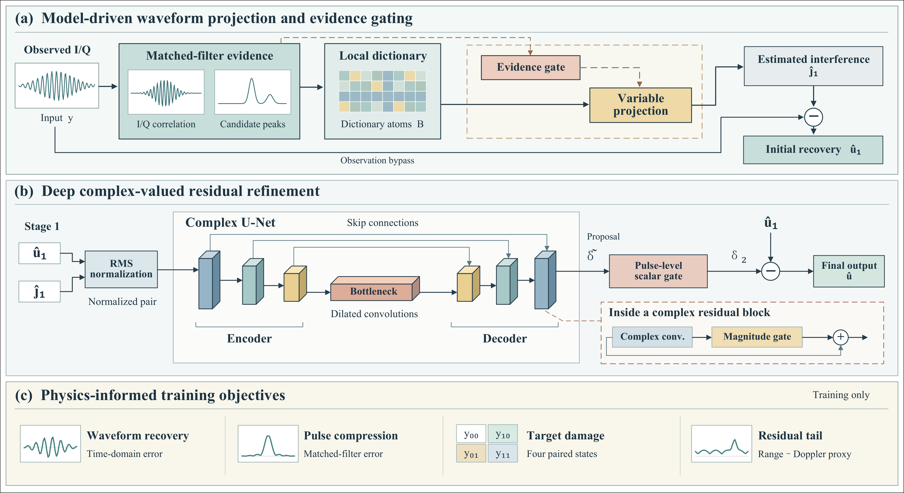

# ReCoVP-Hybrid 可编辑架构图

**图注**　（a）模型从观测 I/Q 的匹配滤波响应构建局部字典，并结合证据门进行变量投影。观测减去初始干扰估计，得到初步恢复结果。（b）复值 U-Net 读取归一化的两路中间估计，通过编码器、膨胀卷积瓶颈和解码器产生修正提案。门控后的修正量用于更新初步恢复结果。虚线框展示复值残差块的简化视图。（c）训练目标包括波形恢复、脉压误差、目标损伤和距离–多普勒残余尾部代理。目标损伤旁的四格代表配对状态。

**绘图取舍**　波形、峰图和字典色块是可编辑示意图。特征块的高度与透视厚度表达网络层次，并无数值刻度。参考图中的具体通道数、时延微调公式和八脉冲相参效果未纳入本版。图上只保留一次变量投影，修正提案、门控修正量和恢复输出各有独立标记。

**文件**　使用 Visio 打开 [原生源文件](Hybrid_Visio.vsdx) 修改文字、线条和色块，使用 [矢量 PDF](Hybrid_Visio.pdf) 排版。高清 PNG 为 3600 × 1968 像素。三个图层对应上、中、下三个分区。
