# ReCoVP-Hybrid：五种子综合实验报告

结果汇总时间：2026-11-27T03:47:13Z。纳入 seed 17、29、41、53、67，全部使用 epoch 256；是 8 种子计划中的阶段性结果。

## 1. 结论先行

五种子证据支持 Hybrid 在恢复误差、目标保真和虚警控制之间形成较好的综合折衷，但不支持“所有指标全面超过第一篇 RSDR-Net”。相对于卷积 Tail 基线，Hybrid 在 1%、5%、10% 校准虚警目标上的检测优势均存在；相对于 RSDR，5% 点略低、10% 点基本持平，1% 严格低虚警点明显落后。

受控 SNR×JSR 扫描中，Hybrid 的网格平均恢复误差和目标损伤优于 RSDR，检测率相当；RSDR 的平均 SJRI-F 略高。DEV 与网格扫描分布不同，不能用网格平均代替 DEV，或据单个漂亮数值宣告最终模型冻结。

此外，seed 67 的无目标纯噪声改动明显高于其余四个 seed，虽然绝对值仍小，却说明背景透明性存在种子敏感性。剩余 3 个 seed、独立确认集和同机计时仍是后续任务，本报告没有新增训练或打开独立确认集。

## 2. 证据范围与统计口径

| 层次 | 场景/方法 | 统计解释 |
| --- | --- | --- |
| 训练 | 5 seed × 256 epoch；每 seed 12,288 updates | 固定末轮，不选 best seed / best checkpoint |
| Equal-PFA | 校准 1,024 parent；评测 2,048 parent；每 parent 3 类干扰 | 各方法/seed 独立校准；评测实测虚警另报 |
| 固定 DEV | 256 parent；direct/repeat/cyclic；4 状态 | 本次补齐五种子主输出、Stage 1、脉压相干/多普勒 |
| 受控扫描 | 8 SNR × 4 JSR × 64 parent = 2,048 parent | 32 格等权；检测沿用 cell-CFAR，非 Equal-PFA |
| 基线 | 卷积网络通常 3 seed；RSDR/CVED 各 1 个冻结检查点 | 不是 5 对 5；训练数据及预算不同 |
| 不确定性 | seed SD 与 parent bootstrap 分开 | 先平均种子，再按物理 parent 配对重抽样 4,000 次 |

parent 置信区间以已训练检查点和已校准阈值为条件，不包括重新训练或重抽校准集的不确定性。seed 均值的 t 区间另见 SEED_STATISTICS.csv（n=5 时 df=4），不等于场景泛化区间。对 32 格和多个指标的比较为描述性分析，未作多重比较校正；不根据区间筛选指标。

E_U = ||u(S+J+E)−(S+E)||² / ||S+E||²，对应 `u_nmse`；E_S = ||[u(S+J+E)−u(J+E)]−S||² / ||S||²，对应 `damage`。E0 为纯噪声输出相对输入的改动能量比。目标增量 D=u(S+J+E)−u(J+E)，幅度比为 |<S,D>|/||S||²。SJRI-F 按项目冻结脉压/雷达评估实现计算，报告的是场景 dB 的平均，不能与平均线性比值后转 dB 混用。

## 3. 五种子的训练完成情况

| seed | epoch / updates | 训练总目标 | 最终分支目标 | 完成时间 UTC | checkpoint SHA（前 12 位） |
| --- | --- | --- | --- | --- | --- |
| 17 | 256 / 12288 | 0.33644 | 0.06373 | 2026-11-25T17:24:38.021859+00:00 | e0b6cb1be955 |
| 29 | 256 / 12288 | 0.33230 | 0.06544 | 2026-11-26T11:37:01.784832+00:00 | 14d7740c45ed |
| 41 | 256 / 12288 | 0.33416 | 0.05841 | 2026-11-26T15:10:45.681507+00:00 | 07697294408c |
| 53 | 256 / 12288 | 0.33770 | 0.06066 | 2026-11-26T19:58:33.641175+00:00 | 8fafaabe762d |
| 67 | 256 / 12288 | 0.33698 | 0.06150 | 2026-11-27T02:49:02.181001+00:00 | de7f659217ef |

五个 seed 共同绑定的 9 个模型/训练核心源文件及训练集 SHA 一致；后续 seed 的清单额外登记多种子调度与评估包装器，不宣称全部文件清单完全相同。各自配置 SHA 随 seed 变化。完整 checkpoint SHA、32 epoch 里程碑摘要和每轮曲线保存在 TRAINING.json，权重留在服务器。训练损失接近不能代替测试稳定性，尤其 seed 17 的 1% 检测率并不代表五种子平均。

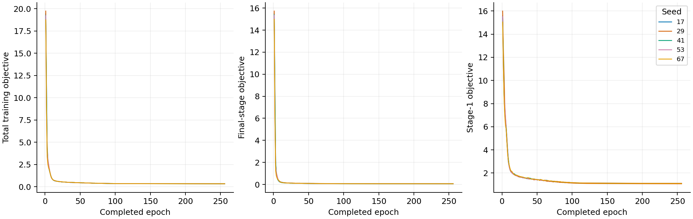

## 4. 等虚警检测：明确优势与失败边界

| 方法（seed数） | Pd @1% | 实测Pfa @1% | Pd @5% | 实测Pfa @5% | Pd @10% | 实测Pfa @10% |
| --- | --- | --- | --- | --- | --- | --- |
| ReCoVP-Hybrid (5) | 56.3835 ± 2.2341% | 0.9570 ± 0.1284% | 88.3073 ± 0.5709% | 5.0000 ± 0.0887% | 91.0645 ± 0.2252% | 10.0488 ± 0.2233% |
| ReCoVP-Stage1 (5) | 54.3327 ± 3.4675% | 0.9928 ± 0.1410% | 84.4857 ± 0.7422% | 5.1237 ± 0.1934% | 88.6068 ± 0.2614% | 10.4102 ± 0.3349% |
| CorrectionNet-Tail (3) | 47.8787 ± 1.1921% | 0.7541 ± 0.0835% | 72.5911 ± 0.5907% | 4.4000 ± 0.0835% | 83.5992 ± 0.6755% | 9.1146 ± 0.3251% |
| UNet-Tail (3) | 52.7127 ± 0.2492% | 0.8518 ± 0.0523% | 77.4034 ± 0.2210% | 4.3511 ± 0.0523% | 86.9412 ± 0.3924% | 9.2773 ± 0.1715% |
| RSDR-Net (1) | 73.5026% | 0.9277% | 88.7207% | 5.0944% | 91.0645% | 10.0423% |
| CVEDNet (1) | 91.7806% | 0.9440% | 95.6706% | 4.9479% | 97.4447% | 9.6680% |

“@5%”等标记表示校准目标而非强制实测值相等。基线在评测集上的虚警通常更低，因此比较是同一预定校准策略的比较，不声称精确相同实测 Pfa 下的支配关系；本次未在评测集上重调阈值或插值选工作点。

| Hybrid − 对照 | ΔPd @1% (百分点) | ΔPd @5% (百分点) | ΔPd @10% (百分点) |
| --- | --- | --- | --- |
| CorrectionNet-Tail | +8.505 [+7.672, +9.397] | +15.716 [+14.419, +17.089] | +7.465 [+6.551, +8.380] |
| UNet-Tail | +3.671 [+3.152, +4.207] | +10.904 [+9.821, +12.044] | +4.123 [+3.504, +4.761] |
| ReCoVP-Stage1 | +2.051 [+1.432, +2.646] | +3.822 [+3.311, +4.362] | +2.458 [+2.008, +2.930] |
| RSDR-Net | -17.119 [-18.516, -15.755] | -0.413 [-0.762, -0.059] | +0.000 [-0.339, +0.335] |

方括号是配对 parent 95% bootstrap CI。Hybrid 对两种 Tail 网络的检测优势明确；对 RSDR 的 1% 点落后约 17.12 个百分点，是当前最重要的检测短板。5% 点约低 0.41 个百分点；10% 点均值相同，区间包含零。不能用 5%/10% 成绩掩盖严格低虚警端不足。

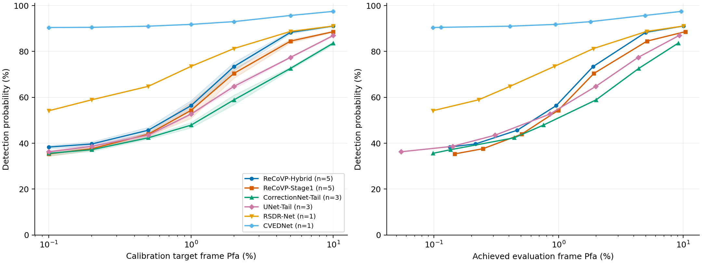

| seed | Pd @1% | Pd @5% | Pd @10% | E0 |
| --- | --- | --- | --- | --- |
| 17 | 52.751% | 87.533% | 90.934% | 1.016e-06 |
| 29 | 57.129% | 87.858% | 90.934% | 1.340e-06 |
| 41 | 57.340% | 88.688% | 90.902% | 4.445e-07 |
| 53 | 56.038% | 88.704% | 91.113% | 1.205e-06 |
| 67 | 58.659% | 88.753% | 91.439% | 7.230e-05 |

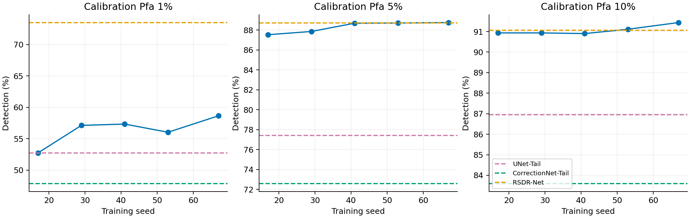

种子稳定性随工作点变化：Pd 的 seed SD 在 1%、5%、10% 校准点分别为 2.234、0.571、0.225 个百分点。较宽松工作点比较稳定，但 1% 点的种子敏感性不能忽略。这里的 SD 来自五次训练，不能把 6,144 帧当成 6,144 个训练重复。

| 干扰类型 | Pd @1% | Pd @5% | Pd @10% |
| --- | --- | --- | --- |
| direct | 59.326% | 90.029% | 92.363% |
| repeat | 52.285% | 85.723% | 89.053% |
| cyclic | 57.539% | 89.170% | 91.777% |

repeat 仍是三类中最难的，但在 5% 校准目标上平均达到 85.72%，10% 达到 89.05%；1% 仅 52.29%。这些是独立 Equal-PFA 评测集的结果，不能与旧 DEV 的 73.83% 直接相减归因。

## 5. 背景透明性、残余长尾与阶段作用

| 方法 | E0 mean ± seed SD | 残余峰值 p99 | 残余峰值 p99.9 |
| --- | --- | --- | --- |
| ReCoVP-Hybrid | 1.526e-05 ± 3.189e-05 | 76.11565 | 884.62735 |
| ReCoVP-Stage1 | 4.950e-07 ± 4.985e-07 | 539.41852 | 2812.88114 |
| CorrectionNet-Tail | 1.241e-04 ± 1.921e-05 | 124.78135 | 463.00453 |
| UNet-Tail | 8.181e-05 ± 2.715e-05 | 104.69355 | 587.79813 |
| RSDR-Net | 1.052e-05 | 25.04203 | 55.79615 |
| CVEDNet | 0.9999 | 1244.77133 | 27926.06736 |

Hybrid 的 E0 五种子平均约 1.53e-5，但 seed 67 为 7.23e-5，其余四个仅约 4.44e-7–1.34e-6。不能把 seed 17 的近透明背景推广为每个 seed 的同等保证。CVEDNet 的 E0 接近 1，说明其迁移输出基本改变了全部纯噪声；其高 Equal-PFA Pd 需要与保真损失共同解释。此处不据迁移实验贬低其在原协议上的性能。

Hybrid 残余峰值仍有长尾（p99≈76.12、p99.9≈884.63 个参考噪声功率单位），因此“完全消灭残余假峰”不成立。Stage 1 的低维自适应修正不自动保证噪声不变；Stage 2 也不受同一子空间约束。不能套用固定且与噪声独立字典的 K/N 投影期望上界。

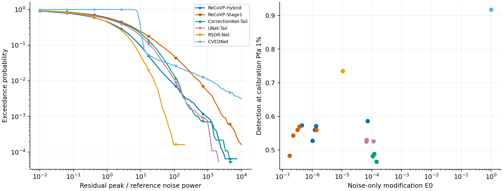

经典方法的 Equal-PFA 成绩也保存在 equal_pfa.csv；BCS-oracle 读取真值支持，只是诊断参照，不是可部署对照，不进入主图或主要结论。Max-TF/GMM-OMP 的迁移扫描结果属于当前实现和参数的描述，并不代替第一篇协议的复现验收；旧 DEV 调参失败记录也不会因本报告被改写为通过。

## 6. SNR×JSR：与第一篇及其他方法的同场景比较

SNR = −25、−20、−15、−10、−5、0、5、10 dB；JSR = 0、10、20、30 dB。每格 64 个物理 parent，三种干扰先在 parent 内平均。所有方法使用同一注册扫描场景；没有为本报告生成新数据或使用确认集。这是选定网格的描述性宏平均，不是实际工况频率加权平均。

| 方法（seed数） | E_U↓ | E_S↓ | Pd↑ | 干扰帧Pfa↓ | SJRI-F dB↑ | 目标幅度比≈1 |
| --- | --- | --- | --- | --- | --- | --- |
| ReCoVP-Hybrid (5) | 0.07284 | 0.04269 | 0.91305 | 0.08730 | 4.22091 | 0.93196 |
| CorrectionNet (3) | 0.09464 | 0.05444 | 0.91064 | 0.22510 | 3.84392 | 0.92642 |
| UNet (3) | 0.08631 | 0.04079 | 0.91135 | 0.16488 | 3.96191 | 0.93946 |
| RSDR-Net (1) | 0.11478 | 0.09105 | 0.91357 | 0.09049 | 4.46703 | 0.89248 |
| CVEDNet (1) | 1.10781 | 0.62771 | 0.63558 | 0.90365 | -1.12063 | 0.53454 |
| Max-TF (1) | 0.85662 | 2.84739 | 0.89518 | 0.43408 | 2.53635 | 0.65510 |
| GMM-OMP (1) | 1.18655 | 3.72996 | 0.65739 | 0.99967 | -3.84946 | 0.21110 |

Hybrid 相对 RSDR 的网格平均 E_U 约降低 36.53%、E_S 约降低 53.11%，目标幅度比由 0.89248 提升到 0.93196；Pd 为 91.305% 对 91.357%，差异很小。干扰帧虚警约 8.73% 对 9.05%，SJRI-F 为 4.221 对 4.467 dB。这里既有改善也有代价，不是全面支配。

逐格看，Hybrid 的 E_S 在 32/32 格均低于 RSDR；E_U 在 15/32 格低于 RSDR，说明较好的宏平均不能解释为所有条件都更好。SJRI-F 在 29/32 格低于 RSDR；检测差异的 32 个逐格 parent 区间均包含零。详见完整 snr_jsr.csv 与 ANALYSIS.json 中逐格配对区间；小样本、未校正多重比较，仅作结构化诊断。

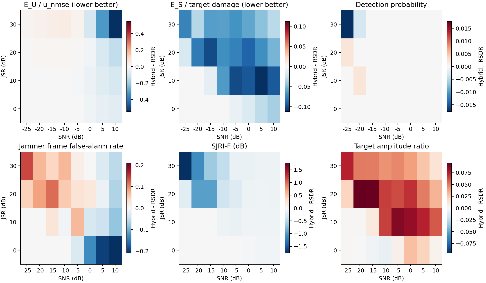

六类 SNR 曲线分别如下，颜色/标记表示不同 JSR，左右面板分别是 Hybrid 与 RSDR；阴影仅表示 Hybrid 种子 SD：

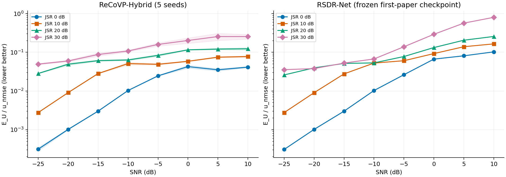

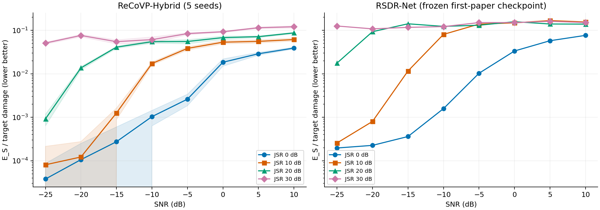

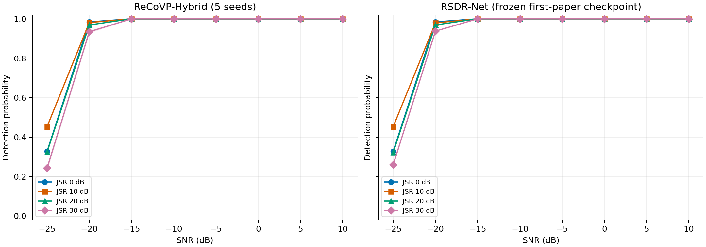

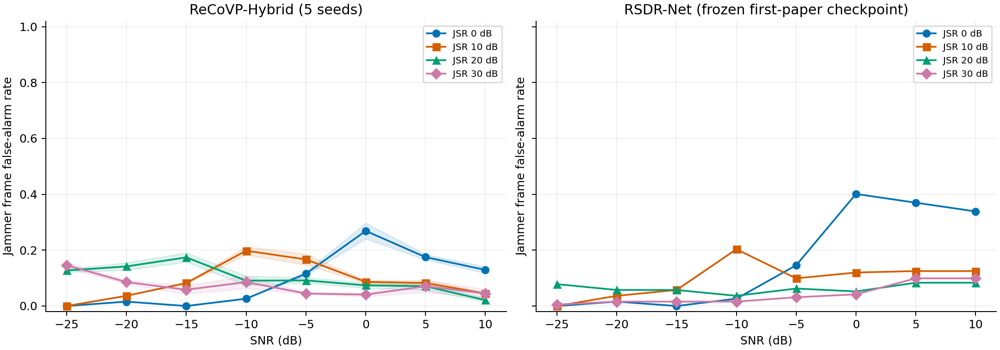

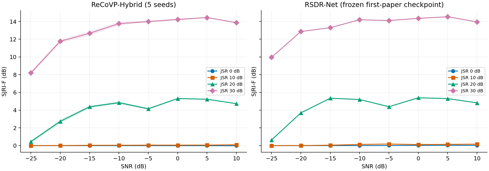

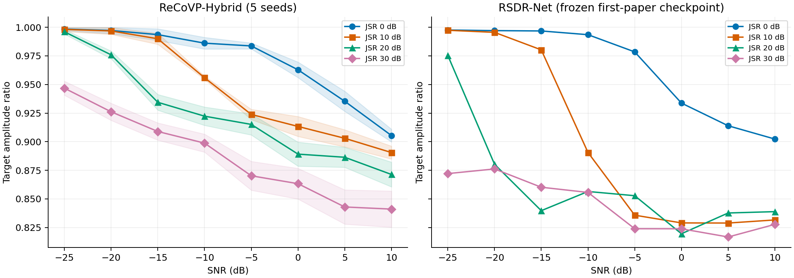

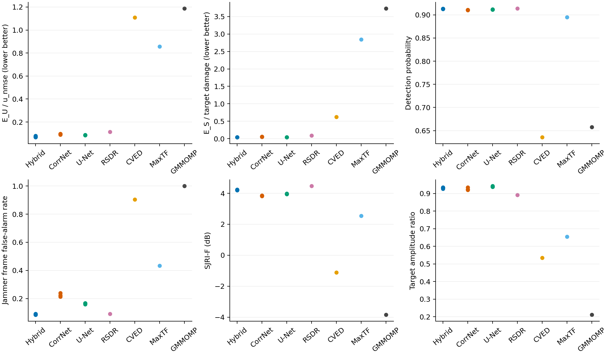

## 7. 固定 DEV、脉压与多普勒补测

| 指标 | Hybrid 五种子 mean ± SD | Stage 1 五种子 mean ± SD | RSDR 单检查点 |
| --- | --- | --- | --- |
| u_nmse | 0.0428 ± 0.0019 | 0.3958 ± 0.0038 | 0.03343 |
| damage | 0.0581 ± 0.0034 | 0.1247 ± 0.0079 | 0.09470 |
| background_nmse | 0.0430 ± 0.0021 | 0.4083 ± 0.0041 | 0.03321 |
| no_jammer_pooled_nmse | 1.770e-05 ± 3.207e-05 | 2.005e-06 ± 5.569e-07 | 1.346e-05 |
| noise_nmse | 1.517e-05 ± 3.183e-05 | 4.419e-07 ± 4.626e-07 | 1.126e-05 |
| amplitude | 0.9217 ± 0.0040 | 0.9861 ± 6.217e-04 | 0.89052 |
| sjrif_db | 11.1268 ± 0.0437 | 10.4665 ± 0.0595 | 11.33760 |
| false_peak_suppression_db | 13.4528 ± 0.0548 | 11.8662 ± 0.0774 | 13.93947 |
| pd | 0.8758 ± 0.0039 | 0.8536 ± 0.0015 | 0.86979 |
| frame_pfa_jammer | 0.0565 ± 0.0065 | 0.0719 ± 0.0076 | 0.05078 |
| frame_pfa_noise | 0.0039 ± 0.0000 | 0.0039 ± 0.0000 | 0.00391 |

| seed | E_U | E_S | Pd | 干扰帧Pfa | SJRI-F dB | 幅度比 |
| --- | --- | --- | --- | --- | --- | --- |
| 17 | 0.04312 | 0.05967 | 0.87109 | 0.05599 | 11.09686 | 0.91518 |
| 29 | 0.04588 | 0.06333 | 0.87630 | 0.06771 | 11.06581 | 0.92167 |
| 41 | 0.04078 | 0.05499 | 0.87370 | 0.05078 | 11.15845 | 0.92170 |
| 53 | 0.04158 | 0.05625 | 0.87630 | 0.05469 | 11.14455 | 0.92512 |
| 67 | 0.04289 | 0.05605 | 0.88151 | 0.05339 | 11.16812 | 0.92492 |

以下相干指标统一对照纯目标脉压输出，取真实目标的距离单元。operational 为实际 u(S+J+E)，保留噪声和干扰残留；increment 为 D，用于分离模型目标响应。两种指标不能混称。相干功率 dB 是有符号功率比，负值代表下降；它不是所有距离单元最大峰值的损失，也不能直接等同旧报告的 absCPL。相位 RMSE 去除公共相位后计算，多普勒峰值误差用相同 4096 点零填充 FFT，只有 8 个实际脉冲，零填充没有提高物理分辨率。

| 脉压/多普勒指标 | Hybrid mean ± seed SD | RSDR | Hybrid−RSDR [parent95%CI] |
| --- | --- | --- | --- |
| operational_coherent_power_db | -0.7780 ± 0.0410 | -1.10098 | 0.32295 [0.28341, 0.36365] |
| operational_phase_rmse_deg | 16.9083 ± 0.0837 | 16.84826 | 0.06004 [-0.26299, 0.38884] |
| operational_peak_error_hz | 203.6921 ± 1.0931 | 200.13385 | 3.55826 [-1.69267, 8.70832] |
| increment_coherent_power_db | -0.7274 ± 0.0406 | -1.06157 | 0.33414 [0.29956, 0.36972] |
| increment_phase_rmse_deg | 0.9786 ± 0.0707 | 1.56267 | -0.58407 [-0.67782, -0.49005] |
| increment_peak_error_hz | 8.6339 ± 0.7581 | 12.18584 | -3.55191 [-4.33620, -2.81858] |

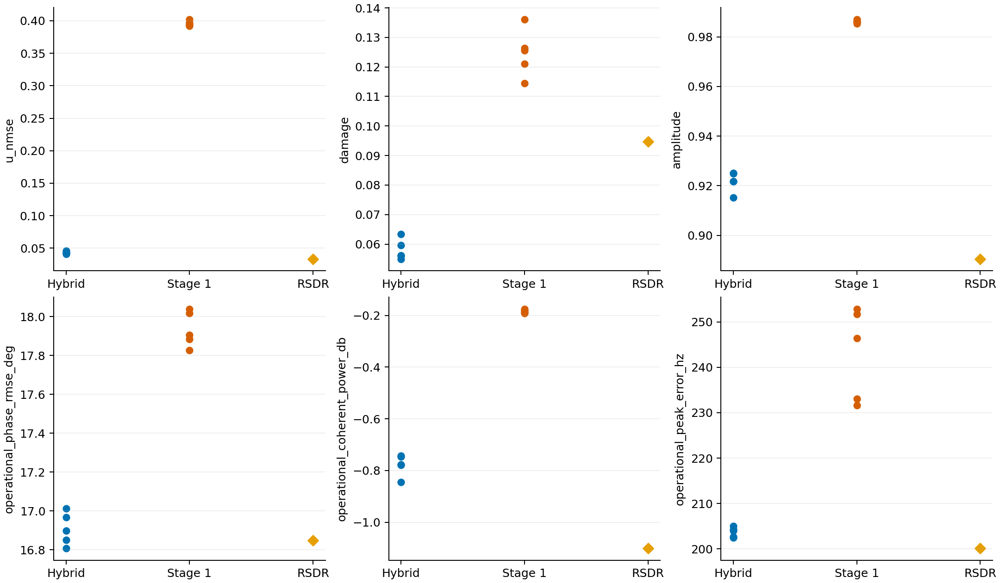

DEV 五种子 E_U=0.04285，反而高于 RSDR 的 0.03343；E_S=0.05806，低于 RSDR 的 0.09470，下降约 38.69%。目标幅度比从 0.89052 提高到 0.92172。检测率 87.578% 对 86.979%、干扰帧虚警 5.651% 对 5.078%，两项配对区间均包含零，不能判定检测或虚警全面胜出。

Stage 2 将 DEV 的 E_U 从 Stage 1 的 0.39580 降到 0.04285，E_S 从 0.12468 降到 0.05806；但 Stage 1 的幅度比更接近 1，Stage 2 带来了额外幅度衰减。低目标损伤、幅度保真和残余抑制必须分别评价，不能以单一幅度指标概括整个阶段的作用。

实际输出的相干功率相对纯目标平均为 −0.7780 dB（seed SD 0.0410 dB），RSDR 为 −1.1010 dB，Hybrid 少损失约 0.3230 dB；但尚未达到旧设想的 0.3–0.4 dB 损失。目标增量的相位 RMSE 为 0.9786° 对 1.5627°，插值多普勒峰值误差为 8.6339 对 12.1858 Hz，两项配对区间均支持改善。实际含噪输出的相位 RMSE 为 16.9083° 对 16.8483°、峰值误差为 203.6921 对 200.1339 Hz，差值区间均包含零。目标响应更保真不等于最终含噪多普勒估计已改善。

RSDR 本次复算与原 E7 冻结 DEV 的共同指标最大绝对差为 1.776e-15；检测和帧虚警完全一致。

| DEV 干扰类型 | E_U | E_S | Pd | 干扰帧Pfa | SJRI-F | 幅度比 |
| --- | --- | --- | --- | --- | --- | --- |
| direct | 0.01100 | 0.02692 | 0.89141 | 0.06719 | 11.94193 | 0.94755 |
| repeat | 0.07652 | 0.09008 | 0.84844 | 0.05781 | 10.71925 | 0.89429 |
| cyclic | 0.04103 | 0.05718 | 0.88750 | 0.04453 | 10.71910 | 0.92331 |

DEV 与独立扫描上的排名变化是分布依赖的实际证据。下结论时应同时引用本节与第 6 节，而非只选有利结果。ANALYSIS.json 还给出每个指标的 parent 中位数、p95、配对区间及逐干扰类型均值。

### 7.1 全部 12 类卷积对照

| 方法（各3 seed） | E_U↓ | E_S↓ | Pd↑ | 干扰帧Pfa↓ | SJRI-F dB↑ | 幅度比 |
| --- | --- | --- | --- | --- | --- | --- |
| CorrectionNet | 0.05989 | 0.06340 | 0.85981 | 0.15321 | 10.30131 | 0.91813 |
| CorrectionNet-Ctrl | 0.05999 | 0.06249 | 0.86198 | 0.15234 | 10.31241 | 0.91913 |
| CorrectionNet-Tail | 0.05821 | 0.06355 | 0.86458 | 0.14540 | 10.40468 | 0.91780 |
| CN-NoDechirp | 0.05087 | 0.04523 | 0.87326 | 0.10851 | 10.69652 | 0.93747 |
| CN-NoRMS | 0.05937 | 0.06398 | 0.87196 | 0.14583 | 10.33936 | 0.92228 |
| CN-NoPC | 0.06265 | 0.05905 | 0.86458 | 0.16536 | 10.22086 | 0.92309 |
| CN-NoDamage | 0.04902 | 0.13032 | 0.83637 | 0.09115 | 10.86006 | 0.85830 |
| UNet | 0.05451 | 0.04814 | 0.86806 | 0.11111 | 10.60521 | 0.93072 |
| UNet-Tail | 0.05364 | 0.04883 | 0.86632 | 0.10634 | 10.67027 | 0.93006 |
| UNet-NoiseNorm | 0.06563 | 0.05956 | 0.86285 | 0.13672 | 10.34469 | 0.91820 |
| UNet-Freq | 0.09969 | 0.13582 | 0.74219 | 0.15582 | 9.15583 | 0.82372 |
| UNet-Dilation | 0.05707 | 0.05050 | 0.87109 | 0.11458 | 10.57703 | 0.92963 |

在这套 DEV 上，Hybrid 的 E_U 均值和干扰帧虚警均低于全部 12 类卷积对照；但 E_S 高于 CN-NoDechirp、UNet、UNet-Tail 和 UNet-Dilation，幅度保真也不是所有对照中最好。不能把恢复误差、虚警控制的优势改写为每一维都最好。全部 Hybrid−对照的 parent 配对区间保存在 dev_comparisons.csv；未按相同 seed 号码强行配对。

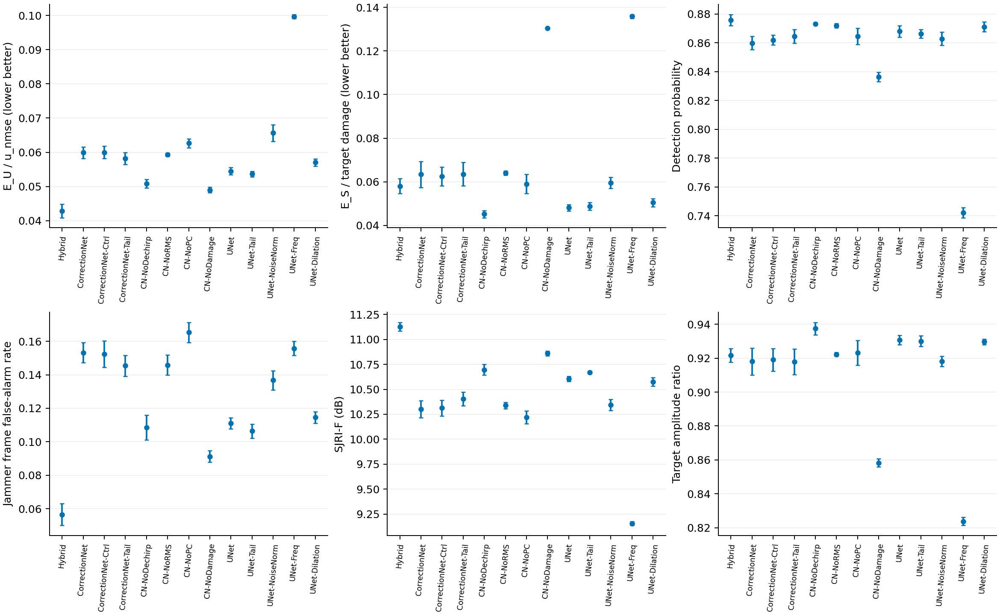

### 7.2 场景分布的尾部

| 指标（先在parent内平均3类干扰） | Hybrid parent中位数 | Hybrid parent p95 |
| --- | --- | --- |
| u_nmse | 0.02425 | 0.14084 |
| damage | 0.04713 | 0.12494 |
| operational_coherent_power_db | -0.71306 | 1.02045 |
| operational_phase_rmse_deg | 12.54901 | 49.15852 |
| operational_peak_error_hz | 131.83594 | 579.56272 |
| increment_phase_rmse_deg | 0.78772 | 2.55626 |
| increment_peak_error_hz | 6.78168 | 23.87153 |

以上分位数对应先平均五个 seed、再在每个 parent 内平均三类干扰后的分布；不是所有帧混合分位数。相干功率的 p95 是数值较高的一端，不能把它当作损失最严重的 5% 尾部。

### 7.3 五次训练的稳定性

| DEV指标 | 五种子均值 | seed SD | 最小seed均值 | 最大seed均值 |
| --- | --- | --- | --- | --- |
| u_nmse | 0.04285 | 0.00195 | 0.04078 | 0.04588 |
| damage | 0.05806 | 0.00343 | 0.05499 | 0.06333 |
| amplitude | 0.92172 | 0.00402 | 0.91518 | 0.92512 |
| pd | 0.87578 | 0.00386 | 0.87109 | 0.88151 |
| frame_pfa_jammer | 0.05651 | 0.00655 | 0.05078 | 0.06771 |
| noise_nmse | 1.517e-05 | 3.183e-05 | 3.929e-07 | 7.212e-05 |
| operational_coherent_power_db | -0.77802 | 0.04098 | -0.84495 | -0.74287 |

所有五个 seed 均计入，不因为背景改动较大而删除 seed 67。E0 的均值和 SD 被该 seed 明显拉高，不能仅展示平均检测率就宣称各 seed 在全部指标上同样稳定。完整逐种子数值见 dev_metrics.csv，种子均值的 df=4 t 区间见 SEED_STATISTICS.csv。

## 8. 零训练结构诊断（WP8）

已读取 seed 17, 29, 41, 53, 67 的现成结果（本节 n=5，与前述五种子主评测分开计数）。以下改变都是冻结模型的推理期干预，不能当作从头训练的架构消融，也不用于选择最终 K 或门控参数。

| 推理期变体 | E_U | E_S | E0 | Pd | 干扰帧Pfa |
| --- | --- | --- | --- | --- | --- |
| stage1_K4_learned | 1.77031 | 0.16171 | 2.089e-07 | 0.83333 | 0.14349 |
| stage1_K8_learned | 0.75557 | 0.06848 | 3.185e-07 | 0.84479 | 0.08333 |
| stage1_K12_learned | 0.51622 | 0.07537 | 3.870e-07 | 0.84922 | 0.07500 |
| stage1_K16_learned | 0.39580 | 0.12468 | 4.419e-07 | 0.85365 | 0.07187 |
| stage1_K16_noreg | 0.44699 | 1.45365 | 0.07456 | 0.30443 | 0.02396 |
| final_K16_learned | 0.04285 | 0.05806 | 1.517e-05 | 0.87578 | 0.05651 |
| final_K16_noreg | 0.10466 | 1.24999 | 0.07864 | 0.31510 | 0.00755 |
| final_K16_alpha1 | 13.15193 | 13.47980 | 2.34858 | 0.54583 | 0.06615 |

前 k 个原子按贪心候选峰选择顺序截取，并非按距离排序。K 减少同时改变候选覆盖与后续精修输入；强行取消学习正则或令门控为 1 会造成分布偏移。它们能揭示冻结模型对部件的依赖，不能证明相应组件在重训练后的因果必要性。

seed 17 重构与原 DEV 的 E_U 差约 7.3e-8、E_S 差约 1.84e-6、SJRI-F 差约 3.95e-5 dB；Pd 和帧虚警一致。这些小数值差异已保留，未重复旧回执中“所有指标在 1e-6 内”的不准确说法。

取消逐原子正则后，完整输出的 E_S 从约 0.058 升到 1.250，Pd 从 87.58% 降到 31.51%；其较低虚警不能解释为更好的干扰抑制。强令门控 α=1 后，E_U≈13.15、E_S≈13.48，说明训练得到的残差幅值控制对当前冻结模型非常关键。减小 Stage 1 的 K 会降低候选覆盖；K=8 的 E_S 小于 K=16，但恢复误差更大，体现预算、目标损伤和残余抑制之间的折衷。

五个包装器 K=16 对照的最大相对修正差为 9.256e-12。

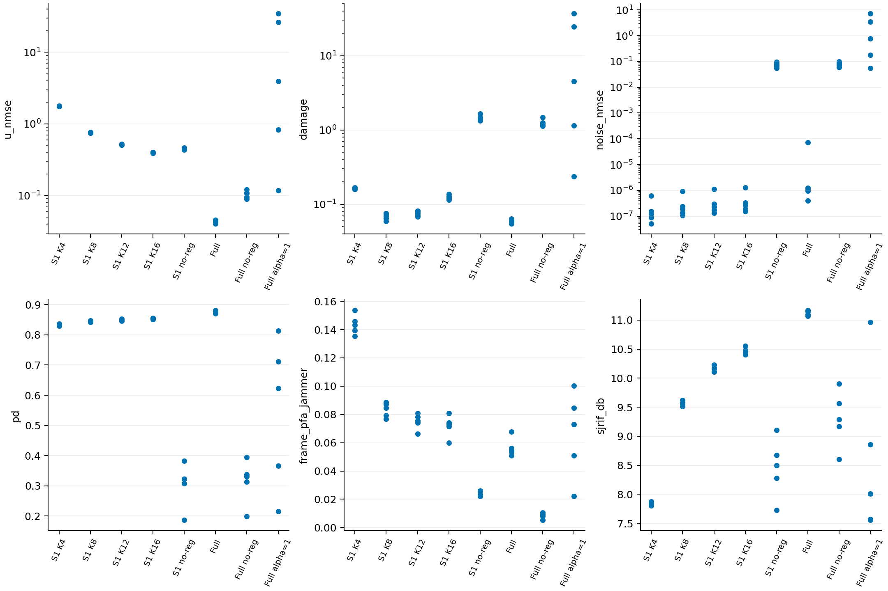

WP8 的参数核对给出：Stage 1 为 28,948 个有效实参数，Stage 2 为 28,577 个，总计 57,525。RSDR 适配器登记 3,017,877 个参数元素，训练数据与训练预算也不同。参数量不能代替同机耗时；本报告没有把带并发负载的零散推理耗时包装为公平速度基准，也没有补造未覆盖解析求解的 FLOPs。

## 9. 当前能下什么结论，下一步做什么

1. 可以确认：五种子在 5%/10% 校准工作点上稳定优于两种 Tail 卷积基线；Stage 2 对同次前向 Stage 1 的恢复、目标保真与检测有实证收益。
2. 可以确认：在所注册的 SNR×JSR 网格上，Hybrid 的目标损伤和宏平均恢复误差优于第一篇冻结 RSDR；但严格低虚警检测、部分背景指标、平均 SJRI-F 仍有短板。
3. 不能确认：已跨所有 SNR/JSR/宽度/未受扰比例获得全面优势；已彻底消灭 CFAR 掩蔽；已满足旧任务书 BVR01≤0.15 dB 或 JCR>16.5 dB。当前套件没有同定义的五种子 BVR01/JCR 汇总，不用 E0 或 SJRI-F 替代这些量。
4. 不能确认：模型已完成 8 种子最终验证或一次独立确认集封口。报告不自动冻结最终模型、不追加种子、不改训练损失。保留既有剩余种子流水线，完成后按同一统计口径增量更新。
5. 建议下一步：优先审计 seed 67 的 E0 异常和 1% 虚警端阈值/残余长尾；补齐宽度、支持比例扫描与公平同机计时，再依据预先约定的门槛决定是否微调。微调属于后续独立训练版本，不能与当前五种子混合汇总。

## 10. 文件、复现与交接

- 本报告：REPORT.md；所有图在 figures/，同时提供 PNG 和矢量 PDF。
- 数值与溯源：ANALYSIS.json（含原证据 SHA/服务器相对路径）、TRAINING.json、equal_pfa.csv、snr_jsr.csv、SEED_STATISTICS.csv。原始 parent 数组和权重只保留服务器，不进入 GitHub。
- 逐对照比较：dev_comparisons.csv 给出对 RSDR 和 12 类卷积对照的 DEV 差值及 parent 95% 区间；dev_metrics.csv 给出逐种子主输出/Stage 1 和 RSDR 数值。
- 重新作图：在本文件夹运行 `python build_hybrid_five_seed_report.py --package .`。只读汇总脚本和补测脚本副本也随包交付，执行推理仍要求服务器 B。
- 项目备份：`G:/Project Code/ISRJ_222/reports/Hybrid_5seed_20261127/`。
- 交接备份：`G:/Files/Markdown/ISRJ_2/opus对话/03_分析/Hybrid_5seed_20261127/`。主目录 README.md 的“Hybrid 五种子结果”固定段落持续更新，不另建主目录说明报告。
- 统计仅使用本次列明的五个 seed。其他线程后续新增结果不会自动混入，需重新运行汇总并更新本包。

## 图注索引

- `01_equal_pfa`：等虚警阈值策略下的检测曲线。左图横轴为校准目标，阴影为种子 SD；右图横轴为实际评测虚警率。连线仅引导阅读，不代表在评测集上重新选阈值。
- `02_seed_detection`：五种子逐点检测结果及基线均值。不同方法的同号 seed 不视作统计配对；seed 17 在 1% 点最低。
- `03_training`：各 seed 的完整 256 epoch 训练目标；是训练损失而非独立验证性能，未据此挑选最佳检查点。
- `04_snr_u_nmse`：SNR×JSR 受控扫描：E_U / u_nmse (lower better)。每格 64 个独立物理 parent、3 类干扰；Hybrid 阴影为 5 个 seed 均值的 SD，RSDR 只有一个冻结检查点。此处检测使用固定 cell-CFAR，未做逐格等整帧虚警校准。
- `05_snr_damage`：SNR×JSR 受控扫描：E_S / target damage (lower better)。每格 64 个独立物理 parent、3 类干扰；Hybrid 阴影为 5 个 seed 均值的 SD，RSDR 只有一个冻结检查点。此处检测使用固定 cell-CFAR，未做逐格等整帧虚警校准。
- `06_snr_pd`：SNR×JSR 受控扫描：Detection probability。每格 64 个独立物理 parent、3 类干扰；Hybrid 阴影为 5 个 seed 均值的 SD，RSDR 只有一个冻结检查点。此处检测使用固定 cell-CFAR，未做逐格等整帧虚警校准。
- `07_snr_frame_pfa_jammer`：SNR×JSR 受控扫描：Jammer frame false-alarm rate。每格 64 个独立物理 parent、3 类干扰；Hybrid 阴影为 5 个 seed 均值的 SD，RSDR 只有一个冻结检查点。此处检测使用固定 cell-CFAR，未做逐格等整帧虚警校准。
- `08_snr_sjrif_db`：SNR×JSR 受控扫描：SJRI-F (dB)。每格 64 个独立物理 parent、3 类干扰；Hybrid 阴影为 5 个 seed 均值的 SD，RSDR 只有一个冻结检查点。此处检测使用固定 cell-CFAR，未做逐格等整帧虚警校准。
- `09_snr_amplitude`：SNR×JSR 受控扫描：Target amplitude ratio。每格 64 个独立物理 parent、3 类干扰；Hybrid 阴影为 5 个 seed 均值的 SD，RSDR 只有一个冻结检查点。此处检测使用固定 cell-CFAR，未做逐格等整帧虚警校准。
- `10_delta_heatmap`：所有 32 格的 Hybrid−RSDR 差值。蓝色表示数值更低，是否更好取决于指标；各面板独立色标，未作平滑。
- `11_tail_and_preservation`：残余峰值的超越概率与背景改动/检测折衷。曲线是 seed×场景混合分布的描述，不作为独立重复；概率为零的尾部不在对数轴显示。
- `12_grid_all_methods`：32 格等权宏平均，各点为一个训练 seed（经典方法/冻结旧模型各一个点）。不同方法的训练数据、预算和种子数不同。
- `13_dev_and_doppler`：固定 DEV256 上五种子、同次前向 Stage 1 与 RSDR 的比较。下排采用实际含残余干扰和噪声的输出；相干功率是相对纯目标的有符号 dB，多普勒峰值来自相同 4096 点插值 FFT。
- `14_dev_convolutional_controls`：固定 DEV 上全部 12 类卷积对照。点为种子均值，误差线为种子 SD；Hybrid n=5，对照各 n=3。相同编号不表示训练种子配对。
- `15_frozen_interventions`：冻结模型的推理期诊断，每点一个 seed，n=5。前三项采用对数轴；这些干预不是重新训练的因果消融。低虚警必须与目标损伤和检测率合看。
