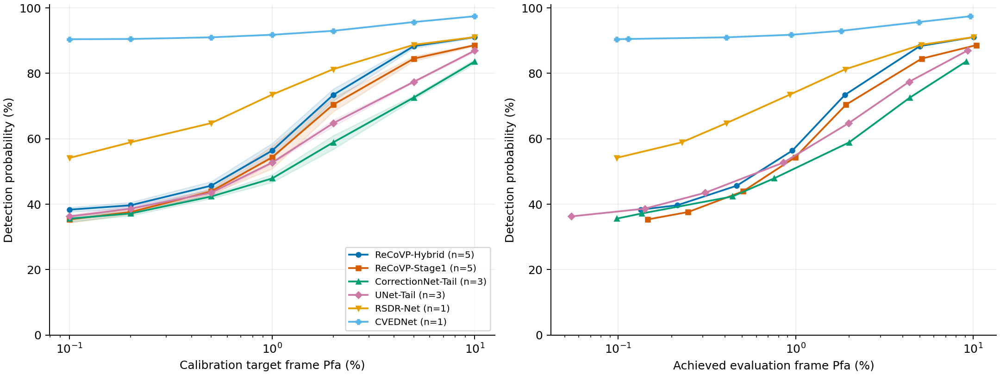
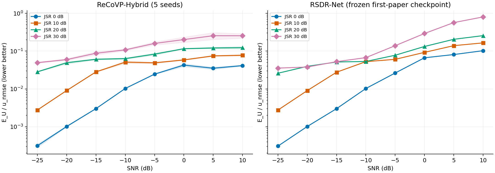
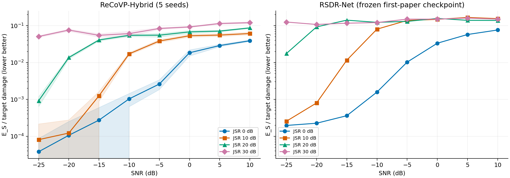
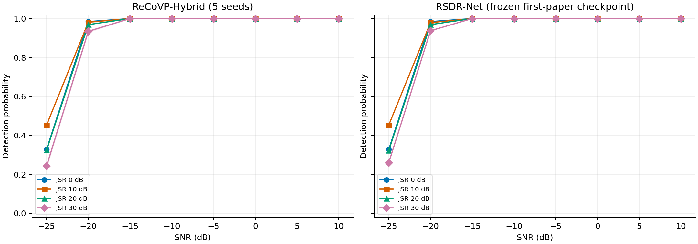
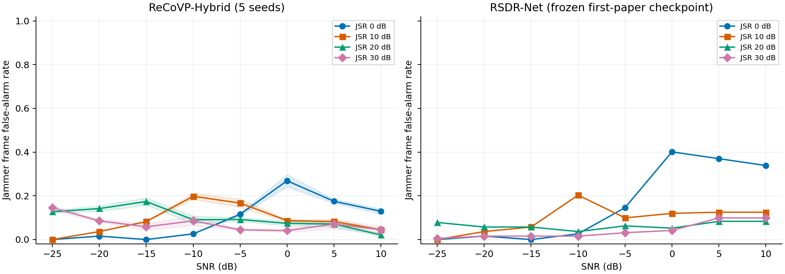
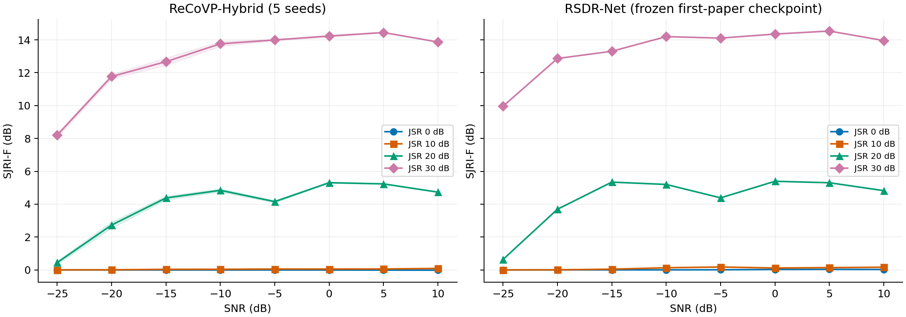
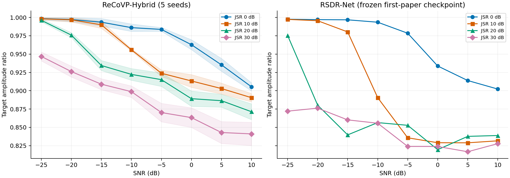
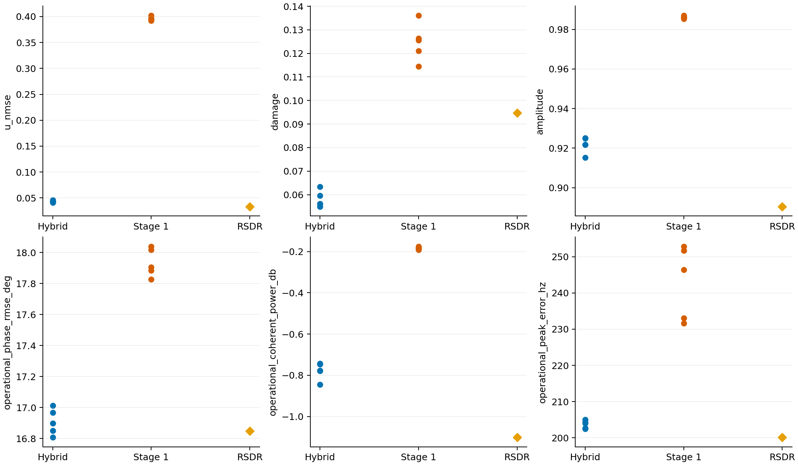
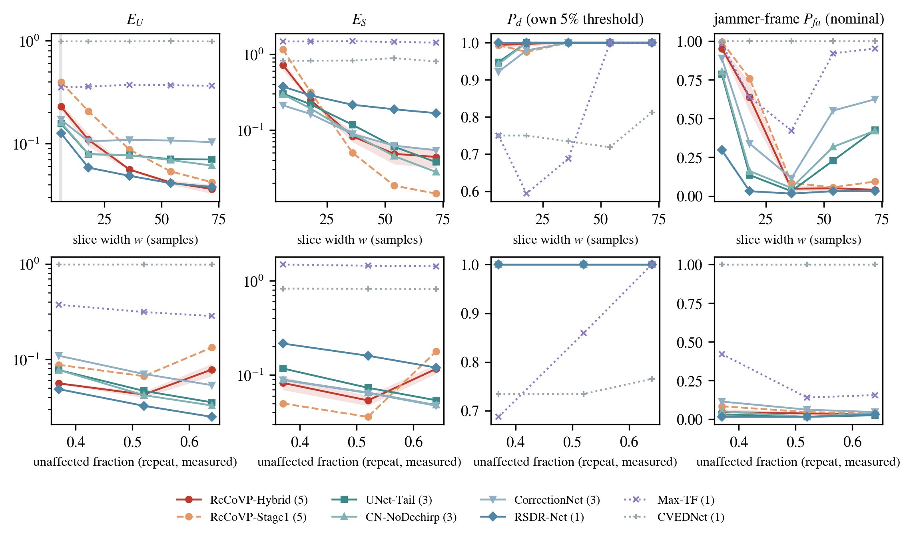

# ReCoVP-Hybrid 当前能力、短板与实验进度

服务器状态核验于 2026-11-27 03:46:30 PST，即 2026-11-27T11:46:30.6552275Z。性能统计采用 seed 17、29、41、53、67 的固定 epoch 256。seed 79、97 尚在续训，seed 109 排队，当前性能结论的训练重复数为 5。

## 1. 综合判断

Hybrid 在同规模卷积对照中表现出较低的恢复误差和受扰帧虚警，目标保真相对第一篇 RSDR-Net 有改善，模型有效实参数量为 57,525。当前主要不足集中在严格低虚警检测、密集窄切片干扰、第二阶段目标幅度收缩、背景改动的种子差异以及第一阶段求解耗时。

DEV 上 Hybrid 的 E_U 为 0.04285、E_S 为 0.05806、目标幅度比为 0.92172，受扰帧虚警为 5.651%。RSDR 对应为 0.03343、0.09470、0.89052 和 5.078%。Hybrid 的目标损伤较低，DEV 恢复误差较高。32 格受控扫描中，Hybrid 的平均 E_U 为 0.07284，RSDR 为 0.11478，排名随场景分布变化。

在 1%/5%/10% 校准虚警目标下，Hybrid 检测率为 56.38%/88.31%/91.06%，RSDR 为 73.50%/88.72%/91.06%。严格低虚警端仍落后。repeat 干扰在宽度 18 样点时的受扰帧虚警为 63.7%，宽度 36–72 时为约 4–5%，适用边界需要随主结果一起报告。

## 2. 评测协议与指标

| 评测 | 场景规模 | 用途 |
| --- | --- | --- |
| 固定 DEV | 256 个物理 parent，3 类干扰，4 种输入状态 | 同场景保真、残余、脉压与多普勒诊断 |
| Equal-PFA | 1,024 个校准 parent，2,048 个评测 parent，各含 3 类干扰 | 按固定校准策略比较检测工作点 |
| SNR×JSR 网格 | 8×4 格，每格 64 个 parent，三类干扰先在 parent 内平均 | 分条件性能与网格宏平均 |
| 结构扫描 WP5b | 固定 SNR −10 dB、JSR 20 dB，每格 64 个配对 parent | 宽度、回放密度和未受扰比例边界 |

卷积对照通常为 3 个种子，RSDR/CVED 各为一个冻结检查点。置信区间按物理 parent 配对 bootstrap。五种子 SD 单独表示训练差异。区间以已训练检查点与固定校准阈值为条件，尚未包含重新训练、重抽校准集的不确定性。32 格比较为描述性分析，尚未做多重比较校正。

- 恢复误差 `E_U = ||u(S+J+E)−(S+E)||² / ||S+E||²`，对应 `u_nmse`，越低越好。
- 目标损伤 `E_S = ||[u(S+J+E)−u(J+E)]−S||² / ||S||²`，对应 `damage`，越低越好。
- `Pd` 为目标检测概率。受扰帧虚警率在无目标、含干扰状态下统计一帧出现虚警的比例，纯噪声帧虚警另行统计。
- `SJRI-F` 为脉压后目标距离单元与最强非目标距离单元的功率比改善量，取处理后 dB 减处理前 dB。实现先对脉冲功率平均，再在距离维比较，报告再对场景 dB 平均。
- `false_peak_suppression_db` 为主瓣保护区外最强峰的处理前后功率比，和 SJRI-F 的定义各有侧重。
- 目标幅度比采用目标增量 `D=u(S+J+E)−u(J+E)` 的相干投影，理想值为 1。`E0` 为纯噪声输入上的相对改动能量。

网格检测使用冻结 cell-CFAR。Equal-PFA 使用各方法独立校准的帧级阈值。两套检测结果分别解释。每格的训练加权总损失尚无独立测试定义，本报告逐格给出 E_U、E_S 等已登记评测误差，训练总目标单列于进度部分。

## 3. 固定 DEV 的综合表现

| 方法 | E_U↓ | E_S↓ | Pd↑ | 受扰帧虚警↓ | SJRI-F/dB↑ | 幅度比 |
| --- | --- | --- | --- | --- | --- | --- |
| ReCoVP-Hybrid | 0.04285 | 0.05806 | 87.578% | 5.651% | 11.127 | 0.92172 |
| UNet-Tail | 0.05364 | 0.04883 | 86.632% | 10.634% | 10.670 | 0.93006 |
| CorrectionNet-Tail | 0.05821 | 0.06355 | 86.458% | 14.540% | 10.405 | 0.91780 |
| RSDR-Net | 0.03343 | 0.09470 | 86.979% | 5.078% | 11.338 | 0.89052 |

Hybrid 的 E_U 和受扰帧虚警均值低于全部 12 类卷积对照。对 UNet-Tail，恢复误差约低 20.1%，受扰帧虚警约低 46.9%，SJRI-F 高约 0.457 dB。对 CorrectionNet-Tail，恢复误差约低 26.4%，受扰帧虚警约低 61.1%。

目标损伤仍存在代价。UNet-Tail 的 E_S 为 0.04883，低于 Hybrid 的 0.05806，幅度比也更接近 1。Hybrid 的 E_S 较 RSDR 低约 38.69%，幅度比从 0.89052 提升至 0.92172。DEV 上 Hybrid 与 RSDR 的检测率、受扰帧虚警差值区间均跨零，当前无法确认这两项的改善。

Hybrid 的 DEV 五种子 SD 分别为 E_U 0.00195、E_S 0.00343、Pd 0.386 个百分点、受扰帧虚警 0.655 个百分点。纯噪声帧虚警为 0.3906%，与 RSDR 及主要卷积对照相同。

| 干扰类型 | E_U | E_S | Pd | 受扰帧虚警 | SJRI-F/dB | 幅度比 |
| --- | --- | --- | --- | --- | --- | --- |
| direct | 0.01100 | 0.02692 | 89.141% | 6.719% | 11.942 | 0.94755 |
| repeat | 0.07652 | 0.09008 | 84.844% | 5.781% | 10.719 | 0.89429 |
| cyclic | 0.04103 | 0.05718 | 88.750% | 4.453% | 10.719 | 0.92331 |

repeat 的恢复误差、目标损伤与幅度收缩最明显。direct 的目标保真最好，但其受扰帧虚警仍需单独观察。

## 4. Equal-PFA 检测与残余长尾

| 方法 | 种子数 | Pd @1% | Pd @5% | Pd @10% |
| --- | --- | --- | --- | --- |
| ReCoVP-Hybrid | 5 | 56.383% | 88.307% | 91.064% |
| ReCoVP-Stage1 | 5 | 54.333% | 84.486% | 88.607% |
| UNet-Tail | 3 | 52.713% | 77.403% | 86.941% |
| CorrectionNet-Tail | 3 | 47.879% | 72.591% | 83.599% |
| RSDR-Net | 1 | 73.503% | 88.721% | 91.064% |
| CVEDNet | 1 | 91.781% | 95.671% | 97.445% |

Hybrid 的三个工作点实测受扰帧虚警分别为 0.957%、5.000%、10.049%。UNet-Tail 为 0.852%、4.351%、9.277%，CorrectionNet-Tail 为 0.754%、4.400%、9.115%，RSDR 为 0.928%、5.094%、10.042%。表头标记校准目标，各方法在评测集上的实测虚警有差别。

Hybrid 相对 UNet-Tail 的检测增益分别为 3.671、10.904、4.123 个百分点，相对 CorrectionNet-Tail 为 8.505、15.716、7.465 个百分点，配对场景区间均支持改善。相对 RSDR，1% 点差值为 −17.119 个百分点，95% 区间 [−18.516, −15.755]。5% 点为 −0.413，区间 [−0.762, −0.059]。10% 点均值相同，区间 [−0.339, +0.335]。

Hybrid 的 Pd 种子 SD 在三个工作点分别为 2.234、0.571、0.225 个百分点。严格低虚警点对训练初始化更敏感。repeat 在三个点的检测率为 52.285%、85.723%、89.053%。CVEDNet 在此校准协议下有更高 Pd，其噪声输出和目标保真特征与 Hybrid 存在较大差异，需与其他指标共同评价。

残余峰值 p99 为 Hybrid 76.12、UNet-Tail 104.69、CorrectionNet-Tail 124.78、RSDR 25.04 个参考噪声功率单位。p99.9 为 884.63、587.80、463.00、55.80。Hybrid 压低了卷积对照的 p99，但最极端的 p99.9 更高，严格低虚警检测受这些少数强峰限制。

WP12b 修正后的 run_3 在评测集 310 帧和校准集 155 帧上均通过 oracle 下界及字典子空间自检。按已登记的整帧合并口径，评测极端帧中 50.0% 属于收缩不足，30.0% 接近 oracle，11.9% 为表示残差，8.1% 为其他。校准集收缩不足为 47.7%。

收缩不足组的字典 oracle 残余中位数为 0.0365，第一阶段实际残余为 0.2253。匹配证据约为接近 oracle 组的 1/29，正则更大。结果支持弱证据条件下修正过于保守的解释。按逐脉冲均值重新聚合，收缩不足降至 32.3%、表示残差升至 34.5%，归因比例具有聚合敏感性。该诊断覆盖所选极端帧，推广到全部窄窗失效或全部场景还需要额外证据。

## 5. 各 SNR×JSR 条件下的完整性能

下面六张表均为 Hybrid 五种子均值，列为 JSR/dB，行为 SNR/dB。每格先对物理场景和三类干扰按协议平均。完整 CSV 同时包含 17 个方法、32 格、8 项指标及各自种子 SD。

### 5.1 恢复误差 E_U

| SNR / JSR | 0 | 10 | 20 | 30 |
| --- | --- | --- | --- | --- |
| -25 | 0.00031 | 0.00277 | 0.02838 | 0.04949 |
| -20 | 0.00102 | 0.00909 | 0.04919 | 0.05966 |
| -15 | 0.00302 | 0.02825 | 0.06087 | 0.08779 |
| -10 | 0.01029 | 0.05108 | 0.06334 | 0.10795 |
| -5 | 0.02465 | 0.04896 | 0.08321 | 0.15968 |
| 0 | 0.04268 | 0.05858 | 0.11585 | 0.20181 |
| 5 | 0.03525 | 0.07483 | 0.12105 | 0.25499 |
| 10 | 0.04139 | 0.07766 | 0.12316 | 0.25472 |

### 5.2 目标损伤 E_S

| SNR / JSR | 0 | 10 | 20 | 30 |
| --- | --- | --- | --- | --- |
| -25 | 0.00004 | 0.00008 | 0.00092 | 0.05097 |
| -20 | 0.00011 | 0.00012 | 0.01366 | 0.07618 |
| -15 | 0.00027 | 0.00125 | 0.04098 | 0.05490 |
| -10 | 0.00103 | 0.01723 | 0.05478 | 0.06105 |
| -5 | 0.00261 | 0.03841 | 0.05539 | 0.08405 |
| 0 | 0.01845 | 0.05338 | 0.06802 | 0.09284 |
| 5 | 0.02891 | 0.05570 | 0.07147 | 0.11479 |
| 10 | 0.03906 | 0.06137 | 0.08732 | 0.12080 |

### 5.3 检测率 Pd（%）

| SNR / JSR | 0 | 10 | 20 | 30 |
| --- | --- | --- | --- | --- |
| -25 | 32.81 | 45.31 | 32.50 | 24.27 |
| -20 | 98.44 | 98.12 | 96.88 | 93.44 |
| -15 | 100.00 | 100.00 | 100.00 | 100.00 |
| -10 | 100.00 | 100.00 | 100.00 | 100.00 |
| -5 | 100.00 | 100.00 | 100.00 | 100.00 |
| 0 | 100.00 | 100.00 | 100.00 | 100.00 |
| 5 | 100.00 | 100.00 | 100.00 | 100.00 |
| 10 | 100.00 | 100.00 | 100.00 | 100.00 |

### 5.4 受扰帧虚警率（%）

| SNR / JSR | 0 | 10 | 20 | 30 |
| --- | --- | --- | --- | --- |
| -25 | 0.00 | 0.00 | 12.71 | 14.58 |
| -20 | 1.56 | 3.65 | 14.17 | 8.54 |
| -15 | 0.00 | 8.23 | 17.40 | 5.83 |
| -10 | 2.60 | 19.79 | 9.06 | 8.54 |
| -5 | 11.56 | 16.67 | 9.17 | 4.48 |
| 0 | 26.88 | 8.65 | 7.40 | 4.06 |
| 5 | 17.50 | 8.23 | 7.08 | 7.08 |
| 10 | 12.92 | 4.48 | 2.08 | 4.48 |

### 5.5 干扰压制 SJRI-F（dB）

| SNR / JSR | 0 | 10 | 20 | 30 |
| --- | --- | --- | --- | --- |
| -25 | 0.002 | -0.000 | 0.444 | 8.197 |
| -20 | -0.002 | 0.006 | 2.730 | 11.771 |
| -15 | -0.004 | 0.034 | 4.378 | 12.675 |
| -10 | -0.004 | 0.037 | 4.845 | 13.762 |
| -5 | -0.004 | 0.052 | 4.157 | 13.996 |
| 0 | -0.007 | 0.053 | 5.309 | 14.234 |
| 5 | -0.011 | 0.057 | 5.235 | 14.449 |
| 10 | -0.016 | 0.090 | 4.733 | 13.870 |

### 5.6 目标幅度比

| SNR / JSR | 0 | 10 | 20 | 30 |
| --- | --- | --- | --- | --- |
| -25 | 0.9985 | 0.9982 | 0.9961 | 0.9468 |
| -20 | 0.9972 | 0.9968 | 0.9759 | 0.9261 |
| -15 | 0.9936 | 0.9900 | 0.9344 | 0.9089 |
| -10 | 0.9861 | 0.9559 | 0.9223 | 0.8987 |
| -5 | 0.9837 | 0.9238 | 0.9151 | 0.8702 |
| 0 | 0.9628 | 0.9133 | 0.8891 | 0.8633 |
| 5 | 0.9353 | 0.9030 | 0.8864 | 0.8429 |
| 10 | 0.9054 | 0.8905 | 0.8713 | 0.8411 |

### 5.7 分条件解释

- SNR −25 dB 时，Pd 仅为 24.27%–45.31%。JSR 0 dB 的 E_U 只有约 0.00031，但目标检测率仅 32.81%。此时 E_U 的参考分母由噪声主导，低恢复误差不能单独证明弱目标可检出。
- SNR −20 dB 时，Pd 为 93.44%–98.44%。SNR −15 至 10 dB 的当前网格里 Pd 均为 100%，检测率出现饱和，方法区分主要来自虚警、残余与目标损伤。每格只有 64 个 parent，观察到 100% 仍有抽样不确定性。
- 受扰帧虚警呈非单调变化。最大值出现在 SNR 0 dB、JSR 0 dB，为 26.875%。中弱干扰条件也可能产生误判，模型可靠性需要逐格观察。
- JSR 0–10 dB 时，SJRI-F 大体接近 0 dB。JSR 20 dB 时约为 0.44–5.31 dB，JSR 30 dB 时约为 8.20–14.45 dB。该指标由脉压目标峰和最强非目标峰共同决定，弱干扰条件下还受底噪与目标旁瓣影响。
- 高 SNR、高 JSR 同时出现时，目标幅度收缩和归一化恢复误差更明显。SNR 10 dB、JSR 30 dB 的幅度比约 0.8411，E_U 为 0.25472，E_S 为 0.12080，SJRI-F 为 13.870 dB。强干扰压制与目标保真需要同时检查。

### 5.8 全部方法的 32 格等权宏平均

| 方法 | 种子数 | E_U | E_S | Pd | 受扰帧虚警 | SJRI-F/dB | 幅度比 |
| --- | --- | --- | --- | --- | --- | --- | --- |
| CN-NoDamage | 3 | 0.09595 | 0.12732 | 91.168% | 11.648% | 4.178 | 0.86018 |
| CN-NoDechirp | 3 | 0.07852 | 0.03831 | 91.135% | 15.956% | 4.010 | 0.94500 |
| CN-NoPC | 3 | 0.09716 | 0.05020 | 91.064% | 23.394% | 3.800 | 0.93122 |
| CN-NoRMS | 3 | 0.08835 | 0.05109 | 91.140% | 18.891% | 3.952 | 0.93561 |
| CorrectionNet | 3 | 0.09464 | 0.05444 | 91.064% | 22.510% | 3.844 | 0.92642 |
| CorrectionNet-Ctrl | 3 | 0.09452 | 0.05386 | 91.075% | 22.238% | 3.844 | 0.92714 |
| CorrectionNet-Tail | 3 | 0.09266 | 0.05520 | 91.092% | 21.159% | 3.888 | 0.92550 |
| CVEDNet | 1 | 1.10781 | 0.62771 | 63.558% | 90.365% | -1.121 | 0.53454 |
| GMM-OMP | 1 | 1.18655 | 3.72996 | 65.739% | 99.967% | -3.849 | 0.21110 |
| Max-TF | 1 | 0.85662 | 2.84739 | 89.518% | 43.408% | 2.536 | 0.65510 |
| ReCoVP-Hybrid | 5 | 0.07284 | 0.04269 | 91.305% | 8.730% | 4.221 | 0.93196 |
| RSDR-Net | 1 | 0.11478 | 0.09105 | 91.357% | 9.049% | 4.467 | 0.89248 |
| UNet | 3 | 0.08631 | 0.04079 | 91.135% | 16.488% | 3.962 | 0.93946 |
| UNet-Dilation | 3 | 0.08613 | 0.04087 | 91.102% | 15.408% | 4.002 | 0.93959 |
| UNet-Freq | 3 | 0.18202 | 0.10297 | 89.903% | 23.617% | 3.505 | 0.85463 |
| UNet-NoiseNorm | 3 | 0.10574 | 0.04980 | 91.059% | 18.305% | 3.878 | 0.92891 |
| UNet-Tail | 3 | 0.08528 | 0.04184 | 91.173% | 15.413% | 4.000 | 0.93827 |

Hybrid 的网格平均 E_U 较 RSDR 低约 36.53%，E_S 低约 53.11%。目标损伤在 32/32 格低于 RSDR，恢复误差在 15/32 格低于 RSDR。SJRI-F 在 29/32 格低于 RSDR，32 格检测率差值的场景区间均跨零。

相对 UNet-Tail，Hybrid 网格 E_U 低约 14.6%，受扰帧虚警低约 43.4%，但 E_S 高约 2.0%，幅度比也稍低。网格平均、DEV 和 Equal-PFA 各自刻画不同场景与检测规则，应同时引用。

## 6. 脉压、目标相干性与多普勒

| DEV 指标 | Hybrid 五种子均值 | RSDR | 解释 |
| --- | --- | --- | --- |
| 实际输出相干功率相对纯目标 | −0.7780 dB | −1.1010 dB | Hybrid 平均少损失约 0.3230 dB |
| 目标增量相干功率比 | −0.7274 dB | −1.0616 dB | 分离后的目标响应衰减更小 |
| 目标增量相位 RMSE | 0.9786° | 1.5627° | 配对区间支持改善 |
| 目标增量多普勒峰值误差 | 8.6339 Hz | 12.1858 Hz | 配对区间支持改善 |
| 实际含噪输出相位 RMSE | 16.9083° | 16.8483° | 差值区间跨零 |
| 实际含噪输出多普勒误差 | 203.6921 Hz | 200.1339 Hz | 差值区间跨零 |

相干功率在真实目标距离单元、相对纯目标脉压输出计算，覆盖实际输出的噪声与干扰残留。当前平均损失约 0.78 dB，距离此前设想的 0.3–0.4 dB 仍有差距。direct/repeat/cyclic 的实际输出相干功率比分别为 −0.528/−1.077/−0.729 dB，repeat 衰减最明显。

目标增量保真已有改善，最终含噪多普勒估计的改善尚未确立。评测只有 8 个实际脉冲，4096 点零填充用于峰值插值，物理分辨率仍由真实脉冲数与 PRI 决定。

## 7. 两阶段贡献与种子稳定性

第一阶段在 DEV 上的 E_U 为 0.39580、E_S 为 0.12468、幅度比为 0.9861。最终输出为 0.04285、0.05806、0.92172。WP6 的逐场景分析显示，第二阶段使 96.5% 场景的恢复误差下降，目标损伤下降的场景占 31.6%，幅度比在全部 256 个场景中下降。平均目标损伤的改善主要来自部分场景的大幅改善。

| seed | Equal-PFA 集 E0 | Pd @1% |
| --- | --- | --- |
| 17 | 1.016e-06 | 52.751% |
| 29 | 1.340e-06 | 57.129% |
| 41 | 4.445e-07 | 57.340% |
| 53 | 1.205e-06 | 56.038% |
| 67 | 7.230e-05 | 58.659% |

第一阶段的 E0 五种子均值约 4.95×10⁻⁷。最终输出在四个种子上为约 10⁻⁶，seed 67 为 7.23×10⁻⁵，约为输入能量的 −41.4 dB。背景改动具有训练实例差异，五种子全部保留。

WP11b 显示，受扰/纯噪声的门均值比在 seed 17/29/41/53/67 上分别为 51.57/43.91/316.55/48.83/5.64，seed 67 的纯噪声门 α 均值约 0.0352。第二阶段有效修正由 α 与精修提案的乘积决定，二者的尺度存在不可辨识性。seed 67 的门在纯噪声上关闭程度较低，差异在早期里程碑已出现，后期逐步下降。逐场景 E0 与噪声估计、SNR 估计、匹配证据的相关性还需统一统计收尾。

DEV 与 Equal-PFA 场景集上的 E0 数值略有不同。本节表格沿用 Equal-PFA 诊断集，DEV 五种子均值为 1.517×10⁻⁵，Equal-PFA 诊断集为 1.526×10⁻⁵。第一阶段的证据正则促进低背景改动，适用论断仍受自适应字典和第二阶段的条件限制。

## 8. 宽度、干扰密度与未受扰比例边界

WP5b 沿用第一篇已登记的扫描网格。下面为 SNR −10 dB、JSR 20 dB 的 repeat 结果，五种子均值。

| 宽度/比例条件 | 回放片段/脉冲 | Hybrid E_U | Hybrid E_S | Hybrid 帧虚警 | UNet-Tail 帧虚警 | RSDR 帧虚警 |
| --- | --- | --- | --- | --- | --- | --- |
| 6（外推） | 64 | 0.229 | 0.723 | 95.3% | 78.6% | 29.7% |
| 18 | 22 | 0.109 | 0.247 | 63.7% | 13.5% | 3.1% |
| 36 | 12 | 0.056 | 0.083 | 4.7% | 3.1% | 1.6% |
| 54 | 8 | 0.042 | 0.049 | 5.0% | 22.9% | 3.1% |
| 72 | 6 | 0.036 | 0.044 | 4.1% | 42.7% | 3.1% |
| 未受扰比例 0.52 | 8 | 0.043 | 0.054 | 3.8% | 1.6% | 1.6% |
| 未受扰比例 0.64 | 6 | 0.078 | 0.116 | 3.4% | 2.6% | 3.1% |

宽度 6 样点为训练周期范围外推点，宽度 18 样点仍属于训练范围。后者已有 63.7% 的受扰帧虚警，是当前必须正面报告的失效区域。宽度 36–72 样点时，Hybrid 的虚警约 4–5%，UNet-Tail 在宽度 72 时增至 42.7%。

两处明显失效对应每脉冲约 64、22 个回放片段，高于当前 K=16 原子预算。该现象与字典容量解释一致，增大 K 重训的因果验证尚待进行。未受扰比例 0.64 时，片段数仅约 6，Hybrid 的虚警为 3.4%，但 E_U、E_S 分别升至 0.078、0.116，说明另有稀疏、弱证据条件下的保真问题。其机制目前属于待核验假设。

## 9. 参数量与推理效率

Hybrid 有效实参数 57,525，其中第一阶段 28,948、第二阶段 28,577，约为 RSDR 3,017,877 个参数的 1/52.46。U-Net 系列为 59,714 有效参数，CorrectionNet 系列为 59,714 有效参数、112,756 登记参数，闲置 53,042。

WP7 在本机 RTX 4060、FP32、TF32 关闭条件下，以 5 轮交错测量的轮中位数再取中位数。每轮每配置预热 5 次、测量 40 次。

| 方法 | 8 脉冲端到端/ms | 64 脉冲端到端/ms |
| --- | --- | --- |
| ReCoVP-Hybrid | 17.0 | 55.5 |
| UNet-Tail | 1.5 | 7.3 |
| CorrectionNet-Tail | 2.3 | 7.7 |
| RSDR-Net | 25.5 | 172.8 |
| CVEDNet | 43.0 | 567.5 |

Hybrid 的第一阶段在 8/64 脉冲时约为 11.5/46.2 ms，主要耗时来自模板处理和复数线性求解。相对 UNet-Tail，总耗时约为 11.3/7.6 倍。64 脉冲时较 RSDR 快约 3.1 倍、较 CVEDNet 快约 10.2 倍。参数较少仍有求解开销。

8 脉冲、PRI 30 μs 的观测时长约 240 μs，当前 17 ms 推理耗时距离按脉冲节奏实时处理还有明显差距。FLOPs 工具遗漏部分 FFT/linalg 运算，完整计算量尚不能从已登记 FLOPs 直接得出。上述结果是本机同机计时，服务器训练吞吐需另行解释。

## 10. 服务器实验进度

状态核验于 2026-11-27 03:46:30 PST。当前有 2 个逻辑训练任务、1 个排队训练任务和 1 个训练控制器。已完成 5/8 个种子，累计已保存 1664/2048 个 epoch，约 81.25%。

| seed | 状态 | 已保存 epoch | GPU | 训练总目标 | 最终分支目标 |
| --- | --- | --- | --- | --- | --- |
| 17 | 完成 | 256/256 | 已结束 | 0.33644 | 0.06373 |
| 29 | 完成 | 256/256 | 已结束 | 0.33230 | 0.06544 |
| 41 | 完成 | 256/256 | 已结束 | 0.33416 | 0.05841 |
| 53 | 完成 | 256/256 | 已结束 | 0.33770 | 0.06066 |
| 67 | 完成 | 256/256 | 已结束 | 0.33698 | 0.06150 |
| 79 | 训练中 | 161/256 | GPU1 | 0.33153 | 0.05870 |
| 97 | 训练中 | 223/256 | GPU0 | 0.32995 | 0.05762 |
| 109 | 排队 | 0/256 | 首个续训种子结束后择卡 | 待训练 | 待训练 |

训练总目标与最终分支目标来自各次已保存 epoch 的训练汇总，包含各自损失权重。它们与上文 E_U、E_S 的数值尺度各自独立。每个 seed 的训练计划为 256 epoch、每 epoch 48 次更新，共 12,288 次参数更新。八种子总计划为 98,304 次更新。

- GPU 0, NVIDIA GeForce RTX 5060 Ti, GPU-f12e73b1-3bed-5a1e-bcb0-f9726dd1621d, 100, 8072, 16311
- GPU 1, NVIDIA GeForce RTX 5060 Ti, GPU-bb60dd3a-738e-2398-908f-7f77ac05549b, 98, 7090, 16311

GPU 行依次记录物理编号、型号、UUID、利用率百分数、已用显存 MiB 和总显存 MiB。两卡均有实际训练负载。进程树中的虚拟环境启动器和解释器子进程分别属于同一个实验，按逻辑 seed 计数。

当前控制器为 `tools.run_recovp_hybrid_resume_pipeline`。seed 79、97 保留原 GPU/UUID 绑定，首个续训种子完成后，seed 109 根据当时利用率低于 85% 的显卡择卡启动。控制器负责训练续接和训练完成校验，新增种子的正式 DEV、Equal-PFA 与网格评测还需后续执行。顶层状态字段仍显示 STARTING，逐种子 RUNNING、心跳、进程与递增检查点共同表明训练正在进行。

本次对全部 7 个已开训种子的固定 recovery 检查点读取文件 SHA256，并与 latest、recovery sidecar、epoch 汇总四方核对，一致。训练集身份和共同 9 个核心源码的登记 SHA 也一致。各已保存轮次、最新训练目标、GPU UUID、里程碑与 checkpoint SHA 见 `STATUS.json`。

| 实验/工作包 | 当前状态 | 完成范围与待办 |
| --- | --- | --- |
| 主模型多种子训练 | 5 完成、2 训练中、1 排队 | 79/97/109 结束后再纳入正式性能统计 |
| 五种子 DEV、Equal-PFA | 完成 | 固定末轮，逐种子、三类干扰及配对区间已汇总 |
| WP13 SNR×JSR | 完成现有 17 方法网格 | 32 格，Base/P0 缺检查点 |
| WP5b 宽度/未受扰比例 | 完成 | 18 方法标签，含 Hybrid Stage1 |
| WP6 典型场景与阶段分布 | 完成 | 图5、图6，阶段图采用幅度差值，增益/形状分解输入仍欠缺 |
| WP7 同机计时 | 完成 | 以交错重测 TIMING_RR 为准，初测作废 |
| WP12b 极端残余归因 | 修正后完成 | 以 run_3 为准，旧 NaN/残余定义错误运行作废 |
| WP11b seed 67 门诊断 | 主要分析完成 | 门对比度、里程碑已出，部分相关性尚待统一统计 |
| WP8c 完整性复核 | 数值复核通过 | 数值差异 0、临时 chunk 清理为 0，独立包装器形式要求仍有偏差 |
| WP2r 经典方法核对 | 功能核对完成 | 固定工程条件，第一篇全协议复现验收仍有范围缺口 |
| WP4 Base/P0 | 一轮定位结束 | 当前检查点未找到，相关对照仍有缺口 |
| WP14 BVR01/JCR | 统一定义与身份绑定欠缺 | 关闭建议已有记录，本报告未给出其达标结论 |
| T1/T2 等训练型消融 | 待定 | 当前运行进程中尚无此类训练 |
| 独立确认集 | 尚待一次性最终评测 | 当前结果属于开发评测证据 |

本次进程查询覆盖服务器本项目的 Python 训练/评测入口，当前找到两个续训任务和一个控制器。其他工作包均为已有结果或待办。八种子统计完成、训练型因果消融与独立确认集验收仍有缺口，最终冻结条件需结合这些进展判断。

## 11. 能力与短板的结论

1. 同规模卷积对照下，恢复误差、受扰帧虚警与中等宽度干扰的稳定性构成主要优势。对应代价包括更长推理耗时，以及相对部分卷积网络更高的目标损伤。
2. 相对第一篇 RSDR，目标保真已有可重复改善，32 格目标损伤全部更低，脉压相干功率平均少损失约 0.323 dB。DEV 恢复误差和严格低虚警检测仍有差距。
3. 检测能力对工作点与 SNR 有明显依赖。5%/10% 校准目标较稳定，1% 仍落后 RSDR。SNR −25 dB 的检出率不足一半。
4. 证据门控在弱证据极端帧上可能过于保守，残余长尾仍明显。密集窄切片属于更严重的适用边界，训练范围内的 w18 也已失效。
5. 第二阶段改善整体恢复误差，同时普遍引入幅度收缩。seed 67 的背景改动暴露出门与提案尺度分配的训练实例差异，需逐种子保留报告。
6. 当前训练流水线正在补足八种子，五种子性能与续训进度分别更新。已有证据支持明确的优势和局限，完整八种子与独立确认集结论尚待后续形成。

## 12. 文件与来源

项目报告包位于 `G:/Project Code/ISRJ_222/reports/Hybrid_capability_status_20261127/`，交接备份位于 `G:/Files/Markdown/ISRJ_2/opus对话/03_分析/Hybrid_capability_status_20261127/`。

- `REPORT.md` 为本报告。
- `SNR_JSR_METRICS.csv` 覆盖 17 个方法×32 格，每格包含均值和种子 SD。
- `METHOD_MACRO_AVERAGES.csv` 保存 32 格等权宏平均。
- `STATUS.json` 保存本次服务器状态与 7 个已保存检查点的 SHA 核验。
- `VALIDATION.json` 保存数据交叉核验与来源 SHA。
- `figures/` 复用已完成评测的曲线与结构扫描图。
- `LANGUAGE_AUDIT.json` 保存离线文字检查，`MANIFEST.json` 保存报告包文件 SHA。

科学来源包括五种子 `ANALYSIS.json`、`TRAINING.json`、WP13 的 `WP13_SWEEP_SUMMARY.json`、WP5b 的 `SUMMARY.json`、WP7 的 `TIMING_RR.json`、WP12b 的 `run_3/ATTRIBUTION_run3.json`、WP11b/WP8c 回执。具体项目相对路径与 SHA256 见 `VALIDATION.json`。SJRI-F 定义核对了 `paper2/radar_eval.py` 的 `sjrif` 实现。
