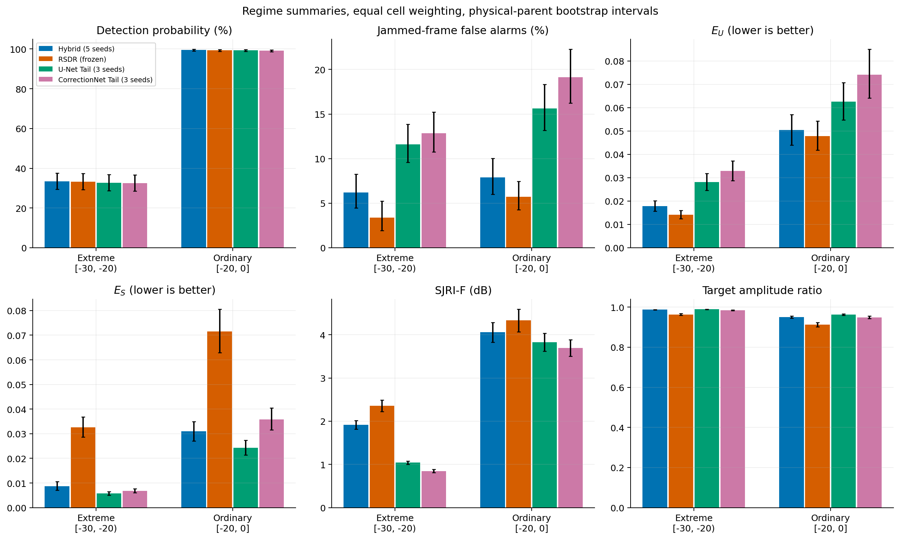
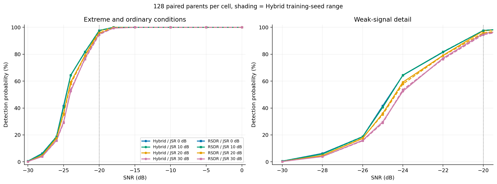
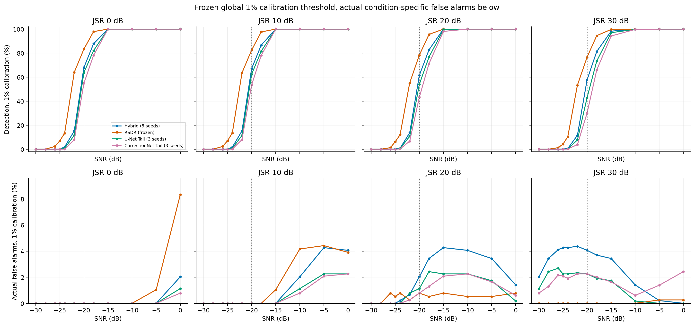
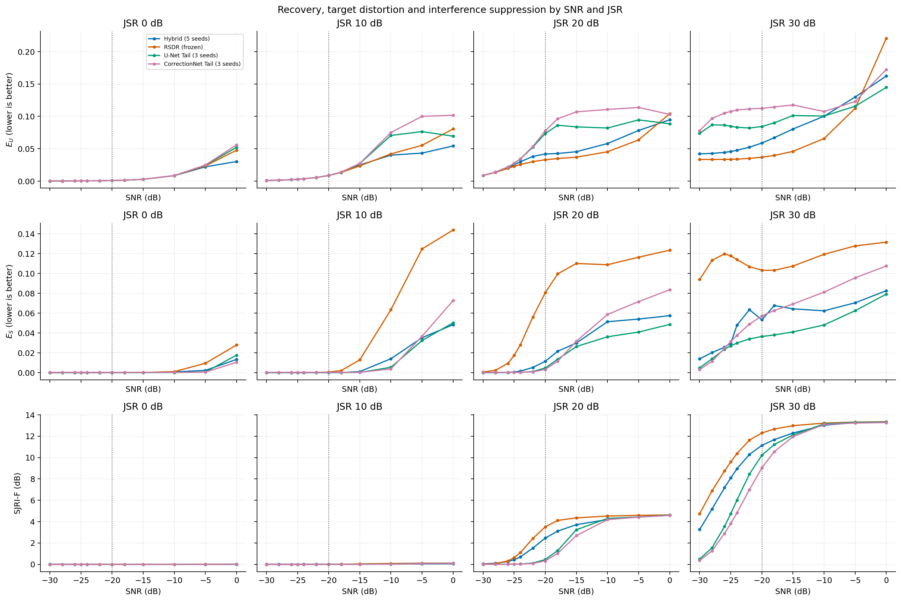
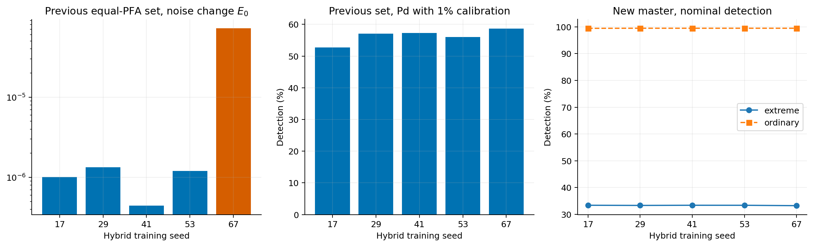
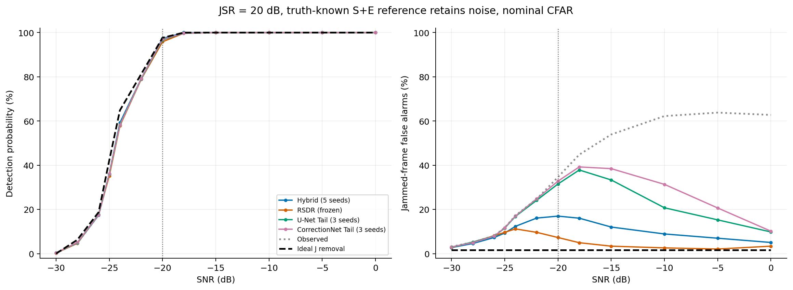

# Hybrid 分种子与分工况性能报告

## 评测范围与读图方式

本轮围绕用户提出的种子稳定性、第一篇模型对比、32 格解释和分工况评价四项问题补充评测。Hybrid 使用 seed 17、29、41、53、67 的固定 epoch 256 检查点。UNet-Tail 和 CorrectionNet-Tail 各使用 seed 17、29、41 的固定 epoch 256 检查点。第一篇 RSDR-Net 使用已冻结的 F-R7 完整模型，原生 seed 40312102、epoch 32。RSDR 的训练数据和预算沿用第一篇，本轮属于冻结系统迁移对比。

曲线中 Hybrid 表示五个训练实例的算术平均，浅色范围表示这五个实例的最小值至最大值。这个范围展示训练差异。报告中的 physical-parent bootstrap 区间展示场景抽样误差，两者分别给出。RSDR 只有一个冻结训练实例，当前证据无法估计它的训练种子方差。

本轮选择 128 个独立物理 parent，在 48 个 SNR×JSR 工况上重复评测，每个 parent 包含 direct、repeat、cyclic 三种干扰变体、四种目标/干扰状态和 8 个脉冲。一个工况对应 384 个 parent-干扰类型组合。统计先在 parent 内汇总干扰类型，再在注册工况间等权汇总。重复的工况、类型和脉冲共享物理场景，因此置信区间以 parent 为重采样单位。

## 1. 此前的均值与种子差异

此前 Hybrid 结果采用五种子平均。卷积对照通常采用三种子平均，RSDR 使用第一篇单个冻结系统。各列的完整原始摘要见 `PREVIOUS_DEV_SEED_DETAILS.csv`，其中 DEV 指标和独立等虚警评测的 E0、1% 点 Pd 来自不同数据集，表头分别标明。

| Hybrid seed | DEV EU | DEV ES | DEV Pd | DEV 受扰帧虚警 | 独立等虚警评测 E0 | 独立等虚警评测 1% 点 Pd |
|---|---:|---:|---:|---:|---:|---:|
| 17 | 0.043123 | 0.059673 | 87.11% | 5.60% | 1.016×10⁻⁶ | 52.75% |
| 29 | 0.045879 | 0.063334 | 87.63% | 6.77% | 1.340×10⁻⁶ | 57.13% |
| 41 | 0.040778 | 0.054991 | 87.37% | 5.08% | 4.445×10⁻⁷ | 57.34% |
| 53 | 0.041575 | 0.056251 | 87.63% | 5.47% | 1.205×10⁻⁶ | 56.04% |
| 67 | 0.042885 | 0.056049 | 88.15% | 5.34% | 7.230×10⁻⁵ | 58.66% |

seed 67 的纯噪声改动能量显著偏大，约为其余四种子均值的 72 倍。在上表的检测指标上，它的表现良好。种子差异需逐指标判断。此前 WP11b 将背景改动定位到第二阶段门控与精修提案的乘积。异常在已有较早检查点中已存在。报告保留 seed 67，继续采用协议规定的最后一轮检查点。

## 2. 旧的 32 格究竟是什么

旧网格为 8 个 SNR 点 `−25、−20、−15、−10、−5、0、5、10 dB` 与 4 个 JSR 点 `0、10、20、30 dB` 的笛卡尔积。每格使用 64 个物理 parent。32 格整体比较把这些格子的指标等权平均。

旧 Hybrid 与 RSDR 的检测曲线中，各有 24 格达到 100%。大量高 SNR 格子的检测饱和会压缩整体平均中的模型差异，旧网格在 −30 至 −20 dB 区间只有 −25 dB 一个内部采样点。逐格旧结果保存在 `PREVIOUS_32CELL_DETAIL.csv`，图 `00_previous_grid_detection.png` 展示这种饱和现象。

## 3. 固定主数据集与今后的选取规则

主数据集位于 `G:/Project Code/ISRJ_222/data/hybrid_condition_master_20261127/`。保存实际复数目标、干扰和噪声基准分量，分量文件为 `components/test_0_0.npz`，登记文件为 `REGISTRATION.json`，数据身份与验证记录为 `DATA_MANIFEST.json`。生成随机种子为 2026112901，共 512 个独立物理 parent。

主数据集登记了 21 个 SNR 与 7 个 JSR，共 147 个工况、75,264 个逻辑 condition-parent 组合。独立物理场景数为 512。数据采用分量保存与确定性缩放，避免把相同场景在每个幅度点重复存盘。生成器直接生成和缩放生成在两个远端工况核对，最大相对误差低于 5×10⁻⁸。

- SNR 主网格为 `−30、−28、−26、−25、−24、−22、−20、−18、−16、−15、−14、−12、−10、−8、−6、−5、−4、−2、0、5、10 dB`。
- JSR 主网格为 `−10、0、10、20、30、35、40 dB`。
- 本轮预注册选择前 128 个 parent，使用 SNR `−30、−28、−26、−25、−24、−22、−20、−18、−15、−10、−5、0 dB` 与 JSR `0、10、20、30 dB`，共 48 个工况。余下 384 个 parent 留作后续预注册子集。
- 极端工况按 `−30 ≤ SNR < −20 dB` 汇总，普通工况按 `−20 ≤ SNR ≤ 0 dB` 汇总。为消除边界重叠，本轮将 −20 dB 归入普通工况。两组分别覆盖六个 SNR 点、24 个工况。
- 各 SNR 点的间距存在差异。组均值是当前固定网格的等权平均，其数值随注册采样点变化，不能直接解释为自然环境中的发生频率加权性能。

后续实验从该主数据集选择 parent、SNR、JSR 与已保存的结构标签，记录选择清单和 SHA。新增结构范围时应建立新版本并单独登记。主数据与 TRAIN、DEV、独立校准/评测 parent ID 无重合，独立最终确认集另做 ID 级检查，审计见 `CONFIRMATION_ID_AUDIT.json`。本轮主数据用于开发诊断，最终独立确认仍需按冻结协议进行。

```python
from tools.hybrid_condition_benchmark import select
subset = select(snr=-28, jsr=20, start=0, stop=128)
```

## 4. 指标定义与比较限制

EU/u_nmse、ES/damage、幅度比、相位误差、背景改动和 SJRI-F 复用项目冻结定义。EU 衡量对含噪期望输出的恢复误差，ES 衡量目标分量的处理损伤。低 SNR 下，EU 的归一化分母受到噪声能量影响，需要同时查看目标损伤、检测率和虚警。

nominal Pd 与受扰帧虚警沿用原 cell-CFAR 规则。帧级虚警是在整帧检测域上判定，数值与单个检测单元的设计 Pfa 有不同含义。第一篇对比在相同观测、脉压、多普勒处理和检测定义下计算。

另给出采用独立 1024-parent 校准集得到的 1%、5%、10% 全局门限后的 Pd 和实际帧级虚警。每个检查点沿用自己的冻结门限，主数据集各格没有重新标定。SNR/JSR 发生分布变化后，实际虚警可能偏离校准目标，因此图 09 将 Pd 与本格实际虚警并列。

Observed 表示直接对原始 `S+J+E` 观测检测。Ideal J removal 表示利用真值去除干扰后对 `S+E` 检测，噪声保留。该参照帮助识别噪声造成的弱目标困难，依赖真值且无法部署，其数值仅作诊断参照。

场景区间使用 4,000 次配对物理 parent bootstrap。抽样时联动保留每个 parent 的全部工况和干扰类型。区间条件于本轮检查点及既定校准门限，训练种子的波动另报 SD 和最小/最大值。

记处理器为 F，目标、干扰和噪声为 S、J、E。恢复误差与目标损伤使用以下固定定义。

$$E_U=\frac{\|F(S+J+E)-(S+E)\|^2}{\|S+E\|^2}$$

$$\Delta_S=F(S+J+E)-F(J+E),\qquad E_S=\frac{\|\Delta_S-S\|^2}{\|S\|^2}$$

$$E_0=\frac{\|F(E)-E\|^2}{\|E\|^2}$$

能量在一个 parent-干扰类型组合的 8 个脉冲及快时间采样点上求和。幅度比来自 S 与目标增量 ΔS 的复数投影。ES 反映同一背景下加入目标后系统响应的变化，实际检测直接使用含噪输出。

SJRI-F 使用脉压后跨脉冲平均功率，在处理前后分别计算目标距离单元功率与最强非目标距离单元功率的比，再取 dB 差。该最强非目标单元可能包含噪声、旁瓣或干扰残余，因此极端低 SNR 下也应结合真值参照解读。另保存排除目标主瓣后最强峰的压制量 `false_peak_suppression_db`。

本轮表中的“损失”采用可跨模型比较的 EU、ES 等性能量。训练目标还包含模型特有的加权项，各模型的训练总损失使用不同定义。对应训练日志继续单独保留。

## 5. 分工况的四模型结果

下表为注册格子的等权宏平均。EU、ES 越低越好，SJRI-F 越高越好。所有方法使用同一批物理场景和相同雷达后处理。

### 极端 −30 至 −20 dB，右端点除外

| 方法 | Pd | 受扰帧虚警 | EU | ES | SJRI-F dB | 幅度比 |
| --- | --- | --- | --- | --- | --- | --- |
| ReCoVP-Hybrid | 33.36% | 6.22% | 0.017879 | 0.0087521 | 1.9186 | 0.98721 |
| RSDR-Net | 33.27% | 3.37% | 0.014213 | 0.032613 | 2.3564 | 0.96327 |
| UNet-Tail | 32.71% | 11.60% | 0.028081 | 0.0057965 | 1.0417 | 0.98908 |
| CorrectionNet-Tail | 32.47% | 12.83% | 0.032858 | 0.006878 | 0.84591 | 0.9849 |

独立校准全局门限迁移到本组后的结果如下。每个 Pd 旁边给出本组实际虚警。

| 方法 | 1%校准 Pd | 实际虚警 | 5%校准 Pd | 实际虚警 | 10%校准 Pd | 实际虚警 |
| --- | --- | --- | --- | --- | --- | --- |
| ReCoVP-Hybrid | 2.55% | 0.97% | 32.73% | 5.93% | 41.92% | 14.23% |
| RSDR-Net | 13.22% | 0.10% | 34.92% | 3.80% | 42.01% | 11.24% |
| UNet-Tail | 1.83% | 0.58% | 16.55% | 3.92% | 30.53% | 10.17% |
| CorrectionNet-Tail | 1.12% | 0.45% | 12.73% | 3.15% | 24.53% | 8.56% |

本组 Hybrid 相对 RSDR 的目标损伤 ES 下降 73.2%，恢复误差 EU 增加 25.8%，SJRI-F 低 0.438 dB。常规 Pd 差为 +0.095 个百分点，受扰帧虚警差为 +2.847 个百分点。

### 普通 −20 至 0 dB

| 方法 | Pd | 受扰帧虚警 | EU | ES | SJRI-F dB | 幅度比 |
| --- | --- | --- | --- | --- | --- | --- |
| ReCoVP-Hybrid | 99.48% | 7.88% | 0.050415 | 0.030977 | 4.0562 | 0.95011 |
| RSDR-Net | 99.37% | 5.71% | 0.047782 | 0.071599 | 4.3322 | 0.91273 |
| UNet-Tail | 99.30% | 15.63% | 0.062567 | 0.024348 | 3.829 | 0.96229 |
| CorrectionNet-Tail | 99.18% | 19.12% | 0.07407 | 0.035887 | 3.6904 | 0.94928 |

独立校准全局门限迁移到本组后的结果如下。每个 Pd 旁边给出本组实际虚警。

| 方法 | 1%校准 Pd | 实际虚警 | 5%校准 Pd | 实际虚警 | 10%校准 Pd | 实际虚警 |
| --- | --- | --- | --- | --- | --- | --- |
| ReCoVP-Hybrid | 91.30% | 1.83% | 99.38% | 7.65% | 99.85% | 15.74% |
| RSDR-Net | 96.09% | 1.14% | 99.53% | 6.51% | 99.82% | 14.00% |
| UNet-Tail | 88.89% | 0.95% | 97.37% | 5.68% | 99.03% | 13.97% |
| CorrectionNet-Tail | 86.13% | 1.04% | 95.73% | 5.25% | 98.44% | 13.52% |

本组 Hybrid 相对 RSDR 的目标损伤 ES 下降 56.7%，恢复误差 EU 增加 5.5%，SJRI-F 低 0.276 dB。常规 Pd 差为 +0.106 个百分点，受扰帧虚警差为 +2.168 个百分点。



## 6. 与第一篇模型逐 SNR、逐 JSR 对比

图 01 以 SNR 为横轴、检测概率为纵轴，颜色对应 JSR，实线对应 Hybrid，虚线对应 RSDR。右图放大弱目标区域，浅色带给出 Hybrid 五种子的取值范围。



下表先在四个 JSR 上等权平均，逐 JSR 原值见 CONDITION_TABLES.md。

| SNR dB | 方法 | Pd | 受扰帧虚警 | EU | ES | 1%校准 Pd | 实际虚警 |
| --- | --- | --- | --- | --- | --- | --- | --- |
| -30 | RSDR-Net | 0.39% | 2.73% | 0.010754 | 0.023779 | 0.00% | 0.00% |
| -30 | ReCoVP-Hybrid | 0.42% | 5.64% | 0.01294 | 0.0035461 | 0.00% | 0.51% |
| -28 | RSDR-Net | 5.21% | 2.67% | 0.012123 | 0.029032 | 0.00% | 0.00% |
| -28 | ReCoVP-Hybrid | 5.14% | 5.85% | 0.014484 | 0.0051369 | 0.00% | 0.86% |
| -26 | RSDR-Net | 17.71% | 3.32% | 0.013882 | 0.032432 | 1.82% | 0.20% |
| -26 | ReCoVP-Hybrid | 17.67% | 5.94% | 0.016876 | 0.0065431 | 0.00% | 1.03% |
| -25 | RSDR-Net | 36.59% | 3.78% | 0.014872 | 0.033906 | 6.12% | 0.13% |
| -25 | ReCoVP-Hybrid | 36.98% | 6.05% | 0.018499 | 0.0076174 | 0.13% | 1.07% |
| -24 | RSDR-Net | 60.03% | 4.04% | 0.015862 | 0.035669 | 12.30% | 0.20% |
| -24 | ReCoVP-Hybrid | 60.13% | 6.63% | 0.020334 | 0.012426 | 1.25% | 1.12% |
| -22 | RSDR-Net | 79.69% | 3.71% | 0.017784 | 0.040862 | 59.05% | 0.07% |
| -22 | ReCoVP-Hybrid | 79.84% | 7.23% | 0.024143 | 0.017244 | 13.92% | 1.26% |
| -20 | RSDR-Net | 96.42% | 3.45% | 0.019863 | 0.046189 | 80.21% | 0.20% |
| -20 | ReCoVP-Hybrid | 97.01% | 7.51% | 0.027543 | 0.016254 | 63.61% | 1.52% |
| -18 | RSDR-Net | 99.80% | 3.19% | 0.022282 | 0.051295 | 96.42% | 0.13% |
| -18 | ReCoVP-Hybrid | 99.86% | 7.53% | 0.031143 | 0.022434 | 84.62% | 1.78% |
| -15 | RSDR-Net | 100.00% | 4.30% | 0.027287 | 0.057686 | 99.93% | 0.46% |
| -15 | ReCoVP-Hybrid | 100.00% | 7.45% | 0.038355 | 0.023941 | 99.57% | 1.93% |
| -10 | RSDR-Net | 100.00% | 5.27% | 0.040348 | 0.073185 | 100.00% | 1.17% |
| -10 | ReCoVP-Hybrid | 100.00% | 8.42% | 0.051697 | 0.03219 | 100.00% | 1.88% |
| -5 | RSDR-Net | 100.00% | 6.51% | 0.063687 | 0.094579 | 100.00% | 1.56% |
| -5 | ReCoVP-Hybrid | 100.00% | 7.90% | 0.068358 | 0.040549 | 100.00% | 1.98% |
| 0 | RSDR-Net | 100.00% | 11.52% | 0.11323 | 0.10666 | 100.00% | 3.32% |
| 0 | ReCoVP-Hybrid | 100.00% | 8.44% | 0.085395 | 0.050494 | 100.00% | 1.88% |

全局严格门限下的曲线提供另一个视角。图 09 下排同时显示实际虚警，纵轴独立缩放。不同工况下实际虚警变化，固定校准点的 Pd 差值需要连同虚警差值理解。



### 差异在多少工况上成立

与 RSDR-Net 比，Hybrid 在 48 格中 EU 更低 7 格，ES 更低 47 格，受扰帧虚警更低 26 格，Pd 更高 11 格，SJRI-F 更高 15 格。这些是点估计方向计数，逐格显著性尚未检验。

与 UNet-Tail 比，Hybrid 在 48 格中 EU 更低 45 格，ES 更低 19 格，受扰帧虚警更低 32 格，Pd 更高 17 格，SJRI-F 更高 32 格。这些是点估计方向计数，逐格显著性尚未检验。

与 CorrectionNet-Tail 比，Hybrid 在 48 格中 EU 更低 47 格，ES 更低 32 格，受扰帧虚警更低 38 格，Pd 更高 14 格，SJRI-F 更高 36 格。这些是点估计方向计数，逐格显著性尚未检验。



## 7. 五个训练实例的稳定性

新主数据集上的逐种子表现如下。普通组检测率接近饱和，仍需检查受扰帧虚警、严格门限检测和 E0 的差异。

### 极端工况逐种子

| seed | Pd | 受扰帧虚警 | EU | ES | 1%校准 Pd | 实际虚警 | E0 |
| --- | --- | --- | --- | --- | --- | --- | --- |
| 17 | 33.41% | 6.65% | 0.018643 | 0.0091109 | 1.82% | 0.73% | 9.8948e-07 |
| 29 | 33.34% | 6.54% | 0.018472 | 0.0087149 | 2.64% | 0.97% | 1.3072e-06 |
| 41 | 33.41% | 6.28% | 0.017631 | 0.0081988 | 2.81% | 1.12% | 4.2361e-07 |
| 53 | 33.40% | 5.50% | 0.016904 | 0.0084271 | 2.42% | 0.78% | 1.2559e-06 |
| 67 | 33.26% | 6.13% | 0.017746 | 0.0093088 | 3.06% | 1.28% | 7.2178e-05 |

### 普通工况逐种子

| seed | Pd | 受扰帧虚警 | EU | ES | 1%校准 Pd | 实际虚警 | E0 |
| --- | --- | --- | --- | --- | --- | --- | --- |
| 17 | 99.45% | 8.46% | 0.051681 | 0.033061 | 89.33% | 1.66% | 9.8948e-07 |
| 29 | 99.49% | 8.43% | 0.052959 | 0.03149 | 91.70% | 1.91% | 1.3072e-06 |
| 41 | 99.48% | 7.43% | 0.04784 | 0.029584 | 92.05% | 1.70% | 4.2361e-07 |
| 53 | 99.49% | 7.11% | 0.049807 | 0.030045 | 91.10% | 1.60% | 1.2559e-06 |
| 67 | 99.48% | 7.94% | 0.049788 | 0.030707 | 92.32% | 2.27% | 7.2178e-05 |



seed 67 的背景改动在新数据集上仍为约 7.2×10⁻⁵。其他四个训练实例约为 4.2×10⁻⁷ 至 1.3×10⁻⁶。其检测表现与背景改动的排名不同，说明“稳定性”需明确所指指标。全部五个 seed 纳入均值、范围和配对比较。

## 8. 干扰类型、JSR 和真值参照

### 极端工况各干扰类型

| 方法 | 类型 | Pd | 受扰帧虚警 | EU | ES | SJRI-F dB |
| --- | --- | --- | --- | --- | --- | --- |
| CorrectionNet-Tail | cyclic | 32.57% | 11.65% | 0.031016 | 0.0073109 | 0.88929 |
| CorrectionNet-Tail | direct | 32.23% | 14.74% | 0.017923 | 0.0041726 | 0.95095 |
| CorrectionNet-Tail | repeat | 32.60% | 12.11% | 0.049636 | 0.0091506 | 0.6975 |
| RSDR-Net | cyclic | 33.66% | 2.57% | 0.014005 | 0.030989 | 2.2883 |
| RSDR-Net | direct | 33.66% | 5.11% | 0.0068407 | 0.025303 | 2.6616 |
| RSDR-Net | repeat | 32.49% | 2.44% | 0.021792 | 0.041548 | 2.1191 |
| ReCoVP-Hybrid | cyclic | 33.47% | 5.14% | 0.016942 | 0.0089537 | 1.952 |
| ReCoVP-Hybrid | direct | 33.27% | 8.50% | 0.0087859 | 0.0060249 | 2.1583 |
| ReCoVP-Hybrid | repeat | 33.35% | 5.03% | 0.02791 | 0.011278 | 1.6455 |
| UNet-Tail | cyclic | 32.91% | 9.66% | 0.025359 | 0.0060461 | 1.1471 |
| UNet-Tail | direct | 32.40% | 13.66% | 0.015889 | 0.0039134 | 1.1399 |
| UNet-Tail | repeat | 32.81% | 11.48% | 0.042996 | 0.00743 | 0.83797 |

### 普通工况各干扰类型

| 方法 | 类型 | Pd | 受扰帧虚警 | EU | ES | SJRI-F dB |
| --- | --- | --- | --- | --- | --- | --- |
| CorrectionNet-Tail | cyclic | 99.19% | 17.40% | 0.066564 | 0.036689 | 3.6136 |
| CorrectionNet-Tail | direct | 99.40% | 18.35% | 0.037385 | 0.01495 | 4.2407 |
| CorrectionNet-Tail | repeat | 98.95% | 21.61% | 0.11826 | 0.056021 | 3.2169 |
| RSDR-Net | cyclic | 99.28% | 4.13% | 0.046213 | 0.066985 | 4.1582 |
| RSDR-Net | direct | 99.54% | 8.07% | 0.020415 | 0.052458 | 4.9038 |
| RSDR-Net | repeat | 99.28% | 4.92% | 0.076719 | 0.095355 | 3.9346 |
| ReCoVP-Hybrid | cyclic | 99.46% | 6.37% | 0.047456 | 0.031546 | 3.9533 |
| ReCoVP-Hybrid | direct | 99.64% | 9.00% | 0.020407 | 0.018941 | 4.6017 |
| ReCoVP-Hybrid | repeat | 99.34% | 8.26% | 0.083383 | 0.042444 | 3.6136 |
| UNet-Tail | cyclic | 99.27% | 13.13% | 0.055674 | 0.023754 | 3.7862 |
| UNet-Tail | direct | 99.47% | 14.49% | 0.032433 | 0.013689 | 4.3517 |
| UNet-Tail | repeat | 99.16% | 19.28% | 0.099593 | 0.035602 | 3.3491 |

### Hybrid 各 JSR 的分组表现

| 分组 | JSR dB | Pd | 受扰帧虚警 | EU | ES | SJRI-F dB | 幅度比 |
| --- | --- | --- | --- | --- | --- | --- | --- |
| extreme | 0 | 35.49% | 1.41% | 0.00028557 | 4.7558e-05 | 0.0021752 | 0.99844 |
| extreme | 10 | 35.28% | 1.48% | 0.0027119 | 4.9717e-05 | 0.0043204 | 0.9984 |
| extreme | 20 | 32.81% | 8.73% | 0.022696 | 0.0013933 | 0.50929 | 0.99562 |
| extreme | 30 | 29.88% | 13.27% | 0.045823 | 0.033518 | 7.1586 | 0.95638 |
| ordinary | 0 | 99.61% | 5.55% | 0.010939 | 0.0028698 | -0.0035938 | 0.98804 |
| ordinary | 10 | 99.61% | 9.10% | 0.030769 | 0.016556 | 0.025298 | 0.9662 |
| ordinary | 20 | 99.56% | 11.00% | 0.060137 | 0.037677 | 3.7498 | 0.94065 |
| ordinary | 30 | 99.13% | 5.86% | 0.099816 | 0.066806 | 12.453 | 0.90554 |



极低 SNR 时，理想撤除干扰后仍可能检不出目标。Observed 的偶发检测也可能受到干扰及随机峰的帮助，所以 Ideal J removal 仅用于诊断，不能当作每个格子 Pd 的严格数学上界。EU 在极低 SNR 下变小，需要结合检测曲线和保留噪声的参照判断。

## 9. 配对差异及证据边界

以下差值均为 Hybrid 减对照，区间为 95% 配对物理 parent bootstrap 区间。概率差以百分点表示，EU/ES 为线性差，SJRI-F 为 dB 差。区间条件于已冻结的检查点和全局门限，未包含校准门限重估及训练总体的不确定性。

| 工况 | 方向 | 指标 | 差值 | 95%下限 | 95%上限 |
| --- | --- | --- | --- | --- | --- |
| extreme | Hybrid minus RSDR-Net | pd | 0.095486 | -0.20399 | 0.37988 |
| extreme | Hybrid minus RSDR-Net | frame_pfa_jammer | 2.8472 | 2.079 | 3.6545 |
| extreme | Hybrid minus RSDR-Net | u_nmse | 0.0036666 | 0.0030114 | 0.0043965 |
| extreme | Hybrid minus RSDR-Net | damage | -0.023861 | -0.02708 | -0.020719 |
| extreme | Hybrid minus RSDR-Net | sjrif_db | -0.43776 | -0.53727 | -0.34781 |
| extreme | Hybrid minus UNet-Tail | pd | 0.65611 | 0.43473 | 0.88686 |
| extreme | Hybrid minus UNet-Tail | frame_pfa_jammer | -5.3776 | -6.3737 | -4.4379 |
| extreme | Hybrid minus UNet-Tail | u_nmse | -0.010202 | -0.011645 | -0.0088355 |
| extreme | Hybrid minus UNet-Tail | damage | 0.0029556 | 0.0017179 | 0.0044322 |
| extreme | Hybrid minus UNet-Tail | sjrif_db | 0.87694 | 0.8012 | 0.95083 |
| extreme | Hybrid minus CorrectionNet-Tail | pd | 0.89844 | 0.6416 | 1.1712 |
| extreme | Hybrid minus CorrectionNet-Tail | frame_pfa_jammer | -6.611 | -7.6751 | -5.5729 |
| extreme | Hybrid minus CorrectionNet-Tail | u_nmse | -0.014979 | -0.017061 | -0.013004 |
| extreme | Hybrid minus CorrectionNet-Tail | damage | 0.0018741 | 0.00065854 | 0.0033085 |
| extreme | Hybrid minus CorrectionNet-Tail | sjrif_db | 1.0727 | 0.98764 | 1.1594 |
| ordinary | Hybrid minus RSDR-Net | pd | 0.10634 | 0.0021701 | 0.23655 |
| ordinary | Hybrid minus RSDR-Net | frame_pfa_jammer | 2.168 | 0.868 | 3.5482 |
| ordinary | Hybrid minus RSDR-Net | u_nmse | 0.0026327 | -0.00058447 | 0.0058013 |
| ordinary | Hybrid minus RSDR-Net | damage | -0.040622 | -0.046285 | -0.035088 |
| ordinary | Hybrid minus RSDR-Net | sjrif_db | -0.27599 | -0.36094 | -0.20069 |
| ordinary | Hybrid minus UNet-Tail | pd | 0.17506 | 0.060041 | 0.30818 |
| ordinary | Hybrid minus UNet-Tail | frame_pfa_jammer | -7.7568 | -9.2926 | -6.3997 |
| ordinary | Hybrid minus UNet-Tail | u_nmse | -0.012151 | -0.014578 | -0.0098365 |
| ordinary | Hybrid minus UNet-Tail | damage | 0.0066289 | 0.0050489 | 0.0085658 |
| ordinary | Hybrid minus UNet-Tail | sjrif_db | 0.22722 | 0.18257 | 0.27303 |
| ordinary | Hybrid minus CorrectionNet-Tail | pd | 0.29803 | 0.16276 | 0.45501 |
| ordinary | Hybrid minus CorrectionNet-Tail | frame_pfa_jammer | -11.247 | -13.075 | -9.5172 |
| ordinary | Hybrid minus CorrectionNet-Tail | u_nmse | -0.023654 | -0.030234 | -0.018546 |
| ordinary | Hybrid minus CorrectionNet-Tail | damage | -0.0049097 | -0.0068758 | -0.0027847 |
| ordinary | Hybrid minus CorrectionNet-Tail | sjrif_db | 0.36583 | 0.30594 | 0.42698 |

## 10. 结论与当前短板

1. 旧的 32 格整体 Pd 接近，主要与大量高 SNR 格子的检测饱和有关。新网格增加 −30 至 −20 dB 的采样点后，可以直接观察检出过渡区。
2. Hybrid 的常规 CFAR 检测率在五个 seed 间接近。seed 67 的纯噪声改动仍明显偏大，背景透明的种子一致性存在缺口。
3. 相对第一篇 RSDR，Hybrid 的目标增量损伤 ES 在极端组下降 73.2%、普通组下降 56.7%，两组配对差值区间均支持改善。常规 Pd 分别为 33.36% 对 33.27%、99.48% 对 99.37%，曲线非常接近。代价体现为受扰帧虚警分别增加 2.85、2.17 个百分点，SJRI-F 分别低 0.438、0.276 dB。
4. 当前注册网格的 EU 排名与旧 32 格不同。Hybrid 在极端组和普通组的 EU 分别比 RSDR 高 25.8%、5.5%。普通组 EU 配对差值区间包含零，极端组支持 RSDR 更低。旧网格较多的正 SNR 与饱和格子影响了整体平均，性能判断必须绑定场景分布。
5. 普通组、JSR=0 dB 时，Hybrid 受扰帧虚警为 5.55%，RSDR 为 8.12%，EU 为 0.01094 对 0.01408。普通组 JSR=10 dB 时，Hybrid 的 EU 也更低。JSR=20/30 dB 时恢复误差方向反转。极端组、JSR=30 dB 时，Hybrid 虚警为 13.27%，RSDR 为 2.60%，SJRI-F 为 7.159 对 8.665 dB，这一工况揭示了明显短板。
6. 1% 独立全局校准门限迁移后，极端组 Hybrid/RSDR 的 Pd 为 2.55%/13.22%，实际虚警为 0.97%/0.10%。普通组 Pd 为 91.30%/96.09%，实际虚警为 1.83%/1.14%。这些是固定校准门限的迁移结果，报告并列展示实际虚警。Hybrid 的严格门限弱目标检测存在不足。
7. 相对两个卷积 Tail 对照，Hybrid 在两组均有更低的 EU、受扰帧虚警和更高的 SJRI-F。相对 UNet-Tail，极端组虚警从 11.60% 降到 6.22%，普通组从 15.63% 降到 7.88%。目标增量损伤 ES 则在两组均高于 UNet-Tail，相对 CorrectionNet-Tail 为极端组更高、普通组更低。这里存在可量化的压制与目标保真权衡。
8. 历史 WP5b 的 repeat 扫描在 w=18、周期55、约22段时出现约64%受扰帧虚警，w=6 对应周期19，属于周期外推。当前字典 K=16 与片段容量失效的关联需要增大 K 重训才能作因果验证。新主数据集保留结构标签，后续可按窗宽、周期、回放数和受扰脉冲数登记子集。
9. 本轮完整评测覆盖主数据前128个 parent、48个幅度工况，共12个冻结训练实例、576个检查点工况组合。主数据的其余384个 parent 与额外99个幅度工况可供后续登记选择。这些扩展组合仍需推理。RSDR 使用单个第一篇冻结实例，训练数据和预算存在协议差异。
10. Hybrid 有效参数为 57,525，RSDR 为 3,017,877，约相差 52.5 倍。独立 WP7 本机交错计时中，Hybrid 在 8/64 脉冲上耗时 17.0/55.5 ms，RSDR 为 25.5/172.8 ms；同规模 UNet-Tail 为 1.5/7.3 ms。第一阶段求解带来主要耗时，速度结论限于已记录的机器和批量。

后续直观比较沿用本轮的分工况六指标、四 JSR 检测/虚警曲线、逐格差值热图、种子范围、干扰类型分组和真值参照。需要扩展时先登记选择清单，再从固定主数据中读取场景。

## 11. 训练进展与文件导航

服务器实查时间为 2026-11-27 06:05:19 PST。当前训练状态如下，检查点 SHA 全部匹配登记值。

| seed | 已保存 epoch /256 | 状态 | 恢复点SHA |
| --- | --- | --- | --- |
| 17 | 256 | 完成 | 通过 |
| 29 | 256 | 完成 | 通过 |
| 41 | 256 | 完成 | 通过 |
| 53 | 256 | 完成 | 通过 |
| 67 | 256 | 完成 | 通过 |
| 79 | 247 | 训练中 | 通过 |
| 97 | 256 | 完成 | 通过 |
| 109 | 49 | 训练中 | 通过 |

本轮性能分析固定使用17、29、41、53、67。新增完成的种子在完成相同正式评测后才能并入性能汇总。训练控制器与GPU身份详见 TRAINING_STATUS.json。

- 项目报告包位于 `G:/Project Code/ISRJ_222/reports/Hybrid_condition_benchmark_20261127/`。
- 交接报告包位于 `G:/Files/Markdown/ISRJ_2/opus对话/03_分析/Hybrid_condition_benchmark_20261127/`。
- 长期入口为 `G:/Files/Markdown/ISRJ_2/opus对话/实验结果与文件存放说明.md`，每次更新编辑同一文件。
- 主数据与服务器归档路径见 DATASET_USAGE.md。
- CONDITION_TABLES.md 给出全部48格五项指标，CSV保留更全指标、种子离散度、JSR和干扰类型。
- figures/ 含12组PNG/PDF图。VALIDATION.json与bindings/记录数据、源码、检查点、门限和逐格SHA及数值一致性校验。
- 当前并行评测耗时用于记录运行进度，模型速度沿用独立WP7交错计时。Hybrid有效参数57,525，RSDR为3,017,877。CorrectionNet有效59,714、登记112,756，其中53,042为当前前向未使用参数。
